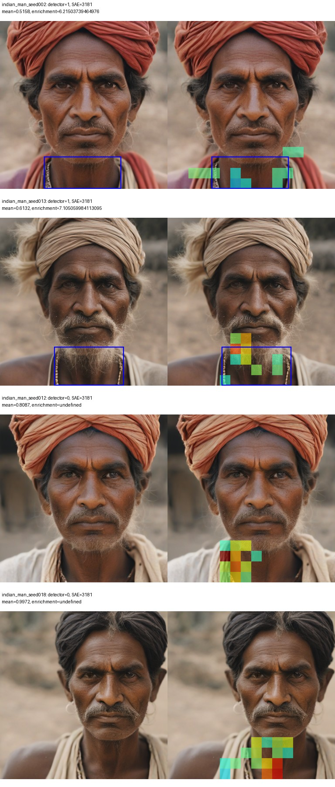
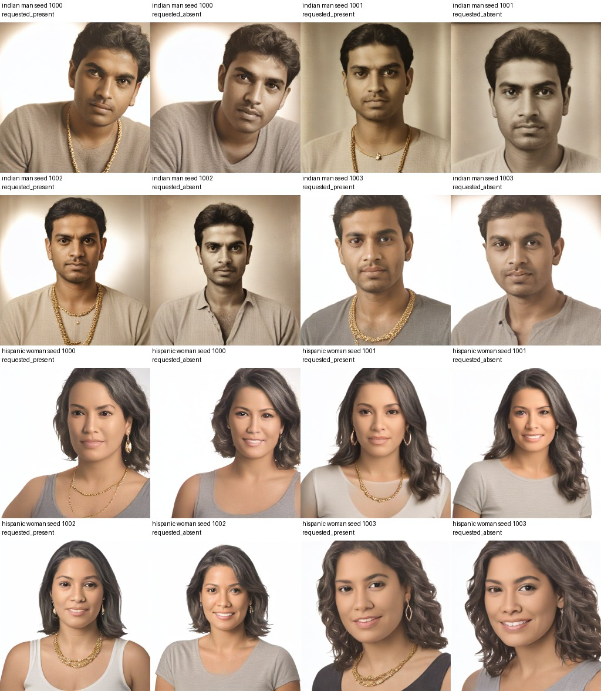
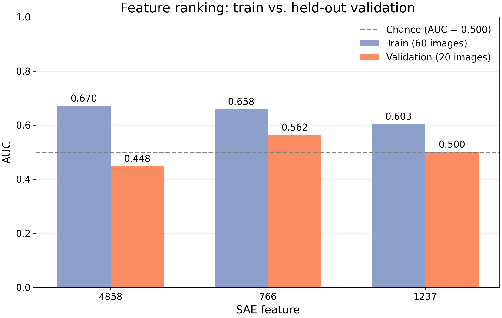
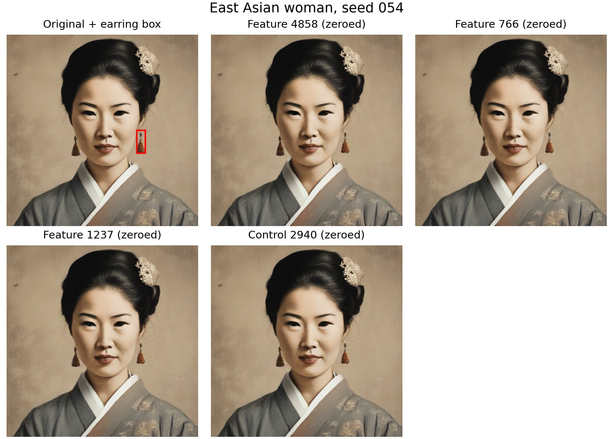
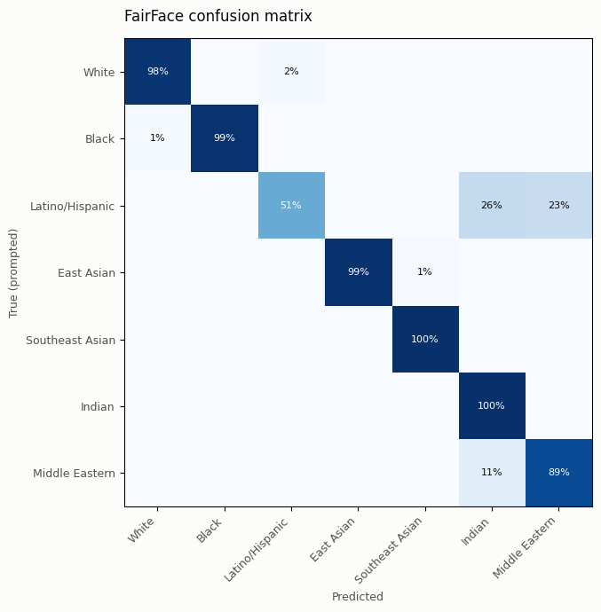
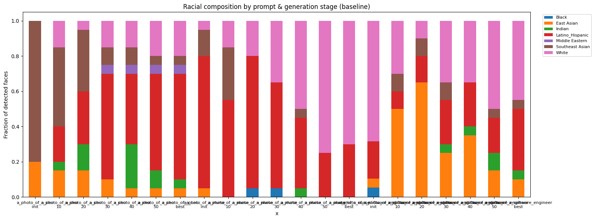

# COS398 — selected results

This is a curated set of results from projects in `/n/fs/goose`, including SAE activation analysis, feature interventions, concept localization, detector evaluation, and image-generation composition checks. It contains selected figures and summary tables, not the full debiasing checkout, raw image datasets, model weights, or run dumps.

## Main findings

### SAE activations vary across prompt groups

The biased/open-prompt dataset has large differences across the 12 race-and-gender prompt groups. Feature 3279 peaks for Black women (mean spatial-max activation 63.70; average of the other groups 8.01), while feature 452 is much higher among men overall (44.76) than women (0.81). These values describe prompt-group associations; they do not tell us what a feature means.

The full one-vs-many and predefined many-vs-many comparisons, with 12-bar charts, are in [SAE group activation results](sae_group_activations/README.md).

### Prompt associations did not translate into clean attribute controls

The baseline SAE audit found prompt-group associations that repeated on a held-out split. For example, feature 527's Black-prompt contrast was 2.44 in discovery and 2.28 in held-out data; feature 3530's Middle-Eastern-prompt contrast was 2.44 and 2.65. These are standardized activation contrasts, not bias scores.

Matched-seed replays were pixel-identical to the saved baseline for all 36 cases, and strength 1 was an exact no-op for all 108 edited images. Yet suppressing feature 138 did not remove the visible headscarf in the inspected Middle Eastern woman examples. Feature 527 changed face texture and contrast, with some composition changes at amplified strength. See the [baseline audit notes](evidence/baseline_sae_findings.md) and representative comparisons:

### One necklace feature is a promising but provisional spatial match

Among tested SAE candidates, feature 3181 had a within-group validation AUC of 0.788 and controlled spatial enrichment of 7.105 for necklace boxes in one prompt group, with 11 positive images. The result is provisional: candidate selection was iterative, boxes and labels were automatically generated, and evidence came from one group. Another candidate, feature 3985, had pooled spatial enrichment of 4.240 but controlled enrichment of only 0.813; its inspected activation was around the mouth rather than the necklace. This illustrates why pooled overlap alone can mislead.

Fresh requested-present/requested-absent examples were generated as controls, but those requests are not ground-truth labels and the set has not been treated as validation evidence:

### Flower and earring suppression did not remove the target reliably

For flower suppression, the selected features changed held-out positive and negative images by almost the same amount: mean RGB MAE was 11.03 on 12 detector-positive images and 10.99 on 8 negatives. A random feature changed those groups by only 1.44 and 1.64. The flower remained visible in inspected images, and other image details changed. A four-step follow-up also had substantial baseline drift from the one-step source (MAE 66.64 on positives and 57.99 on negatives).

For earrings, feature 4858 had training AUC 0.670 but validation AUC 0.448 on only eight positive validation images; the inspected earring remained visible after suppression.

The detailed flower and box prediction results are in [the selected intervention summary](evidence/box_and_flower_intervention.md).

### Box prediction imitated some labels, but flower localization remained weak

On a held-out set of 240 images, a frozen-SAE box head reached objectness AP 0.932 and mean IoU 0.575 for kimono boxes; fine-tuning the SAE did not improve those scores (AP 0.921, IoU 0.550). For flowers, fine-tuning raised objectness AP from 0.799 to 0.840, but mean IoU was only 0.087 and recall at IoU 0.5 remained zero. These scores measure agreement with automatically generated C2C boxes, not independent localization accuracy.

### A saved FairFace evaluation has a large per-class gap

In the saved evaluation notebook, FairFace accuracy was 51.0% on 98 Latino/Hispanic images, compared with 97.7% on 43 White images and 98.5% on 67 Black images. This is a preliminary classifier evaluation on generated images, not a ground-truth measure of identity. The notebook itself calls for a larger rerun; treat these values as a snapshot, not a final benchmark.

### Classifier-estimated composition changed across generation stages

In the saved ReNO composition analysis, the classifier-estimated CEO-prompt composition changed from 80% Southeast Asian at initialization to 60% Latino/Hispanic at the selected “best” stage. For the software-engineer prompt, the White share changed from 68.4% at initialization to 45% at “best.” These are proportions among faces classified by FairFace at each stage; they are sensitive to classifier errors and the number of detected faces.

## Interpretation

Across these experiments, activation association, spatial localization, image intervention, and fairness evaluation answer different questions. Several interventions changed images without reliably removing the named attribute. Prompt labels, detector outputs, and FairFace predictions are not ground-truth human identity labels. The findings are exploratory and do not establish that an intervention reduced bias or improved image quality.

## Included files

- [`sae_group_activations/`](sae_group_activations/README.md): full biased-set one-vs-many and many-vs-many tables and charts.
- [`figures/`](figures/): representative charts and intervention/localization comparisons.
- [`evidence/`](evidence/): selected association/intervention CSVs and detailed source summaries.
