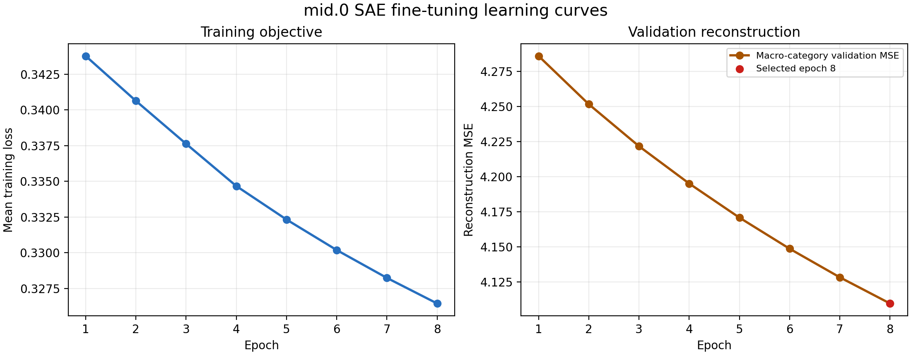

# Mid.0 SAE fine-tuning

## What was fine-tuned

We began with the pretrained sparse autoencoder (SAE) matched to SDXL Turbo's
`unet.mid_block.attentions.0` layer. The diffusion generator was frozen throughout;
only the SAE encoder and decoder weights were updated. This was an adaptation of an
existing SAE to the internal activation distribution produced by this project's portraits,
not training a new image generator or an SAE from scratch.

The SAE receives each 1,280-dimensional vector from the layer's 16×16 residual grid,
selects a sparse set of features, and reconstructs the original vector. Its training loss
combined reconstruction error with the existing auxiliary sparse-reconstruction loss. The
Top-K constraint remained unchanged: on held-out data, both models activated about 10
features per activation vector.

## Training and model selection

Only the SAE was optimized. Each epoch was balanced across the 12 prompt categories, so
every category contributed equally; category labels were neither model inputs nor training
targets. We selected the checkpoint with the lowest macro-average validation reconstruction
MSE across the 12 categories. The best checkpoint was epoch 8 of
8 (learning rate 1e-06).

## Learning curves

The left panel is the SAE optimization objective; the right panel is the macro-average validation reconstruction MSE used to choose the checkpoint. There is no classification accuracy because the SAE is not predicting category labels.

## Held-out reconstruction result

The evaluation used held-out seeds that were not used to update or select the SAE.

| Model | Held-out images | Macro-category reconstruction MSE | Mean active features / token | Dead feature fraction |
|---|---:|---:|---:|---:|
| Pretrained mid.0 SAE | 180 | 4.342 | 10.0 | 37.0% |
| Fine-tuned mid.0 SAE | 180 | 4.123 | 10.0 | 37.4% |

The held-out reconstruction MSE decreased by **5.1%** (4.342 → 4.123).
The best validation epoch was the final tested epoch, so the curve had not clearly plateaued;
any further training should use a new run and preserve the present held-out test set.

## Interpretation

This result says that the fine-tuned SAE reconstructs this project's internal `mid.0`
activations more accurately while retaining the same Top-K sparsity. It does **not** mean
the generated images are 5.1% better, establish that a feature represents race or gender,
or demonstrate a causal image-editing capability. Fine-tuning may change feature coordinates,
so feature discovery and interventions must be rerun using the selected checkpoint.

## Reproducibility

- `settings.json`: model, SAE layer, objective, splits, and checkpoint-selection rule.
- `training_history.json`: validation metrics after each epoch.
- `heldout_reconstruction.json`: per-category and pooled held-out comparison.
