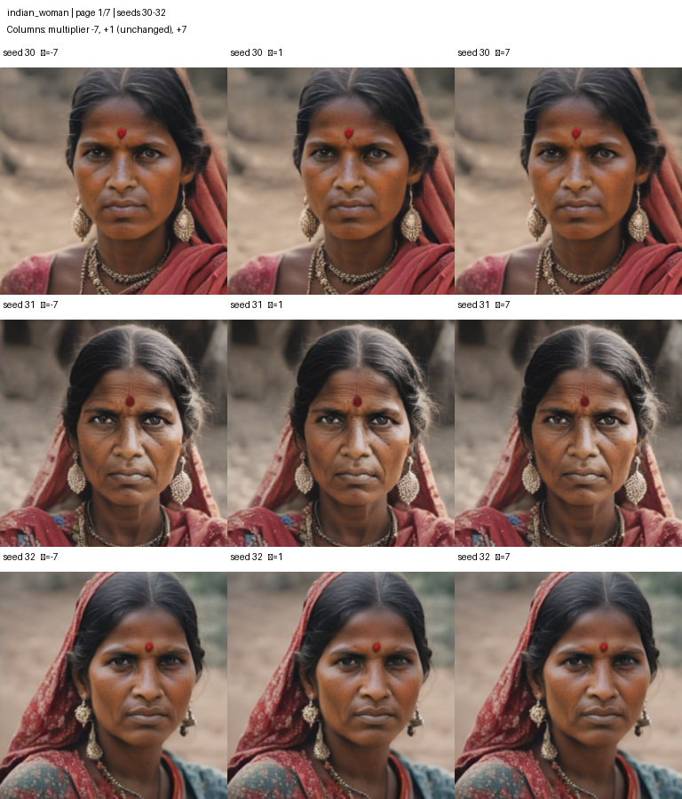
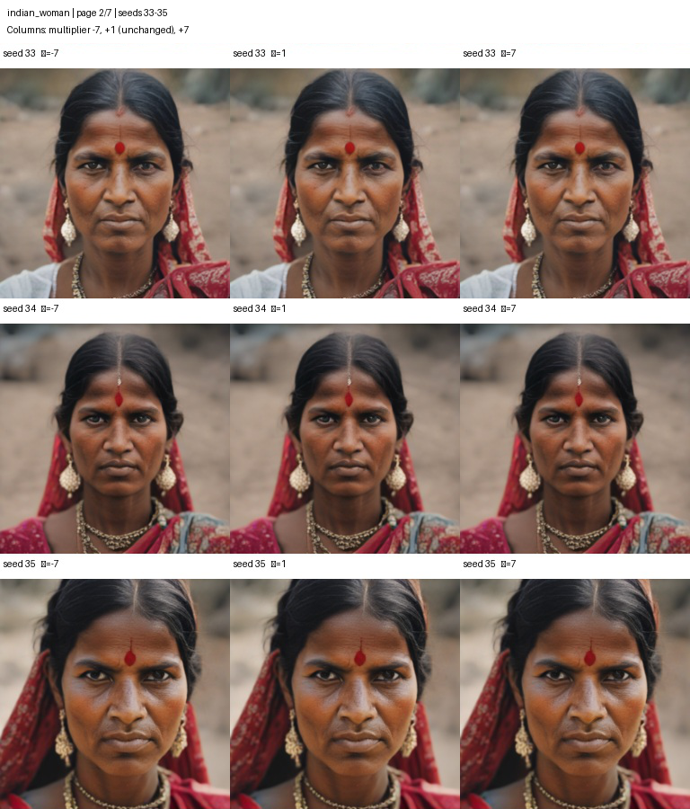
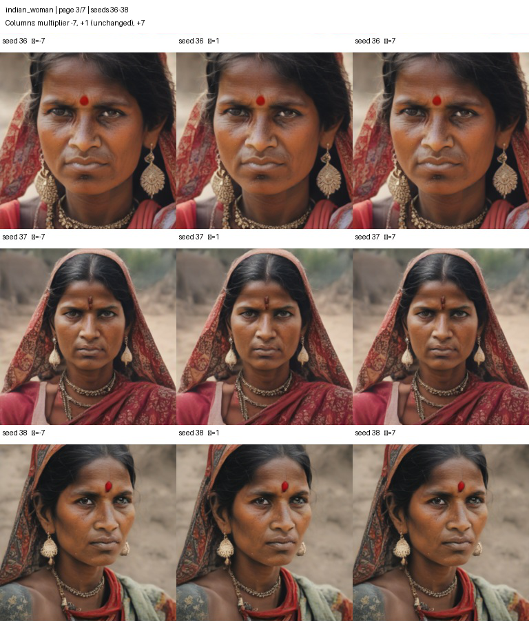
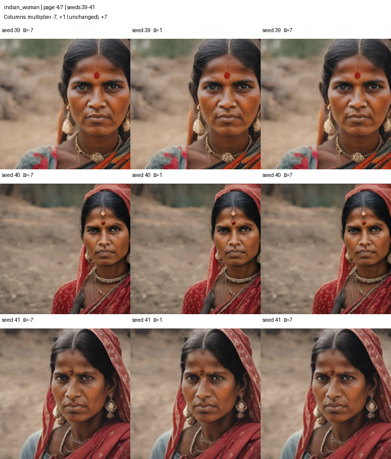
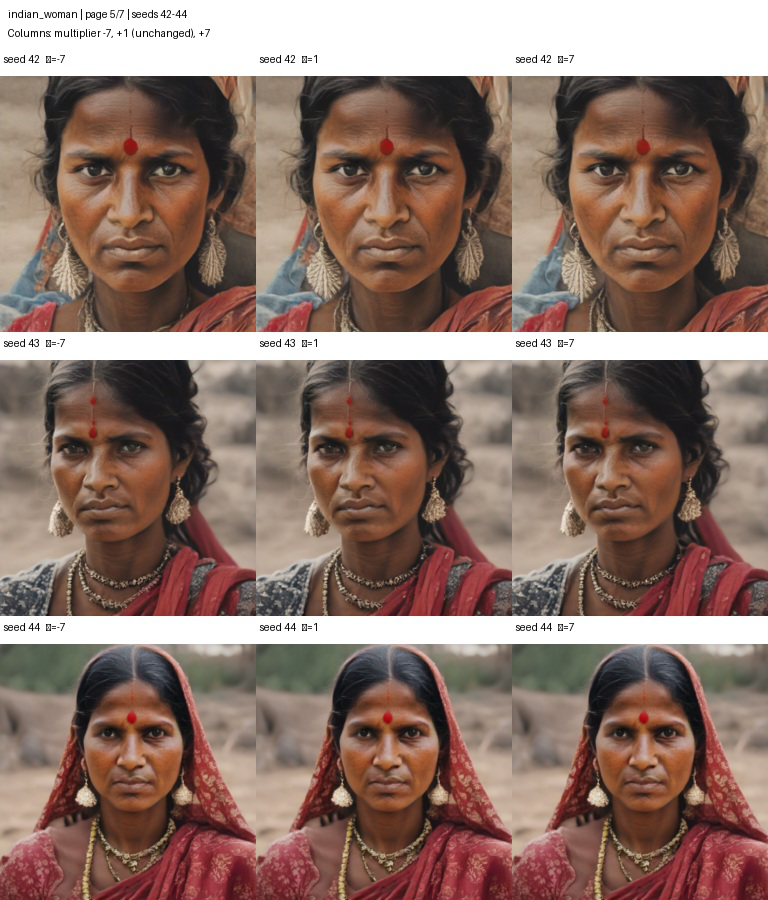
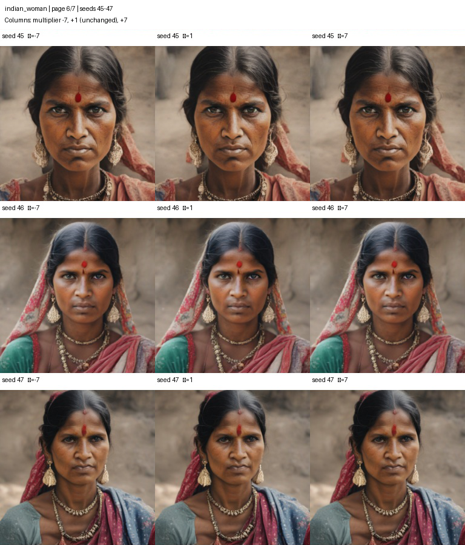
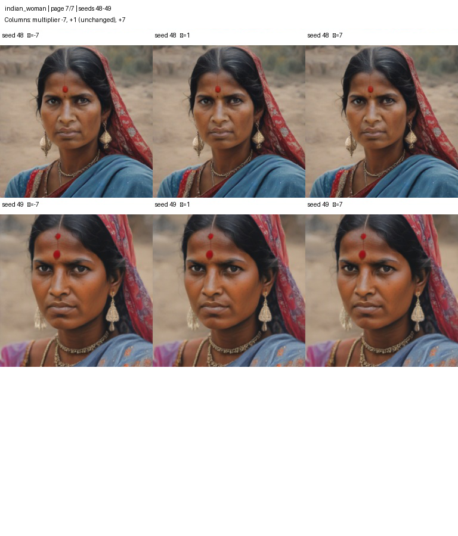

# Indian Woman — beard overlays

Three columns: **α = −7, +1, +7**. Three seeds per page, in order30–49. Magenta denotes the parser’s predicted class14 region; it is not ground truth.

## Seeds 30–32

## Seeds 33–35

## Seeds 36–38

## Seeds 39–41

## Seeds 42–44

## Seeds 45–47

## Seeds 48–49

