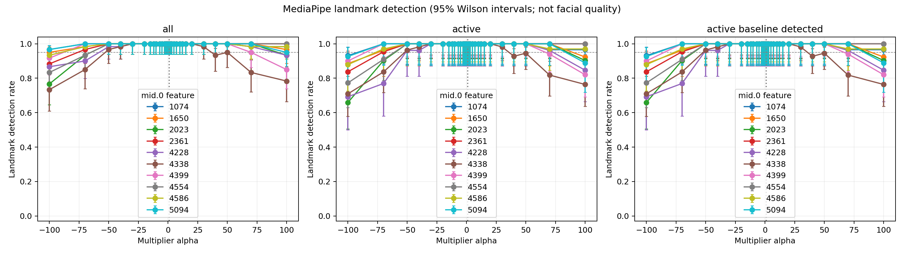
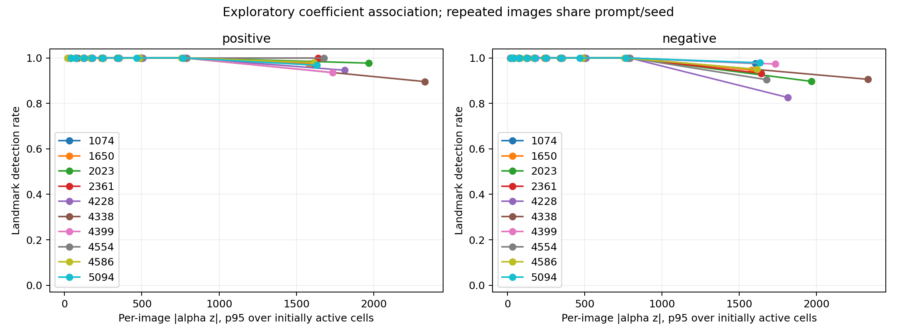

# Fine-tuned mid.0 SAE intervention stability

Completed sweep of **10 features × 12 prompt groups × 5 seeds × 29 multipliers = 17,400 image conditions**, using the **face-fine-tuned SAE** at `unet.mid_block.attentions.0` and single-step SDXL-Turbo.

The checkpoint SHA-256 is `cbb3a0a2d0c43c822c7ba97a494de38ae56ea25401a8d31484ffa32e7cc329a6`. The pretrained SAE is not used for these interventions.

Features, ranked using this fine-tuned checkpoint: **4228, 4554, 1650, 4586, 5094, 2023, 1074, 4338, 2361, 4399**. Ranking uses cached residuals for 100 images per prompt group (discovery seeds 100–199), selecting from the union of each group's ten highest raw-activation features by peak group mean minus the other eleven groups' mean. The intervention sweep uses seeds **30–34**; it does not sweep all 100 available images per category. See [ranking provenance](ranking/top10.json) and [ranked candidates](ranking/ranked_candidates.csv).

Multipliers: `−100, −70, −50, −40, −30, −20, −15, −12, −10, −7, −5, −3, −2, −1, 0, 1, 2, 3, 5, 7, 10, 12, 15, 20, 30, 40, 50, 70, 100`.

The intervention is `h′ = h + (α − 1) zᵢ dᵢ`: α=1 is the no-op, α=0 removes this feature contribution, and α<0 reverses it. Generation uses PyTorch 2.6.0+cu124, Diffusers 0.30.0, and Transformers 4.44.2. Older sweeps from a different environment are evaluated separately and are not pooled into this report.

## Downloads and review

The [20-seed extension](20_seed_evaluation/README.md) evaluates **69,600 conditions** with the same fine-tuned checkpoint, ten features, twelve prompt groups, and 29 multipliers. It includes the complete 94-figure context-stability analysis with PNG/PDF/CSV outputs.

The [context-stability visualization extension](visualizations_v1/README.md) contains **94 figure sets**, each with PNG, PDF, and aggregated CSV: feature × prompt-group heatmaps, sampled crossing brackets, ten per-feature plots, twelve per-category plots, and perturbation-magnitude panels. These use the original **five seeds per group**; counts, pointwise uncertainty intervals, and insufficient-observation flags are included. See [research next steps](RESEARCH_NEXT_STEPS.md) for interpretation and validation priorities.

- [Detection curves](detection_curves.png) and [coefficient associations](coefficient_detection.png).
- [Detection summary](detection_summary.csv), [sampled boundaries](sampled_boundaries.csv), and [seed-cluster bootstrap intervals](seed_cluster_bootstrap.csv).
- [Per-image measurements](per_image.csv) and [coefficient bins](coefficient_bins.csv).
- [Human review sheets](review/README.md) and [blank annotation table](human_review.csv). **Human facial-quality labels have not been collected.**
- [Detector settings](settings.json), [experiment configuration](experiment.json), and [analysis code](code/).

CSV image paths are workspace-relative references to the original local runs; full-resolution generated images, model weights, dependency folders, and detector caches are not included here. Review sheets are included for visual inspection. Code assumes the original workspace layout and cached models; this is a report with supporting source, not a standalone environment.

Layer: `unet.mid_block.attentions.0`. 17,400 intervention records.

Endpoint: MediaPipe landmark detection, not a judgment of facial coherence. Human labels remain blank for review.

## Sampled crossings

| Feature | Direction | Last passing sampled alpha | First failing sampled alpha | Status |
|---|---|---|---|---|
| 1074 | positive_amplification | 100.0 |  | not_reached_in_saved_sweep |
| 1074 | negative_reversal | -70.0 | -100.0 | sampled_crossing |
| 1650 | positive_amplification | 70.0 | 100.0 | sampled_crossing |
| 1650 | negative_reversal | -70.0 | -100.0 | sampled_crossing |
| 2023 | positive_amplification | 70.0 | 100.0 | sampled_crossing |
| 2023 | negative_reversal | -50.0 | -70.0 | sampled_crossing |
| 2361 | positive_amplification | 100.0 |  | not_reached_in_saved_sweep |
| 2361 | negative_reversal | -70.0 | -100.0 | sampled_crossing |
| 4228 | positive_amplification | 70.0 | 100.0 | sampled_crossing |
| 4228 | negative_reversal | -50.0 | -70.0 | sampled_crossing |
| 4338 | positive_amplification | 30.0 | 40.0 | sampled_crossing |
| 4338 | negative_reversal | -50.0 | -70.0 | sampled_crossing |
| 4399 | positive_amplification | 50.0 | 70.0 | sampled_crossing |
| 4399 | negative_reversal | -70.0 | -100.0 | sampled_crossing |
| 4554 | positive_amplification | 100.0 |  | not_reached_in_saved_sweep |
| 4554 | negative_reversal | -50.0 | -70.0 | sampled_crossing |
| 4586 | positive_amplification | 100.0 |  | not_reached_in_saved_sweep |
| 4586 | negative_reversal | -70.0 | -100.0 | sampled_crossing |
| 5094 | positive_amplification | 70.0 | 100.0 | sampled_crossing |
| 5094 | negative_reversal | -70.0 | -100.0 | sampled_crossing |

Detection threshold is an exploratory 95%, applied to initially active, alpha=1-detected samples. A crossing is not evidence of a discontinuous cliff. Negative reversal excludes alpha=0 ablation and 0<alpha<1 attenuation.

Curves include all images, initially active images, and initially active images with a detected alpha=1 reference. Wilson intervals are descriptive; use seed_cluster_bootstrap.csv for uncertainty preserving shared noise seeds across prompt groups. These are pointwise intervals, not simultaneous bounds.

Coefficient plots use per-image p95 over initially active spatial cells, not pooled pixel histogram values. They pool repeated interventions and are exploratory associations; their bins do not establish universal coefficient limits.

delta_fro is the pre-cast intervention Frobenius norm calculated from saved feature maps and the checkpoint decoder norm. relative_delta_fro uses the recorded original-block normalization where available; it is empty for older runs whose original activation norms were not saved. delta_fro_applied additionally records the actual change after floating-point casting in new runs.

Original-versus-alpha=1 pixel MAE is recorded per image where the saved baseline exists. Inactive maps provide a no-change implementation check.

Review sheets prioritize detector transition cases and include strongest-strength audit cases (up to two per prompt group per feature); they are not an unbiased human evaluation set. Label human_review.csv with coherent_face, distorted_face, plausible_pose_or_occlusion, or face_replaced; leave uncertain examples marked uncertain.

These runs use the same mid.0 SAE and SDXL-Turbo single-step configuration. Feature selection uses the descriptive fine-tuned group-difference ranking above, not a random or matched control sample. No attribute segmentation or prediction of held-out feature boundaries is claimed.

