# Feature 138: headscarf intervention sweep

## Run 002: revised alpha sweep

This is the current sweep. It keeps the two prompt conditions and six paired seeds, with the revised alpha set `-100, -80, -60, -50, -40, -30, -20, -10, -5, 0, 5, 10, 20, 30, 40, 50, 60, 80, 100`. Each 4×5 sheet starts with the original (`alpha +1`) image, followed by the 19 intervention images in ascending alpha order. The earlier sweep remains preserved under [`run_001`](run_001/).

The signed coefficient overlays use transparent zero, green near zero, purple for the strongest negative values, and green-to-yellow-to-red for positive values (red is strongest). The post-re-encoded SAE activation itself cannot be negative, so the signed overlay visualizes the scaled coefficient used by the intervention. Graphs use the same sign-aware colors.

| Prompt condition | Summary graph | Images | Signed coefficient overlay |
|---|---|---|---|
| No headscarf | 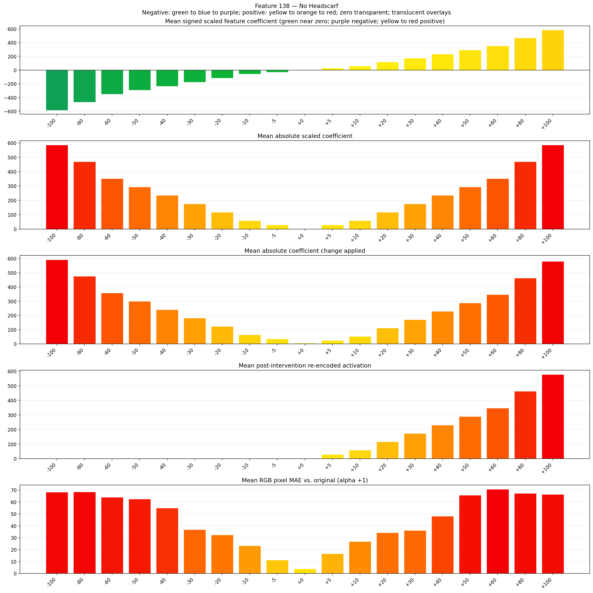 | 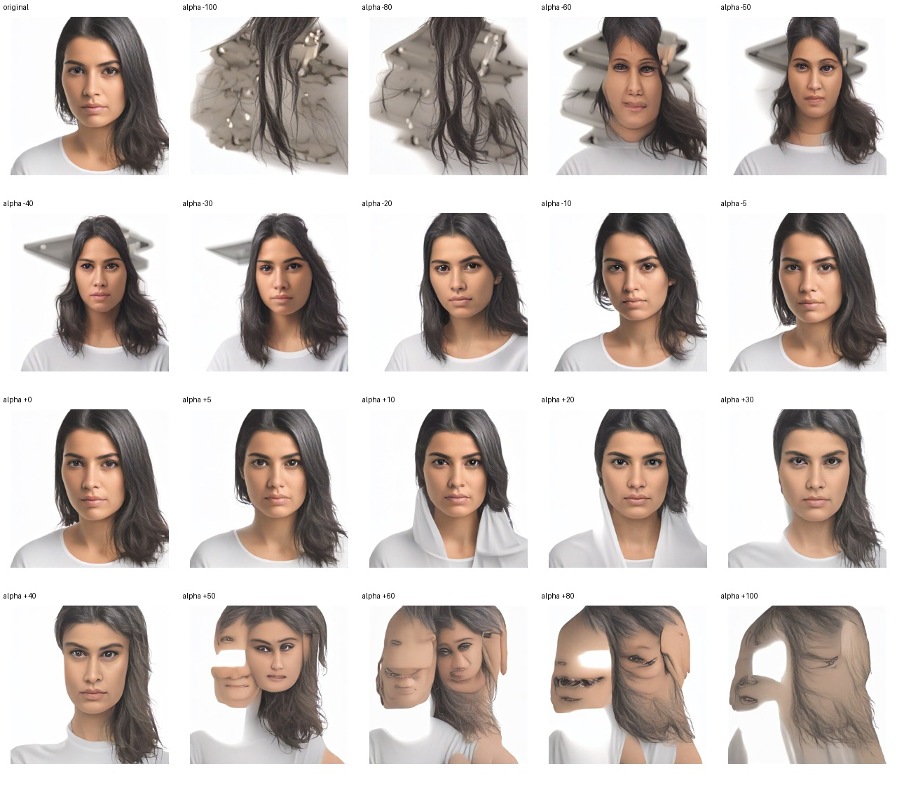 | 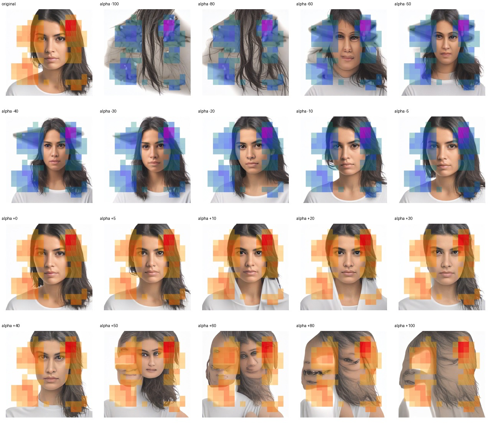 |
| Headscarf | 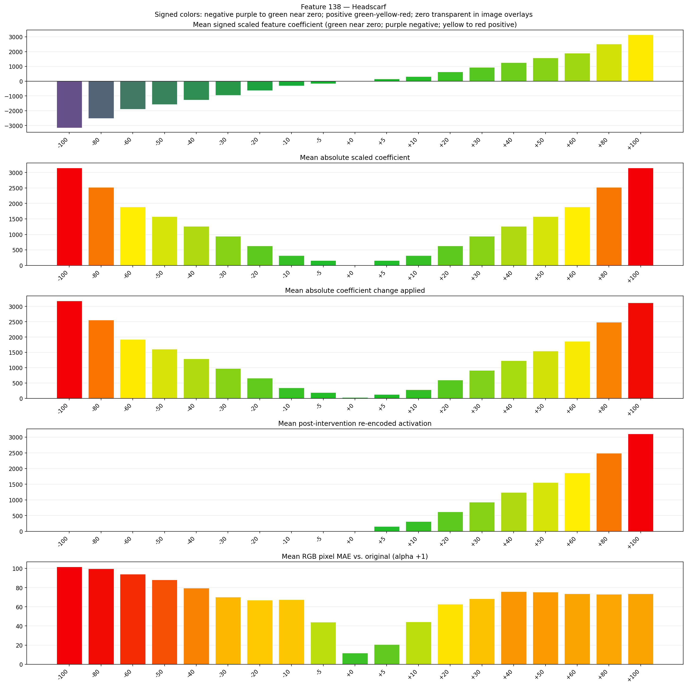 | 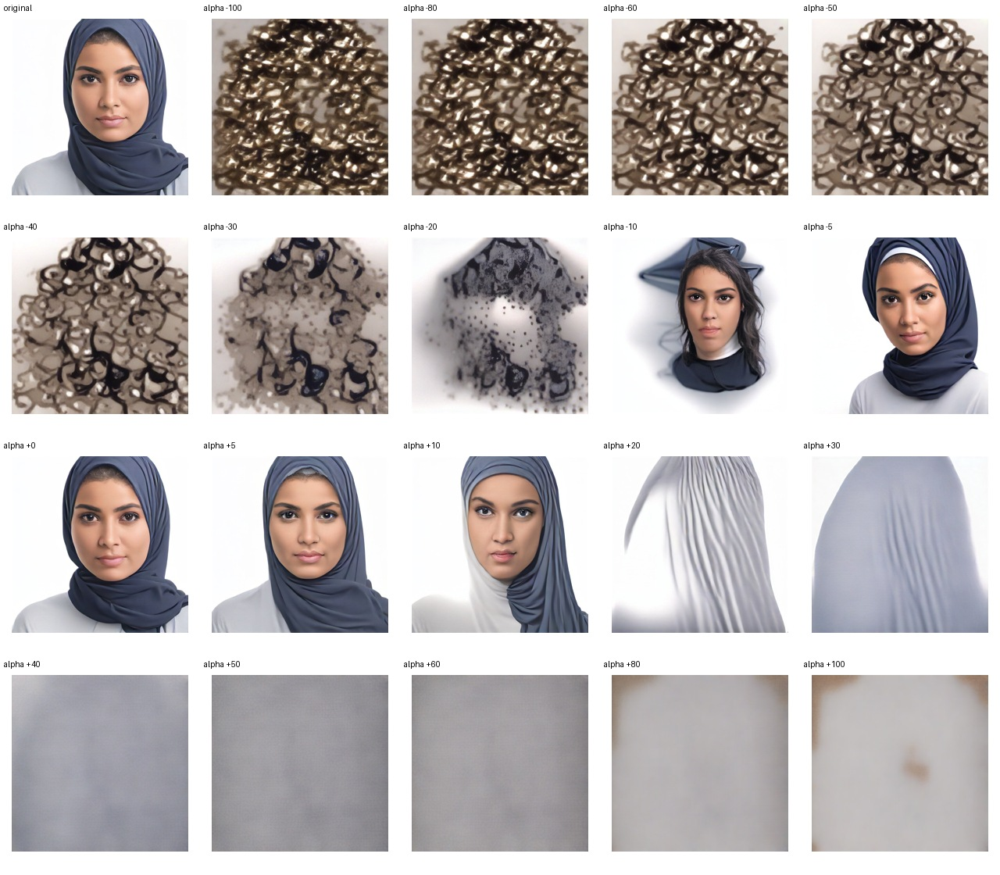 | 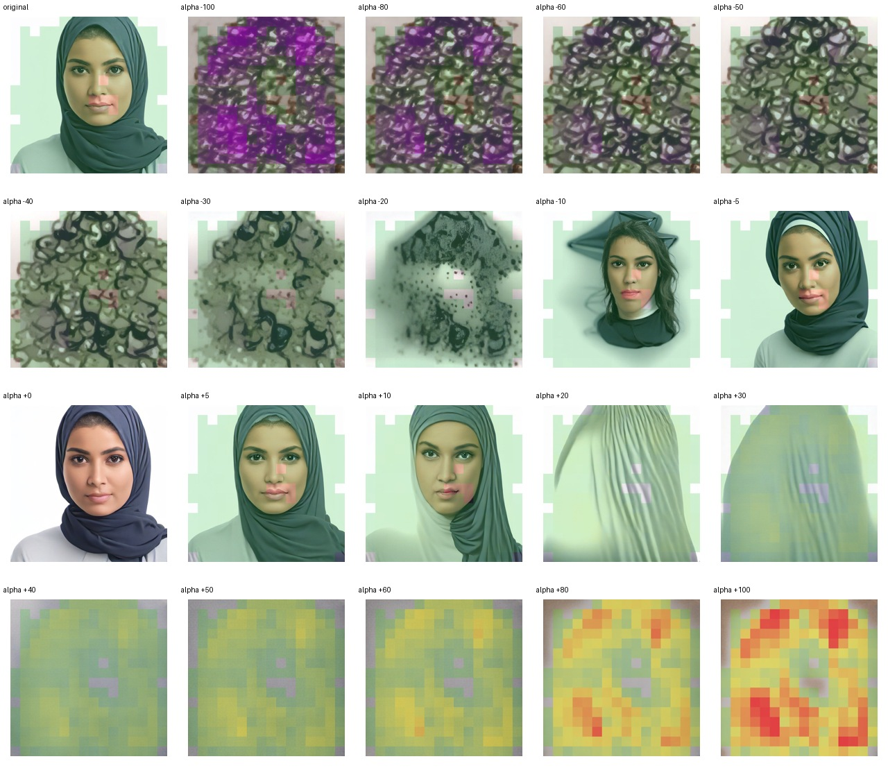 |

### Run 002 metrics: no headscarf

Means across six seeds. Pixel MAE compares with that seed's original (`alpha +1`) image on the 0–255 RGB scale.

| Alpha | Mean post-reencoded activation | Mean active spatial fraction | Mean pixel MAE |
|---:|---:|---:|---:|
| -100 | 0.00 | 0.000 | 68.26 |
| -80 | 0.00 | 0.000 | 68.51 |
| -60 | 0.00 | 0.000 | 63.96 |
| -50 | 0.00 | 0.000 | 62.39 |
| -40 | 0.00 | 0.000 | 54.89 |
| -30 | 0.00 | 0.000 | 36.74 |
| -20 | 0.00 | 0.000 | 32.33 |
| -10 | 0.00 | 0.000 | 23.27 |
| -5 | 0.00 | 0.000 | 11.29 |
| 0 | 0.00 | 0.000 | 3.93 |
| 5 | 28.97 | 0.369 | 16.50 |
| 10 | 57.85 | 0.369 | 26.93 |
| 20 | 115.62 | 0.369 | 34.25 |
| 30 | 173.40 | 0.369 | 36.14 |
| 40 | 231.17 | 0.369 | 48.02 |
| 50 | 288.94 | 0.369 | 65.80 |
| 60 | 346.71 | 0.369 | 70.70 |
| 80 | 462.25 | 0.369 | 67.18 |
| 100 | 577.80 | 0.369 | 66.43 |

### Run 002 metrics: headscarf

| Alpha | Mean post-reencoded activation | Mean active spatial fraction | Mean pixel MAE |
|---:|---:|---:|---:|
| -100 | 0.00 | 0.000 | 101.76 |
| -80 | 0.00 | 0.000 | 99.73 |
| -60 | 0.00 | 0.000 | 94.15 |
| -50 | 0.00 | 0.000 | 88.07 |
| -40 | 0.00 | 0.000 | 79.47 |
| -30 | 0.00 | 0.000 | 70.31 |
| -20 | 0.00 | 0.000 | 66.95 |
| -10 | 0.00 | 0.000 | 67.57 |
| -5 | 0.00 | 0.000 | 44.15 |
| 0 | 0.00 | 0.000 | 11.82 |
| 5 | 155.80 | 0.928 | 20.77 |
| 10 | 311.16 | 0.928 | 44.24 |
| 20 | 621.88 | 0.928 | 62.82 |
| 30 | 932.60 | 0.928 | 68.35 |
| 40 | 1243.32 | 0.928 | 75.88 |
| 50 | 1554.04 | 0.928 | 75.25 |
| 60 | 1864.76 | 0.928 | 73.58 |
| 80 | 2486.20 | 0.928 | 73.23 |
| 100 | 3107.64 | 0.928 | 73.76 |

The negative alpha values drive the re-encoded feature activation to zero in these prompts. That does not mean the generated visual attribute disappears: pixel MAE measures total image change, and the seed sheets should be checked for the scarf itself. The new signed maps expose the direction and size of the scaled latent coefficient. See [`run_002`](run_002/) for per-seed sheets, signed overlays, activation overlays, metrics, and maps.

## Run 001: previous alpha sweep (preserved)

Feature 138 ranked highly for Middle Eastern women in the biased race/gender dataset. A previous intervention at strengths 0–2 did not cleanly remove a headscarf in one image; the earlier prompt had not explicitly forbidden a head covering. This run asks a more specific question: **does scaling feature 138 make a headscarf appear or disappear in matched neutral portraits?**

## Setup

- SDXL Turbo portraits, one inference step, at `unet.down_blocks.2.attentions.1` with the same pretrained SAE.
- Two explicit prompt conditions: a Middle Eastern woman with uncovered dark hair, and a Middle Eastern woman wearing a plain dark navy hijab.
- Six paired seeds, 7000–7005.
- Alpha values: `-100, -75, -50, -25, -10, -5, -3, -2, -1, 0, 1, 2, 3, 5, 10, 25, 50, 75, 100`.
- The intervention is block output plus `(alpha - 1) × original feature coefficient × decoder direction`. Alpha `+1` is the no-op reference.

## Initial visual read

The hijab remained visible at moderate negative and positive values in the seed sheets inspected. Moderate changes affected face details and scarf folds, but did not consistently add or remove the headscarf. At the largest magnitudes, portraits became severely distorted or turned into unrelated fabric-like textures. The no-headscarf condition did not consistently acquire a hijab at moderate values. This does not show feature 138 is a reliable headscarf control.

The output makes a useful distinction between **post-activation overlays** and **intervention-footprint overlays**. Post-activation overlays can be blank after suppression because the SAE encoder clips negative coefficients to zero. Footprint overlays show the absolute coefficient change applied to the feature direction, including when the post-activation is zero. Both use `jet`, with blue/green for lower values and yellow/red for higher values.

## Graphs

| Prompt condition | Graph |
|---|---|
| No headscarf | 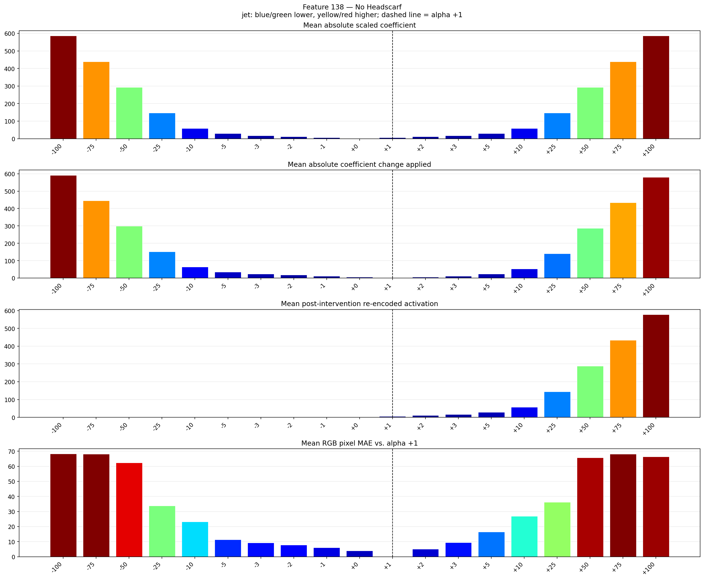 |
| Headscarf | 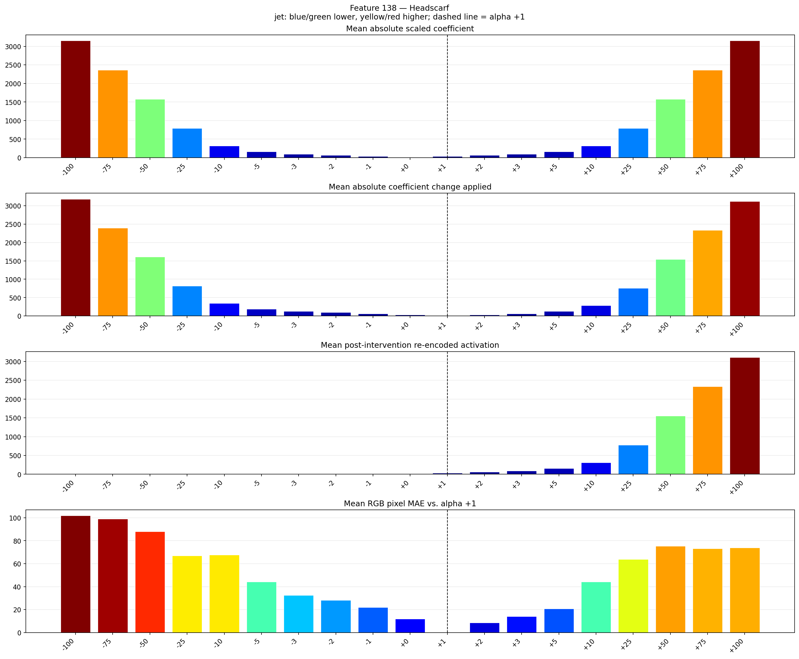 |

## Per-seed sheets

Each sheet contains the original followed by all 19 alpha values in a 4×5 grid.

| Condition | Plain image sweep | Post-activation overlay | Intervention-footprint overlay |
|---|---|---|---|
| No headscarf, seed 7000 | 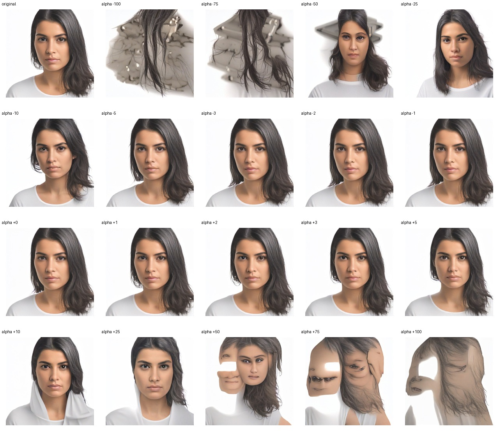 | 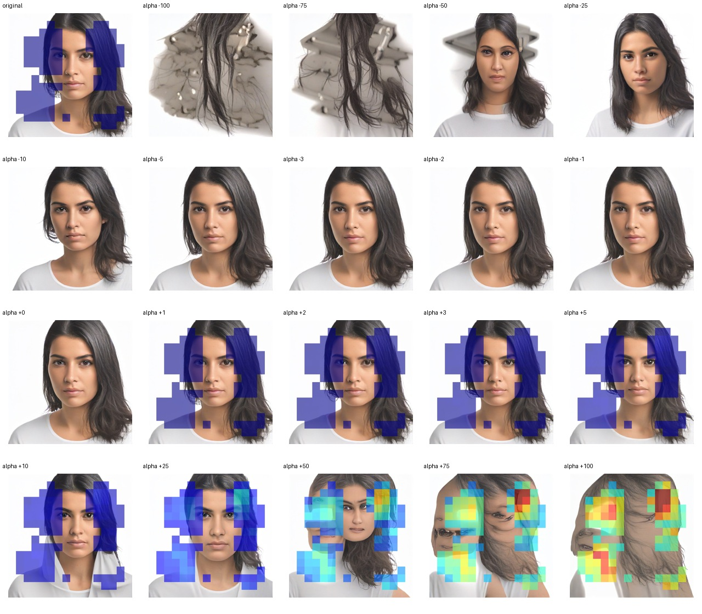 | 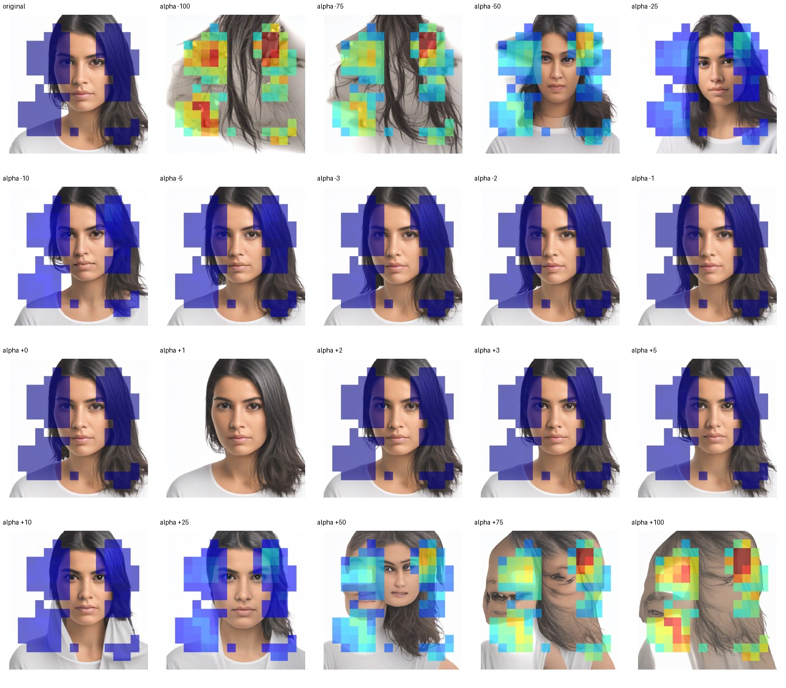 |
| Headscarf, seed 7000 | 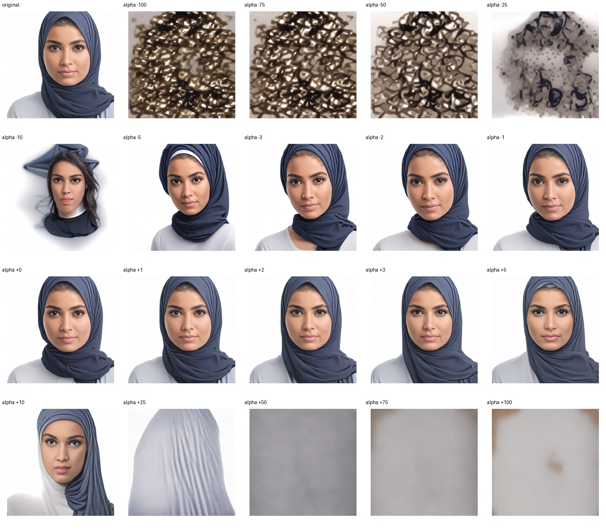 | 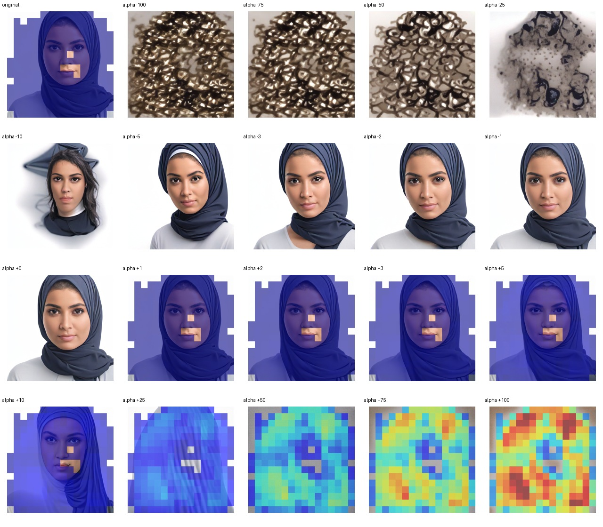 | 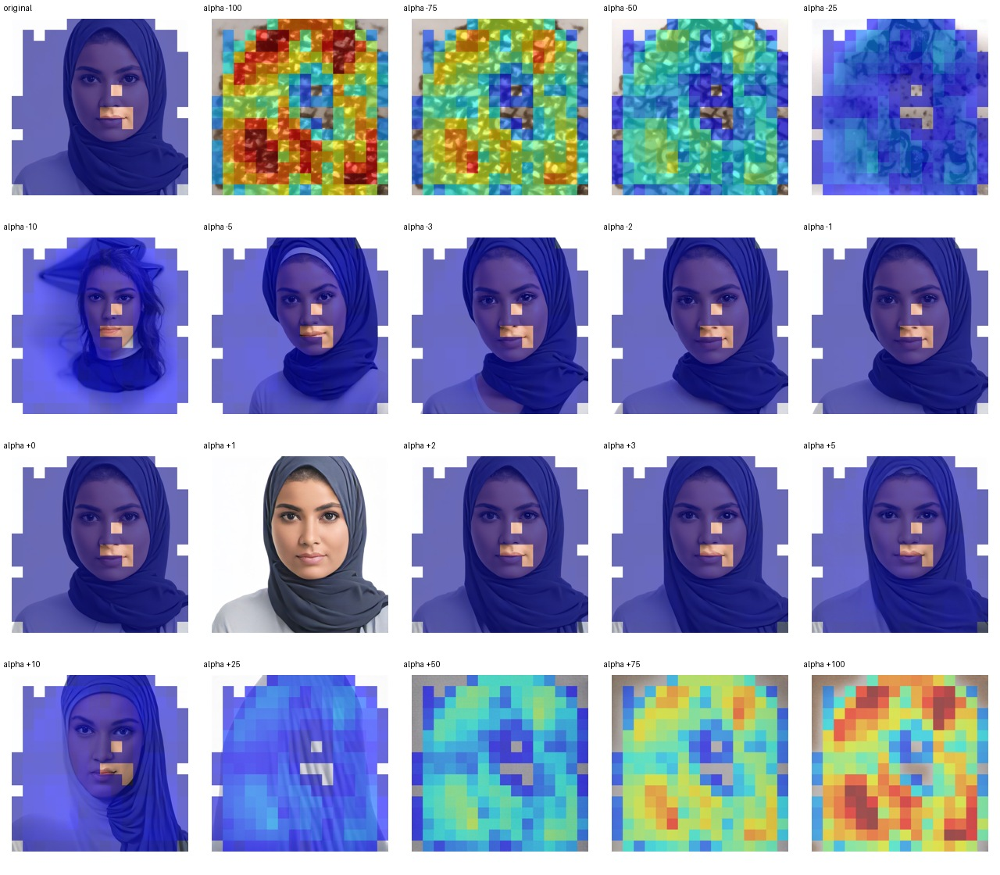 |

All six seeds for both conditions are in the matching folders under [`run_001`](run_001/). The images are saved individually under [`images`](run_001/images/), so the grids and graphs can be rebuilt without rerunning diffusion.

## Metrics for all alpha values

Values are means across six seeds. Pixel MAE compares each generated image with its alpha `+1` reference on the 0–255 RGB scale; it is not a headscarf score.

### No headscarf

| Alpha | Mean post-reencoded activation | Mean active spatial fraction | Mean pixel MAE |
|---:|---:|---:|---:|
| -100 | 0.00 | 0.000 | 68.26 |
| -75 | 0.00 | 0.000 | 68.21 |
| -50 | 0.00 | 0.000 | 62.39 |
| -25 | 0.00 | 0.000 | 33.88 |
| -10 | 0.00 | 0.000 | 23.27 |
| -5 | 0.00 | 0.000 | 11.29 |
| -3 | 0.00 | 0.000 | 9.24 |
| -2 | 0.00 | 0.000 | 7.89 |
| -1 | 0.00 | 0.000 | 6.13 |
| +0 | 0.00 | 0.000 | 3.93 |
| +1 | 5.86 | 0.369 | 0.00 |
| +2 | 11.64 | 0.369 | 5.03 |
| +3 | 17.41 | 0.369 | 9.39 |
| +5 | 28.97 | 0.369 | 16.50 |
| +10 | 57.85 | 0.369 | 26.93 |
| +25 | 144.51 | 0.369 | 36.16 |
| +50 | 288.94 | 0.369 | 65.80 |
| +75 | 433.37 | 0.369 | 68.17 |
| +100 | 577.80 | 0.369 | 66.43 |

### Headscarf

| Alpha | Mean post-reencoded activation | Mean active spatial fraction | Mean pixel MAE |
|---:|---:|---:|---:|
| -100 | 0.00 | 0.000 | 101.76 |
| -75 | 0.00 | 0.000 | 98.96 |
| -50 | 0.00 | 0.000 | 88.07 |
| -25 | 0.00 | 0.000 | 66.80 |
| -10 | 0.00 | 0.000 | 67.57 |
| -5 | 0.00 | 0.000 | 44.15 |
| -3 | 0.00 | 0.000 | 32.44 |
| -2 | 0.00 | 0.000 | 28.09 |
| -1 | 0.00 | 0.000 | 21.87 |
| +0 | 0.00 | 0.000 | 11.82 |
| +1 | 31.51 | 0.928 | 0.00 |
| +2 | 62.58 | 0.928 | 8.52 |
| +3 | 93.66 | 0.928 | 13.99 |
| +5 | 155.80 | 0.928 | 20.77 |
| +10 | 311.16 | 0.928 | 44.24 |
| +25 | 777.24 | 0.928 | 63.81 |
| +50 | 1554.04 | 0.928 | 75.25 |
| +75 | 2330.84 | 0.928 | 73.20 |
| +100 | 3107.64 | 0.928 | 73.76 |

## Saved data

- [`metrics.csv`](run_001/metrics.csv) — per-seed activation and pixel-change metrics
- [`visual_review.csv`](run_001/visual_review.csv) — blank human annotation template
- [`activation_maps.npz`](run_001/activation_maps.npz) — pre-activation, post-re-encoded, coefficient-change footprint, and scaled-coefficient maps
- [`settings.json`](run_001/settings.json) — prompts, seeds, alpha values, and method

This is a prompt-controlled exploratory run, not a rerun on the original 12-group biased images. Prompt conditions are requested attributes, not verified image labels. The reported group association does not prove what feature 138 represents or why it activates.
