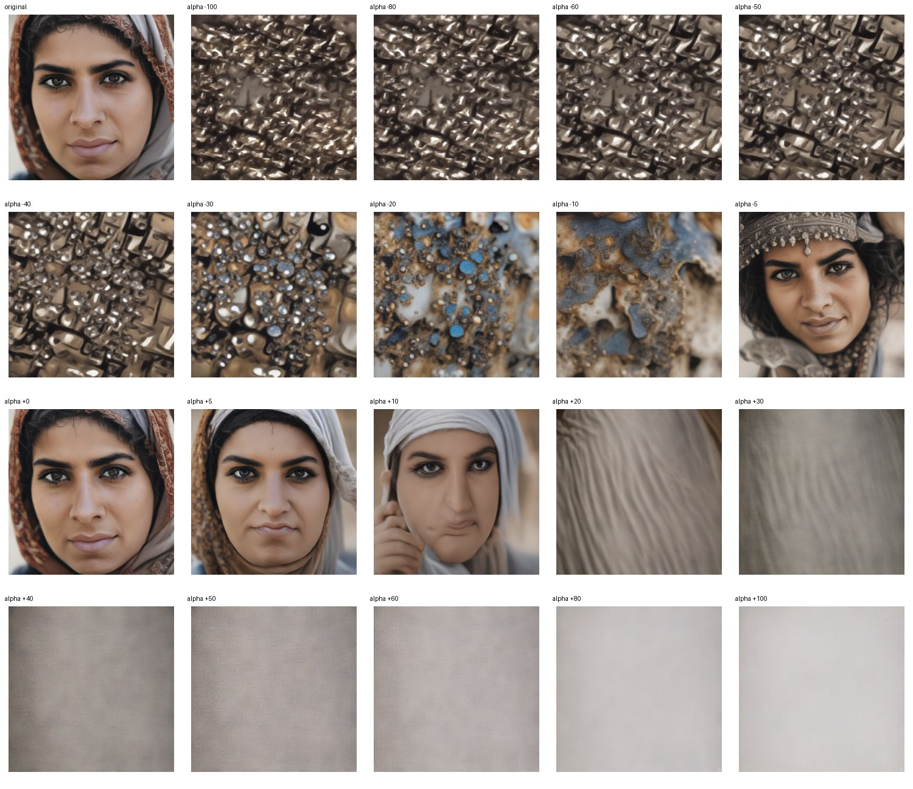

# Feature 138: biased dataset alpha sweep

This experiment uses the 100 original biased-dataset images in the `middle_eastern_woman` group. For each image it replays the original prompt (`a picture of a middle eastern woman`) and seed from the dataset manifest, then applies the feature 138 intervention at 19 alpha values. Each seed is arranged in a 4×5 grid: original followed by alpha values in ascending order.

## Example

The corresponding overlays use the same 20 tiles and order:

- [Signed coefficient overlay](example_seed_sheets/biased_middle_eastern_woman_seed000_signed_overlay.jpg): negative coefficients move green → blue → purple; positive coefficients move yellow → orange → red; zero is transparent.
- [Post-re-encoded activation overlay](example_seed_sheets/biased_middle_eastern_woman_seed000_post_activation_overlay.jpg): shows the SAE feature activation after each image intervention.

The complete run will add per-seed image and signed-overlay sheets, aggregate activation graphs, metrics, and run settings here. The overlay palette maps negative coefficients from green through blue to purple, positive coefficients from yellow through orange to red, with zero transparent. The older scarf/no-scarf prompt-controlled experiment is preserved in [`../../sae_activation_tuning/race_gender_feature_interventions/feature_138/`](../../sae_activation_tuning/race_gender_feature_interventions/feature_138/) and is separate from this biased-dataset run.

The notebook and scripts are available in this folder and in the [SAE demo notebook repository](https://github.com/ele906/sae-demo-notebooks/tree/main/sae-activation/activation_tuning).
