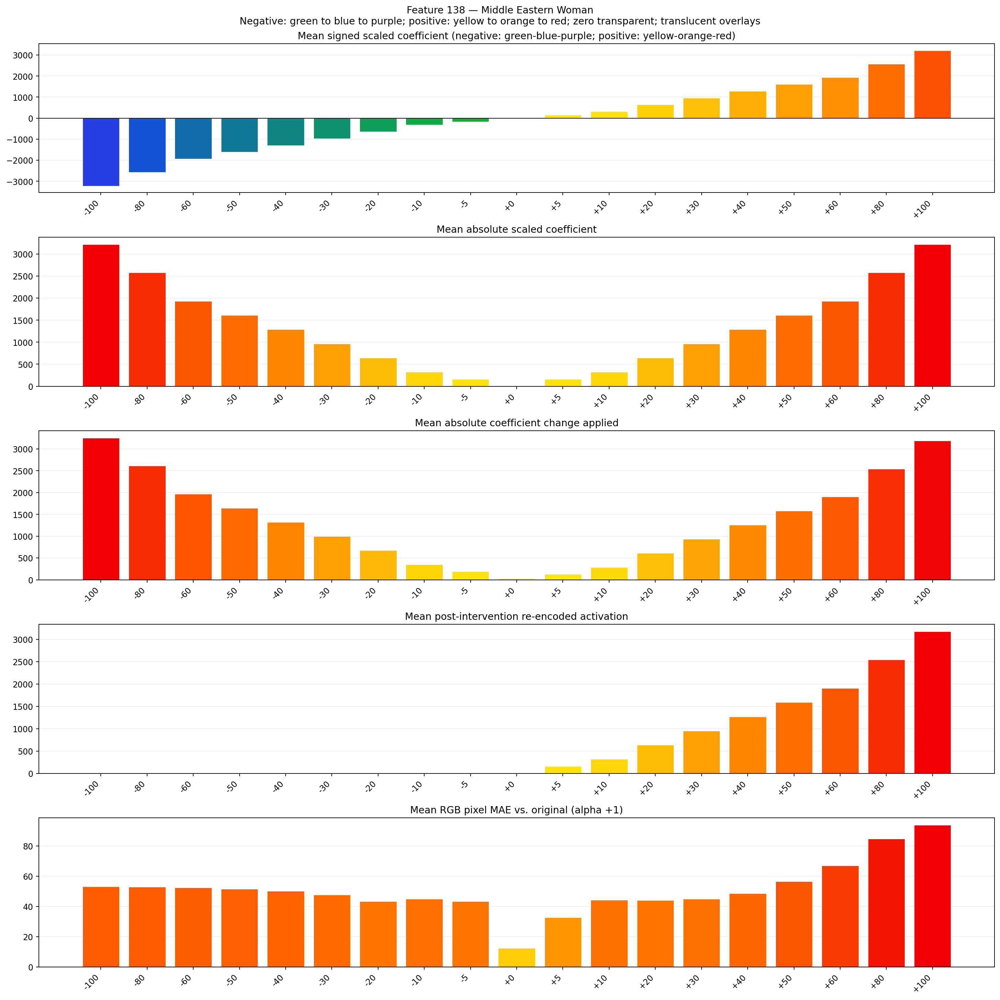
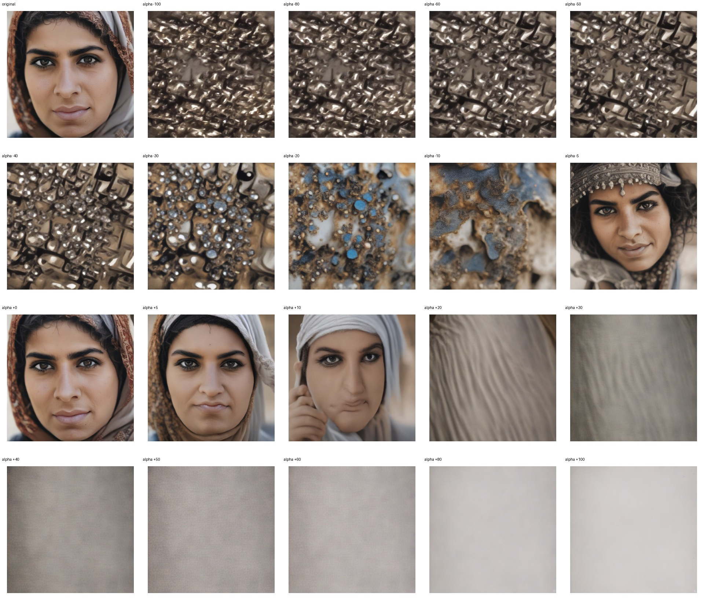
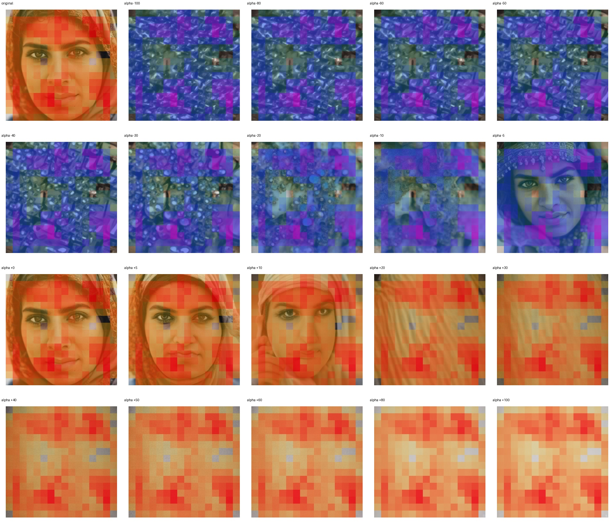
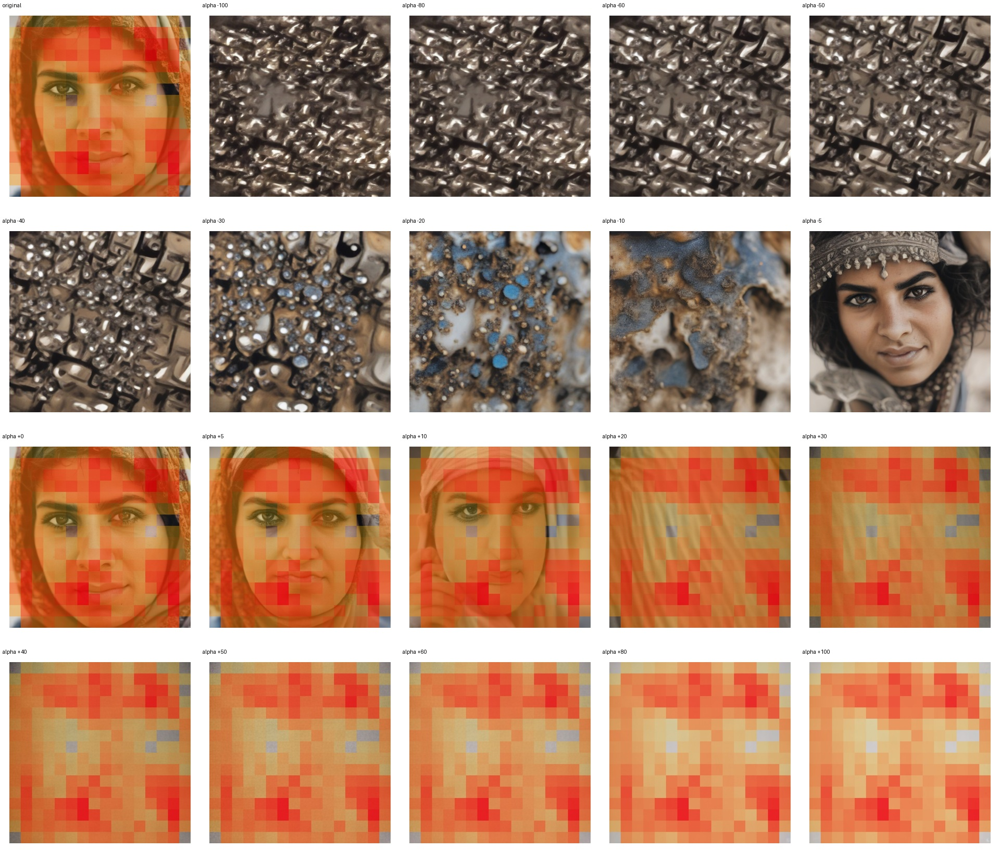

# Feature 138: biased dataset alpha sweep

This experiment uses the 100 original biased-dataset images in the `middle_eastern_woman` group. For each image it replays the original prompt (`a picture of a middle eastern woman`) and seed from the dataset manifest, then applies the feature 138 intervention at 19 alpha values. Each seed is arranged in a 4×5 grid: original followed by alpha values in ascending order.

## Run 001 results

### Activation graph

The graph summarizes mean signed scaled coefficient, mean absolute coefficient values, mean post-re-encoded activation, and mean pixel MAE across 100 seeds.

| Alpha | Mean post-re-encoded activation | Mean active spatial fraction | Mean pixel MAE |
|---:|---:|---:|---:|
| -100 | 0.00 | 0.000 | 53.23 |
| -80 | 0.00 | 0.000 | 52.95 |
| -60 | 0.00 | 0.000 | 52.41 |
| -50 | 0.00 | 0.000 | 51.55 |
| -40 | 0.00 | 0.000 | 50.20 |
| -30 | 0.00 | 0.000 | 47.80 |
| -20 | 0.00 | 0.000 | 43.36 |
| -10 | 0.00 | 0.000 | 44.95 |
| -5 | 0.00 | 0.000 | 43.49 |
| 0 | 0.00 | 0.000 | 12.49 |
| 5 | 159.24 | 0.960 | 32.69 |
| 10 | 318.03 | 0.960 | 44.23 |
| 20 | 635.61 | 0.960 | 44.13 |
| 30 | 953.19 | 0.960 | 44.88 |
| 40 | 1270.77 | 0.960 | 48.65 |
| 50 | 1588.35 | 0.960 | 56.58 |
| 60 | 1905.93 | 0.960 | 67.17 |
| 80 | 2541.09 | 0.960 | 84.75 |
| 100 | 3176.25 | 0.960 | 93.93 |

### Per-seed images and overlays

Every sheet has 20 tiles in a 4×5 grid: the original followed by all 19 alpha values in ascending order. The plain images, signed coefficient overlays, post-re-encoded activation overlays, and intervention-footprint overlays are kept in separate folders.

- [All 100 plain image sheets](run_biased_001/seed_sheets/)
- [All 100 signed coefficient overlay sheets](run_biased_001/signed_coefficient_overlays/)
- [All 100 post-re-encoded activation overlay sheets](run_biased_001/post_activation_overlays/)
- [All 100 intervention-footprint overlay sheets](run_biased_001/intervention_footprint_overlays/)
- [Per-image metrics](run_biased_001/metrics.csv), [visual review template](run_biased_001/visual_review.csv), [activation maps](run_biased_001/activation_maps.npz), and [run settings](run_biased_001/settings.json)

The overlays use transparent zero, green through blue to purple for negative coefficients, and yellow through orange to red for positive coefficients. Each tile is normalized separately for visibility, so use the metrics for magnitude comparisons. Alpha `+1` is the no-op reference used for pixel MAE; it is not one of the 19 displayed alpha values. The older scarf/no-scarf prompt-controlled experiment is preserved in [`../../sae_activation_tuning/race_gender_feature_interventions/feature_138/`](../../sae_activation_tuning/race_gender_feature_interventions/feature_138/) and is separate from this biased-dataset run.

The notebook and scripts are available in this folder and in the [SAE demo notebook repository](https://github.com/ele906/sae-demo-notebooks/tree/main/sae-activation/activation_tuning).
