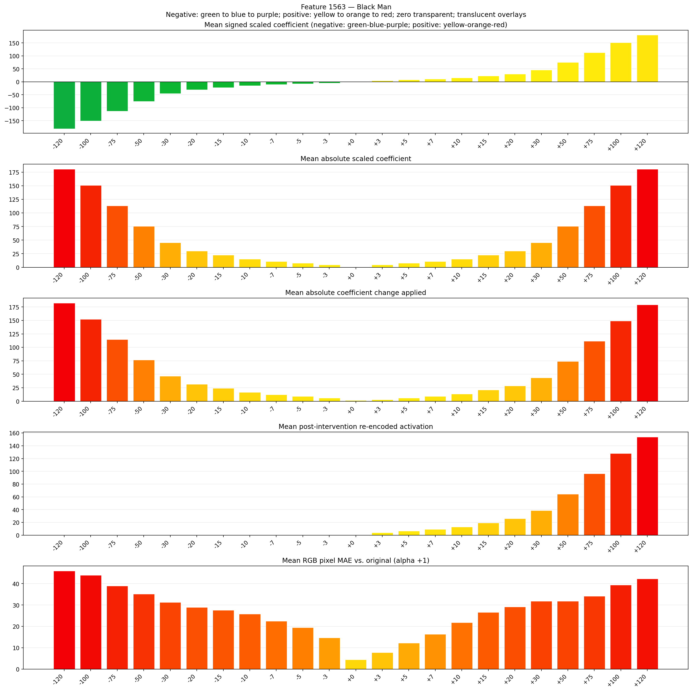
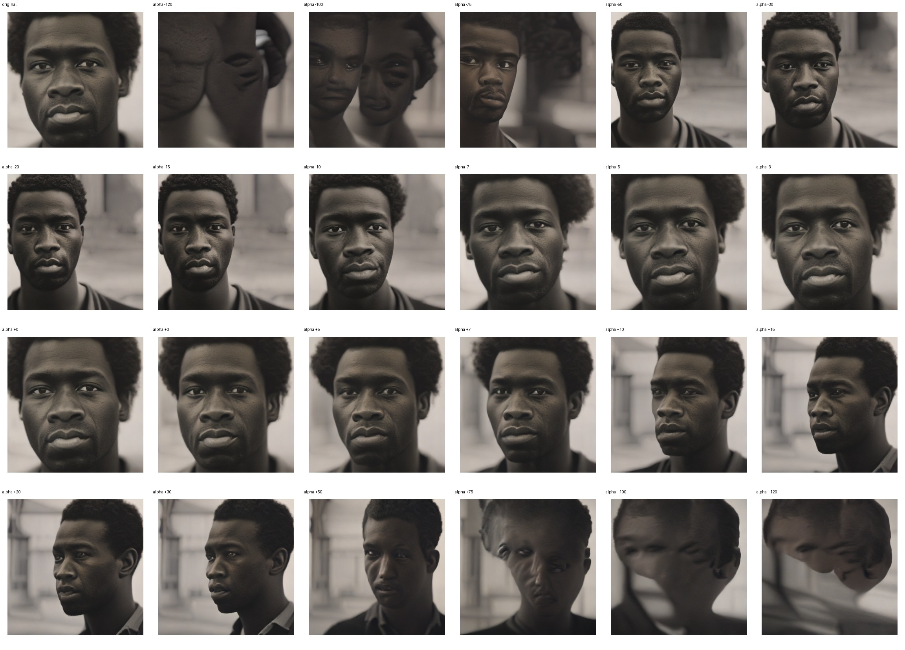
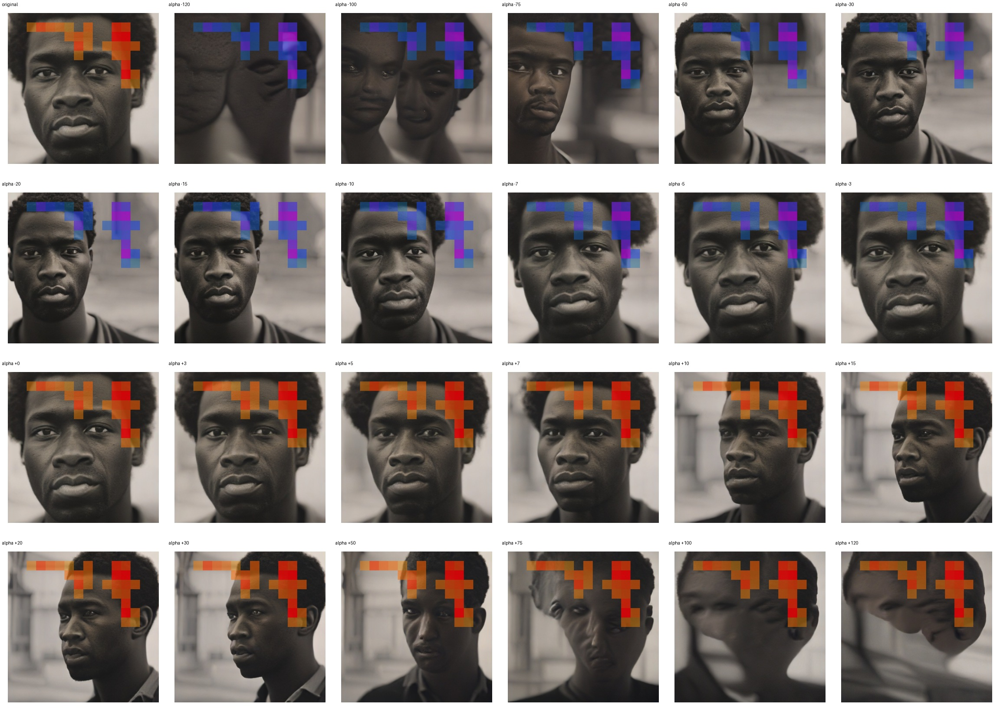
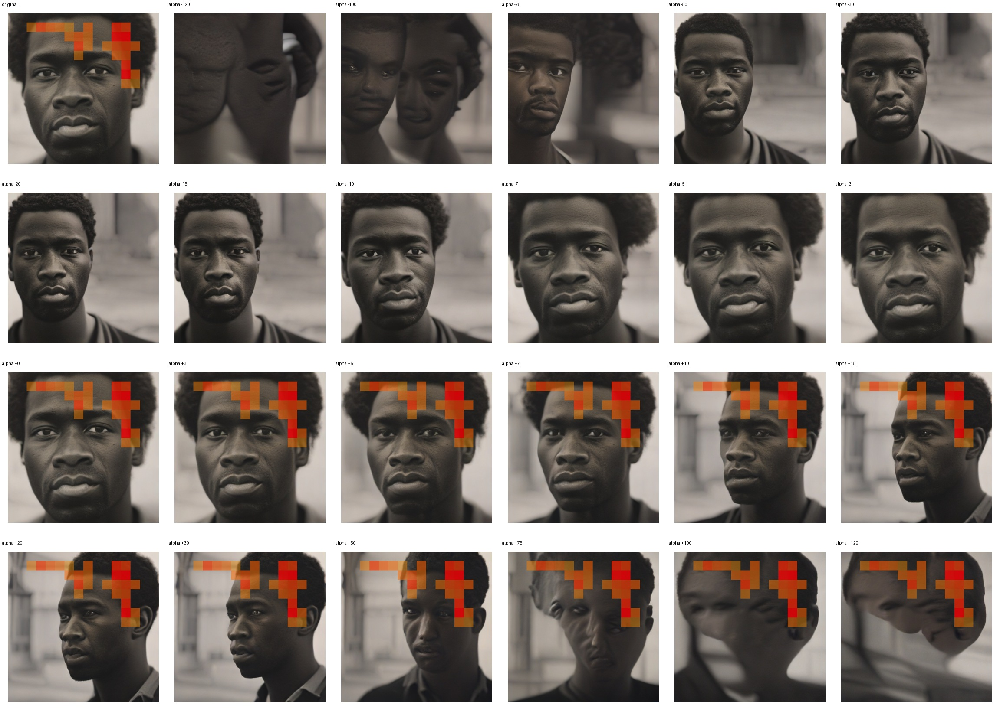

# Feature 1563 — Black Man

Biased dataset; original prompt and seed replay for seeds 0–19. Values are means across 20 source images. The table reports the mean post-re-encoded activation of feature 1563, the active spatial fraction, mean RGB pixel MAE versus the original image (0–255 scale), and coefficient change magnitudes for each alpha.

## Activation graph

## Mean metrics by alpha

| Alpha | Mean post-reencoded feature 1563 activation | Active spatial fraction | Mean pixel change (MAE) | Mean absolute coefficient change | Mean absolute scaled coefficient |
|---:|---:|---:|---:|---:|---:|
| -120 | 0.000 | 0.000 | 45.967 | 182.299 | 180.792 |
| -100 | 0.000 | 0.000 | 43.906 | 152.167 | 150.660 |
| -75 | 0.000 | 0.000 | 38.887 | 114.502 | 112.995 |
| -50 | 0.000 | 0.000 | 35.112 | 76.837 | 75.330 |
| -30 | 0.000 | 0.000 | 31.282 | 46.705 | 45.198 |
| -20 | 0.000 | 0.000 | 28.935 | 31.639 | 30.132 |
| -15 | 0.000 | 0.000 | 27.553 | 24.106 | 22.599 |
| -10 | 0.000 | 0.000 | 25.813 | 16.573 | 15.066 |
| -7 | 0.000 | 0.000 | 22.497 | 12.053 | 10.546 |
| -5 | 0.000 | 0.000 | 19.461 | 9.040 | 7.533 |
| -3 | 0.000 | 0.000 | 14.631 | 6.026 | 4.520 |
| +0 | 0.000 | 0.000 | 4.406 | 1.507 | 0.000 |
| +3 | 4.066 | 0.090 | 7.799 | 3.013 | 4.520 |
| +5 | 6.625 | 0.090 | 12.196 | 6.026 | 7.533 |
| +7 | 9.185 | 0.090 | 16.333 | 9.040 | 10.546 |
| +10 | 13.024 | 0.090 | 21.814 | 13.559 | 15.066 |
| +15 | 19.422 | 0.090 | 26.548 | 21.092 | 22.599 |
| +20 | 25.821 | 0.090 | 29.166 | 28.625 | 30.132 |
| +30 | 38.617 | 0.090 | 31.823 | 43.692 | 45.198 |
| +50 | 64.211 | 0.090 | 31.801 | 73.824 | 75.330 |
| +75 | 96.203 | 0.090 | 34.131 | 111.489 | 112.995 |
| +100 | 128.195 | 0.090 | 39.406 | 149.154 | 150.660 |
| +120 | 153.788 | 0.090 | 42.311 | 179.286 | 180.792 |

## Per-seed grids

Each 4×6 sheet contains the original followed by the 23 alpha variants in ascending alpha order, from −120 through +120.

### Plain images

[All 20 plain-image grids](seed_sheets/)

### Signed coefficient overlays

[All 20 signed coefficient grids](signed_coefficient_overlays/)

### Post-re-encoded activation overlays

[All 20 post-activation grids](post_activation_overlays/)

### Intervention-footprint overlays

[All 20 intervention-footprint grids](intervention_footprint_overlays/)

Zero is transparent. Negative coefficient colors progress green through blue to purple; positive colors progress yellow through orange to red. Each map tile is normalized individually for visibility. The original and alpha-zero tiles show the pre-intervention feature map so its location remains visible.
