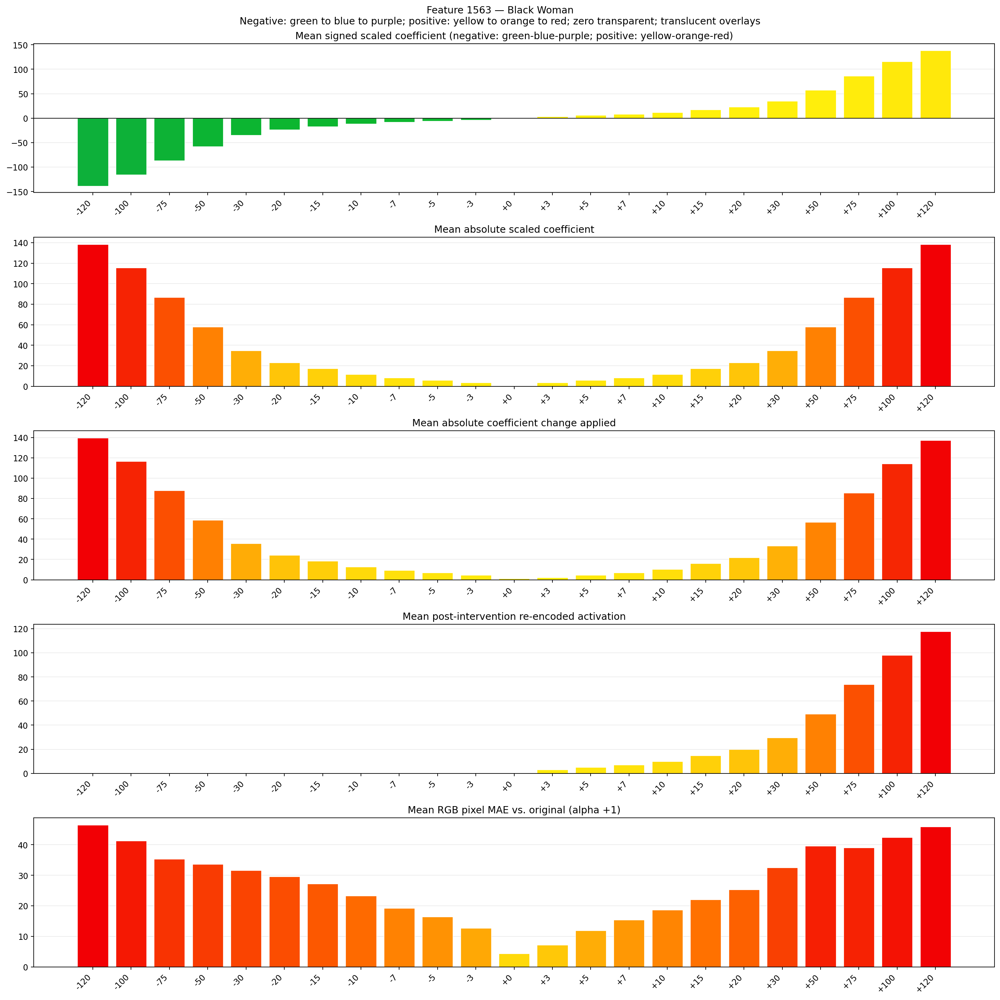
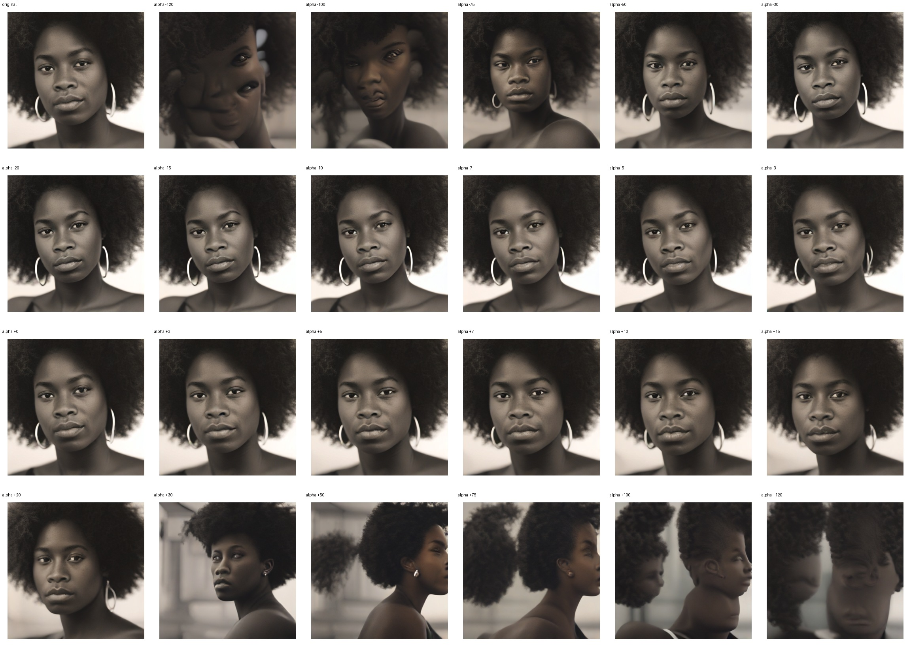
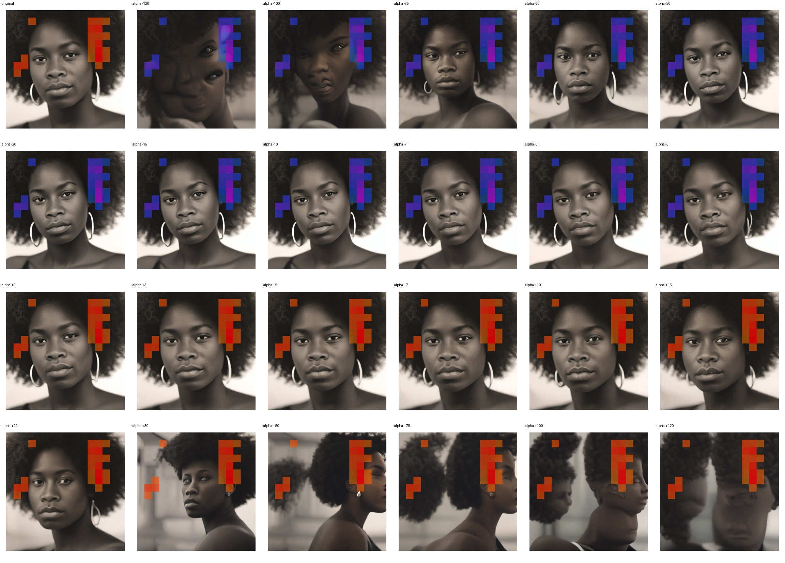
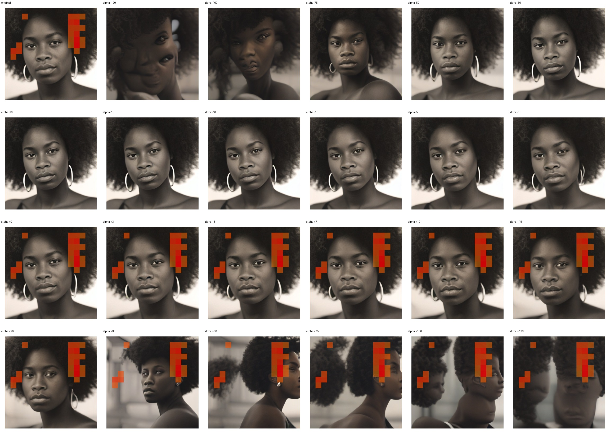

# Feature 1563 — Black Woman

Biased dataset; original prompt and seed replay for seeds 0–19. Values are means across 20 source images. The table reports the mean post-re-encoded activation of feature 1563, the active spatial fraction, mean RGB pixel MAE versus the original image (0–255 scale), and coefficient change magnitudes for each alpha.

## Activation graph

## Mean metrics by alpha

| Alpha | Mean post-reencoded feature 1563 activation | Active spatial fraction | Mean pixel change (MAE) | Mean absolute coefficient change | Mean absolute scaled coefficient |
|---:|---:|---:|---:|---:|---:|
| -120 | 0.000 | 0.000 | 46.476 | 139.607 | 138.453 |
| -100 | 0.000 | 0.000 | 41.238 | 116.531 | 115.378 |
| -75 | 0.000 | 0.000 | 35.355 | 87.687 | 86.533 |
| -50 | 0.000 | 0.000 | 33.590 | 58.843 | 57.689 |
| -30 | 0.000 | 0.000 | 31.597 | 35.767 | 34.613 |
| -20 | 0.000 | 0.000 | 29.612 | 24.229 | 23.076 |
| -15 | 0.000 | 0.000 | 27.167 | 18.460 | 17.307 |
| -10 | 0.000 | 0.000 | 23.307 | 12.692 | 11.538 |
| -7 | 0.000 | 0.000 | 19.277 | 9.230 | 8.076 |
| -5 | 0.000 | 0.000 | 16.391 | 6.923 | 5.769 |
| -3 | 0.000 | 0.000 | 12.673 | 4.615 | 3.461 |
| +0 | 0.000 | 0.000 | 4.328 | 1.154 | 0.000 |
| +3 | 3.114 | 0.077 | 7.163 | 2.308 | 3.461 |
| +5 | 5.074 | 0.077 | 11.883 | 4.615 | 5.769 |
| +7 | 7.034 | 0.077 | 15.355 | 6.923 | 8.076 |
| +10 | 9.974 | 0.077 | 18.671 | 10.384 | 11.538 |
| +15 | 14.874 | 0.077 | 22.080 | 16.153 | 17.307 |
| +20 | 19.774 | 0.077 | 25.260 | 21.922 | 23.076 |
| +30 | 29.574 | 0.077 | 32.504 | 33.460 | 34.613 |
| +50 | 49.174 | 0.077 | 39.599 | 56.535 | 57.689 |
| +75 | 73.673 | 0.077 | 38.998 | 85.380 | 86.533 |
| +100 | 98.174 | 0.077 | 42.392 | 114.224 | 115.378 |
| +120 | 117.774 | 0.077 | 45.926 | 137.299 | 138.453 |

## Per-seed grids

Each 4×6 sheet contains the original followed by the 23 alpha variants in ascending alpha order, from −120 through +120.

### Plain images

[All 20 plain-image grids](seed_sheets/)

### Signed coefficient overlays

[All 20 signed coefficient grids](signed_coefficient_overlays/)

### Post-re-encoded activation overlays

[All 20 post-activation grids](post_activation_overlays/)

### Intervention-footprint overlays

[All 20 intervention-footprint grids](intervention_footprint_overlays/)

Zero is transparent. Negative coefficient colors progress green through blue to purple; positive colors progress yellow through orange to red. Each map tile is normalized individually for visibility. The original and alpha-zero tiles show the pre-intervention feature map so its location remains visible.
