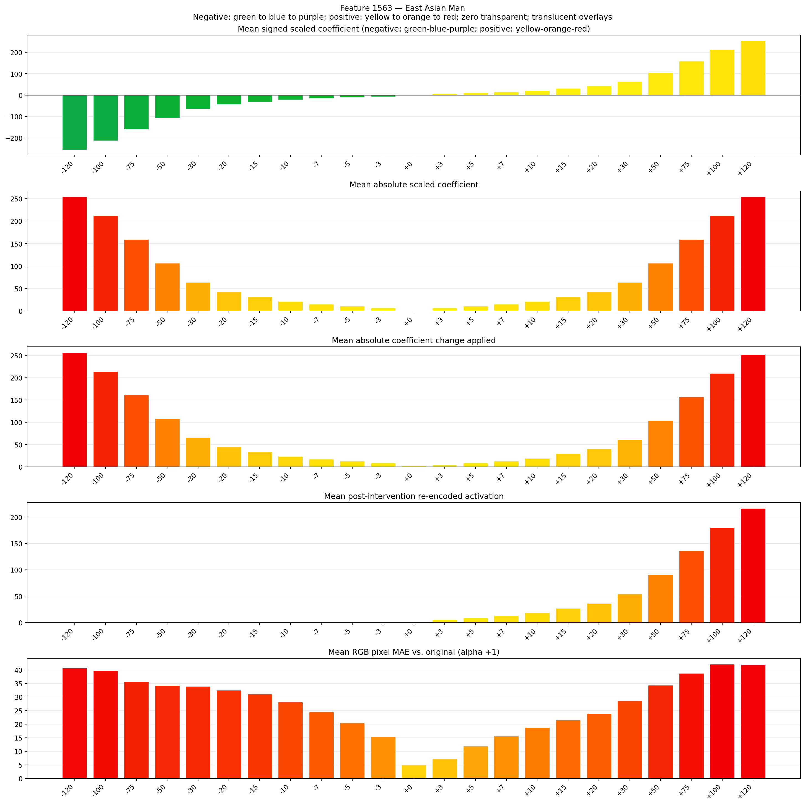
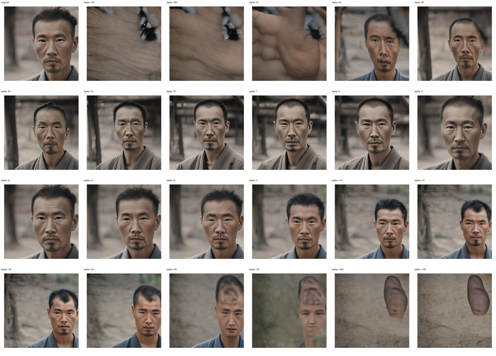
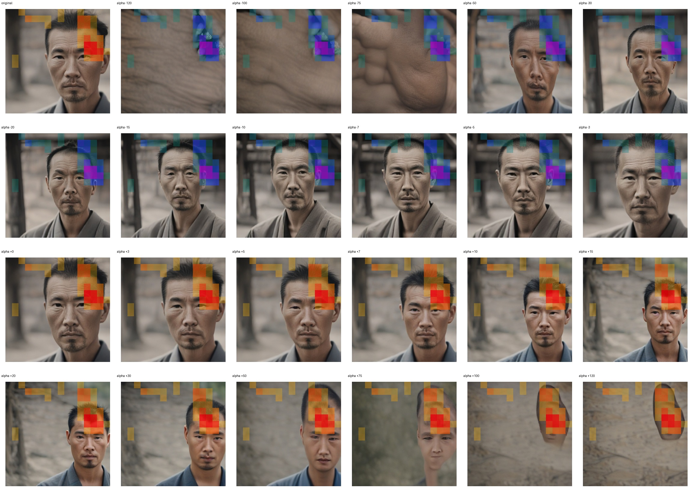
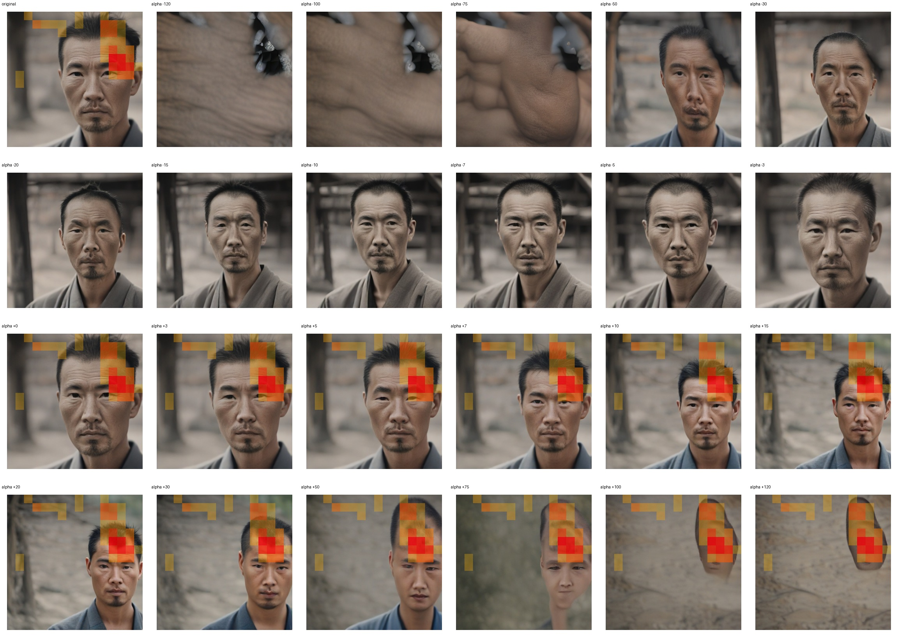

# Feature 1563 — East Asian Man

Biased dataset; original prompt and seed replay for seeds 0–19. Values are means across 20 source images. The table reports the mean post-re-encoded activation of feature 1563, the active spatial fraction, mean RGB pixel MAE versus the original image (0–255 scale), and coefficient change magnitudes for each alpha.

## Activation graph

## Mean metrics by alpha

| Alpha | Mean post-reencoded feature 1563 activation | Active spatial fraction | Mean pixel change (MAE) | Mean absolute coefficient change | Mean absolute scaled coefficient |
|---:|---:|---:|---:|---:|---:|
| -120 | 0.000 | 0.000 | 40.723 | 256.629 | 254.509 |
| -100 | 0.000 | 0.000 | 39.790 | 214.211 | 212.090 |
| -75 | 0.000 | 0.000 | 35.731 | 161.189 | 159.068 |
| -50 | 0.000 | 0.000 | 34.234 | 108.166 | 106.045 |
| -30 | 0.000 | 0.000 | 33.921 | 65.748 | 63.627 |
| -20 | 0.000 | 0.000 | 32.550 | 44.539 | 42.418 |
| -15 | 0.000 | 0.000 | 31.153 | 33.934 | 31.814 |
| -10 | 0.000 | 0.000 | 28.100 | 23.330 | 21.209 |
| -7 | 0.000 | 0.000 | 24.447 | 16.967 | 14.846 |
| -5 | 0.000 | 0.000 | 20.438 | 12.725 | 10.605 |
| -3 | 0.000 | 0.000 | 15.299 | 8.484 | 6.363 |
| +0 | 0.000 | 0.000 | 5.022 | 2.121 | 0.000 |
| +3 | 5.724 | 0.108 | 7.087 | 4.242 | 6.363 |
| +5 | 9.327 | 0.108 | 11.920 | 8.484 | 10.605 |
| +7 | 12.930 | 0.108 | 15.598 | 12.725 | 14.846 |
| +10 | 18.334 | 0.108 | 18.719 | 19.088 | 21.209 |
| +15 | 27.341 | 0.108 | 21.519 | 29.693 | 31.814 |
| +20 | 36.349 | 0.108 | 23.928 | 40.297 | 42.418 |
| +30 | 54.363 | 0.108 | 28.527 | 61.506 | 63.627 |
| +50 | 90.393 | 0.108 | 34.412 | 103.924 | 106.045 |
| +75 | 135.429 | 0.108 | 38.742 | 156.947 | 159.068 |
| +100 | 180.465 | 0.108 | 42.133 | 209.970 | 212.090 |
| +120 | 216.494 | 0.108 | 41.807 | 252.388 | 254.509 |

## Per-seed grids

Each 4×6 sheet contains the original followed by the 23 alpha variants in ascending alpha order, from −120 through +120.

### Plain images

[All 20 plain-image grids](seed_sheets/)

### Signed coefficient overlays

[All 20 signed coefficient grids](signed_coefficient_overlays/)

### Post-re-encoded activation overlays

[All 20 post-activation grids](post_activation_overlays/)

### Intervention-footprint overlays

[All 20 intervention-footprint grids](intervention_footprint_overlays/)

Zero is transparent. Negative coefficient colors progress green through blue to purple; positive colors progress yellow through orange to red. Each map tile is normalized individually for visibility. The original and alpha-zero tiles show the pre-intervention feature map so its location remains visible.
