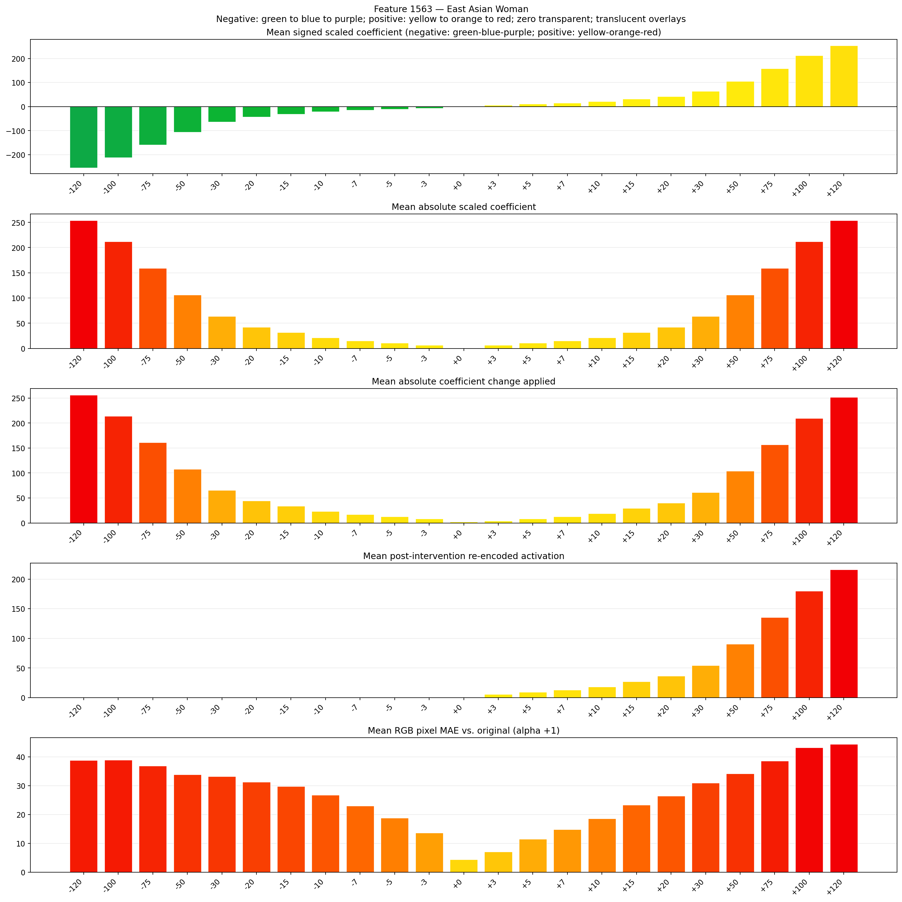
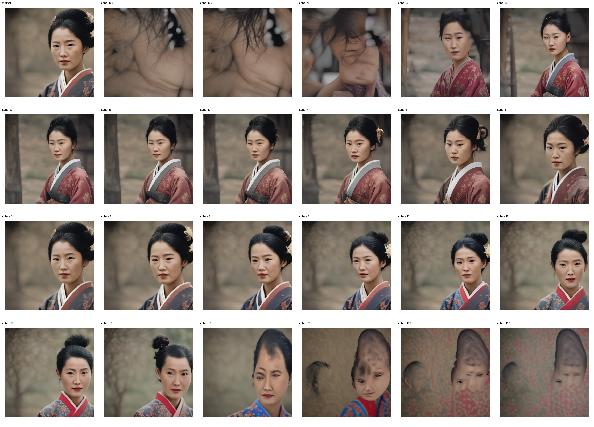
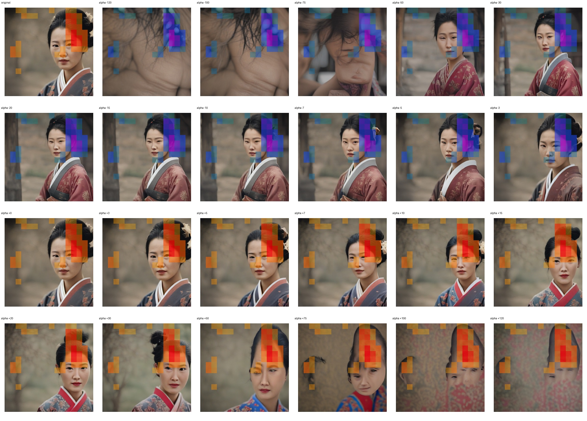
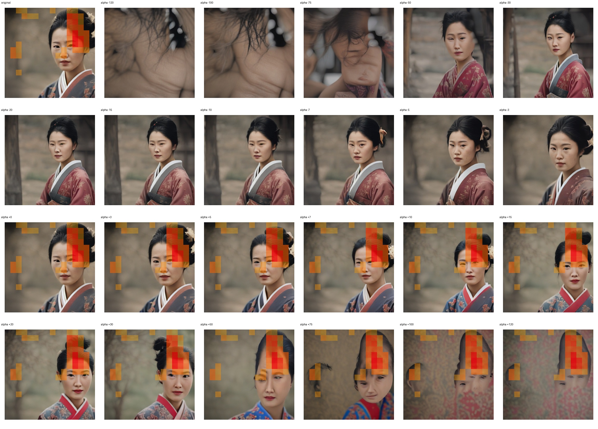

# Feature 1563 — East Asian Woman

Biased dataset; original prompt and seed replay for seeds 0–19. Values are means across 20 source images. The table reports the mean post-re-encoded activation of feature 1563, the active spatial fraction, mean RGB pixel MAE versus the original image (0–255 scale), and coefficient change magnitudes for each alpha.

## Activation graph

## Mean metrics by alpha

| Alpha | Mean post-reencoded feature 1563 activation | Active spatial fraction | Mean pixel change (MAE) | Mean absolute coefficient change | Mean absolute scaled coefficient |
|---:|---:|---:|---:|---:|---:|
| -120 | 0.000 | 0.000 | 38.819 | 256.174 | 254.057 |
| -100 | 0.000 | 0.000 | 38.949 | 213.831 | 211.714 |
| -75 | 0.000 | 0.000 | 36.880 | 160.903 | 158.786 |
| -50 | 0.000 | 0.000 | 33.874 | 107.974 | 105.857 |
| -30 | 0.000 | 0.000 | 33.174 | 65.631 | 63.514 |
| -20 | 0.000 | 0.000 | 31.265 | 44.460 | 42.343 |
| -15 | 0.000 | 0.000 | 29.749 | 33.874 | 31.757 |
| -10 | 0.000 | 0.000 | 26.744 | 23.289 | 21.171 |
| -7 | 0.000 | 0.000 | 23.003 | 16.937 | 14.820 |
| -5 | 0.000 | 0.000 | 18.782 | 12.703 | 10.586 |
| -3 | 0.000 | 0.000 | 13.654 | 8.469 | 6.351 |
| +0 | 0.000 | 0.000 | 4.434 | 2.117 | 0.000 |
| +3 | 5.714 | 0.114 | 7.114 | 4.234 | 6.351 |
| +5 | 9.310 | 0.114 | 11.428 | 8.469 | 10.586 |
| +7 | 12.907 | 0.114 | 14.801 | 12.703 | 14.820 |
| +10 | 18.302 | 0.114 | 18.621 | 19.054 | 21.171 |
| +15 | 27.293 | 0.114 | 23.279 | 29.640 | 31.757 |
| +20 | 36.284 | 0.114 | 26.460 | 40.226 | 42.343 |
| +30 | 54.267 | 0.114 | 30.932 | 61.397 | 63.514 |
| +50 | 90.232 | 0.114 | 34.185 | 103.740 | 105.857 |
| +75 | 135.188 | 0.114 | 38.549 | 156.669 | 158.786 |
| +100 | 180.145 | 0.114 | 43.196 | 209.597 | 211.714 |
| +120 | 216.110 | 0.114 | 44.390 | 251.940 | 254.057 |

## Per-seed grids

Each 4×6 sheet contains the original followed by the 23 alpha variants in ascending alpha order, from −120 through +120.

### Plain images

[All 20 plain-image grids](seed_sheets/)

### Signed coefficient overlays

[All 20 signed coefficient grids](signed_coefficient_overlays/)

### Post-re-encoded activation overlays

[All 20 post-activation grids](post_activation_overlays/)

### Intervention-footprint overlays

[All 20 intervention-footprint grids](intervention_footprint_overlays/)

Zero is transparent. Negative coefficient colors progress green through blue to purple; positive colors progress yellow through orange to red. Each map tile is normalized individually for visibility. The original and alpha-zero tiles show the pre-intervention feature map so its location remains visible.
