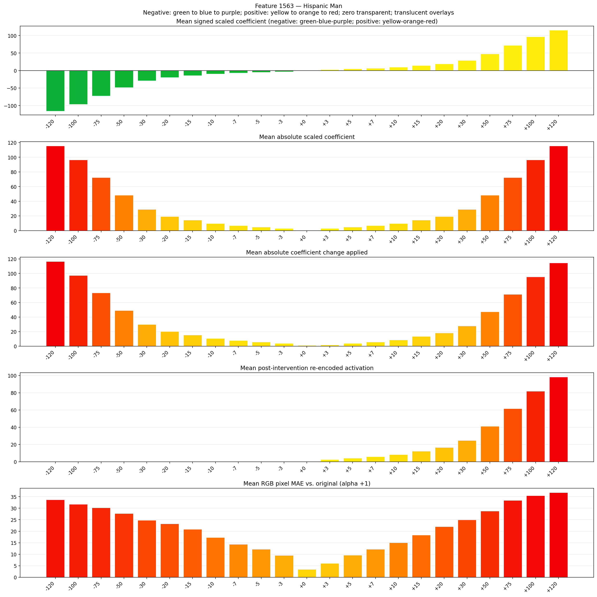
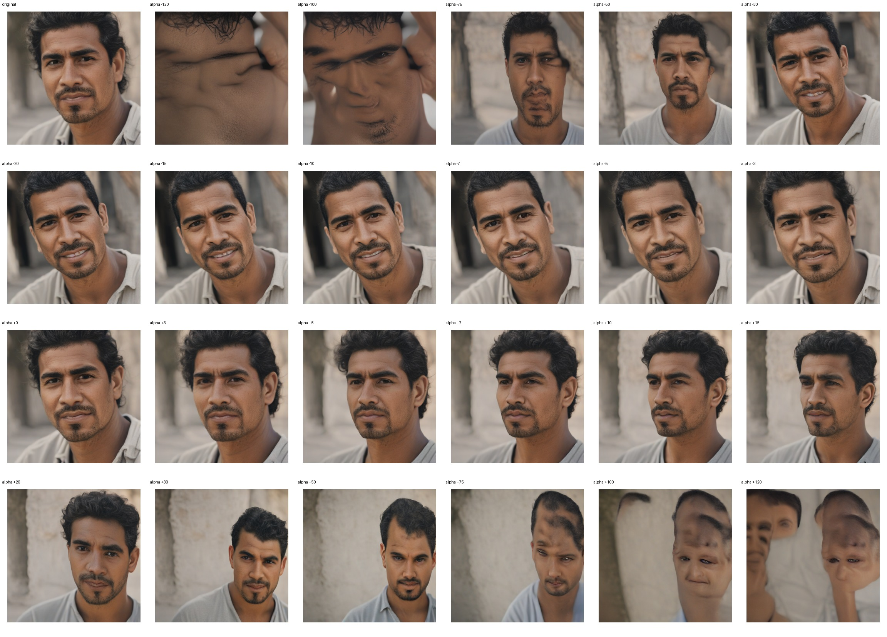
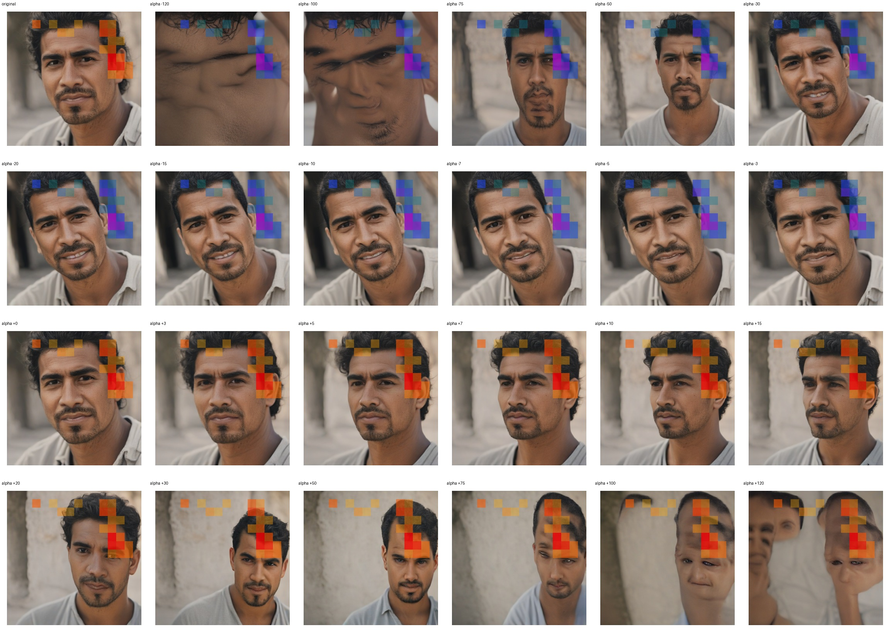
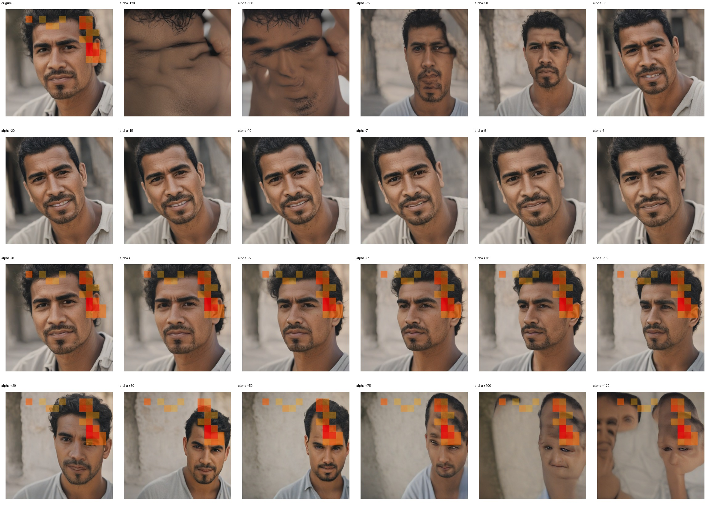

# Feature 1563 — Hispanic Man

Biased dataset; original prompt and seed replay for seeds 0–19. Values are means across 20 source images. The table reports the mean post-re-encoded activation of feature 1563, the active spatial fraction, mean RGB pixel MAE versus the original image (0–255 scale), and coefficient change magnitudes for each alpha.

## Activation graph

## Mean metrics by alpha

| Alpha | Mean post-reencoded feature 1563 activation | Active spatial fraction | Mean pixel change (MAE) | Mean absolute coefficient change | Mean absolute scaled coefficient |
|---:|---:|---:|---:|---:|---:|
| -120 | 0.000 | 0.000 | 33.708 | 116.556 | 115.592 |
| -100 | 0.000 | 0.000 | 31.724 | 97.290 | 96.327 |
| -75 | 0.000 | 0.000 | 30.249 | 73.209 | 72.245 |
| -50 | 0.000 | 0.000 | 27.754 | 49.127 | 48.163 |
| -30 | 0.000 | 0.000 | 24.786 | 29.861 | 28.898 |
| -20 | 0.000 | 0.000 | 23.277 | 20.229 | 19.265 |
| -15 | 0.000 | 0.000 | 20.835 | 15.412 | 14.449 |
| -10 | 0.000 | 0.000 | 17.287 | 10.596 | 9.633 |
| -7 | 0.000 | 0.000 | 14.361 | 7.706 | 6.743 |
| -5 | 0.000 | 0.000 | 12.213 | 5.780 | 4.816 |
| -3 | 0.000 | 0.000 | 9.540 | 3.853 | 2.890 |
| +0 | 0.000 | 0.000 | 3.451 | 0.963 | 0.000 |
| +3 | 2.600 | 0.057 | 6.050 | 1.927 | 2.890 |
| +5 | 4.236 | 0.057 | 9.606 | 3.853 | 4.816 |
| +7 | 5.872 | 0.057 | 12.180 | 5.780 | 6.743 |
| +10 | 8.327 | 0.057 | 15.042 | 8.669 | 9.633 |
| +15 | 12.418 | 0.057 | 18.352 | 13.486 | 14.449 |
| +20 | 16.509 | 0.057 | 21.989 | 18.302 | 19.265 |
| +30 | 24.691 | 0.057 | 24.951 | 27.935 | 28.898 |
| +50 | 41.054 | 0.057 | 28.757 | 47.200 | 48.163 |
| +75 | 61.509 | 0.057 | 33.468 | 71.282 | 72.245 |
| +100 | 81.963 | 0.057 | 35.503 | 95.364 | 96.327 |
| +120 | 98.327 | 0.057 | 36.825 | 114.629 | 115.592 |

## Per-seed grids

Each 4×6 sheet contains the original followed by the 23 alpha variants in ascending alpha order, from −120 through +120.

### Plain images

[All 20 plain-image grids](seed_sheets/)

### Signed coefficient overlays

[All 20 signed coefficient grids](signed_coefficient_overlays/)

### Post-re-encoded activation overlays

[All 20 post-activation grids](post_activation_overlays/)

### Intervention-footprint overlays

[All 20 intervention-footprint grids](intervention_footprint_overlays/)

Zero is transparent. Negative coefficient colors progress green through blue to purple; positive colors progress yellow through orange to red. Each map tile is normalized individually for visibility. The original and alpha-zero tiles show the pre-intervention feature map so its location remains visible.
