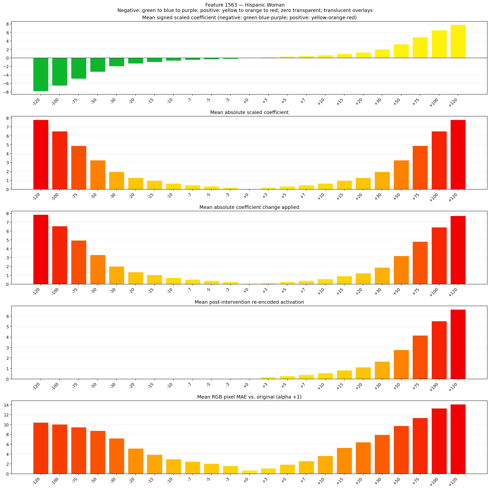
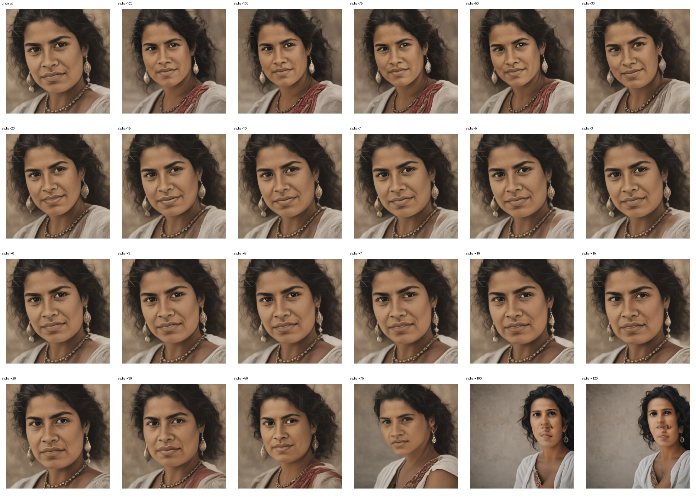
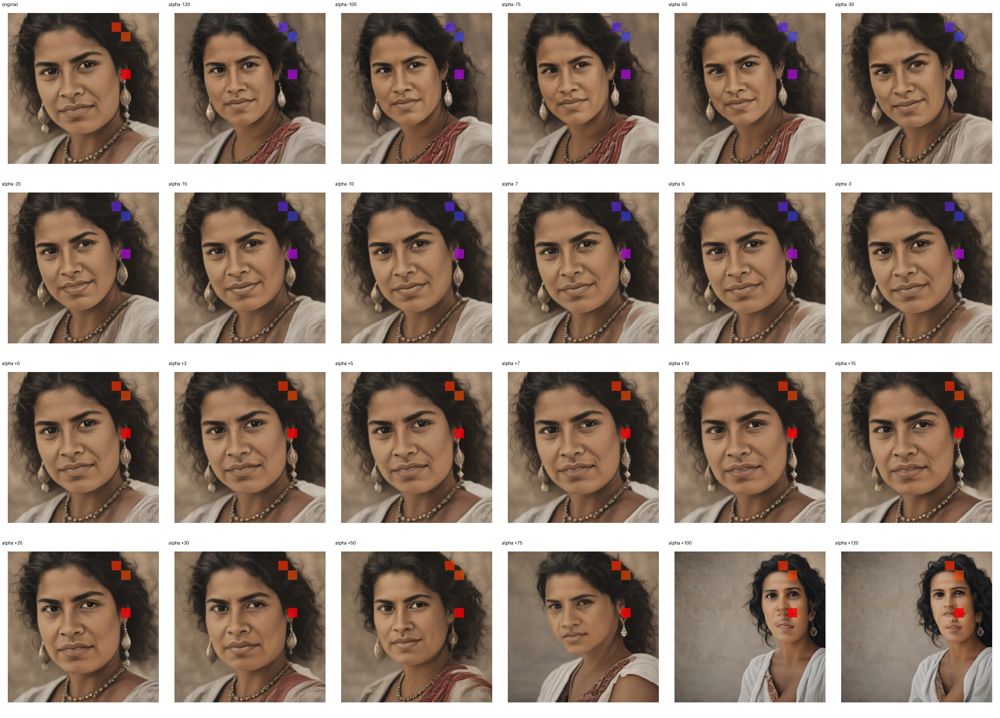
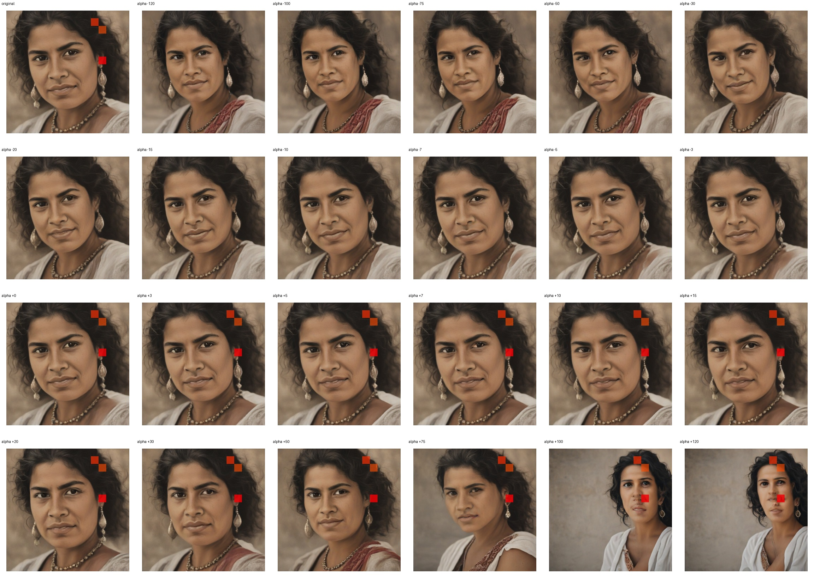

# Feature 1563 — Hispanic Woman

Biased dataset; original prompt and seed replay for seeds 0–19. Values are means across 20 source images. The table reports the mean post-re-encoded activation of feature 1563, the active spatial fraction, mean RGB pixel MAE versus the original image (0–255 scale), and coefficient change magnitudes for each alpha.

## Activation graph

## Mean metrics by alpha

| Alpha | Mean post-reencoded feature 1563 activation | Active spatial fraction | Mean pixel change (MAE) | Mean absolute coefficient change | Mean absolute scaled coefficient |
|---:|---:|---:|---:|---:|---:|
| -120 | 0.000 | 0.000 | 10.430 | 7.872 | 7.807 |
| -100 | 0.000 | 0.000 | 10.061 | 6.571 | 6.506 |
| -75 | 0.000 | 0.000 | 9.459 | 4.945 | 4.879 |
| -50 | 0.000 | 0.000 | 8.742 | 3.318 | 3.253 |
| -30 | 0.000 | 0.000 | 7.221 | 2.017 | 1.952 |
| -20 | 0.000 | 0.000 | 5.154 | 1.366 | 1.301 |
| -15 | 0.000 | 0.000 | 3.904 | 1.041 | 0.976 |
| -10 | 0.000 | 0.000 | 2.970 | 0.716 | 0.651 |
| -7 | 0.000 | 0.000 | 2.477 | 0.520 | 0.455 |
| -5 | 0.000 | 0.000 | 2.096 | 0.390 | 0.325 |
| -3 | 0.000 | 0.000 | 1.630 | 0.260 | 0.195 |
| +0 | 0.000 | 0.000 | 0.708 | 0.065 | 0.000 |
| +3 | 0.176 | 0.005 | 1.126 | 0.130 | 0.195 |
| +5 | 0.286 | 0.005 | 1.868 | 0.260 | 0.325 |
| +7 | 0.397 | 0.005 | 2.588 | 0.390 | 0.455 |
| +10 | 0.562 | 0.005 | 3.651 | 0.586 | 0.651 |
| +15 | 0.839 | 0.005 | 5.285 | 0.911 | 0.976 |
| +20 | 1.115 | 0.005 | 6.423 | 1.236 | 1.301 |
| +30 | 1.668 | 0.005 | 7.931 | 1.887 | 1.952 |
| +50 | 2.773 | 0.005 | 9.741 | 3.188 | 3.253 |
| +75 | 4.154 | 0.005 | 11.333 | 4.814 | 4.879 |
| +100 | 5.536 | 0.005 | 13.288 | 6.441 | 6.506 |
| +120 | 6.641 | 0.005 | 14.122 | 7.742 | 7.807 |

## Per-seed grids

Each 4×6 sheet contains the original followed by the 23 alpha variants in ascending alpha order, from −120 through +120.

### Plain images

[All 20 plain-image grids](seed_sheets/)

### Signed coefficient overlays

[All 20 signed coefficient grids](signed_coefficient_overlays/)

### Post-re-encoded activation overlays

[All 20 post-activation grids](post_activation_overlays/)

### Intervention-footprint overlays

[All 20 intervention-footprint grids](intervention_footprint_overlays/)

Zero is transparent. Negative coefficient colors progress green through blue to purple; positive colors progress yellow through orange to red. Each map tile is normalized individually for visibility. The original and alpha-zero tiles show the pre-intervention feature map so its location remains visible.
