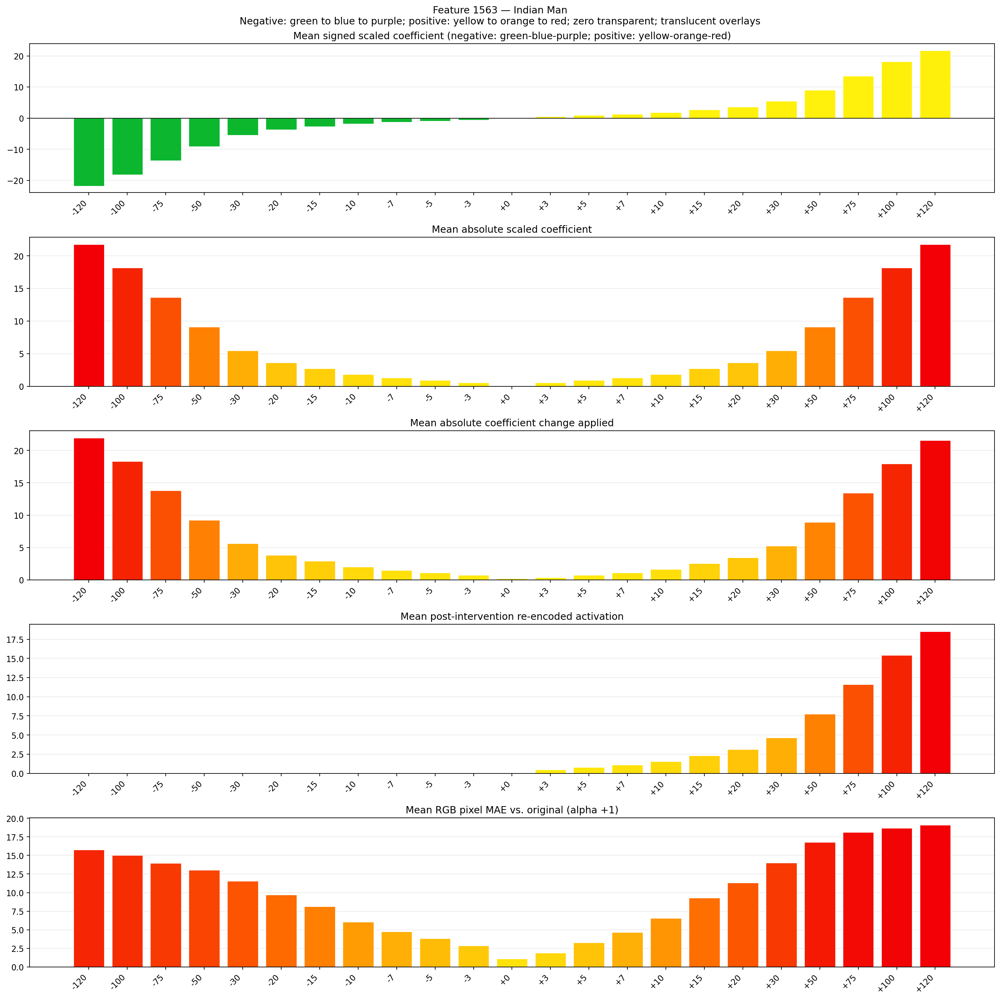
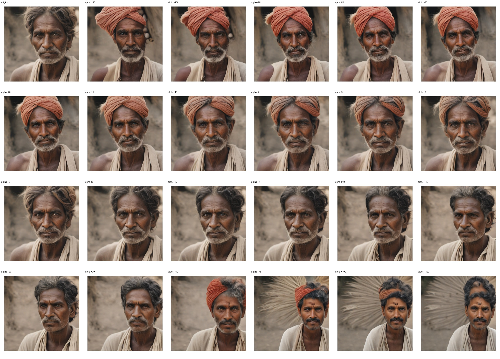
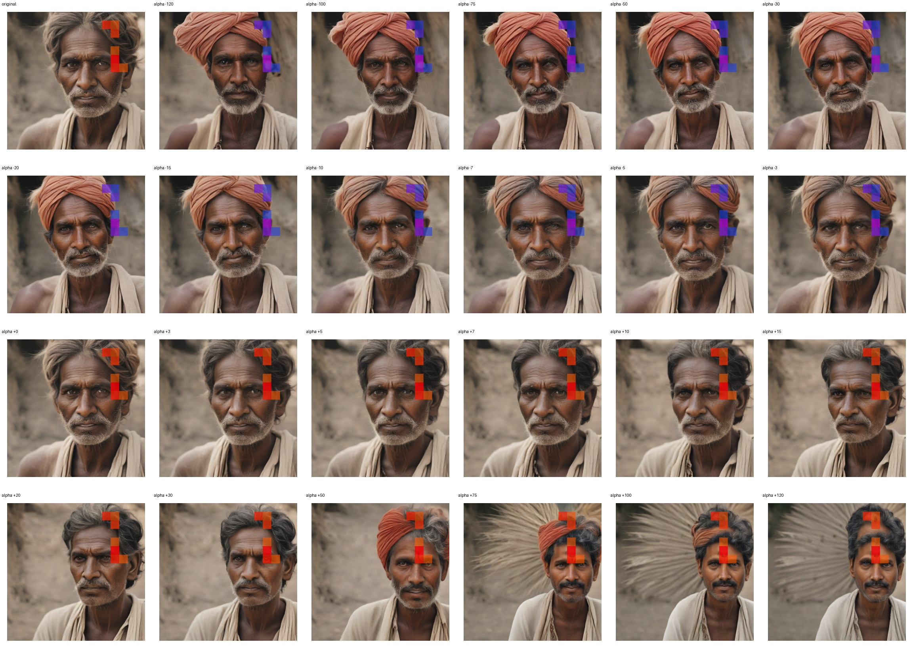
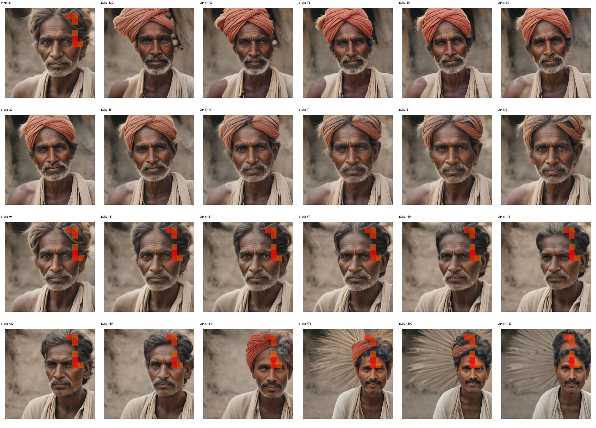

# Feature 1563 — Indian Man

Biased dataset; original prompt and seed replay for seeds 0–19. Values are means across 20 source images. The table reports the mean post-re-encoded activation of feature 1563, the active spatial fraction, mean RGB pixel MAE versus the original image (0–255 scale), and coefficient change magnitudes for each alpha.

## Activation graph

## Mean metrics by alpha

| Alpha | Mean post-reencoded feature 1563 activation | Active spatial fraction | Mean pixel change (MAE) | Mean absolute coefficient change | Mean absolute scaled coefficient |
|---:|---:|---:|---:|---:|---:|
| -120 | 0.000 | 0.000 | 15.765 | 21.953 | 21.771 |
| -100 | 0.000 | 0.000 | 14.997 | 18.324 | 18.143 |
| -75 | 0.000 | 0.000 | 13.966 | 13.788 | 13.607 |
| -50 | 0.000 | 0.000 | 13.012 | 9.253 | 9.071 |
| -30 | 0.000 | 0.000 | 11.546 | 5.624 | 5.443 |
| -20 | 0.000 | 0.000 | 9.695 | 3.810 | 3.629 |
| -15 | 0.000 | 0.000 | 8.111 | 2.903 | 2.721 |
| -10 | 0.000 | 0.000 | 6.047 | 1.996 | 1.814 |
| -7 | 0.000 | 0.000 | 4.736 | 1.451 | 1.270 |
| -5 | 0.000 | 0.000 | 3.829 | 1.089 | 0.907 |
| -3 | 0.000 | 0.000 | 2.866 | 0.726 | 0.544 |
| +0 | 0.000 | 0.000 | 1.078 | 0.181 | 0.000 |
| +3 | 0.490 | 0.012 | 1.885 | 0.363 | 0.544 |
| +5 | 0.798 | 0.012 | 3.295 | 0.726 | 0.907 |
| +7 | 1.106 | 0.012 | 4.667 | 1.089 | 1.270 |
| +10 | 1.568 | 0.012 | 6.575 | 1.633 | 1.814 |
| +15 | 2.339 | 0.012 | 9.306 | 2.540 | 2.721 |
| +20 | 3.109 | 0.012 | 11.318 | 3.447 | 3.629 |
| +30 | 4.650 | 0.012 | 13.995 | 5.261 | 5.443 |
| +50 | 7.732 | 0.012 | 16.797 | 8.890 | 9.071 |
| +75 | 11.585 | 0.012 | 18.121 | 13.426 | 13.607 |
| +100 | 15.437 | 0.012 | 18.675 | 17.961 | 18.143 |
| +120 | 18.519 | 0.012 | 19.090 | 21.590 | 21.771 |

## Per-seed grids

Each 4×6 sheet contains the original followed by the 23 alpha variants in ascending alpha order, from −120 through +120.

### Plain images

[All 20 plain-image grids](seed_sheets/)

### Signed coefficient overlays

[All 20 signed coefficient grids](signed_coefficient_overlays/)

### Post-re-encoded activation overlays

[All 20 post-activation grids](post_activation_overlays/)

### Intervention-footprint overlays

[All 20 intervention-footprint grids](intervention_footprint_overlays/)

Zero is transparent. Negative coefficient colors progress green through blue to purple; positive colors progress yellow through orange to red. Each map tile is normalized individually for visibility. The original and alpha-zero tiles show the pre-intervention feature map so its location remains visible.
