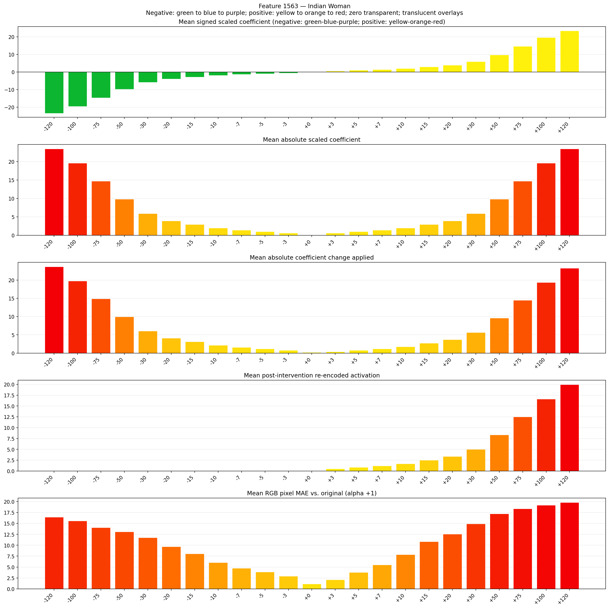
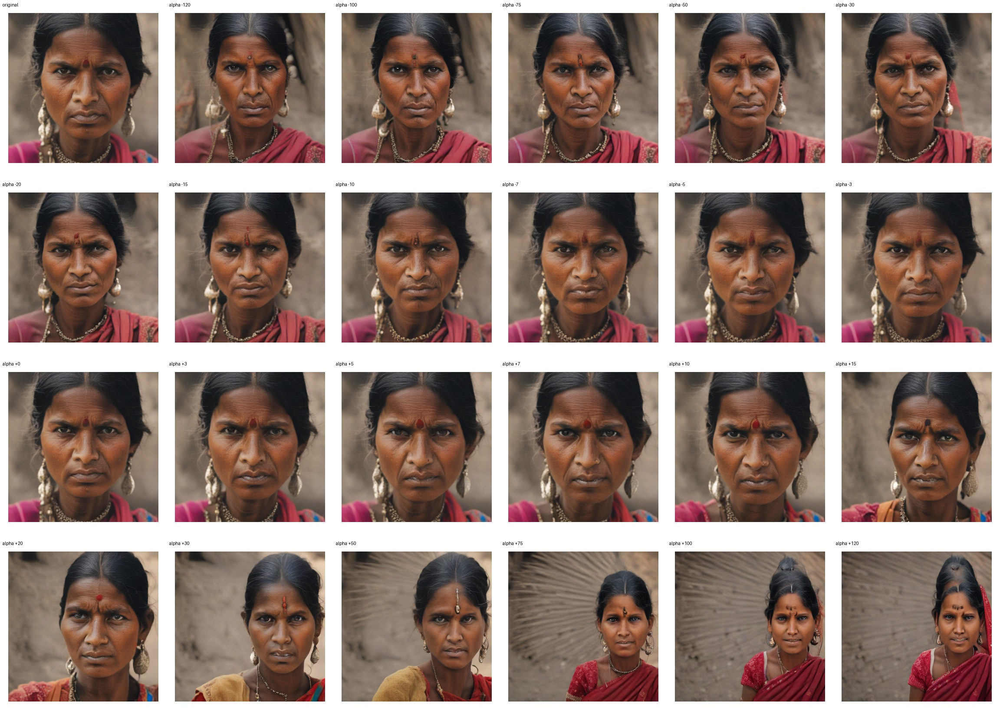
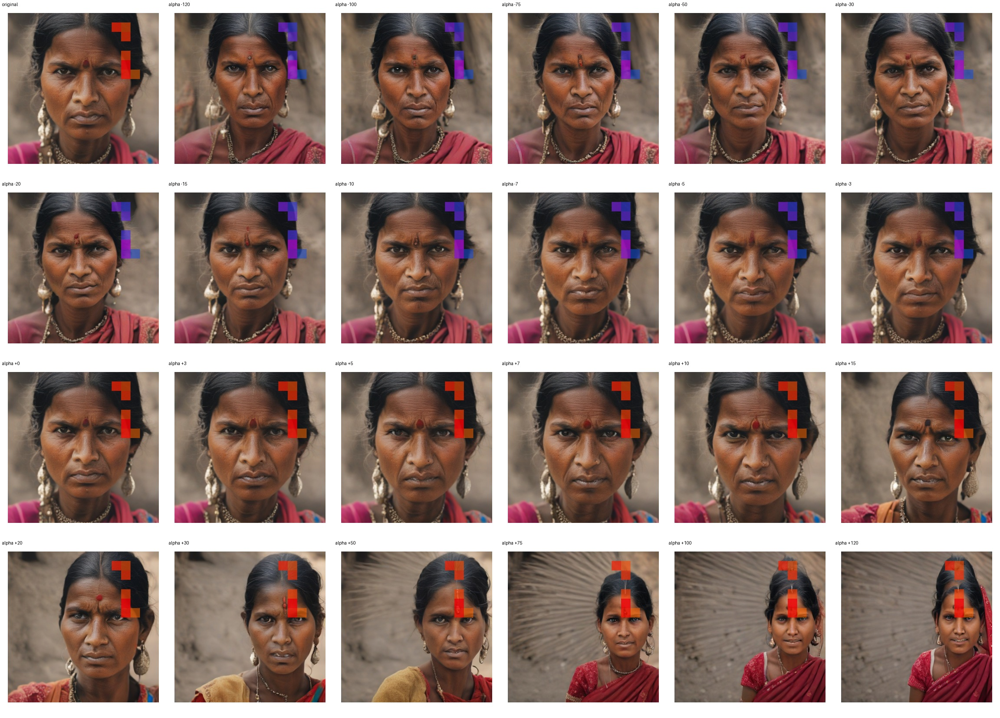
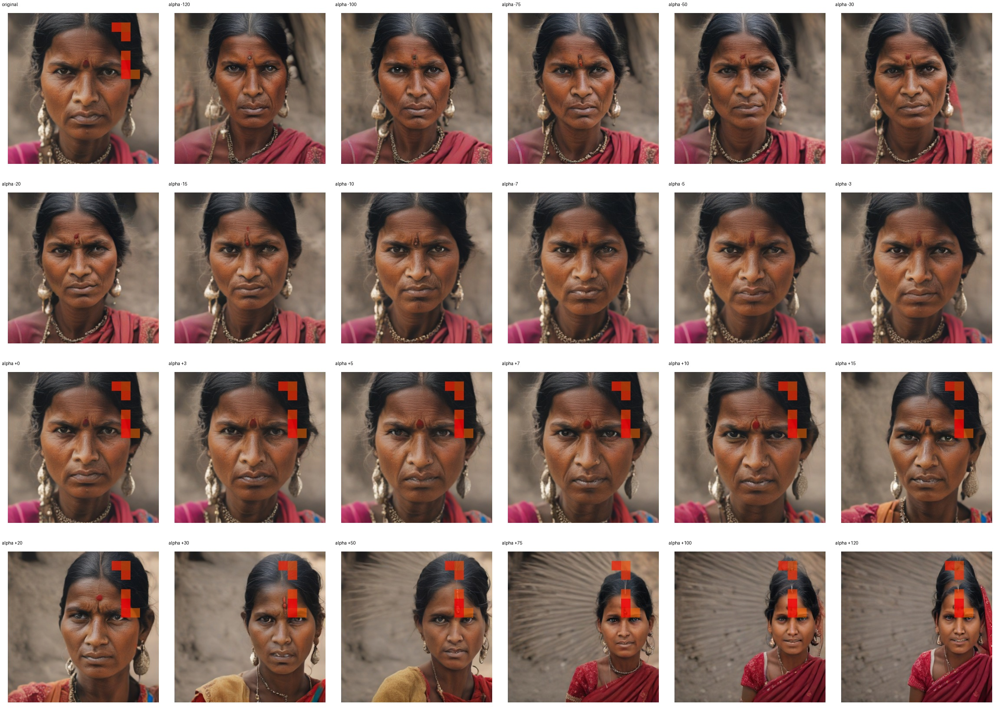

# Feature 1563 — Indian Woman

Biased dataset; original prompt and seed replay for seeds 0–19. Values are means across 20 source images. The table reports the mean post-re-encoded activation of feature 1563, the active spatial fraction, mean RGB pixel MAE versus the original image (0–255 scale), and coefficient change magnitudes for each alpha.

## Activation graph

## Mean metrics by alpha

| Alpha | Mean post-reencoded feature 1563 activation | Active spatial fraction | Mean pixel change (MAE) | Mean absolute coefficient change | Mean absolute scaled coefficient |
|---:|---:|---:|---:|---:|---:|
| -120 | 0.000 | 0.000 | 16.461 | 23.655 | 23.459 |
| -100 | 0.000 | 0.000 | 15.566 | 19.745 | 19.549 |
| -75 | 0.000 | 0.000 | 14.054 | 14.857 | 14.662 |
| -50 | 0.000 | 0.000 | 13.090 | 9.970 | 9.775 |
| -30 | 0.000 | 0.000 | 11.768 | 6.060 | 5.865 |
| -20 | 0.000 | 0.000 | 9.704 | 4.105 | 3.910 |
| -15 | 0.000 | 0.000 | 8.058 | 3.128 | 2.932 |
| -10 | 0.000 | 0.000 | 6.046 | 2.150 | 1.955 |
| -7 | 0.000 | 0.000 | 4.759 | 1.564 | 1.368 |
| -5 | 0.000 | 0.000 | 3.872 | 1.173 | 0.977 |
| -3 | 0.000 | 0.000 | 2.908 | 0.782 | 0.586 |
| +0 | 0.000 | 0.000 | 1.132 | 0.195 | 0.000 |
| +3 | 0.528 | 0.012 | 2.084 | 0.391 | 0.586 |
| +5 | 0.860 | 0.012 | 3.792 | 0.782 | 0.977 |
| +7 | 1.192 | 0.012 | 5.497 | 1.173 | 1.368 |
| +10 | 1.690 | 0.012 | 7.872 | 1.759 | 1.955 |
| +15 | 2.520 | 0.012 | 10.853 | 2.737 | 2.932 |
| +20 | 3.350 | 0.012 | 12.548 | 3.714 | 3.910 |
| +30 | 5.011 | 0.012 | 14.890 | 5.669 | 5.865 |
| +50 | 8.332 | 0.012 | 17.211 | 9.579 | 9.775 |
| +75 | 12.483 | 0.012 | 18.358 | 14.466 | 14.662 |
| +100 | 16.634 | 0.012 | 19.168 | 19.354 | 19.549 |
| +120 | 19.955 | 0.012 | 19.810 | 23.264 | 23.459 |

## Per-seed grids

Each 4×6 sheet contains the original followed by the 23 alpha variants in ascending alpha order, from −120 through +120.

### Plain images

[All 20 plain-image grids](seed_sheets/)

### Signed coefficient overlays

[All 20 signed coefficient grids](signed_coefficient_overlays/)

### Post-re-encoded activation overlays

[All 20 post-activation grids](post_activation_overlays/)

### Intervention-footprint overlays

[All 20 intervention-footprint grids](intervention_footprint_overlays/)

Zero is transparent. Negative coefficient colors progress green through blue to purple; positive colors progress yellow through orange to red. Each map tile is normalized individually for visibility. The original and alpha-zero tiles show the pre-intervention feature map so its location remains visible.
