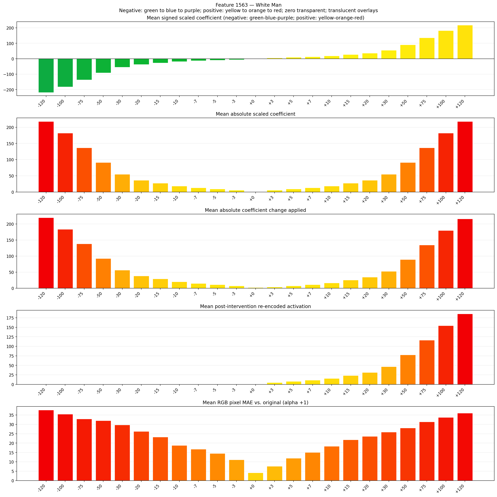
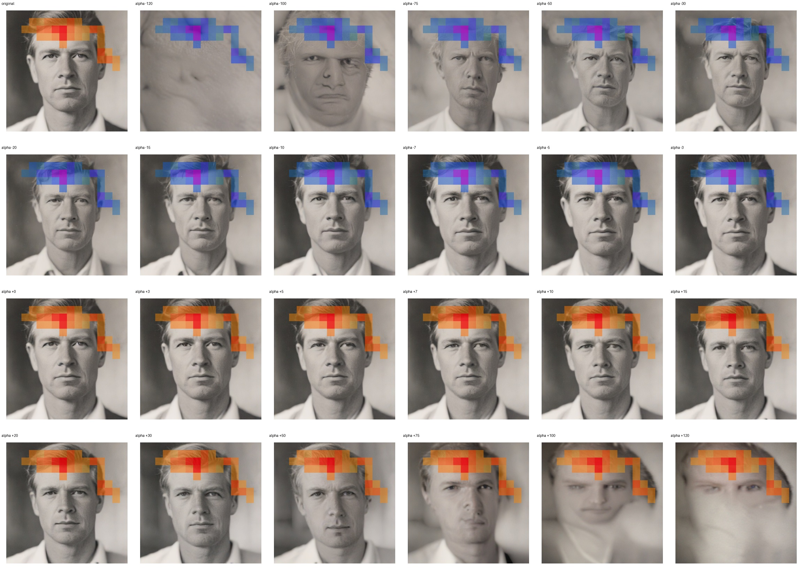
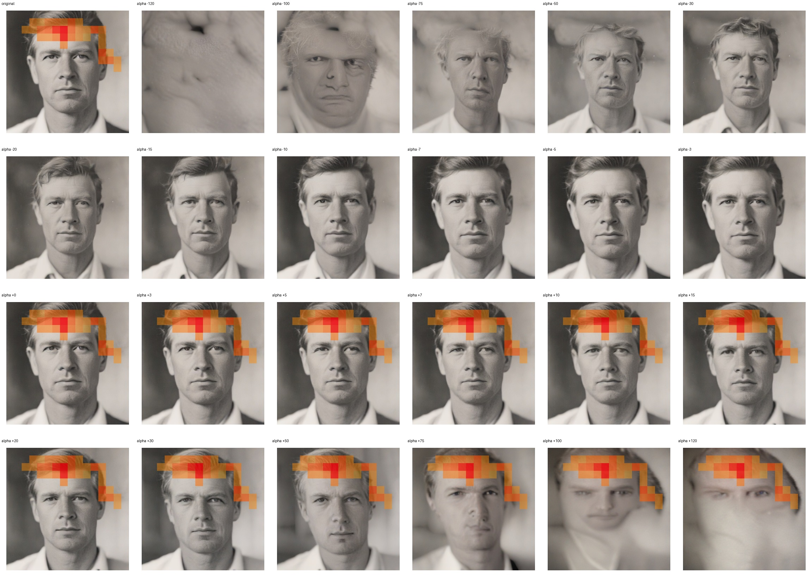

# Feature 1563 — White Man

Biased dataset; original prompt and seed replay for seeds 0–19. Values are means across 20 source images. The table reports the mean post-re-encoded activation of feature 1563, the active spatial fraction, mean RGB pixel MAE versus the original image (0–255 scale), and coefficient change magnitudes for each alpha.

## Activation graph

## Mean metrics by alpha

| Alpha | Mean post-reencoded feature 1563 activation | Active spatial fraction | Mean pixel change (MAE) | Mean absolute coefficient change | Mean absolute scaled coefficient |
|---:|---:|---:|---:|---:|---:|
| -120 | 0.000 | 0.000 | 37.645 | 219.819 | 218.002 |
| -100 | 0.000 | 0.000 | 35.475 | 183.485 | 181.669 |
| -75 | 0.000 | 0.000 | 32.935 | 138.068 | 136.251 |
| -50 | 0.000 | 0.000 | 32.016 | 92.651 | 90.834 |
| -30 | 0.000 | 0.000 | 29.742 | 56.317 | 54.501 |
| -20 | 0.000 | 0.000 | 26.203 | 38.150 | 36.334 |
| -15 | 0.000 | 0.000 | 23.187 | 29.067 | 27.250 |
| -10 | 0.000 | 0.000 | 18.762 | 19.984 | 18.167 |
| -7 | 0.000 | 0.000 | 16.743 | 14.533 | 12.717 |
| -5 | 0.000 | 0.000 | 14.444 | 10.900 | 9.083 |
| -3 | 0.000 | 0.000 | 11.088 | 7.267 | 5.450 |
| +0 | 0.000 | 0.000 | 4.177 | 1.817 | 0.000 |
| +3 | 4.903 | 0.105 | 7.597 | 3.633 | 5.450 |
| +5 | 7.989 | 0.105 | 11.922 | 7.267 | 9.083 |
| +7 | 11.075 | 0.105 | 15.016 | 10.900 | 12.717 |
| +10 | 15.704 | 0.105 | 18.300 | 16.350 | 18.167 |
| +15 | 23.419 | 0.105 | 21.776 | 25.434 | 27.250 |
| +20 | 31.135 | 0.105 | 23.622 | 34.517 | 36.334 |
| +30 | 46.565 | 0.105 | 25.874 | 52.684 | 54.501 |
| +50 | 77.427 | 0.105 | 28.050 | 89.018 | 90.834 |
| +75 | 116.003 | 0.105 | 31.308 | 134.435 | 136.251 |
| +100 | 154.579 | 0.105 | 33.726 | 179.852 | 181.669 |
| +120 | 185.441 | 0.105 | 35.949 | 216.186 | 218.002 |

## Per-seed grids

Each 4×6 sheet contains the original followed by the 23 alpha variants in ascending alpha order, from −120 through +120.

### Plain images

[All 20 plain-image grids](seed_sheets/)

### Signed coefficient overlays

[All 20 signed coefficient grids](signed_coefficient_overlays/)

### Post-re-encoded activation overlays

[All 20 post-activation grids](post_activation_overlays/)

### Intervention-footprint overlays

[All 20 intervention-footprint grids](intervention_footprint_overlays/)

Zero is transparent. Negative coefficient colors progress green through blue to purple; positive colors progress yellow through orange to red. Each map tile is normalized individually for visibility. The original and alpha-zero tiles show the pre-intervention feature map so its location remains visible.
