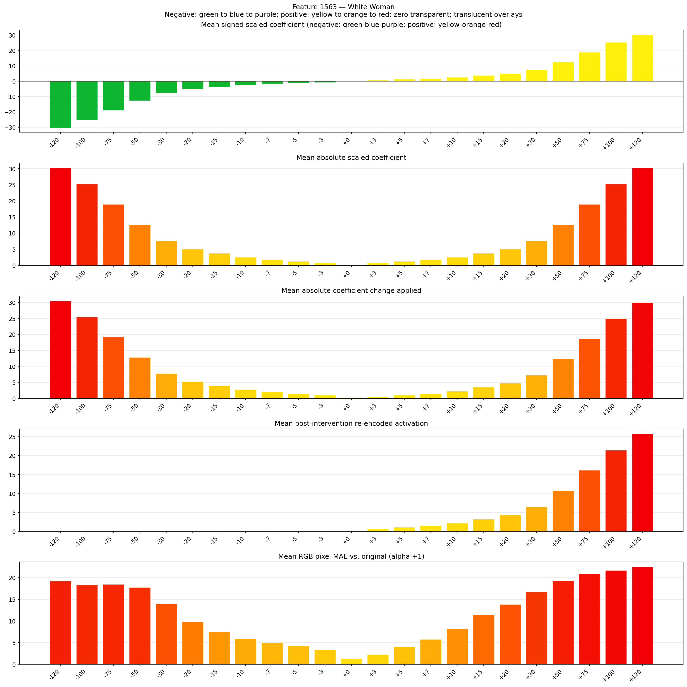
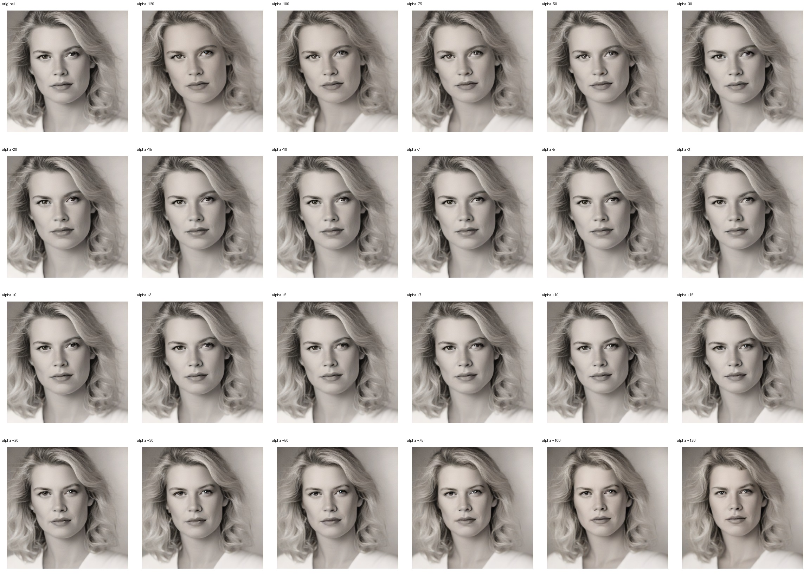
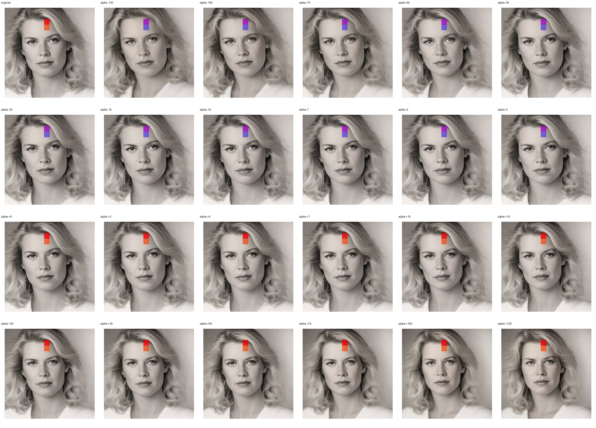
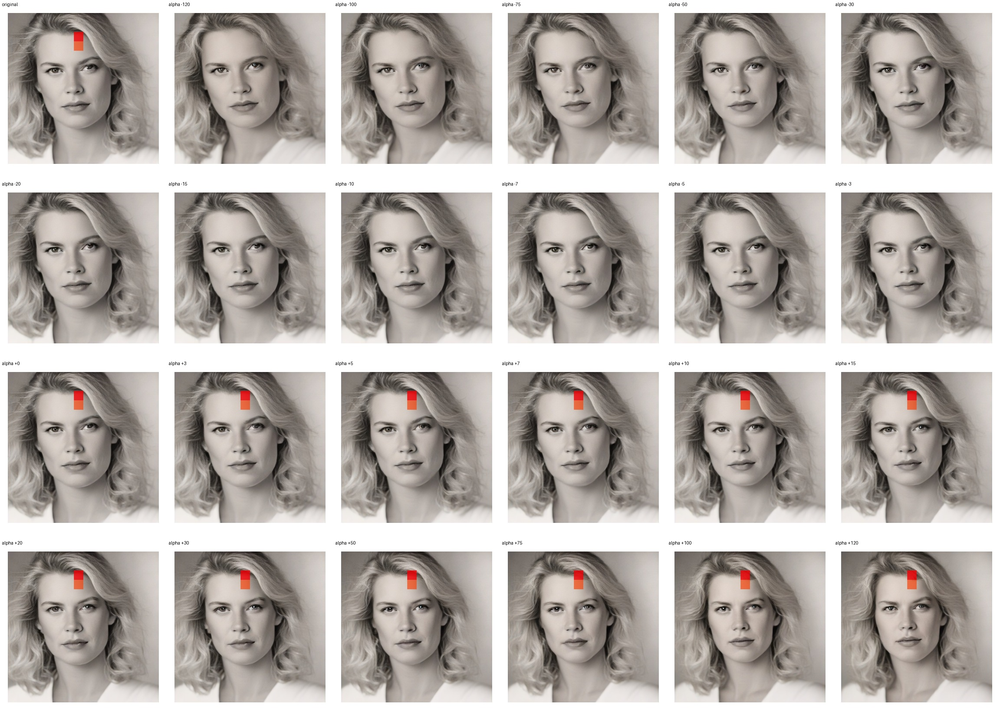

# Feature 1563 — White Woman

Biased dataset; original prompt and seed replay for seeds 0–19. Values are means across 20 source images. The table reports the mean post-re-encoded activation of feature 1563, the active spatial fraction, mean RGB pixel MAE versus the original image (0–255 scale), and coefficient change magnitudes for each alpha.

## Activation graph

## Mean metrics by alpha

| Alpha | Mean post-reencoded feature 1563 activation | Active spatial fraction | Mean pixel change (MAE) | Mean absolute coefficient change | Mean absolute scaled coefficient |
|---:|---:|---:|---:|---:|---:|
| -120 | 0.000 | 0.000 | 19.213 | 30.525 | 30.273 |
| -100 | 0.000 | 0.000 | 18.322 | 25.480 | 25.227 |
| -75 | 0.000 | 0.000 | 18.444 | 19.173 | 18.921 |
| -50 | 0.000 | 0.000 | 17.771 | 12.866 | 12.614 |
| -30 | 0.000 | 0.000 | 13.989 | 7.821 | 7.568 |
| -20 | 0.000 | 0.000 | 9.784 | 5.298 | 5.045 |
| -15 | 0.000 | 0.000 | 7.507 | 4.036 | 3.784 |
| -10 | 0.000 | 0.000 | 5.916 | 2.775 | 2.523 |
| -7 | 0.000 | 0.000 | 4.971 | 2.018 | 1.766 |
| -5 | 0.000 | 0.000 | 4.268 | 1.514 | 1.261 |
| -3 | 0.000 | 0.000 | 3.385 | 1.009 | 0.757 |
| +0 | 0.000 | 0.000 | 1.299 | 0.252 | 0.000 |
| +3 | 0.681 | 0.019 | 2.271 | 0.505 | 0.757 |
| +5 | 1.109 | 0.019 | 4.052 | 1.009 | 1.261 |
| +7 | 1.538 | 0.019 | 5.776 | 1.514 | 1.766 |
| +10 | 2.181 | 0.019 | 8.201 | 2.270 | 2.523 |
| +15 | 3.252 | 0.019 | 11.456 | 3.532 | 3.784 |
| +20 | 4.324 | 0.019 | 13.815 | 4.793 | 5.045 |
| +30 | 6.466 | 0.019 | 16.744 | 7.316 | 7.568 |
| +50 | 10.752 | 0.019 | 19.268 | 12.361 | 12.614 |
| +75 | 16.109 | 0.019 | 20.901 | 18.668 | 18.921 |
| +100 | 21.466 | 0.019 | 21.710 | 24.975 | 25.227 |
| +120 | 25.751 | 0.019 | 22.508 | 30.021 | 30.273 |

## Per-seed grids

Each 4×6 sheet contains the original followed by the 23 alpha variants in ascending alpha order, from −120 through +120.

### Plain images

[All 20 plain-image grids](seed_sheets/)

### Signed coefficient overlays

[All 20 signed coefficient grids](signed_coefficient_overlays/)

### Post-re-encoded activation overlays

[All 20 post-activation grids](post_activation_overlays/)

### Intervention-footprint overlays

[All 20 intervention-footprint grids](intervention_footprint_overlays/)

Zero is transparent. Negative coefficient colors progress green through blue to purple; positive colors progress yellow through orange to red. Each map tile is normalized individually for visibility. The original and alpha-zero tiles show the pre-intervention feature map so its location remains visible.
