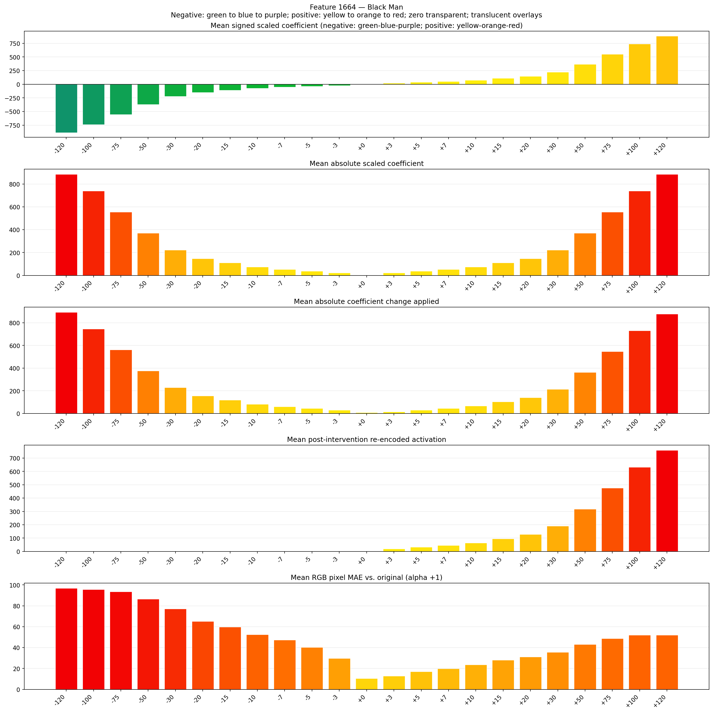
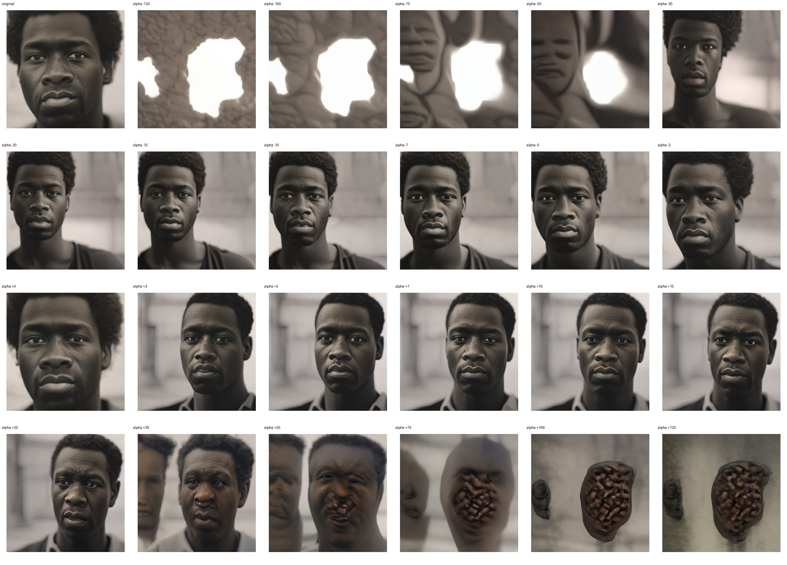
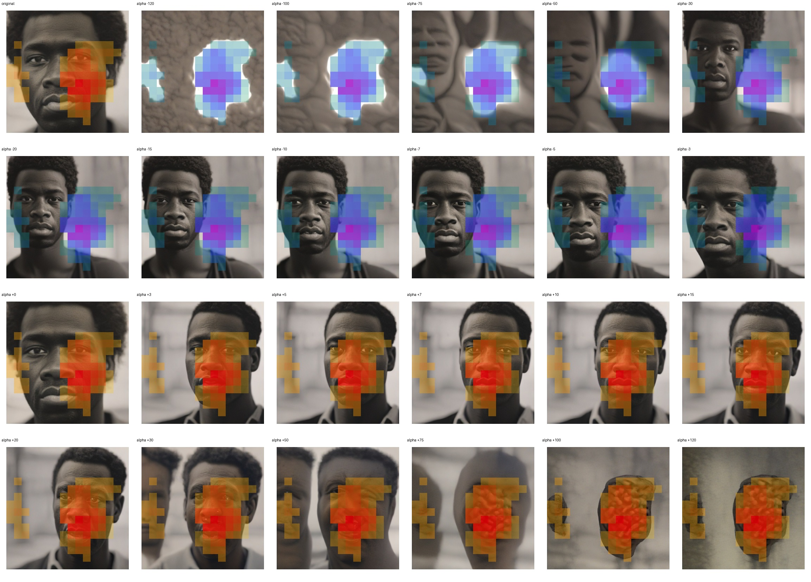
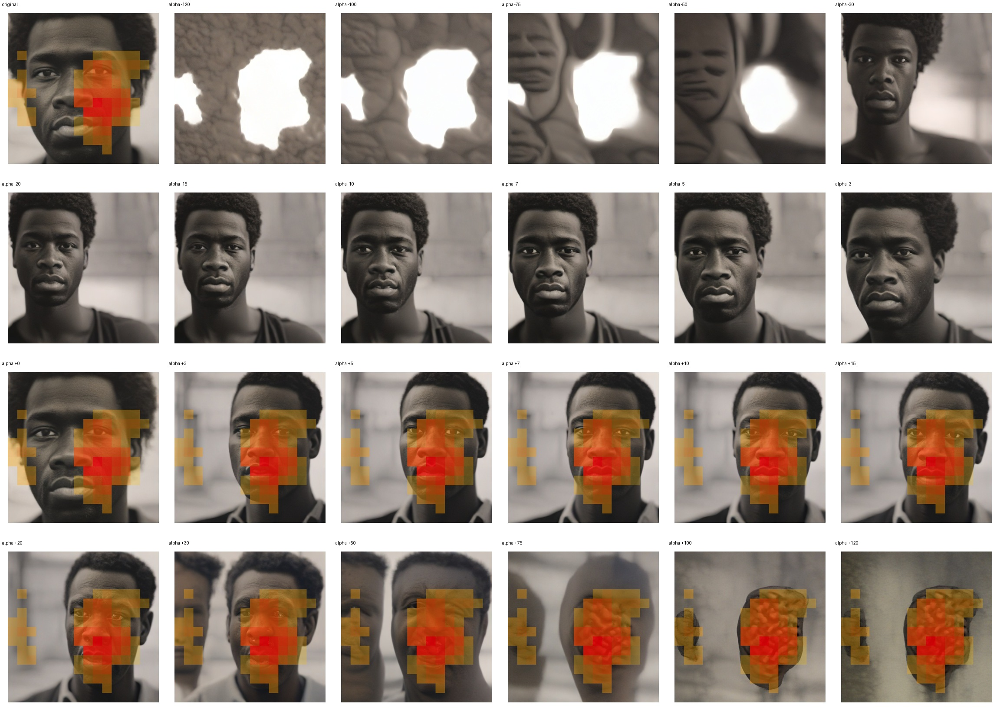

# Feature 1664 — Black Man

Biased dataset; original prompt and seed replay for seeds 0–19. Values are means across 20 source images. The table reports the mean post-re-encoded activation of feature 1664, the active spatial fraction, mean RGB pixel MAE versus the original image (0–255 scale), and coefficient change magnitudes for each alpha.

## Activation graph

## Mean metrics by alpha

| Alpha | Mean post-reencoded feature 1664 activation | Active spatial fraction | Mean pixel change (MAE) | Mean absolute coefficient change | Mean absolute scaled coefficient |
|---:|---:|---:|---:|---:|---:|
| -120 | 0.000 | 0.000 | 96.792 | 893.190 | 885.808 |
| -100 | 0.000 | 0.000 | 95.512 | 745.555 | 738.173 |
| -75 | 0.000 | 0.000 | 93.496 | 561.012 | 553.630 |
| -50 | 0.000 | 0.000 | 86.459 | 376.468 | 369.087 |
| -30 | 0.000 | 0.000 | 77.002 | 228.834 | 221.452 |
| -20 | 0.000 | 0.000 | 65.121 | 155.016 | 147.635 |
| -15 | 0.000 | 0.000 | 59.818 | 118.108 | 110.726 |
| -10 | 0.000 | 0.000 | 52.405 | 81.199 | 73.817 |
| -7 | 0.000 | 0.000 | 47.253 | 59.054 | 51.672 |
| -5 | 0.000 | 0.000 | 40.251 | 44.290 | 36.909 |
| -3 | 0.000 | 0.000 | 29.643 | 29.527 | 22.145 |
| +0 | 0.001 | 0.000 | 10.386 | 7.382 | 0.000 |
| +3 | 20.016 | 0.312 | 12.820 | 14.763 | 22.145 |
| +5 | 32.650 | 0.312 | 17.056 | 29.527 | 36.909 |
| +7 | 45.285 | 0.312 | 19.934 | 44.290 | 51.672 |
| +10 | 64.236 | 0.312 | 23.554 | 66.436 | 73.817 |
| +15 | 95.822 | 0.312 | 28.081 | 103.344 | 110.726 |
| +20 | 127.408 | 0.312 | 31.032 | 140.253 | 147.635 |
| +30 | 190.579 | 0.312 | 35.627 | 214.070 | 221.452 |
| +50 | 316.922 | 0.312 | 43.166 | 361.705 | 369.087 |
| +75 | 474.851 | 0.312 | 48.608 | 546.248 | 553.630 |
| +100 | 632.780 | 0.312 | 51.891 | 730.792 | 738.173 |
| +120 | 759.125 | 0.312 | 51.878 | 878.426 | 885.808 |

## Per-seed grids

Each 4×6 sheet contains the original followed by the 23 alpha variants in ascending alpha order, from −120 through +120.

### Plain images

[All 20 plain-image grids](seed_sheets/)

### Signed coefficient overlays

[All 20 signed coefficient grids](signed_coefficient_overlays/)

### Post-re-encoded activation overlays

[All 20 post-activation grids](post_activation_overlays/)

### Intervention-footprint overlays

[All 20 intervention-footprint grids](intervention_footprint_overlays/)

Zero is transparent. Negative coefficient colors progress green through blue to purple; positive colors progress yellow through orange to red. Each map tile is normalized individually for visibility. The original and alpha-zero tiles show the pre-intervention feature map so its location remains visible.
