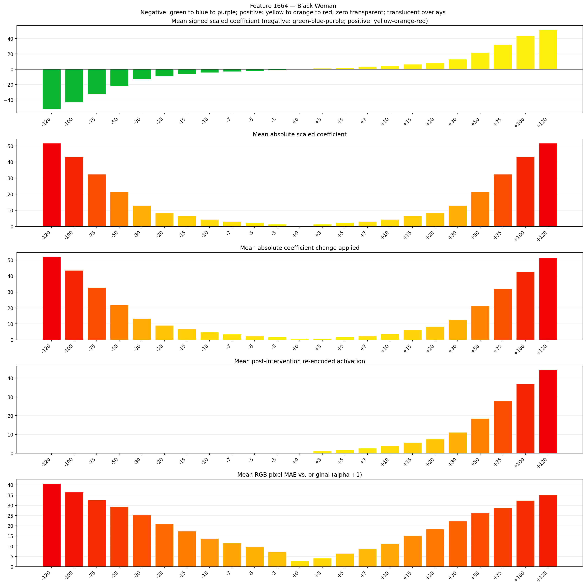
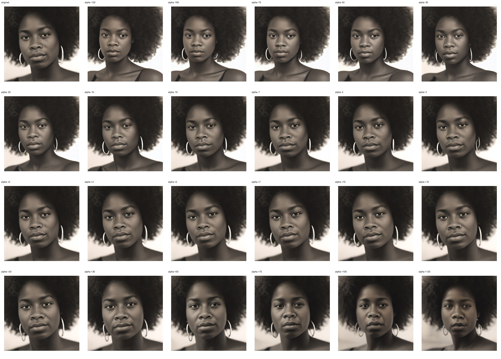
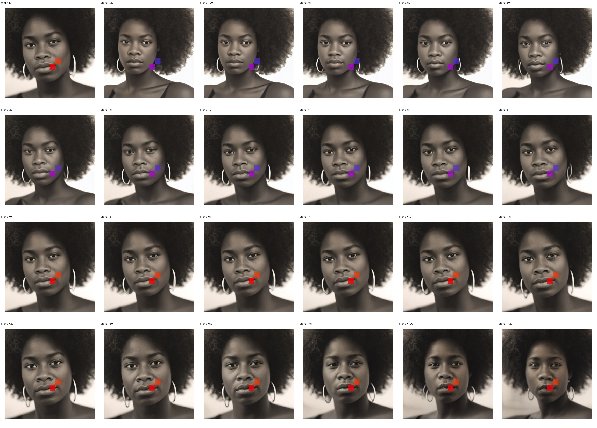
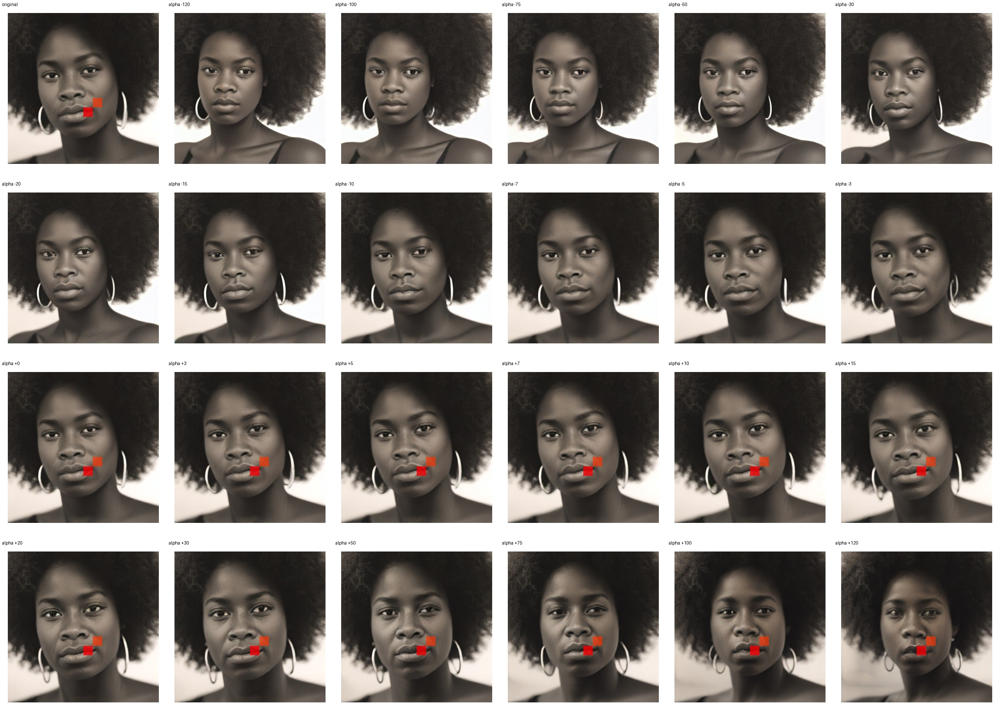

# Feature 1664 — Black Woman

Biased dataset; original prompt and seed replay for seeds 0–19. Values are means across 20 source images. The table reports the mean post-re-encoded activation of feature 1664, the active spatial fraction, mean RGB pixel MAE versus the original image (0–255 scale), and coefficient change magnitudes for each alpha.

## Activation graph

## Mean metrics by alpha

| Alpha | Mean post-reencoded feature 1664 activation | Active spatial fraction | Mean pixel change (MAE) | Mean absolute coefficient change | Mean absolute scaled coefficient |
|---:|---:|---:|---:|---:|---:|
| -120 | 0.000 | 0.000 | 40.710 | 52.145 | 51.714 |
| -100 | 0.000 | 0.000 | 36.465 | 43.526 | 43.095 |
| -75 | 0.000 | 0.000 | 32.725 | 32.752 | 32.321 |
| -50 | 0.000 | 0.000 | 29.267 | 21.979 | 21.548 |
| -30 | 0.000 | 0.000 | 25.193 | 13.360 | 12.929 |
| -20 | 0.000 | 0.000 | 20.872 | 9.050 | 8.619 |
| -15 | 0.000 | 0.000 | 17.360 | 6.895 | 6.464 |
| -10 | 0.000 | 0.000 | 13.813 | 4.740 | 4.310 |
| -7 | 0.000 | 0.000 | 11.556 | 3.448 | 3.017 |
| -5 | 0.000 | 0.000 | 9.661 | 2.586 | 2.155 |
| -3 | 0.000 | 0.000 | 7.413 | 1.724 | 1.293 |
| +0 | 0.000 | 0.000 | 2.717 | 0.431 | 0.000 |
| +3 | 1.169 | 0.029 | 4.104 | 0.862 | 1.293 |
| +5 | 1.906 | 0.029 | 6.491 | 1.724 | 2.155 |
| +7 | 2.644 | 0.029 | 8.528 | 2.586 | 3.017 |
| +10 | 3.750 | 0.029 | 11.224 | 3.879 | 4.310 |
| +15 | 5.594 | 0.029 | 15.312 | 6.033 | 6.464 |
| +20 | 7.438 | 0.029 | 18.305 | 8.188 | 8.619 |
| +30 | 11.126 | 0.029 | 22.218 | 12.498 | 12.929 |
| +50 | 18.502 | 0.029 | 26.247 | 21.117 | 21.548 |
| +75 | 27.722 | 0.029 | 28.729 | 31.890 | 32.321 |
| +100 | 36.942 | 0.029 | 32.369 | 42.664 | 43.095 |
| +120 | 44.318 | 0.029 | 35.131 | 51.283 | 51.714 |

## Per-seed grids

Each 4×6 sheet contains the original followed by the 23 alpha variants in ascending alpha order, from −120 through +120.

### Plain images

[All 20 plain-image grids](seed_sheets/)

### Signed coefficient overlays

[All 20 signed coefficient grids](signed_coefficient_overlays/)

### Post-re-encoded activation overlays

[All 20 post-activation grids](post_activation_overlays/)

### Intervention-footprint overlays

[All 20 intervention-footprint grids](intervention_footprint_overlays/)

Zero is transparent. Negative coefficient colors progress green through blue to purple; positive colors progress yellow through orange to red. Each map tile is normalized individually for visibility. The original and alpha-zero tiles show the pre-intervention feature map so its location remains visible.
