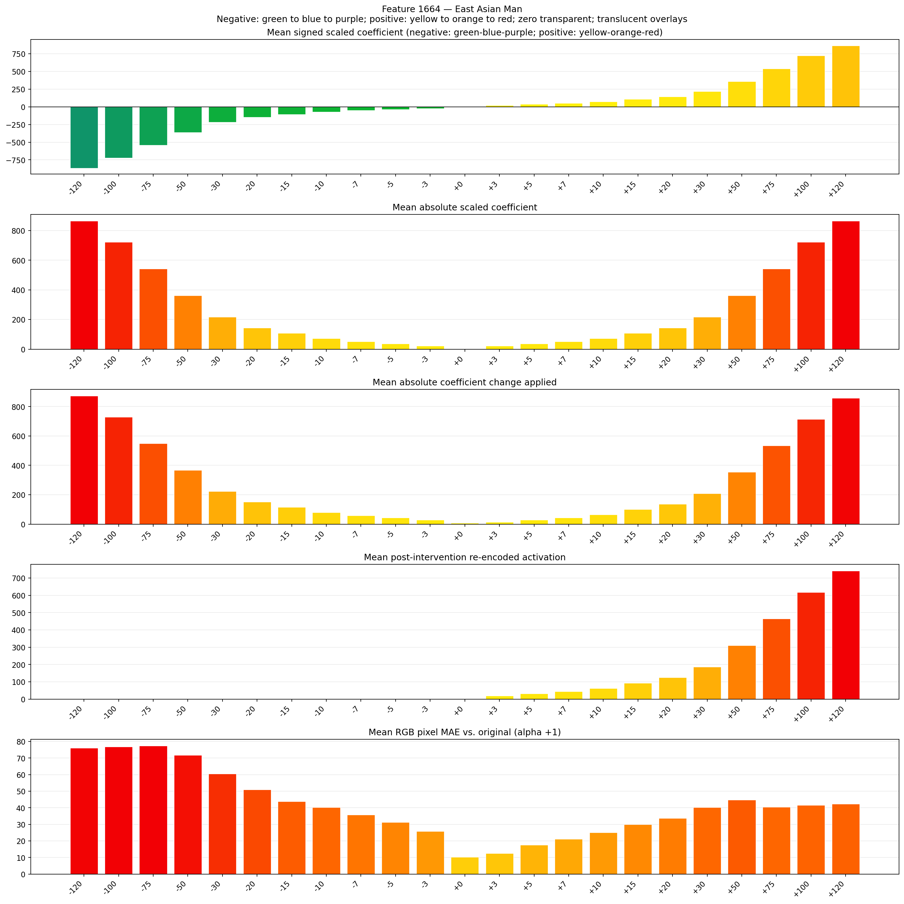
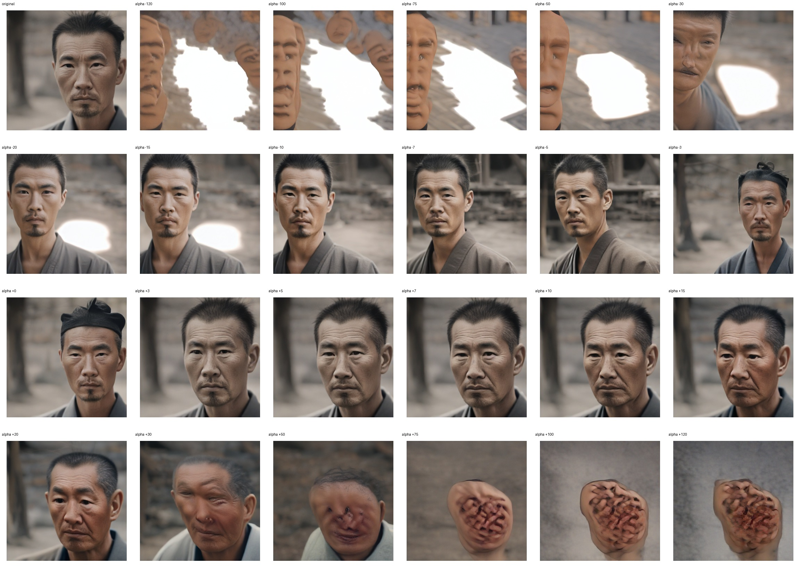
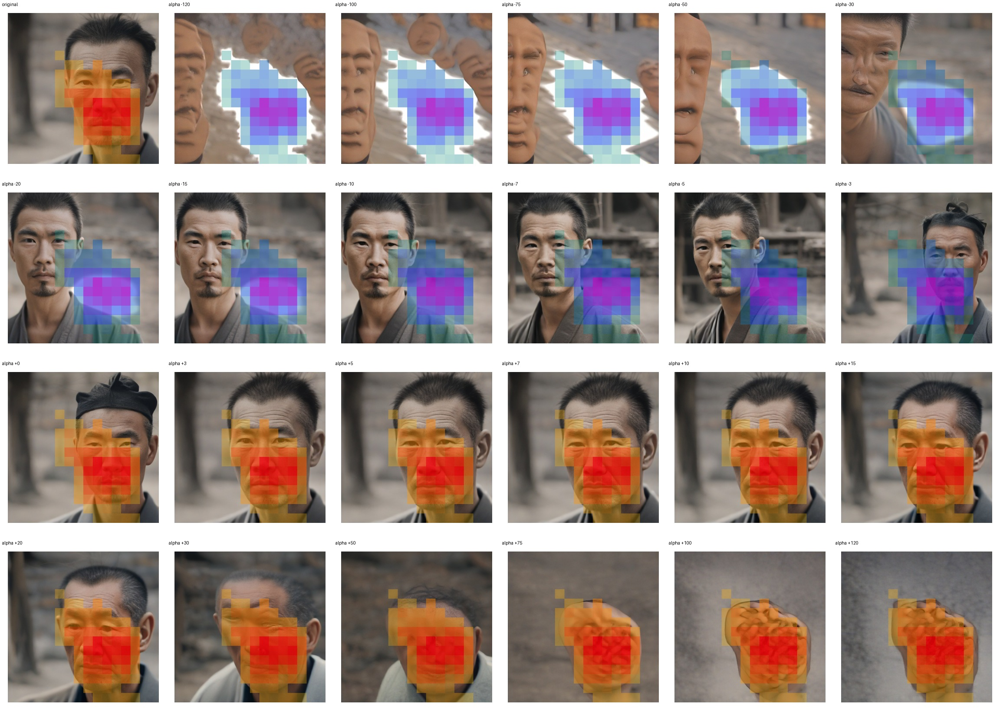
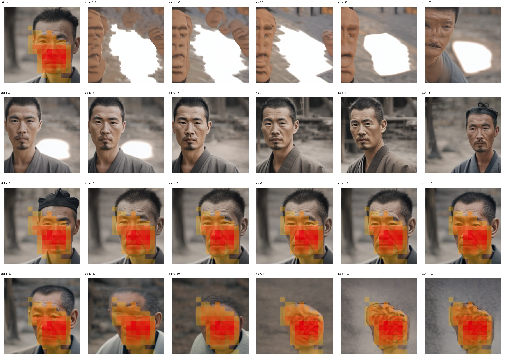

# Feature 1664 — East Asian Man

Biased dataset; original prompt and seed replay for seeds 0–19. Values are means across 20 source images. The table reports the mean post-re-encoded activation of feature 1664, the active spatial fraction, mean RGB pixel MAE versus the original image (0–255 scale), and coefficient change magnitudes for each alpha.

## Activation graph

## Mean metrics by alpha

| Alpha | Mean post-reencoded feature 1664 activation | Active spatial fraction | Mean pixel change (MAE) | Mean absolute coefficient change | Mean absolute scaled coefficient |
|---:|---:|---:|---:|---:|---:|
| -120 | 0.000 | 0.000 | 76.085 | 872.855 | 865.642 |
| -100 | 0.000 | 0.000 | 76.868 | 728.582 | 721.368 |
| -75 | 0.000 | 0.000 | 77.376 | 548.240 | 541.026 |
| -50 | 0.000 | 0.000 | 71.795 | 367.898 | 360.684 |
| -30 | 0.000 | 0.000 | 60.458 | 223.624 | 216.410 |
| -20 | 0.000 | 0.000 | 50.954 | 151.487 | 144.274 |
| -15 | 0.000 | 0.000 | 43.849 | 115.419 | 108.205 |
| -10 | 0.000 | 0.000 | 40.265 | 79.350 | 72.137 |
| -7 | 0.000 | 0.000 | 35.808 | 57.709 | 50.496 |
| -5 | 0.000 | 0.000 | 31.262 | 43.282 | 36.068 |
| -3 | 0.000 | 0.000 | 25.811 | 28.855 | 21.641 |
| +0 | 0.027 | 0.004 | 10.178 | 7.214 | 0.000 |
| +3 | 19.560 | 0.302 | 12.455 | 14.427 | 21.641 |
| +5 | 31.907 | 0.302 | 17.606 | 28.855 | 36.068 |
| +7 | 44.254 | 0.302 | 21.150 | 43.282 | 50.496 |
| +10 | 62.774 | 0.302 | 24.987 | 64.923 | 72.137 |
| +15 | 93.640 | 0.302 | 29.882 | 100.992 | 108.205 |
| +20 | 124.507 | 0.302 | 33.678 | 137.060 | 144.274 |
| +30 | 186.241 | 0.302 | 40.167 | 209.197 | 216.410 |
| +50 | 309.707 | 0.302 | 44.799 | 353.470 | 360.684 |
| +75 | 464.041 | 0.302 | 40.392 | 533.812 | 541.026 |
| +100 | 618.374 | 0.302 | 41.496 | 714.154 | 721.368 |
| +120 | 741.841 | 0.302 | 42.295 | 858.428 | 865.642 |

## Per-seed grids

Each 4×6 sheet contains the original followed by the 23 alpha variants in ascending alpha order, from −120 through +120.

### Plain images

[All 20 plain-image grids](seed_sheets/)

### Signed coefficient overlays

[All 20 signed coefficient grids](signed_coefficient_overlays/)

### Post-re-encoded activation overlays

[All 20 post-activation grids](post_activation_overlays/)

### Intervention-footprint overlays

[All 20 intervention-footprint grids](intervention_footprint_overlays/)

Zero is transparent. Negative coefficient colors progress green through blue to purple; positive colors progress yellow through orange to red. Each map tile is normalized individually for visibility. The original and alpha-zero tiles show the pre-intervention feature map so its location remains visible.
