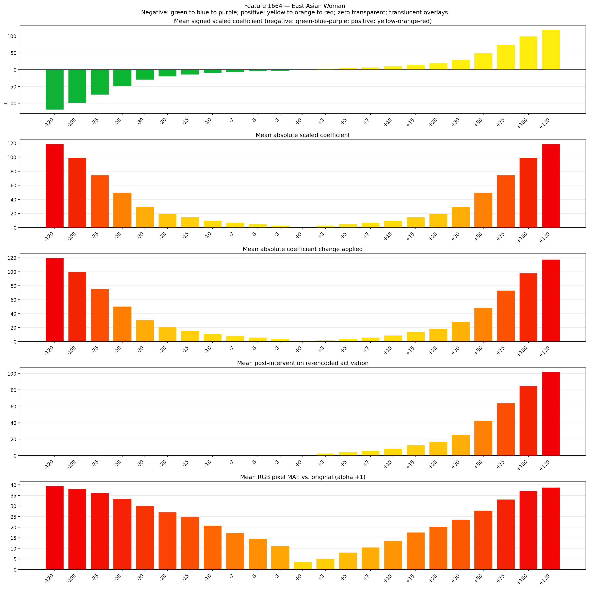
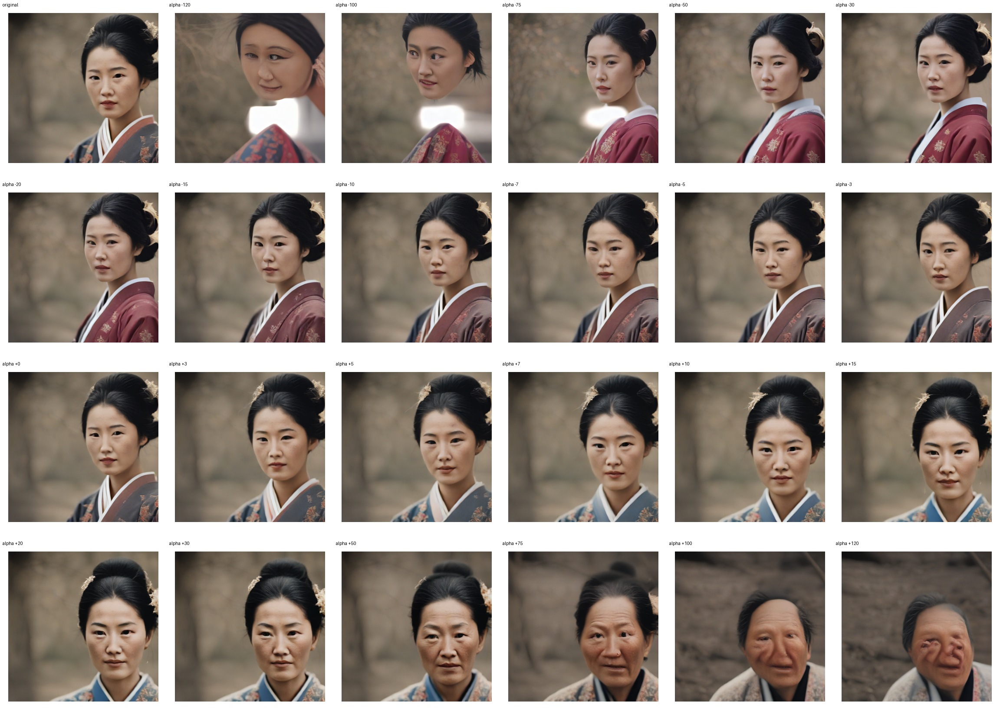
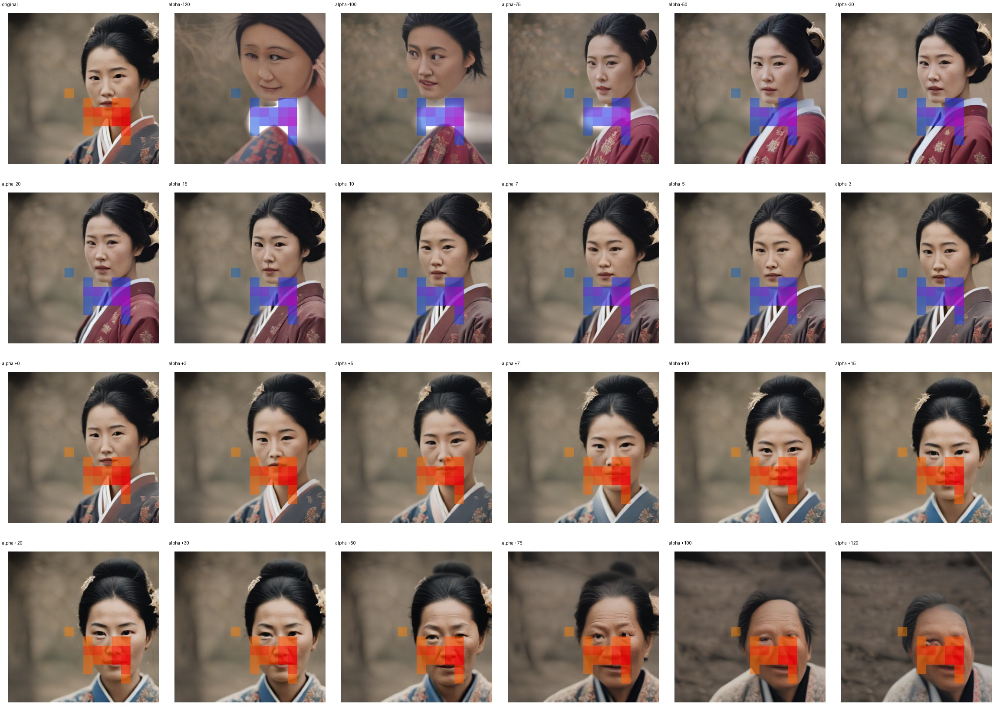
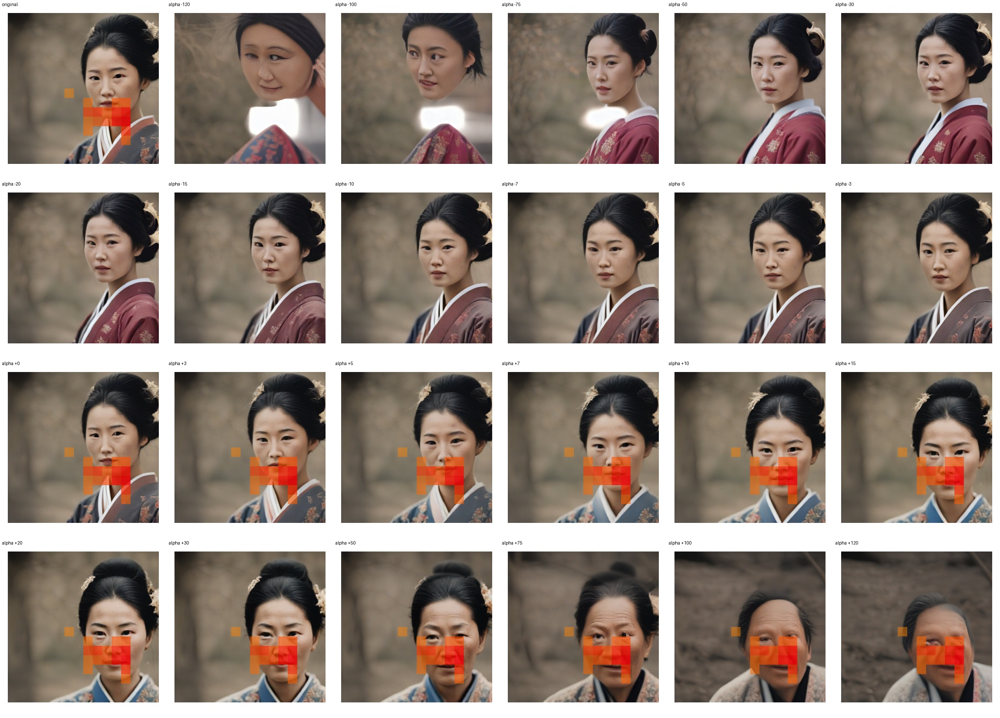

# Feature 1664 — East Asian Woman

Biased dataset; original prompt and seed replay for seeds 0–19. Values are means across 20 source images. The table reports the mean post-re-encoded activation of feature 1664, the active spatial fraction, mean RGB pixel MAE versus the original image (0–255 scale), and coefficient change magnitudes for each alpha.

## Activation graph

## Mean metrics by alpha

| Alpha | Mean post-reencoded feature 1664 activation | Active spatial fraction | Mean pixel change (MAE) | Mean absolute coefficient change | Mean absolute scaled coefficient |
|---:|---:|---:|---:|---:|---:|
| -120 | 0.000 | 0.000 | 39.462 | 119.815 | 118.825 |
| -100 | 0.000 | 0.000 | 38.030 | 100.011 | 99.021 |
| -75 | 0.000 | 0.000 | 36.178 | 75.256 | 74.266 |
| -50 | 0.000 | 0.000 | 33.538 | 50.501 | 49.510 |
| -30 | 0.000 | 0.000 | 30.057 | 30.696 | 29.706 |
| -20 | 0.000 | 0.000 | 27.155 | 20.794 | 19.804 |
| -15 | 0.000 | 0.000 | 24.954 | 15.843 | 14.853 |
| -10 | 0.000 | 0.000 | 20.863 | 10.892 | 9.902 |
| -7 | 0.000 | 0.000 | 17.316 | 7.922 | 6.931 |
| -5 | 0.000 | 0.000 | 14.625 | 5.941 | 4.951 |
| -3 | 0.000 | 0.000 | 11.122 | 3.961 | 2.971 |
| +0 | 0.000 | 0.000 | 3.633 | 0.990 | 0.000 |
| +3 | 2.685 | 0.060 | 5.266 | 1.980 | 2.971 |
| +5 | 4.380 | 0.060 | 8.086 | 3.961 | 4.951 |
| +7 | 6.075 | 0.060 | 10.533 | 5.941 | 6.931 |
| +10 | 8.617 | 0.060 | 13.568 | 8.912 | 9.902 |
| +15 | 12.854 | 0.060 | 17.567 | 13.863 | 14.853 |
| +20 | 17.091 | 0.060 | 20.293 | 18.814 | 19.804 |
| +30 | 25.565 | 0.060 | 23.565 | 28.716 | 29.706 |
| +50 | 42.513 | 0.060 | 27.853 | 48.520 | 49.510 |
| +75 | 63.698 | 0.060 | 33.179 | 73.275 | 74.266 |
| +100 | 84.883 | 0.060 | 37.144 | 98.031 | 99.021 |
| +120 | 101.831 | 0.060 | 38.786 | 117.835 | 118.825 |

## Per-seed grids

Each 4×6 sheet contains the original followed by the 23 alpha variants in ascending alpha order, from −120 through +120.

### Plain images

[All 20 plain-image grids](seed_sheets/)

### Signed coefficient overlays

[All 20 signed coefficient grids](signed_coefficient_overlays/)

### Post-re-encoded activation overlays

[All 20 post-activation grids](post_activation_overlays/)

### Intervention-footprint overlays

[All 20 intervention-footprint grids](intervention_footprint_overlays/)

Zero is transparent. Negative coefficient colors progress green through blue to purple; positive colors progress yellow through orange to red. Each map tile is normalized individually for visibility. The original and alpha-zero tiles show the pre-intervention feature map so its location remains visible.
