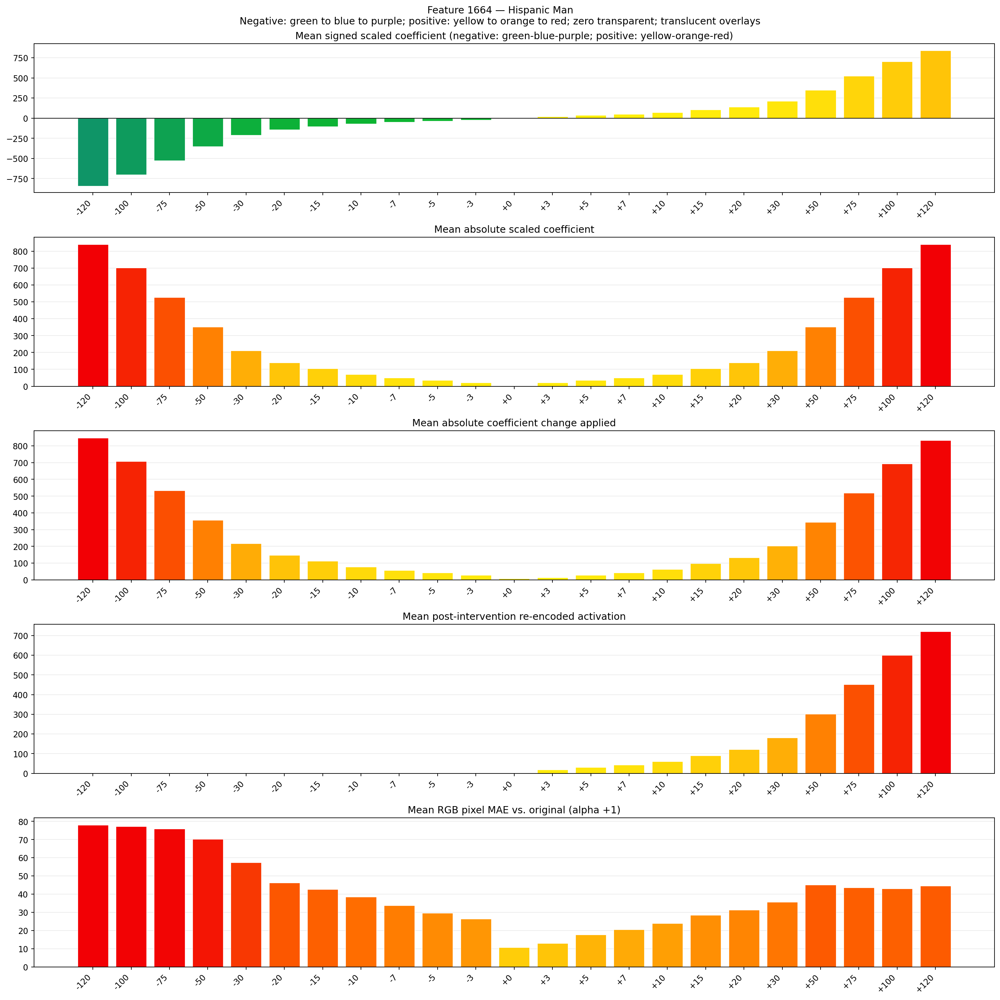
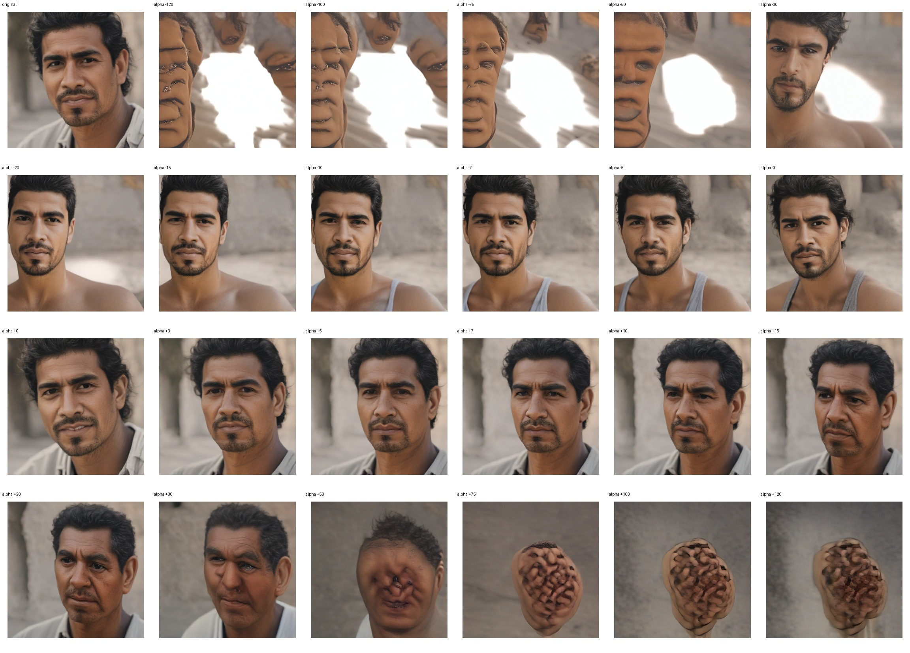
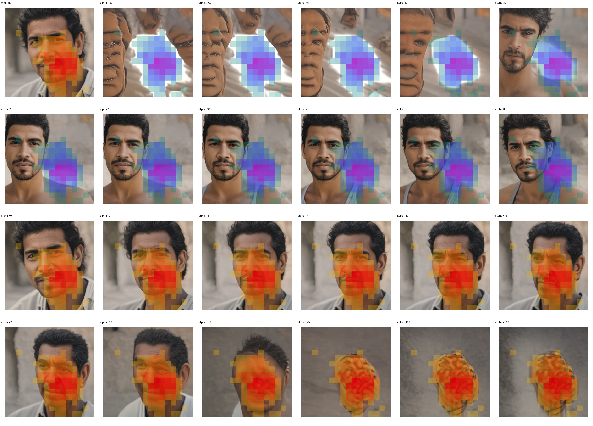
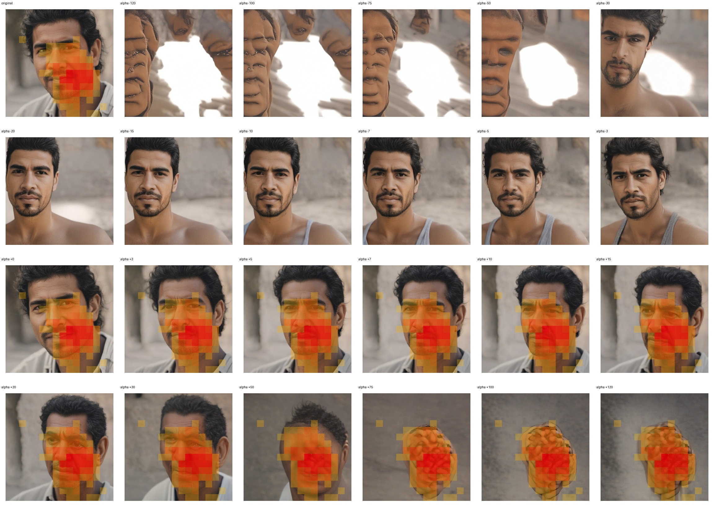

# Feature 1664 — Hispanic Man

Biased dataset; original prompt and seed replay for seeds 0–19. Values are means across 20 source images. The table reports the mean post-re-encoded activation of feature 1664, the active spatial fraction, mean RGB pixel MAE versus the original image (0–255 scale), and coefficient change magnitudes for each alpha.

## Activation graph

## Mean metrics by alpha

| Alpha | Mean post-reencoded feature 1664 activation | Active spatial fraction | Mean pixel change (MAE) | Mean absolute coefficient change | Mean absolute scaled coefficient |
|---:|---:|---:|---:|---:|---:|
| -120 | 0.000 | 0.000 | 77.990 | 848.055 | 841.046 |
| -100 | 0.000 | 0.000 | 77.144 | 707.880 | 700.872 |
| -75 | 0.000 | 0.000 | 75.845 | 532.662 | 525.654 |
| -50 | 0.000 | 0.000 | 70.179 | 357.444 | 350.436 |
| -30 | 0.000 | 0.000 | 57.452 | 217.270 | 210.261 |
| -20 | 0.000 | 0.000 | 46.181 | 147.183 | 140.174 |
| -15 | 0.000 | 0.000 | 42.687 | 112.139 | 105.131 |
| -10 | 0.000 | 0.000 | 38.437 | 77.096 | 70.087 |
| -7 | 0.000 | 0.000 | 33.735 | 56.070 | 49.061 |
| -5 | 0.000 | 0.000 | 29.553 | 42.052 | 35.044 |
| -3 | 0.000 | 0.000 | 26.357 | 28.035 | 21.026 |
| +0 | 0.016 | 0.003 | 10.724 | 7.009 | 0.000 |
| +3 | 19.005 | 0.297 | 13.012 | 14.017 | 21.026 |
| +5 | 31.001 | 0.297 | 17.681 | 28.035 | 35.044 |
| +7 | 42.996 | 0.297 | 20.585 | 42.052 | 49.061 |
| +10 | 60.990 | 0.297 | 23.945 | 63.078 | 70.087 |
| +15 | 90.980 | 0.297 | 28.395 | 98.122 | 105.131 |
| +20 | 120.969 | 0.297 | 31.293 | 133.166 | 140.174 |
| +30 | 180.949 | 0.297 | 35.661 | 203.253 | 210.261 |
| +50 | 300.908 | 0.297 | 45.051 | 343.427 | 350.436 |
| +75 | 450.856 | 0.297 | 43.523 | 518.645 | 525.654 |
| +100 | 600.804 | 0.297 | 42.980 | 693.863 | 700.872 |
| +120 | 720.762 | 0.297 | 44.611 | 834.037 | 841.046 |

## Per-seed grids

Each 4×6 sheet contains the original followed by the 23 alpha variants in ascending alpha order, from −120 through +120.

### Plain images

[All 20 plain-image grids](seed_sheets/)

### Signed coefficient overlays

[All 20 signed coefficient grids](signed_coefficient_overlays/)

### Post-re-encoded activation overlays

[All 20 post-activation grids](post_activation_overlays/)

### Intervention-footprint overlays

[All 20 intervention-footprint grids](intervention_footprint_overlays/)

Zero is transparent. Negative coefficient colors progress green through blue to purple; positive colors progress yellow through orange to red. Each map tile is normalized individually for visibility. The original and alpha-zero tiles show the pre-intervention feature map so its location remains visible.
