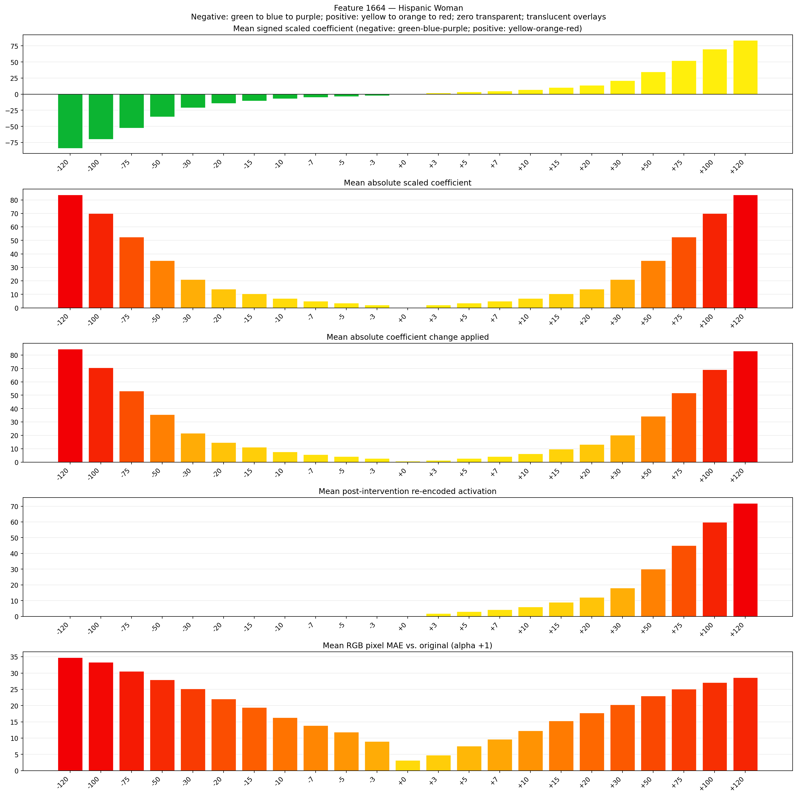
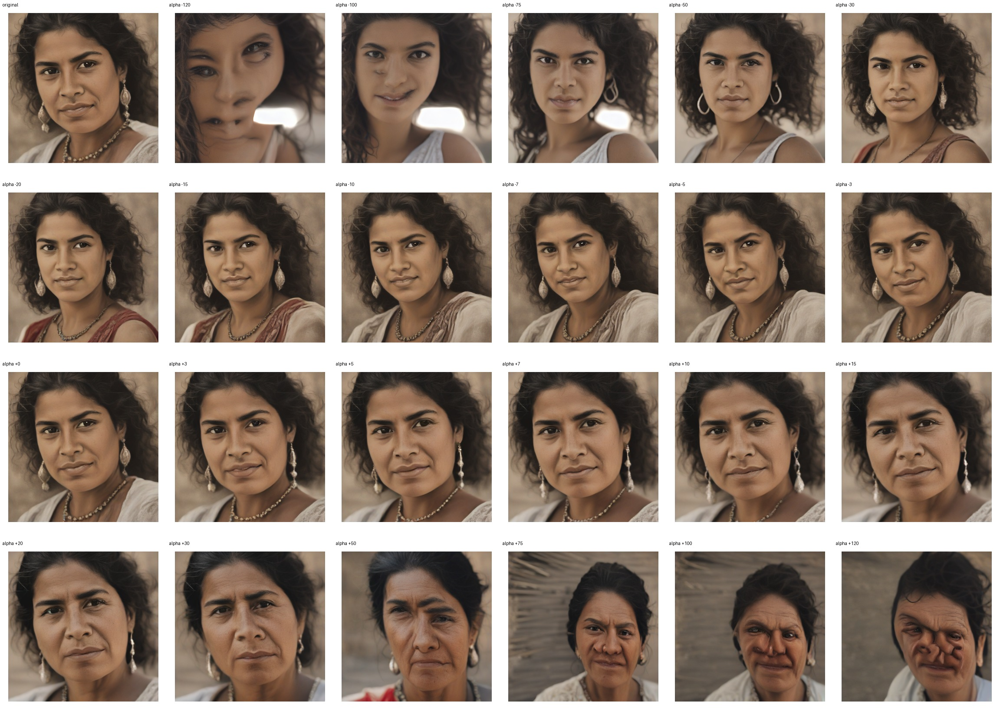
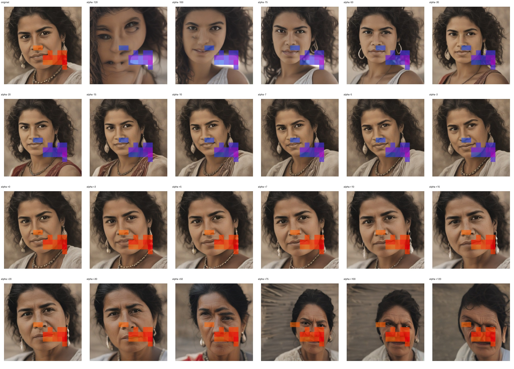
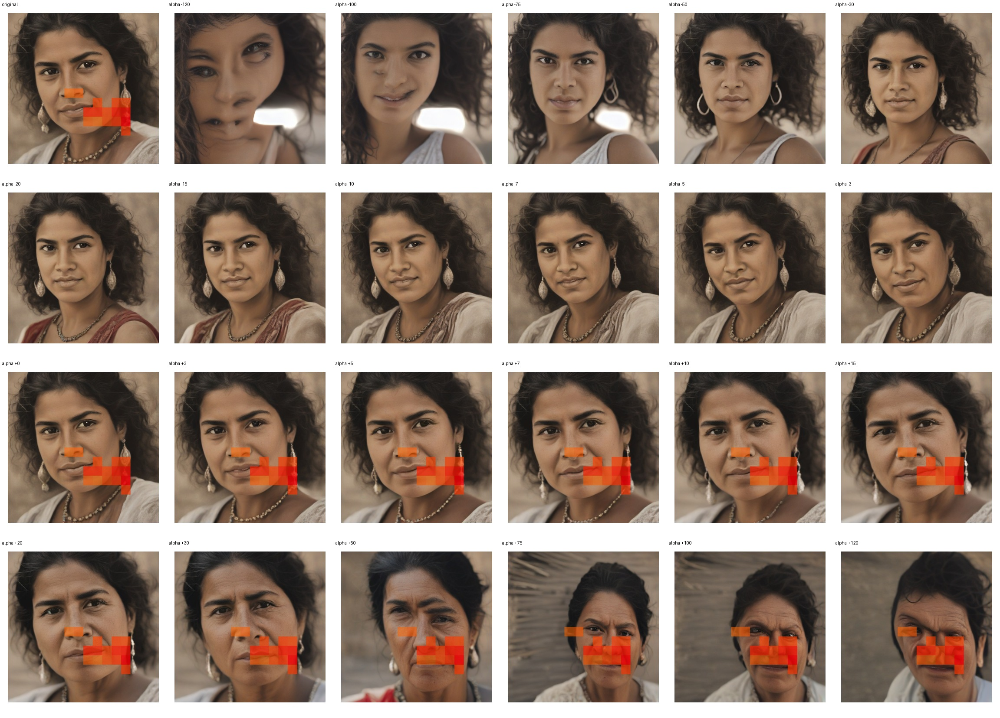

# Feature 1664 — Hispanic Woman

Biased dataset; original prompt and seed replay for seeds 0–19. Values are means across 20 source images. The table reports the mean post-re-encoded activation of feature 1664, the active spatial fraction, mean RGB pixel MAE versus the original image (0–255 scale), and coefficient change magnitudes for each alpha.

## Activation graph

## Mean metrics by alpha

| Alpha | Mean post-reencoded feature 1664 activation | Active spatial fraction | Mean pixel change (MAE) | Mean absolute coefficient change | Mean absolute scaled coefficient |
|---:|---:|---:|---:|---:|---:|
| -120 | 0.000 | 0.000 | 34.766 | 84.561 | 83.862 |
| -100 | 0.000 | 0.000 | 33.324 | 70.584 | 69.885 |
| -75 | 0.000 | 0.000 | 30.514 | 53.113 | 52.414 |
| -50 | 0.000 | 0.000 | 27.940 | 35.641 | 34.942 |
| -30 | 0.000 | 0.000 | 25.183 | 21.664 | 20.965 |
| -20 | 0.000 | 0.000 | 22.027 | 14.676 | 13.977 |
| -15 | 0.000 | 0.000 | 19.456 | 11.182 | 10.483 |
| -10 | 0.000 | 0.000 | 16.320 | 7.687 | 6.988 |
| -7 | 0.000 | 0.000 | 13.918 | 5.591 | 4.892 |
| -5 | 0.000 | 0.000 | 11.814 | 4.193 | 3.494 |
| -3 | 0.000 | 0.000 | 8.984 | 2.795 | 2.097 |
| +0 | 0.000 | 0.000 | 3.146 | 0.699 | 0.000 |
| +3 | 1.895 | 0.043 | 4.771 | 1.398 | 2.097 |
| +5 | 3.091 | 0.043 | 7.521 | 2.795 | 3.494 |
| +7 | 4.287 | 0.043 | 9.708 | 4.193 | 4.892 |
| +10 | 6.081 | 0.043 | 12.249 | 6.290 | 6.988 |
| +15 | 9.072 | 0.043 | 15.329 | 9.784 | 10.483 |
| +20 | 12.062 | 0.043 | 17.731 | 13.278 | 13.977 |
| +30 | 18.043 | 0.043 | 20.249 | 20.267 | 20.965 |
| +50 | 30.004 | 0.043 | 22.938 | 34.244 | 34.942 |
| +75 | 44.956 | 0.043 | 25.093 | 51.715 | 52.414 |
| +100 | 59.907 | 0.043 | 27.109 | 69.186 | 69.885 |
| +120 | 71.868 | 0.043 | 28.621 | 83.163 | 83.862 |

## Per-seed grids

Each 4×6 sheet contains the original followed by the 23 alpha variants in ascending alpha order, from −120 through +120.

### Plain images

[All 20 plain-image grids](seed_sheets/)

### Signed coefficient overlays

[All 20 signed coefficient grids](signed_coefficient_overlays/)

### Post-re-encoded activation overlays

[All 20 post-activation grids](post_activation_overlays/)

### Intervention-footprint overlays

[All 20 intervention-footprint grids](intervention_footprint_overlays/)

Zero is transparent. Negative coefficient colors progress green through blue to purple; positive colors progress yellow through orange to red. Each map tile is normalized individually for visibility. The original and alpha-zero tiles show the pre-intervention feature map so its location remains visible.
