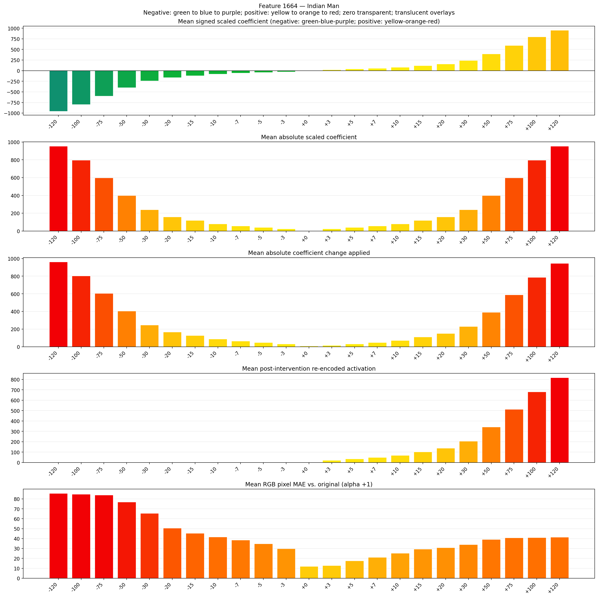
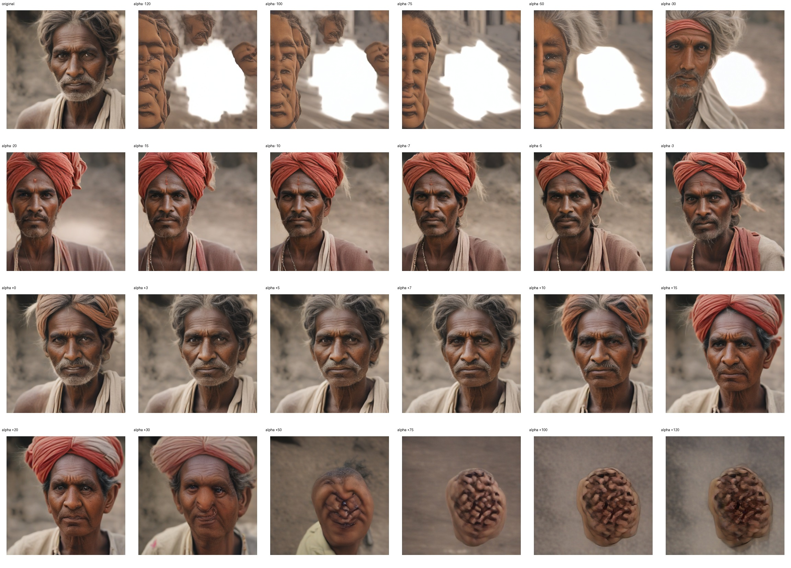
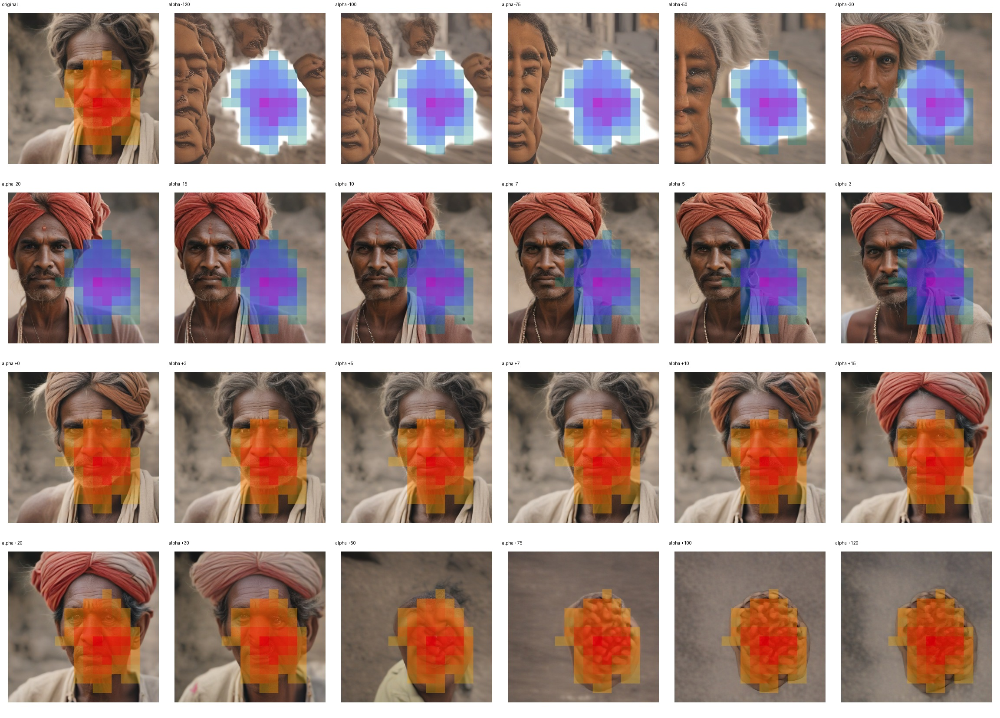
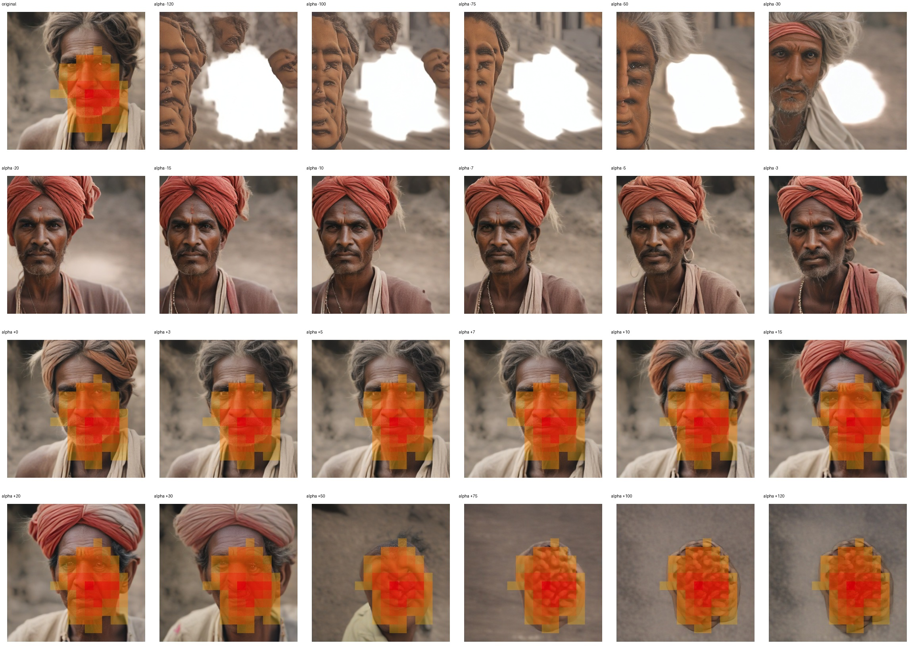

# Feature 1664 — Indian Man

Biased dataset; original prompt and seed replay for seeds 0–19. Values are means across 20 source images. The table reports the mean post-re-encoded activation of feature 1664, the active spatial fraction, mean RGB pixel MAE versus the original image (0–255 scale), and coefficient change magnitudes for each alpha.

## Activation graph

## Mean metrics by alpha

| Alpha | Mean post-reencoded feature 1664 activation | Active spatial fraction | Mean pixel change (MAE) | Mean absolute coefficient change | Mean absolute scaled coefficient |
|---:|---:|---:|---:|---:|---:|
| -120 | 0.000 | 0.000 | 85.611 | 962.488 | 954.534 |
| -100 | 0.000 | 0.000 | 84.853 | 803.399 | 795.445 |
| -75 | 0.000 | 0.000 | 83.921 | 604.538 | 596.584 |
| -50 | 0.000 | 0.000 | 76.804 | 405.677 | 397.722 |
| -30 | 0.000 | 0.000 | 65.442 | 246.588 | 238.633 |
| -20 | 0.000 | 0.000 | 50.457 | 167.043 | 159.089 |
| -15 | 0.000 | 0.000 | 45.306 | 127.271 | 119.317 |
| -10 | 0.000 | 0.000 | 41.695 | 87.499 | 79.544 |
| -7 | 0.000 | 0.000 | 38.482 | 63.636 | 55.681 |
| -5 | 0.000 | 0.000 | 34.860 | 47.727 | 39.772 |
| -3 | 0.000 | 0.000 | 29.796 | 31.818 | 23.863 |
| +0 | 0.015 | 0.002 | 11.907 | 7.954 | 0.000 |
| +3 | 21.569 | 0.306 | 12.743 | 15.909 | 23.863 |
| +5 | 35.183 | 0.306 | 17.644 | 31.818 | 39.772 |
| +7 | 48.798 | 0.306 | 21.120 | 47.727 | 55.681 |
| +10 | 69.220 | 0.306 | 25.166 | 71.590 | 79.544 |
| +15 | 103.256 | 0.306 | 29.417 | 111.362 | 119.317 |
| +20 | 137.293 | 0.306 | 30.879 | 151.135 | 159.089 |
| +30 | 205.365 | 0.306 | 34.012 | 230.679 | 238.633 |
| +50 | 341.511 | 0.306 | 39.228 | 389.768 | 397.722 |
| +75 | 511.693 | 0.306 | 40.781 | 588.629 | 596.584 |
| +100 | 681.875 | 0.306 | 40.987 | 787.490 | 795.445 |
| +120 | 818.020 | 0.306 | 41.456 | 946.579 | 954.534 |

## Per-seed grids

Each 4×6 sheet contains the original followed by the 23 alpha variants in ascending alpha order, from −120 through +120.

### Plain images

[All 20 plain-image grids](seed_sheets/)

### Signed coefficient overlays

[All 20 signed coefficient grids](signed_coefficient_overlays/)

### Post-re-encoded activation overlays

[All 20 post-activation grids](post_activation_overlays/)

### Intervention-footprint overlays

[All 20 intervention-footprint grids](intervention_footprint_overlays/)

Zero is transparent. Negative coefficient colors progress green through blue to purple; positive colors progress yellow through orange to red. Each map tile is normalized individually for visibility. The original and alpha-zero tiles show the pre-intervention feature map so its location remains visible.
