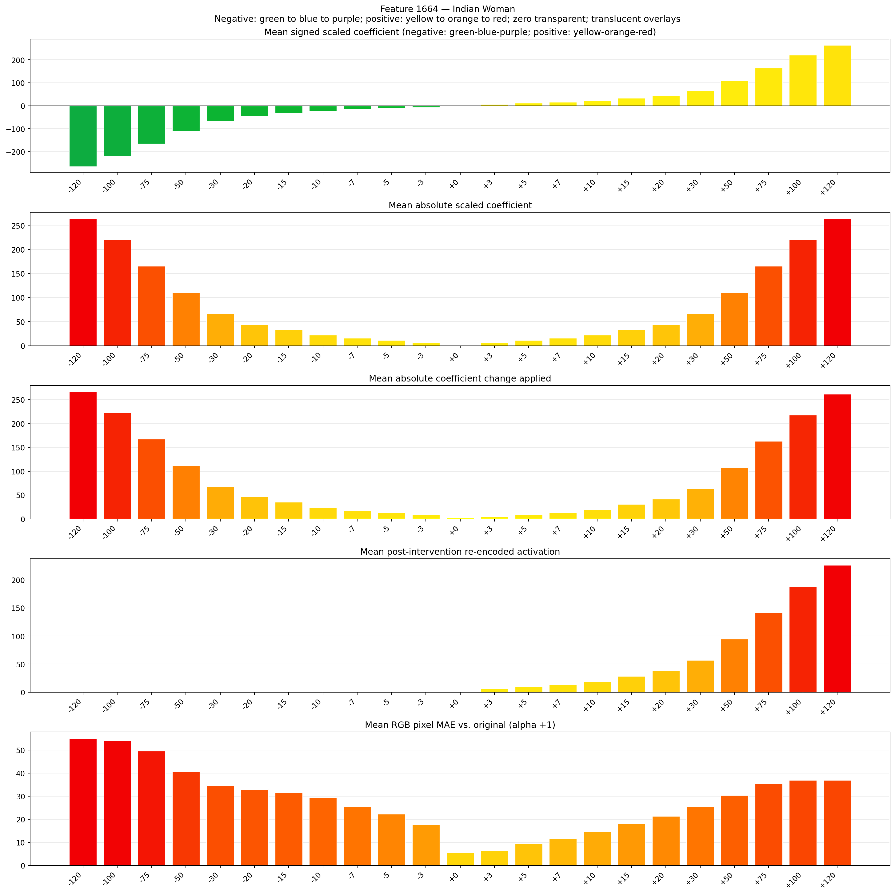
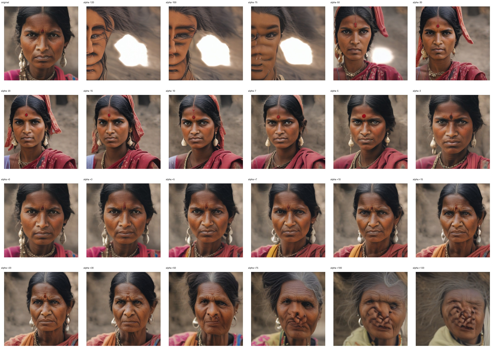
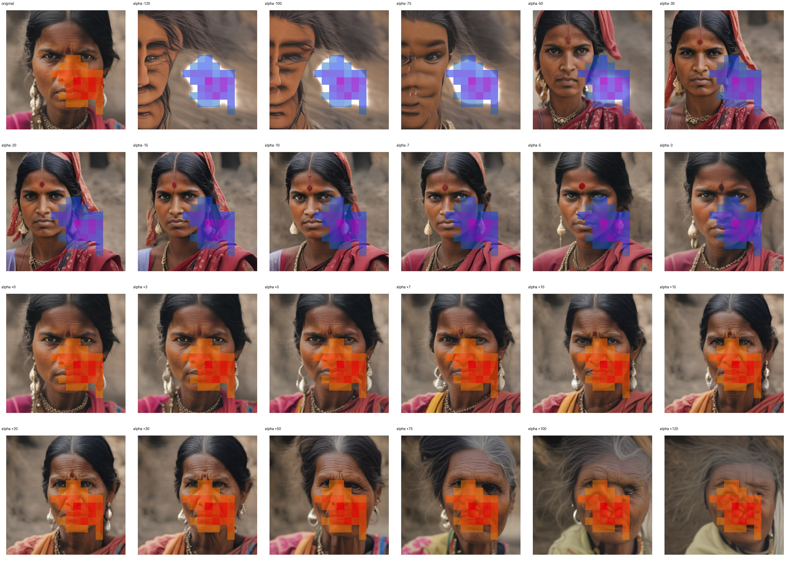
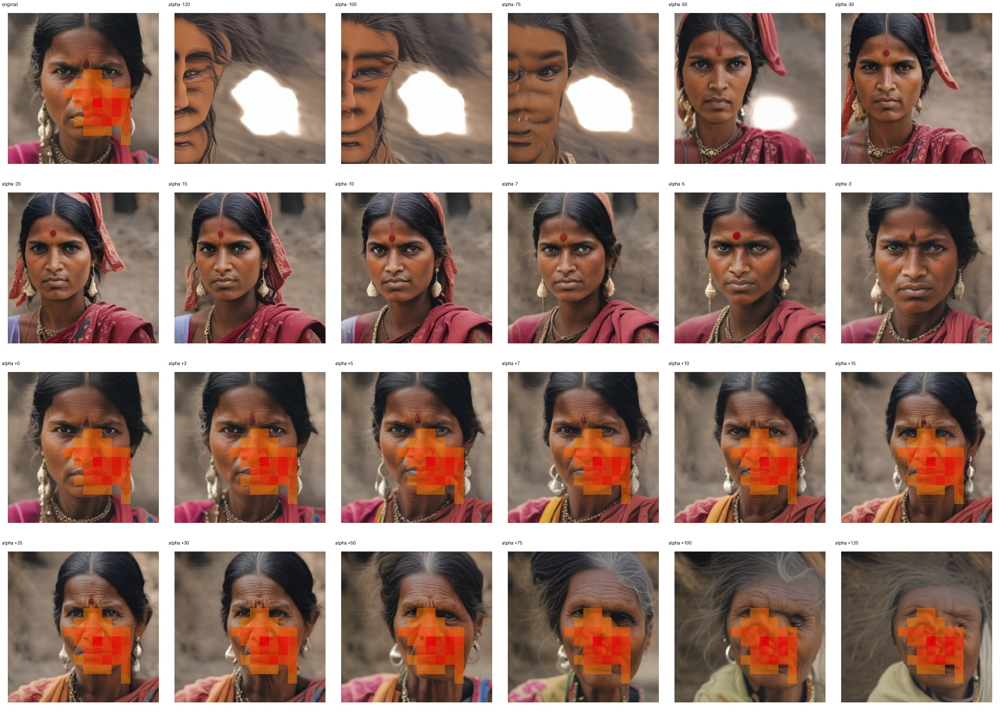

# Feature 1664 — Indian Woman

Biased dataset; original prompt and seed replay for seeds 0–19. Values are means across 20 source images. The table reports the mean post-re-encoded activation of feature 1664, the active spatial fraction, mean RGB pixel MAE versus the original image (0–255 scale), and coefficient change magnitudes for each alpha.

## Activation graph

## Mean metrics by alpha

| Alpha | Mean post-reencoded feature 1664 activation | Active spatial fraction | Mean pixel change (MAE) | Mean absolute coefficient change | Mean absolute scaled coefficient |
|---:|---:|---:|---:|---:|---:|
| -120 | 0.000 | 0.000 | 55.096 | 266.174 | 263.974 |
| -100 | 0.000 | 0.000 | 54.201 | 222.178 | 219.979 |
| -75 | 0.000 | 0.000 | 49.618 | 167.184 | 164.984 |
| -50 | 0.000 | 0.000 | 40.681 | 112.189 | 109.989 |
| -30 | 0.000 | 0.000 | 34.728 | 68.193 | 65.994 |
| -20 | 0.000 | 0.000 | 32.994 | 46.195 | 43.996 |
| -15 | 0.000 | 0.000 | 31.609 | 35.197 | 32.997 |
| -10 | 0.000 | 0.000 | 29.270 | 24.198 | 21.998 |
| -7 | 0.000 | 0.000 | 25.631 | 17.598 | 15.398 |
| -5 | 0.000 | 0.000 | 22.249 | 13.199 | 10.999 |
| -3 | 0.000 | 0.000 | 17.689 | 8.799 | 6.599 |
| +0 | 0.000 | 0.000 | 5.448 | 2.200 | 0.000 |
| +3 | 5.965 | 0.119 | 6.411 | 4.400 | 6.599 |
| +5 | 9.730 | 0.119 | 9.386 | 8.799 | 10.999 |
| +7 | 13.495 | 0.119 | 11.679 | 13.199 | 15.398 |
| +10 | 19.143 | 0.119 | 14.478 | 19.798 | 21.998 |
| +15 | 28.555 | 0.119 | 18.172 | 30.797 | 32.997 |
| +20 | 37.968 | 0.119 | 21.274 | 41.796 | 43.996 |
| +30 | 56.793 | 0.119 | 25.395 | 63.794 | 65.994 |
| +50 | 94.444 | 0.119 | 30.422 | 107.789 | 109.989 |
| +75 | 141.508 | 0.119 | 35.518 | 162.784 | 164.984 |
| +100 | 188.571 | 0.119 | 36.877 | 217.779 | 219.979 |
| +120 | 226.221 | 0.119 | 36.975 | 261.774 | 263.974 |

## Per-seed grids

Each 4×6 sheet contains the original followed by the 23 alpha variants in ascending alpha order, from −120 through +120.

### Plain images

[All 20 plain-image grids](seed_sheets/)

### Signed coefficient overlays

[All 20 signed coefficient grids](signed_coefficient_overlays/)

### Post-re-encoded activation overlays

[All 20 post-activation grids](post_activation_overlays/)

### Intervention-footprint overlays

[All 20 intervention-footprint grids](intervention_footprint_overlays/)

Zero is transparent. Negative coefficient colors progress green through blue to purple; positive colors progress yellow through orange to red. Each map tile is normalized individually for visibility. The original and alpha-zero tiles show the pre-intervention feature map so its location remains visible.
