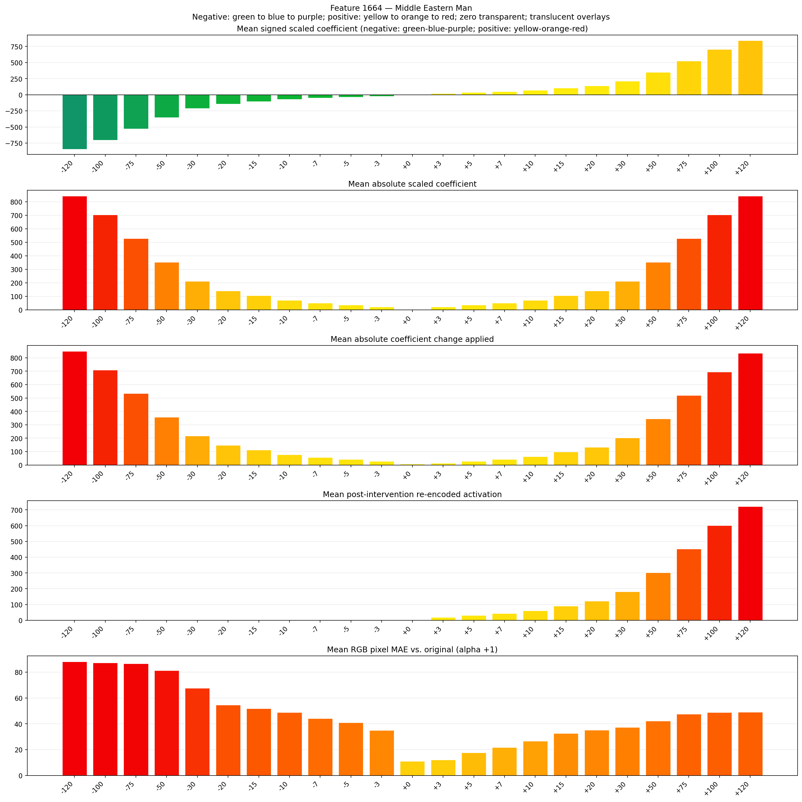
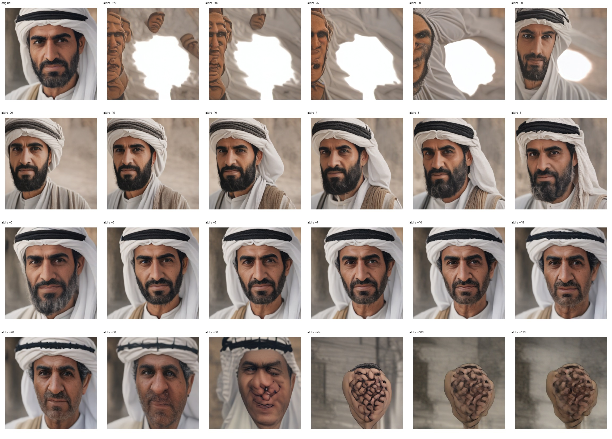
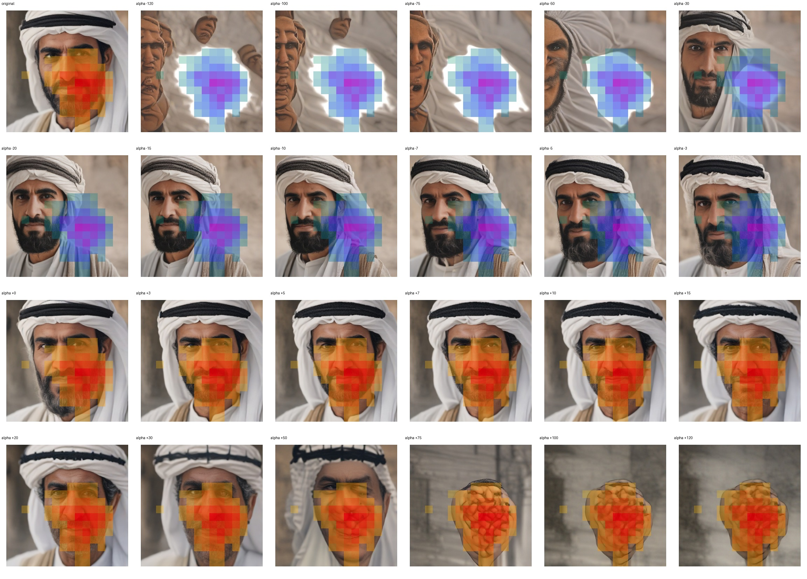
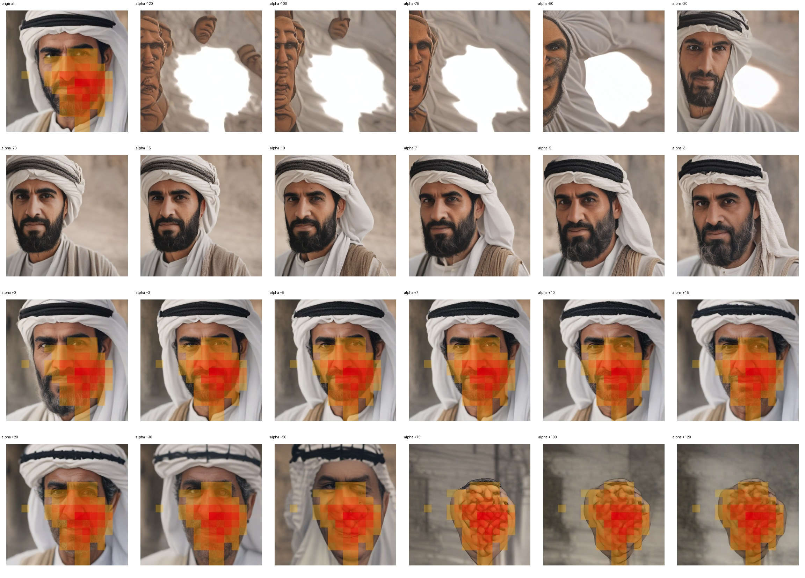

# Feature 1664 — Middle Eastern Man

Biased dataset; original prompt and seed replay for seeds 0–19. Values are means across 20 source images. The table reports the mean post-re-encoded activation of feature 1664, the active spatial fraction, mean RGB pixel MAE versus the original image (0–255 scale), and coefficient change magnitudes for each alpha.

## Activation graph

## Mean metrics by alpha

| Alpha | Mean post-reencoded feature 1664 activation | Active spatial fraction | Mean pixel change (MAE) | Mean absolute coefficient change | Mean absolute scaled coefficient |
|---:|---:|---:|---:|---:|---:|
| -120 | 0.000 | 0.000 | 88.124 | 849.643 | 842.621 |
| -100 | 0.000 | 0.000 | 87.190 | 709.206 | 702.184 |
| -75 | 0.000 | 0.000 | 86.707 | 533.660 | 526.638 |
| -50 | 0.000 | 0.000 | 81.173 | 358.114 | 351.092 |
| -30 | 0.000 | 0.000 | 67.531 | 217.677 | 210.655 |
| -20 | 0.000 | 0.000 | 54.526 | 147.459 | 140.437 |
| -15 | 0.000 | 0.000 | 51.786 | 112.350 | 105.328 |
| -10 | 0.000 | 0.000 | 48.801 | 77.240 | 70.218 |
| -7 | 0.000 | 0.000 | 44.078 | 56.175 | 49.153 |
| -5 | 0.000 | 0.000 | 40.855 | 42.131 | 35.109 |
| -3 | 0.000 | 0.000 | 34.901 | 28.087 | 21.066 |
| +0 | 0.005 | 0.001 | 11.074 | 7.022 | 0.000 |
| +3 | 19.040 | 0.307 | 12.110 | 14.044 | 21.066 |
| +5 | 31.058 | 0.307 | 17.619 | 28.087 | 35.109 |
| +7 | 43.077 | 0.307 | 21.782 | 42.131 | 49.153 |
| +10 | 61.104 | 0.307 | 26.614 | 63.197 | 70.218 |
| +15 | 91.150 | 0.307 | 32.714 | 98.306 | 105.328 |
| +20 | 121.196 | 0.307 | 35.269 | 133.415 | 140.437 |
| +30 | 181.288 | 0.307 | 37.222 | 203.634 | 210.655 |
| +50 | 301.471 | 0.307 | 42.131 | 344.070 | 351.092 |
| +75 | 451.701 | 0.307 | 47.496 | 519.617 | 526.638 |
| +100 | 601.929 | 0.307 | 48.728 | 695.163 | 702.184 |
| +120 | 722.113 | 0.307 | 49.102 | 835.600 | 842.621 |

## Per-seed grids

Each 4×6 sheet contains the original followed by the 23 alpha variants in ascending alpha order, from −120 through +120.

### Plain images

[All 20 plain-image grids](seed_sheets/)

### Signed coefficient overlays

[All 20 signed coefficient grids](signed_coefficient_overlays/)

### Post-re-encoded activation overlays

[All 20 post-activation grids](post_activation_overlays/)

### Intervention-footprint overlays

[All 20 intervention-footprint grids](intervention_footprint_overlays/)

Zero is transparent. Negative coefficient colors progress green through blue to purple; positive colors progress yellow through orange to red. Each map tile is normalized individually for visibility. The original and alpha-zero tiles show the pre-intervention feature map so its location remains visible.
