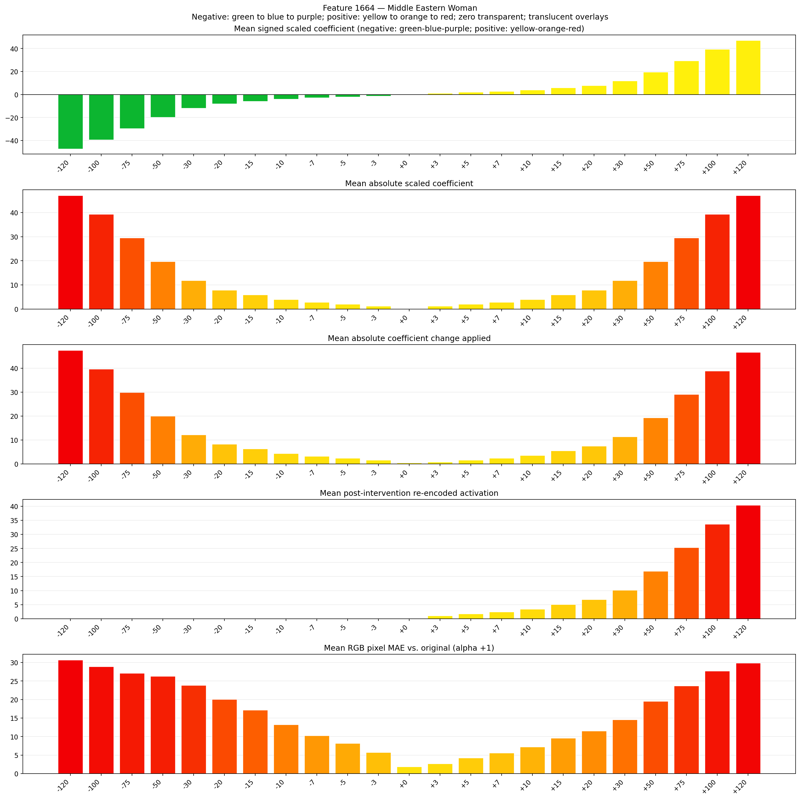
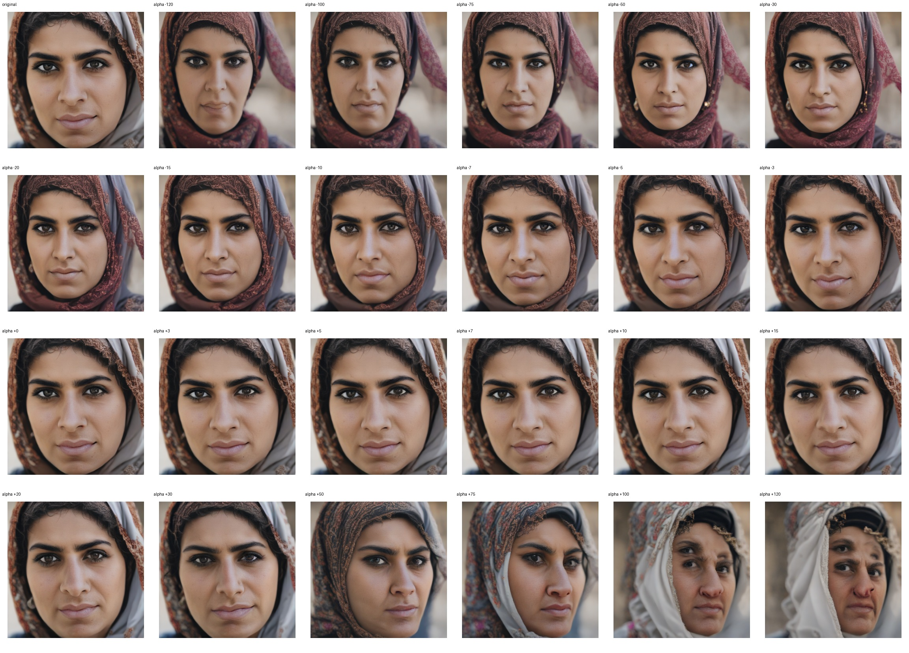
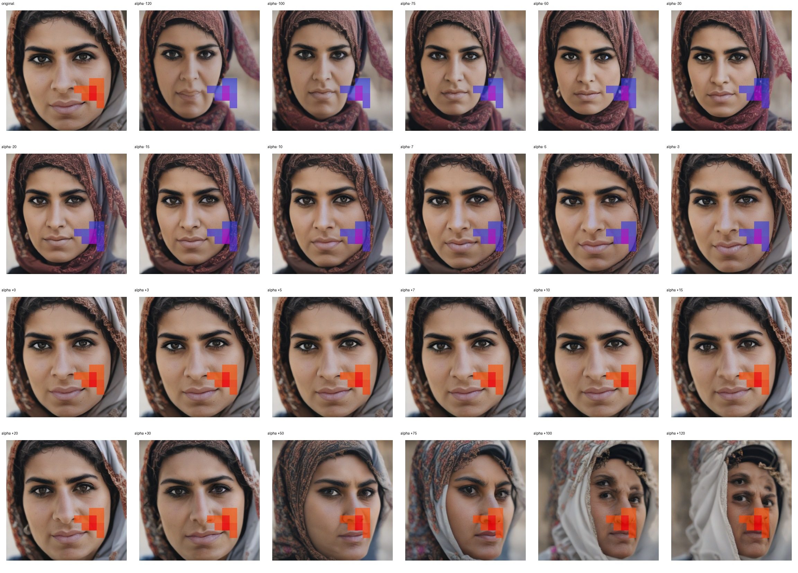
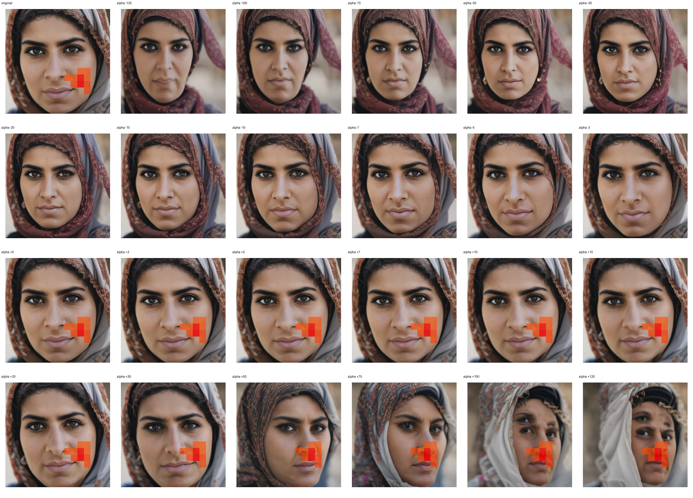

# Feature 1664 — Middle Eastern Woman

Biased dataset; original prompt and seed replay for seeds 0–19. Values are means across 20 source images. The table reports the mean post-re-encoded activation of feature 1664, the active spatial fraction, mean RGB pixel MAE versus the original image (0–255 scale), and coefficient change magnitudes for each alpha.

## Activation graph

## Mean metrics by alpha

| Alpha | Mean post-reencoded feature 1664 activation | Active spatial fraction | Mean pixel change (MAE) | Mean absolute coefficient change | Mean absolute scaled coefficient |
|---:|---:|---:|---:|---:|---:|
| -120 | 0.000 | 0.000 | 30.675 | 47.531 | 47.138 |
| -100 | 0.000 | 0.000 | 28.875 | 39.674 | 39.282 |
| -75 | 0.000 | 0.000 | 27.076 | 29.854 | 29.461 |
| -50 | 0.000 | 0.000 | 26.305 | 20.034 | 19.641 |
| -30 | 0.000 | 0.000 | 23.870 | 12.177 | 11.784 |
| -20 | 0.000 | 0.000 | 20.040 | 8.249 | 7.856 |
| -15 | 0.000 | 0.000 | 17.127 | 6.285 | 5.892 |
| -10 | 0.000 | 0.000 | 13.178 | 4.321 | 3.928 |
| -7 | 0.000 | 0.000 | 10.239 | 3.143 | 2.750 |
| -5 | 0.000 | 0.000 | 8.122 | 2.357 | 1.964 |
| -3 | 0.000 | 0.000 | 5.718 | 1.571 | 1.178 |
| +0 | 0.000 | 0.000 | 1.820 | 0.393 | 0.000 |
| +3 | 1.065 | 0.031 | 2.637 | 0.786 | 1.178 |
| +5 | 1.737 | 0.031 | 4.236 | 1.571 | 1.964 |
| +7 | 2.410 | 0.031 | 5.523 | 2.357 | 2.750 |
| +10 | 3.418 | 0.031 | 7.170 | 3.535 | 3.928 |
| +15 | 5.099 | 0.031 | 9.575 | 5.499 | 5.892 |
| +20 | 6.780 | 0.031 | 11.528 | 7.464 | 7.856 |
| +30 | 10.142 | 0.031 | 14.571 | 11.392 | 11.784 |
| +50 | 16.865 | 0.031 | 19.539 | 19.248 | 19.641 |
| +75 | 25.269 | 0.031 | 23.670 | 29.068 | 29.461 |
| +100 | 33.673 | 0.031 | 27.694 | 38.889 | 39.282 |
| +120 | 40.396 | 0.031 | 29.877 | 46.745 | 47.138 |

## Per-seed grids

Each 4×6 sheet contains the original followed by the 23 alpha variants in ascending alpha order, from −120 through +120.

### Plain images

[All 20 plain-image grids](seed_sheets/)

### Signed coefficient overlays

[All 20 signed coefficient grids](signed_coefficient_overlays/)

### Post-re-encoded activation overlays

[All 20 post-activation grids](post_activation_overlays/)

### Intervention-footprint overlays

[All 20 intervention-footprint grids](intervention_footprint_overlays/)

Zero is transparent. Negative coefficient colors progress green through blue to purple; positive colors progress yellow through orange to red. Each map tile is normalized individually for visibility. The original and alpha-zero tiles show the pre-intervention feature map so its location remains visible.
