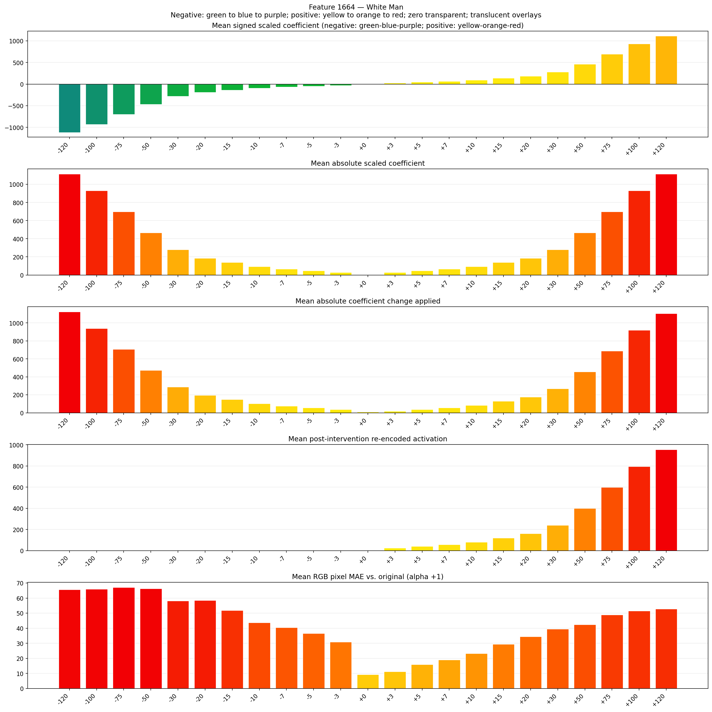
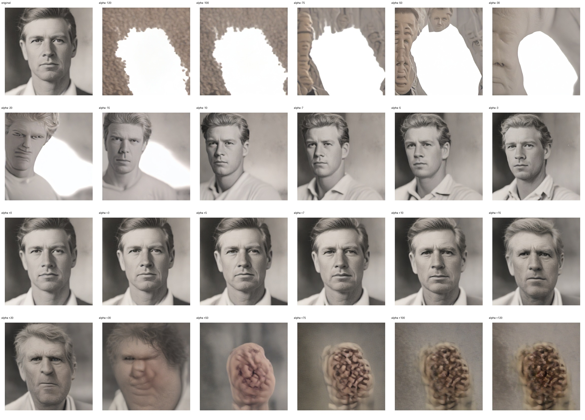
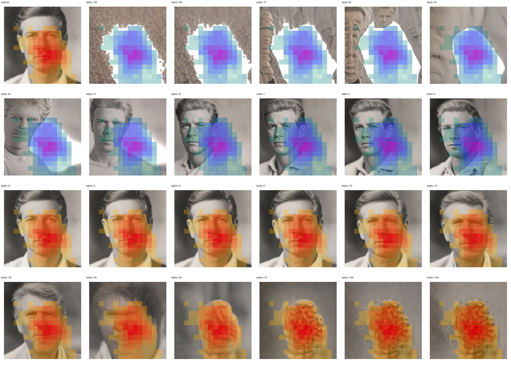
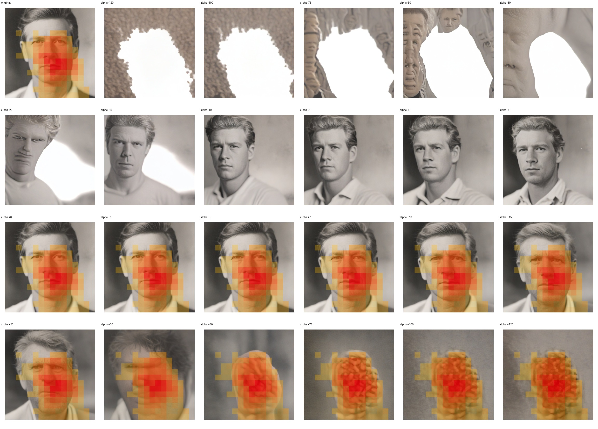

# Feature 1664 — White Man

Biased dataset; original prompt and seed replay for seeds 0–19. Values are means across 20 source images. The table reports the mean post-re-encoded activation of feature 1664, the active spatial fraction, mean RGB pixel MAE versus the original image (0–255 scale), and coefficient change magnitudes for each alpha.

## Activation graph

## Mean metrics by alpha

| Alpha | Mean post-reencoded feature 1664 activation | Active spatial fraction | Mean pixel change (MAE) | Mean absolute coefficient change | Mean absolute scaled coefficient |
|---:|---:|---:|---:|---:|---:|
| -120 | 0.000 | 0.000 | 65.611 | 1123.908 | 1114.619 |
| -100 | 0.000 | 0.000 | 65.944 | 938.138 | 928.849 |
| -75 | 0.000 | 0.000 | 67.101 | 705.926 | 696.637 |
| -50 | 0.000 | 0.000 | 66.232 | 473.713 | 464.425 |
| -30 | 0.000 | 0.000 | 58.201 | 287.943 | 278.655 |
| -20 | 0.000 | 0.000 | 58.420 | 195.058 | 185.770 |
| -15 | 0.000 | 0.000 | 51.848 | 148.616 | 139.327 |
| -10 | 0.000 | 0.000 | 43.621 | 102.173 | 92.885 |
| -7 | 0.000 | 0.000 | 40.380 | 74.308 | 65.019 |
| -5 | 0.000 | 0.000 | 36.521 | 55.731 | 46.442 |
| -3 | 0.000 | 0.000 | 30.895 | 37.154 | 27.865 |
| +0 | 0.024 | 0.003 | 9.252 | 9.288 | 0.000 |
| +3 | 25.186 | 0.355 | 11.225 | 18.577 | 27.865 |
| +5 | 41.084 | 0.355 | 15.903 | 37.154 | 46.442 |
| +7 | 56.982 | 0.355 | 19.044 | 55.731 | 65.019 |
| +10 | 80.829 | 0.355 | 23.277 | 83.596 | 92.885 |
| +15 | 120.573 | 0.355 | 29.417 | 130.039 | 139.327 |
| +20 | 160.318 | 0.355 | 34.351 | 176.481 | 185.770 |
| +30 | 239.807 | 0.355 | 39.445 | 269.366 | 278.655 |
| +50 | 398.786 | 0.355 | 42.457 | 455.136 | 464.425 |
| +75 | 597.509 | 0.355 | 48.825 | 687.349 | 696.637 |
| +100 | 796.232 | 0.355 | 51.471 | 919.561 | 928.849 |
| +120 | 955.212 | 0.355 | 52.839 | 1105.331 | 1114.619 |

## Per-seed grids

Each 4×6 sheet contains the original followed by the 23 alpha variants in ascending alpha order, from −120 through +120.

### Plain images

[All 20 plain-image grids](seed_sheets/)

### Signed coefficient overlays

[All 20 signed coefficient grids](signed_coefficient_overlays/)

### Post-re-encoded activation overlays

[All 20 post-activation grids](post_activation_overlays/)

### Intervention-footprint overlays

[All 20 intervention-footprint grids](intervention_footprint_overlays/)

Zero is transparent. Negative coefficient colors progress green through blue to purple; positive colors progress yellow through orange to red. Each map tile is normalized individually for visibility. The original and alpha-zero tiles show the pre-intervention feature map so its location remains visible.
