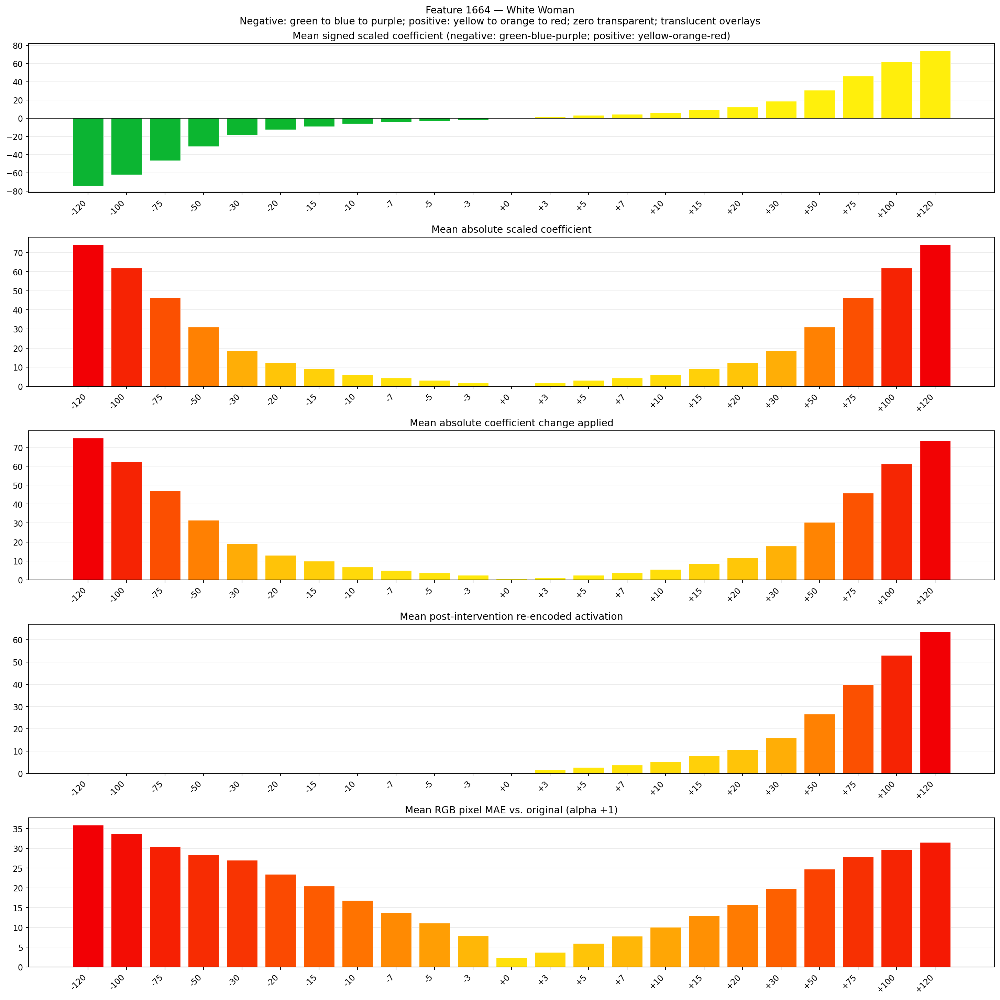
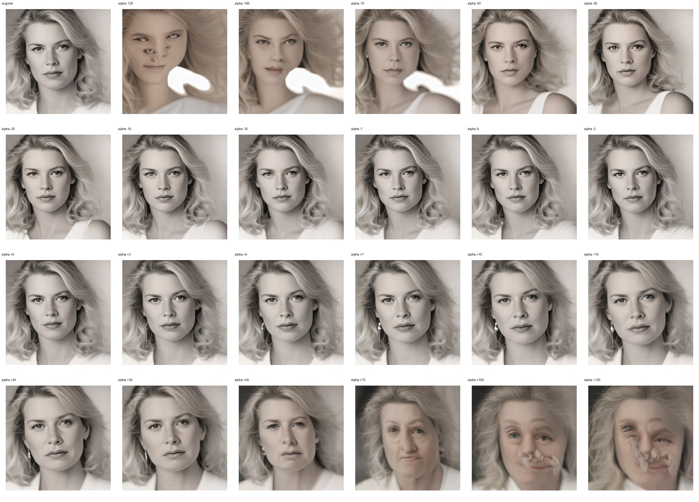
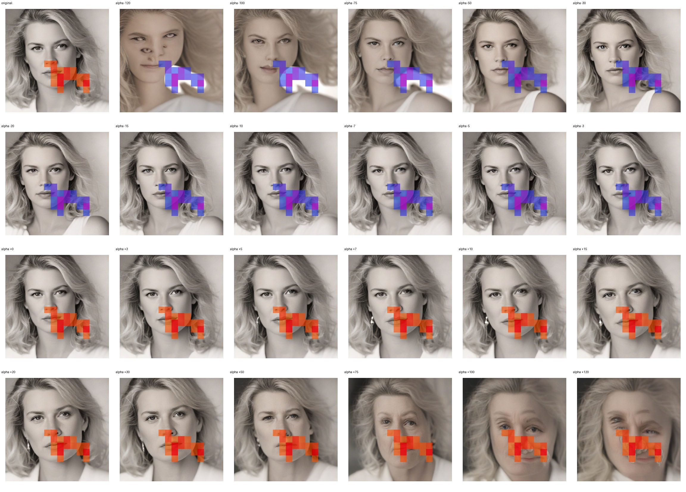
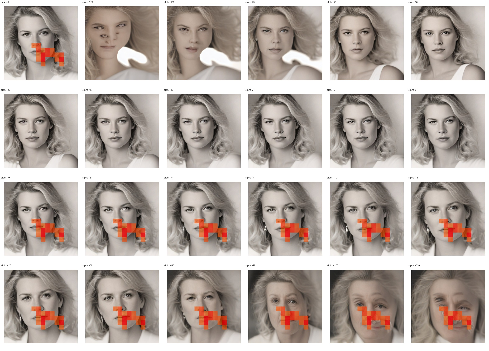

# Feature 1664 — White Woman

Biased dataset; original prompt and seed replay for seeds 0–19. Values are means across 20 source images. The table reports the mean post-re-encoded activation of feature 1664, the active spatial fraction, mean RGB pixel MAE versus the original image (0–255 scale), and coefficient change magnitudes for each alpha.

## Activation graph

## Mean metrics by alpha

| Alpha | Mean post-reencoded feature 1664 activation | Active spatial fraction | Mean pixel change (MAE) | Mean absolute coefficient change | Mean absolute scaled coefficient |
|---:|---:|---:|---:|---:|---:|
| -120 | 0.000 | 0.000 | 35.914 | 75.000 | 74.380 |
| -100 | 0.000 | 0.000 | 33.704 | 62.604 | 61.984 |
| -75 | 0.000 | 0.000 | 30.472 | 47.108 | 46.488 |
| -50 | 0.000 | 0.000 | 28.424 | 31.612 | 30.992 |
| -30 | 0.000 | 0.000 | 27.036 | 19.215 | 18.595 |
| -20 | 0.000 | 0.000 | 23.500 | 13.017 | 12.397 |
| -15 | 0.000 | 0.000 | 20.540 | 9.917 | 9.298 |
| -10 | 0.000 | 0.000 | 16.849 | 6.818 | 6.198 |
| -7 | 0.000 | 0.000 | 13.788 | 4.959 | 4.339 |
| -5 | 0.000 | 0.000 | 11.092 | 3.719 | 3.099 |
| -3 | 0.000 | 0.000 | 7.871 | 2.479 | 1.860 |
| +0 | 0.000 | 0.000 | 2.390 | 0.620 | 0.000 |
| +3 | 1.681 | 0.043 | 3.698 | 1.240 | 1.860 |
| +5 | 2.742 | 0.043 | 6.022 | 2.479 | 3.099 |
| +7 | 3.803 | 0.043 | 7.844 | 3.719 | 4.339 |
| +10 | 5.394 | 0.043 | 10.046 | 5.579 | 6.198 |
| +15 | 8.046 | 0.043 | 13.044 | 8.678 | 9.298 |
| +20 | 10.698 | 0.043 | 15.774 | 11.777 | 12.397 |
| +30 | 16.003 | 0.043 | 19.798 | 17.975 | 18.595 |
| +50 | 26.612 | 0.043 | 24.794 | 30.372 | 30.992 |
| +75 | 39.873 | 0.043 | 27.865 | 45.868 | 46.488 |
| +100 | 53.134 | 0.043 | 29.729 | 61.364 | 61.984 |
| +120 | 63.743 | 0.043 | 31.560 | 73.761 | 74.380 |

## Per-seed grids

Each 4×6 sheet contains the original followed by the 23 alpha variants in ascending alpha order, from −120 through +120.

### Plain images

[All 20 plain-image grids](seed_sheets/)

### Signed coefficient overlays

[All 20 signed coefficient grids](signed_coefficient_overlays/)

### Post-re-encoded activation overlays

[All 20 post-activation grids](post_activation_overlays/)

### Intervention-footprint overlays

[All 20 intervention-footprint grids](intervention_footprint_overlays/)

Zero is transparent. Negative coefficient colors progress green through blue to purple; positive colors progress yellow through orange to red. Each map tile is normalized individually for visibility. The original and alpha-zero tiles show the pre-intervention feature map so its location remains visible.
