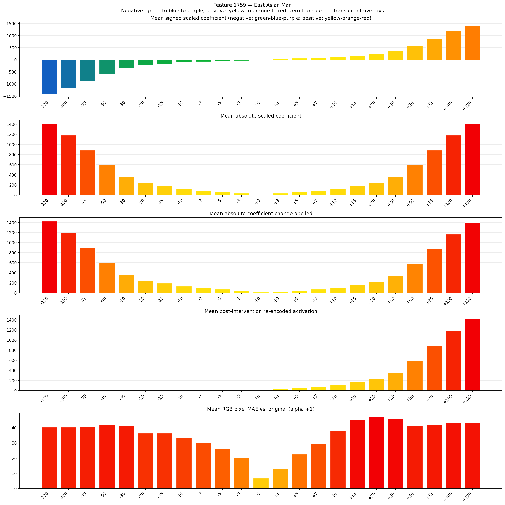
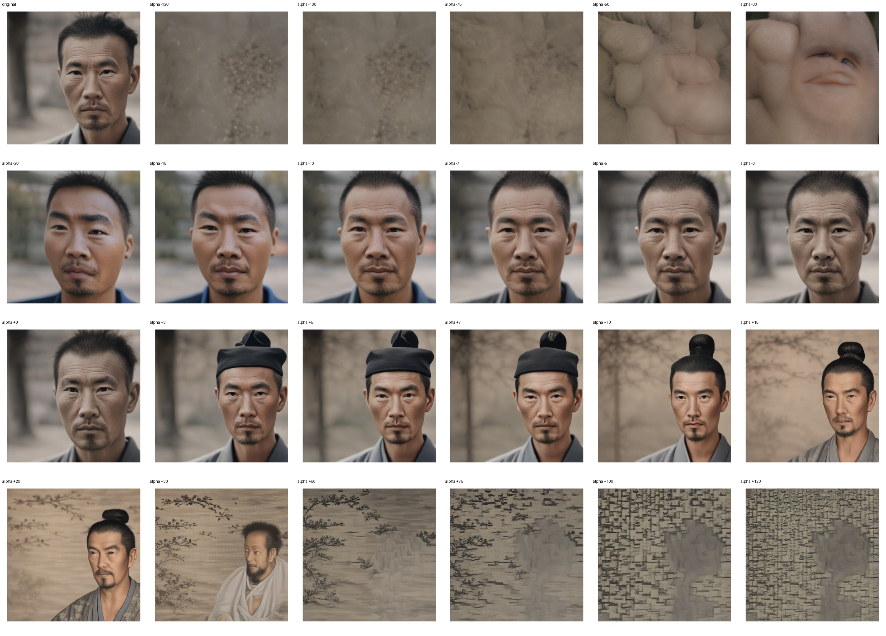
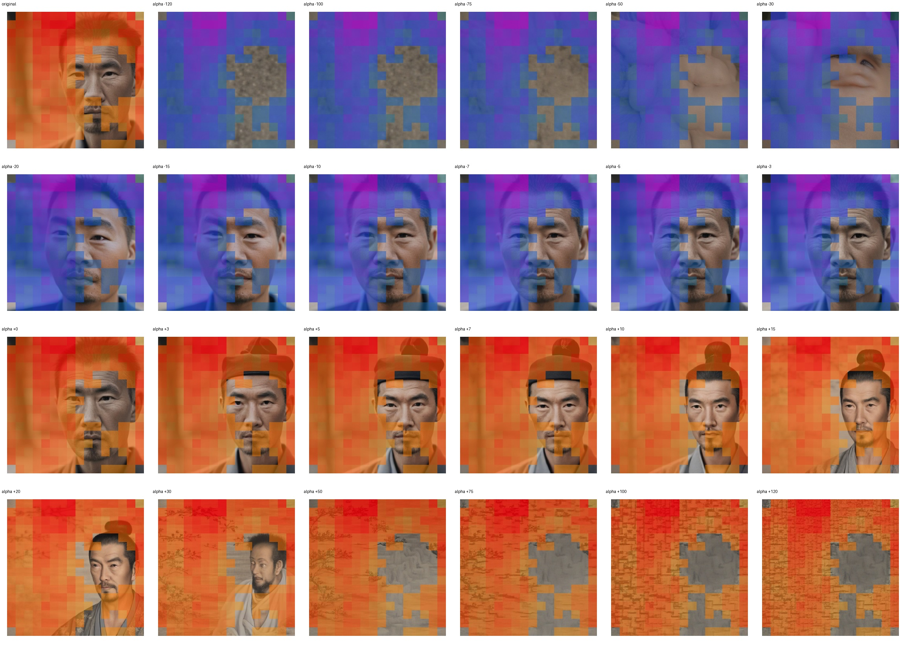
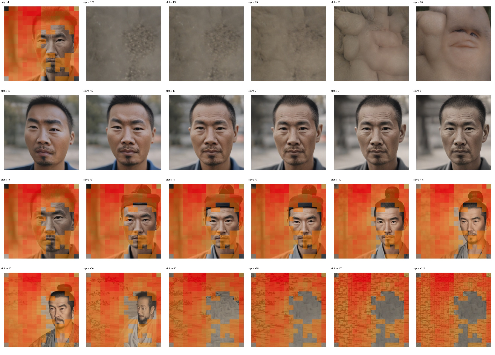

# Feature 1759 — East Asian Man

Biased dataset; original prompt and seed replay for seeds 0–19. Values are means across 20 source images. The table reports the mean post-re-encoded activation of feature 1759, the active spatial fraction, mean RGB pixel MAE versus the original image (0–255 scale), and coefficient change magnitudes for each alpha.

## Activation graph

## Mean metrics by alpha

| Alpha | Mean post-reencoded feature 1759 activation | Active spatial fraction | Mean pixel change (MAE) | Mean absolute coefficient change | Mean absolute scaled coefficient |
|---:|---:|---:|---:|---:|---:|
| -120 | 0.000 | 0.000 | 40.320 | 1425.936 | 1414.151 |
| -100 | 0.000 | 0.000 | 40.300 | 1190.244 | 1178.459 |
| -75 | 0.000 | 0.000 | 40.511 | 895.629 | 883.845 |
| -50 | 0.000 | 0.000 | 42.062 | 601.014 | 589.230 |
| -30 | 0.000 | 0.000 | 41.385 | 365.322 | 353.538 |
| -20 | 0.000 | 0.000 | 36.315 | 247.476 | 235.692 |
| -15 | 0.000 | 0.000 | 36.273 | 188.554 | 176.769 |
| -10 | 0.000 | 0.000 | 33.606 | 129.631 | 117.846 |
| -7 | 0.000 | 0.000 | 30.361 | 94.277 | 82.492 |
| -5 | 0.000 | 0.000 | 26.275 | 70.708 | 58.923 |
| -3 | 0.000 | 0.000 | 20.147 | 47.138 | 35.354 |
| +0 | 0.000 | 0.000 | 6.656 | 11.785 | 0.000 |
| +3 | 35.398 | 0.808 | 12.966 | 23.569 | 35.354 |
| +5 | 59.012 | 0.808 | 22.473 | 47.138 | 58.923 |
| +7 | 82.626 | 0.808 | 29.451 | 70.708 | 82.492 |
| +10 | 118.046 | 0.808 | 37.986 | 106.061 | 117.846 |
| +15 | 177.080 | 0.808 | 45.380 | 164.984 | 176.769 |
| +20 | 236.115 | 0.808 | 47.318 | 223.907 | 235.692 |
| +30 | 354.183 | 0.808 | 45.851 | 341.753 | 353.538 |
| +50 | 590.320 | 0.808 | 41.231 | 577.445 | 589.230 |
| +75 | 885.491 | 0.808 | 42.015 | 872.060 | 883.845 |
| +100 | 1180.662 | 0.808 | 43.546 | 1166.675 | 1178.459 |
| +120 | 1416.800 | 0.808 | 43.285 | 1402.367 | 1414.151 |

## Per-seed grids

Each 4×6 sheet contains the original followed by the 23 alpha variants in ascending alpha order, from −120 through +120.

### Plain images

[All 20 plain-image grids](seed_sheets/)

### Signed coefficient overlays

[All 20 signed coefficient grids](signed_coefficient_overlays/)

### Post-re-encoded activation overlays

[All 20 post-activation grids](post_activation_overlays/)

### Intervention-footprint overlays

[All 20 intervention-footprint grids](intervention_footprint_overlays/)

Zero is transparent. Negative coefficient colors progress green through blue to purple; positive colors progress yellow through orange to red. Each map tile is normalized individually for visibility. The original and alpha-zero tiles show the pre-intervention feature map so its location remains visible.
