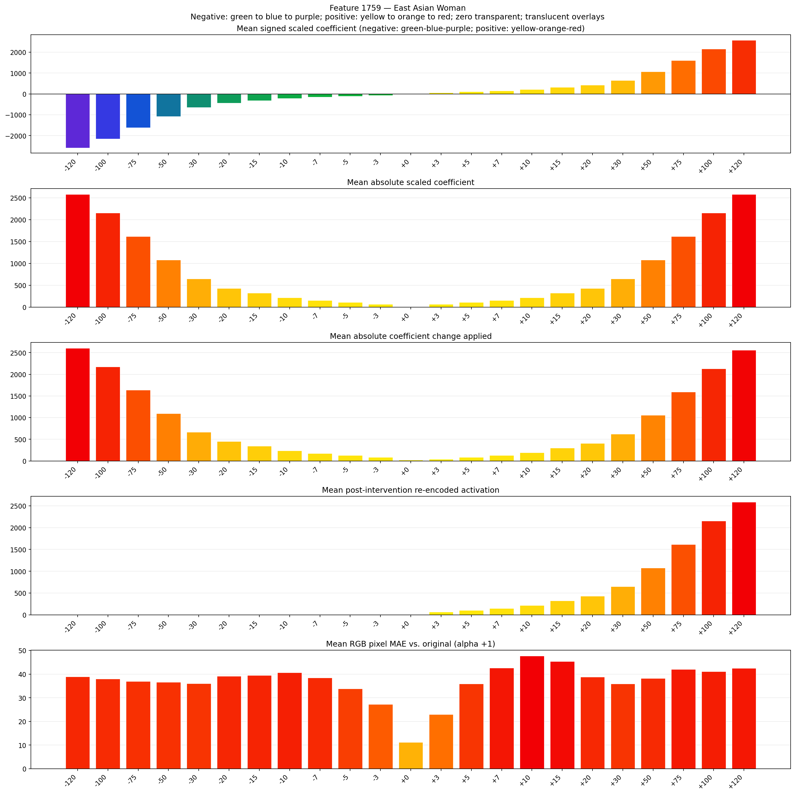
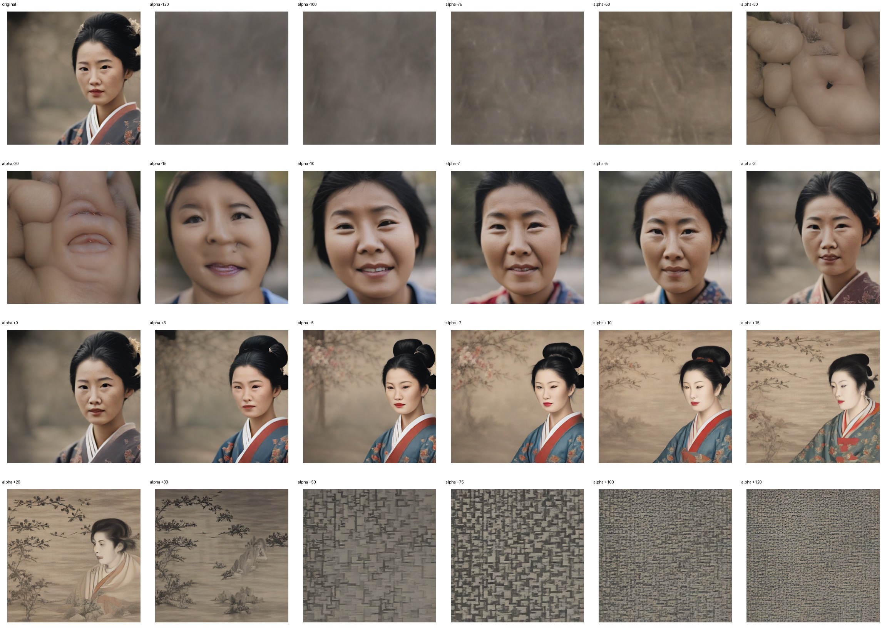
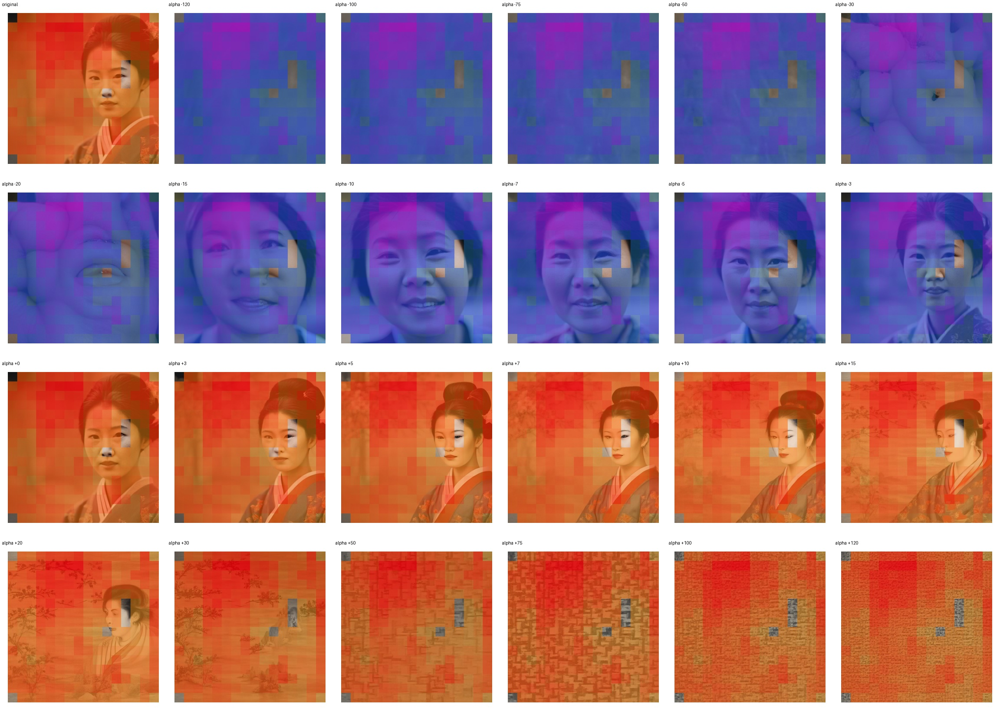
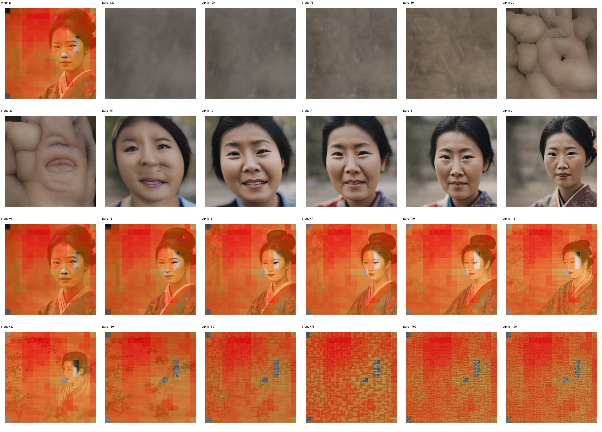

# Feature 1759 — East Asian Woman

Biased dataset; original prompt and seed replay for seeds 0–19. Values are means across 20 source images. The table reports the mean post-re-encoded activation of feature 1759, the active spatial fraction, mean RGB pixel MAE versus the original image (0–255 scale), and coefficient change magnitudes for each alpha.

## Activation graph

## Mean metrics by alpha

| Alpha | Mean post-reencoded feature 1759 activation | Active spatial fraction | Mean pixel change (MAE) | Mean absolute coefficient change | Mean absolute scaled coefficient |
|---:|---:|---:|---:|---:|---:|
| -120 | 0.000 | 0.000 | 38.916 | 2605.479 | 2583.946 |
| -100 | 0.000 | 0.000 | 38.006 | 2174.822 | 2153.289 |
| -75 | 0.000 | 0.000 | 36.946 | 1636.499 | 1614.967 |
| -50 | 0.000 | 0.000 | 36.608 | 1098.177 | 1076.644 |
| -30 | 0.000 | 0.000 | 35.989 | 667.519 | 645.987 |
| -20 | 0.000 | 0.000 | 39.204 | 452.191 | 430.658 |
| -15 | 0.000 | 0.000 | 39.516 | 344.526 | 322.993 |
| -10 | 0.000 | 0.000 | 40.705 | 236.862 | 215.329 |
| -7 | 0.000 | 0.000 | 38.515 | 172.263 | 150.730 |
| -5 | 0.000 | 0.000 | 33.805 | 129.197 | 107.664 |
| -3 | 0.000 | 0.000 | 27.276 | 86.132 | 64.599 |
| +0 | 0.000 | 0.000 | 11.200 | 21.533 | 0.000 |
| +3 | 64.680 | 0.988 | 23.018 | 43.066 | 64.599 |
| +5 | 107.827 | 0.988 | 35.864 | 86.132 | 107.664 |
| +7 | 150.974 | 0.988 | 42.649 | 129.197 | 150.730 |
| +10 | 215.695 | 0.988 | 47.719 | 193.796 | 215.329 |
| +15 | 323.563 | 0.988 | 45.449 | 301.460 | 322.993 |
| +20 | 431.430 | 0.988 | 38.780 | 409.125 | 430.658 |
| +30 | 647.166 | 0.988 | 35.928 | 624.454 | 645.987 |
| +50 | 1078.636 | 0.988 | 38.196 | 1055.111 | 1076.644 |
| +75 | 1617.976 | 0.988 | 42.055 | 1593.434 | 1614.967 |
| +100 | 2157.314 | 0.988 | 41.166 | 2131.756 | 2153.289 |
| +120 | 2588.786 | 0.988 | 42.494 | 2562.414 | 2583.946 |

## Per-seed grids

Each 4×6 sheet contains the original followed by the 23 alpha variants in ascending alpha order, from −120 through +120.

### Plain images

[All 20 plain-image grids](seed_sheets/)

### Signed coefficient overlays

[All 20 signed coefficient grids](signed_coefficient_overlays/)

### Post-re-encoded activation overlays

[All 20 post-activation grids](post_activation_overlays/)

### Intervention-footprint overlays

[All 20 intervention-footprint grids](intervention_footprint_overlays/)

Zero is transparent. Negative coefficient colors progress green through blue to purple; positive colors progress yellow through orange to red. Each map tile is normalized individually for visibility. The original and alpha-zero tiles show the pre-intervention feature map so its location remains visible.
