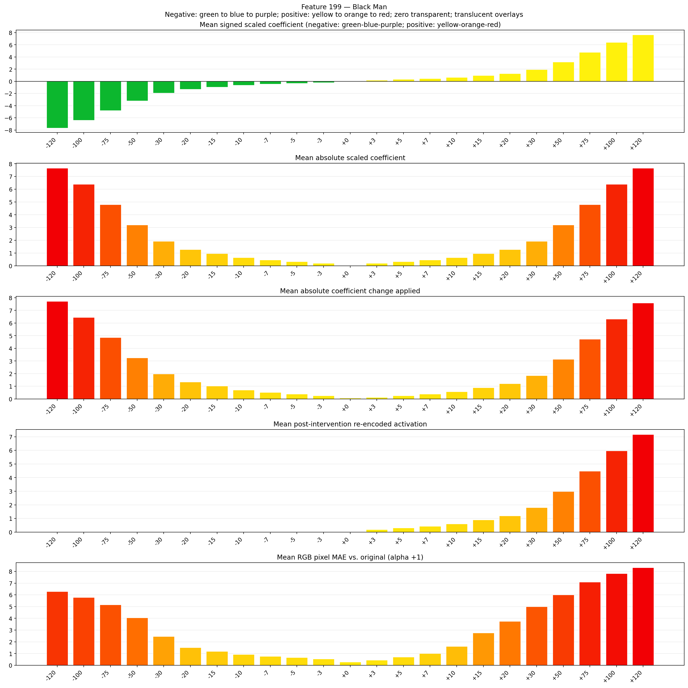

# Feature 199 — Black Man

Biased dataset; original prompt and seed replay for seeds 0–19. Values are means across 20 source images. The table reports the mean post-re-encoded activation of feature 199, the active spatial fraction, mean RGB pixel MAE versus the original image (0–255 scale), and coefficient change magnitudes for each alpha.

## Activation graph

## Mean metrics by alpha

| Alpha | Mean post-reencoded feature 199 activation | Active spatial fraction | Mean pixel change (MAE) | Mean absolute coefficient change | Mean absolute scaled coefficient |
|---:|---:|---:|---:|---:|---:|
| -120 | 0.000 | 0.000 | 6.286 | 7.723 | 7.659 |
| -100 | 0.000 | 0.000 | 5.779 | 6.446 | 6.382 |
| -75 | 0.000 | 0.000 | 5.160 | 4.851 | 4.787 |
| -50 | 0.000 | 0.000 | 4.046 | 3.255 | 3.191 |
| -30 | 0.000 | 0.000 | 2.455 | 1.979 | 1.915 |
| -20 | 0.000 | 0.000 | 1.509 | 1.340 | 1.276 |
| -15 | 0.000 | 0.000 | 1.184 | 1.021 | 0.957 |
| -10 | 0.000 | 0.000 | 0.919 | 0.702 | 0.638 |
| -7 | 0.000 | 0.000 | 0.766 | 0.511 | 0.447 |
| -5 | 0.000 | 0.000 | 0.658 | 0.383 | 0.319 |
| -3 | 0.000 | 0.000 | 0.532 | 0.255 | 0.191 |
| +0 | 0.000 | 0.000 | 0.285 | 0.064 | 0.000 |
| +3 | 0.183 | 0.007 | 0.431 | 0.128 | 0.191 |
| +5 | 0.303 | 0.007 | 0.703 | 0.255 | 0.319 |
| +7 | 0.422 | 0.007 | 1.009 | 0.383 | 0.447 |
| +10 | 0.601 | 0.007 | 1.612 | 0.574 | 0.638 |
| +15 | 0.900 | 0.007 | 2.759 | 0.894 | 0.957 |
| +20 | 1.198 | 0.007 | 3.755 | 1.213 | 1.276 |
| +30 | 1.795 | 0.007 | 5.001 | 1.851 | 1.915 |
| +50 | 2.989 | 0.007 | 6.007 | 3.127 | 3.191 |
| +75 | 4.482 | 0.007 | 7.092 | 4.723 | 4.787 |
| +100 | 5.975 | 0.007 | 7.813 | 6.319 | 6.382 |
| +120 | 7.169 | 0.007 | 8.323 | 7.595 | 7.659 |

## Per-seed grids

Each 4×6 sheet contains the original followed by the 23 alpha variants in ascending alpha order, from −120 through +120.

### Plain images

[All 20 plain-image grids](seed_sheets/)

### Signed coefficient overlays

[All 20 signed coefficient grids](signed_coefficient_overlays/)

### Post-re-encoded activation overlays

[All 20 post-activation grids](post_activation_overlays/)

### Intervention-footprint overlays

[All 20 intervention-footprint grids](intervention_footprint_overlays/)

Zero is transparent. Negative coefficient colors progress green through blue to purple; positive colors progress yellow through orange to red. Each map tile is normalized individually for visibility. The original and alpha-zero tiles show the pre-intervention feature map so its location remains visible.
