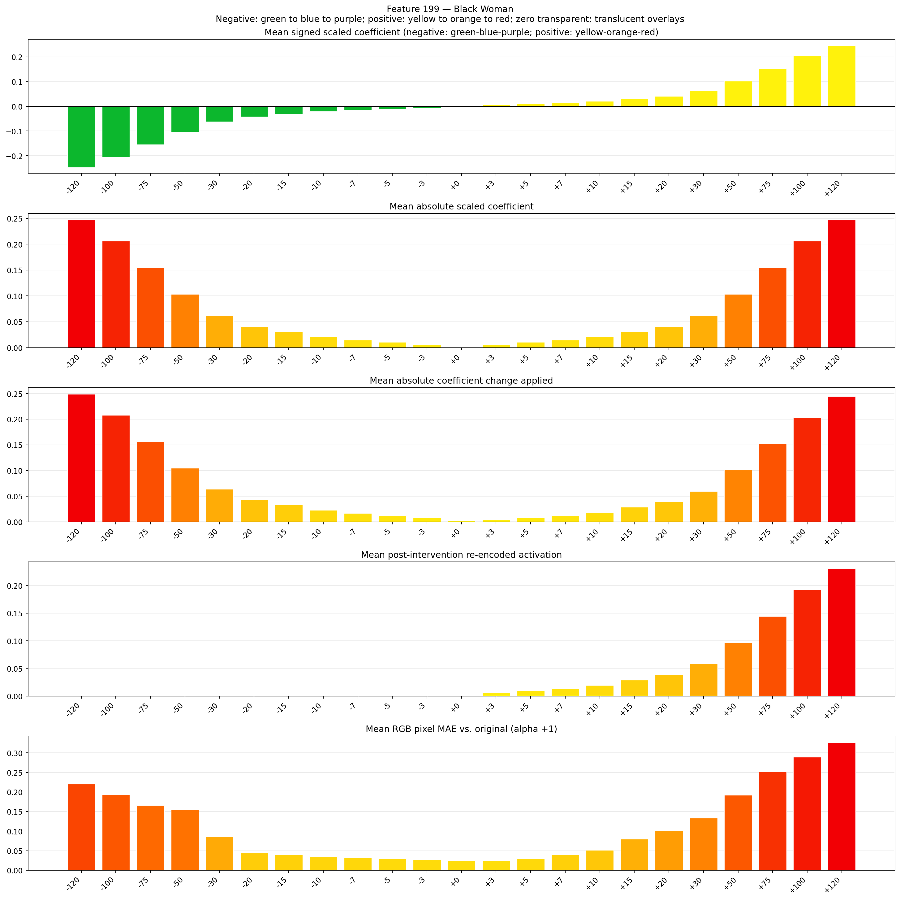

# Feature 199 — Black Woman

Biased dataset; original prompt and seed replay for seeds 0–19. Values are means across 20 source images. The table reports the mean post-re-encoded activation of feature 199, the active spatial fraction, mean RGB pixel MAE versus the original image (0–255 scale), and coefficient change magnitudes for each alpha.

## Activation graph

## Mean metrics by alpha

| Alpha | Mean post-reencoded feature 199 activation | Active spatial fraction | Mean pixel change (MAE) | Mean absolute coefficient change | Mean absolute scaled coefficient |
|---:|---:|---:|---:|---:|---:|
| -120 | 0.000 | 0.000 | 0.220 | 0.249 | 0.247 |
| -100 | 0.000 | 0.000 | 0.194 | 0.208 | 0.206 |
| -75 | 0.000 | 0.000 | 0.166 | 0.156 | 0.154 |
| -50 | 0.000 | 0.000 | 0.155 | 0.105 | 0.103 |
| -30 | 0.000 | 0.000 | 0.086 | 0.064 | 0.062 |
| -20 | 0.000 | 0.000 | 0.044 | 0.043 | 0.041 |
| -15 | 0.000 | 0.000 | 0.039 | 0.033 | 0.031 |
| -10 | 0.000 | 0.000 | 0.035 | 0.023 | 0.021 |
| -7 | 0.000 | 0.000 | 0.032 | 0.016 | 0.014 |
| -5 | 0.000 | 0.000 | 0.029 | 0.012 | 0.010 |
| -3 | 0.000 | 0.000 | 0.028 | 0.008 | 0.006 |
| +0 | 0.000 | 0.000 | 0.025 | 0.002 | 0.000 |
| +3 | 0.006 | 0.000 | 0.024 | 0.004 | 0.006 |
| +5 | 0.010 | 0.000 | 0.030 | 0.008 | 0.010 |
| +7 | 0.014 | 0.000 | 0.041 | 0.012 | 0.014 |
| +10 | 0.019 | 0.000 | 0.051 | 0.019 | 0.021 |
| +15 | 0.029 | 0.000 | 0.079 | 0.029 | 0.031 |
| +20 | 0.039 | 0.000 | 0.102 | 0.039 | 0.041 |
| +30 | 0.058 | 0.000 | 0.134 | 0.060 | 0.062 |
| +50 | 0.096 | 0.000 | 0.192 | 0.101 | 0.103 |
| +75 | 0.145 | 0.000 | 0.251 | 0.152 | 0.154 |
| +100 | 0.193 | 0.000 | 0.290 | 0.204 | 0.206 |
| +120 | 0.231 | 0.000 | 0.327 | 0.245 | 0.247 |

## Per-seed grids

Each 4×6 sheet contains the original followed by the 23 alpha variants in ascending alpha order, from −120 through +120.

### Plain images

[All 20 plain-image grids](seed_sheets/)

### Signed coefficient overlays

[All 20 signed coefficient grids](signed_coefficient_overlays/)

### Post-re-encoded activation overlays

[All 20 post-activation grids](post_activation_overlays/)

### Intervention-footprint overlays

[All 20 intervention-footprint grids](intervention_footprint_overlays/)

Zero is transparent. Negative coefficient colors progress green through blue to purple; positive colors progress yellow through orange to red. Each map tile is normalized individually for visibility. The original and alpha-zero tiles show the pre-intervention feature map so its location remains visible.
