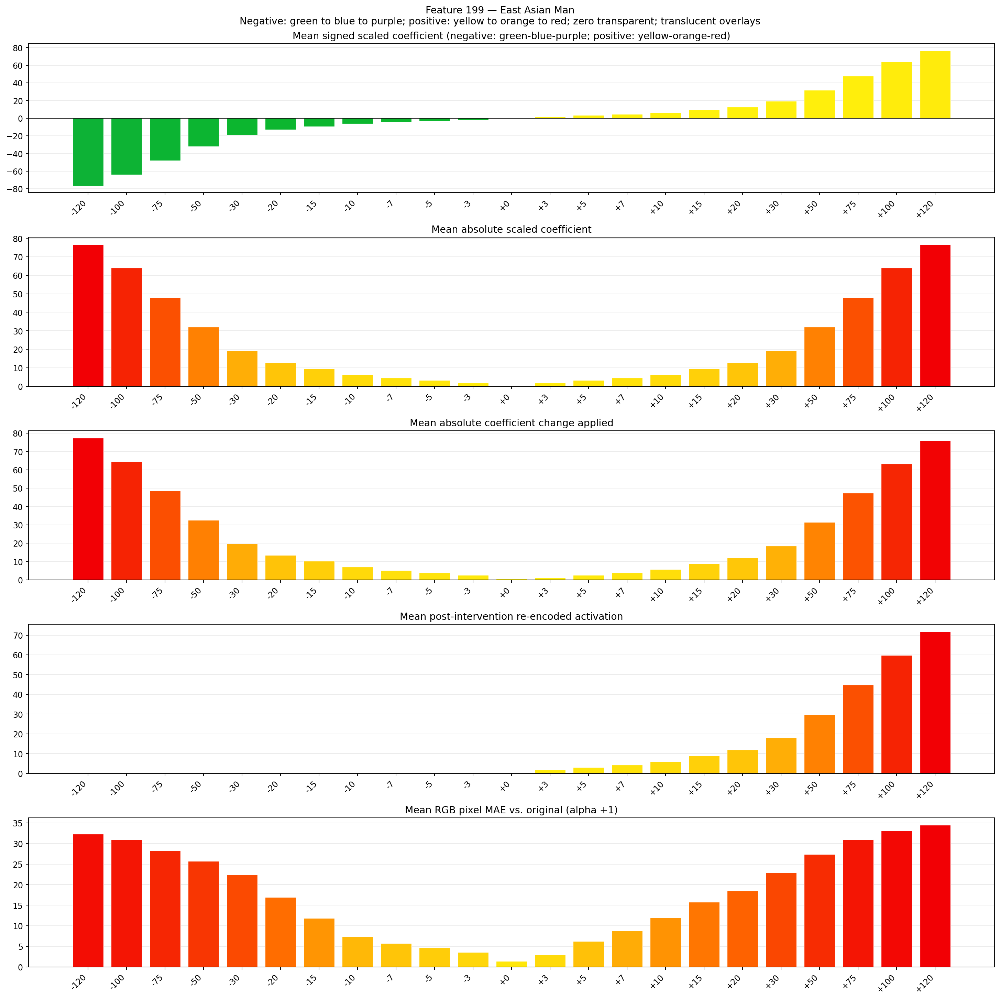
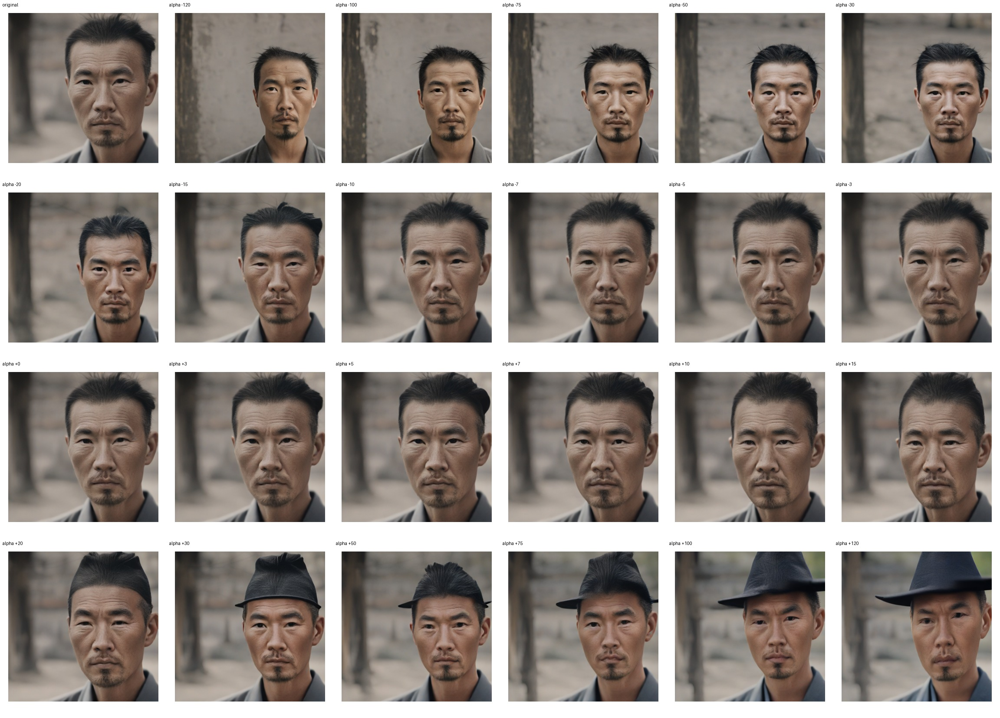
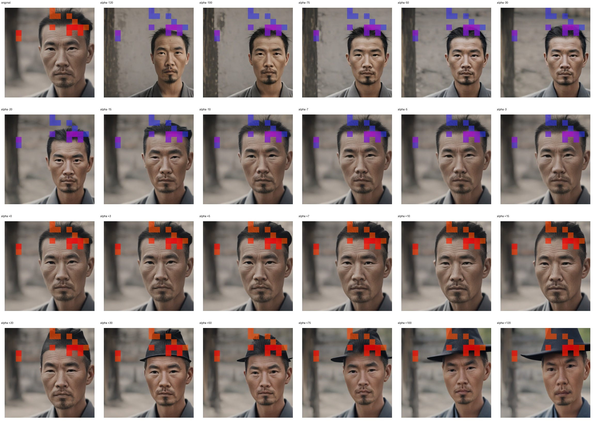
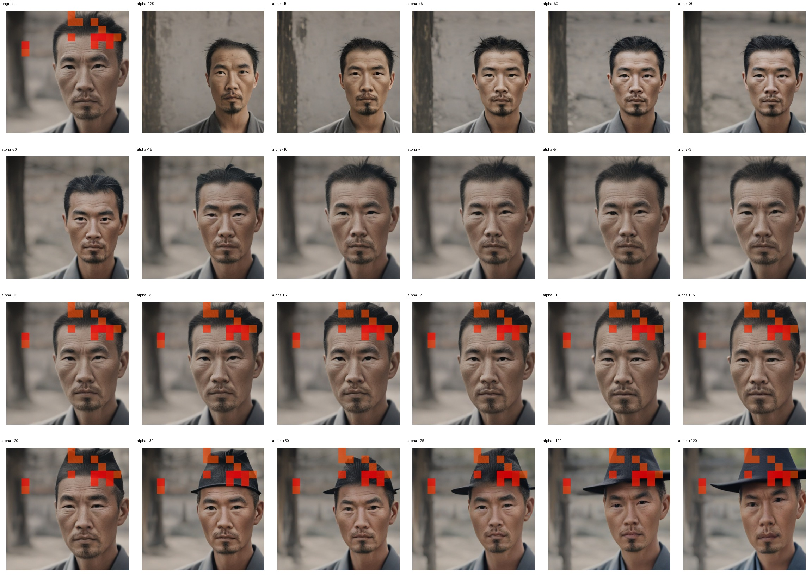

# Feature 199 — East Asian Man

Biased dataset; original prompt and seed replay for seeds 0–19. Values are means across 20 source images. The table reports the mean post-re-encoded activation of feature 199, the active spatial fraction, mean RGB pixel MAE versus the original image (0–255 scale), and coefficient change magnitudes for each alpha.

## Activation graph

## Mean metrics by alpha

| Alpha | Mean post-reencoded feature 199 activation | Active spatial fraction | Mean pixel change (MAE) | Mean absolute coefficient change | Mean absolute scaled coefficient |
|---:|---:|---:|---:|---:|---:|
| -120 | 0.000 | 0.000 | 32.332 | 77.416 | 76.776 |
| -100 | 0.000 | 0.000 | 31.004 | 64.620 | 63.980 |
| -75 | 0.000 | 0.000 | 28.314 | 48.625 | 47.985 |
| -50 | 0.000 | 0.000 | 25.710 | 32.630 | 31.990 |
| -30 | 0.000 | 0.000 | 22.493 | 19.834 | 19.194 |
| -20 | 0.000 | 0.000 | 16.912 | 13.436 | 12.796 |
| -15 | 0.000 | 0.000 | 11.857 | 10.237 | 9.597 |
| -10 | 0.000 | 0.000 | 7.409 | 7.038 | 6.398 |
| -7 | 0.000 | 0.000 | 5.731 | 5.118 | 4.479 |
| -5 | 0.000 | 0.000 | 4.669 | 3.839 | 3.199 |
| -3 | 0.000 | 0.000 | 3.595 | 2.559 | 1.919 |
| +0 | 0.000 | 0.000 | 1.432 | 0.640 | 0.000 |
| +3 | 1.837 | 0.057 | 2.991 | 1.280 | 1.919 |
| +5 | 3.034 | 0.057 | 6.210 | 2.559 | 3.199 |
| +7 | 4.231 | 0.057 | 8.870 | 3.839 | 4.479 |
| +10 | 6.027 | 0.057 | 12.034 | 5.758 | 6.398 |
| +15 | 9.019 | 0.057 | 15.784 | 8.957 | 9.597 |
| +20 | 12.012 | 0.057 | 18.555 | 12.156 | 12.796 |
| +30 | 17.997 | 0.057 | 22.917 | 18.554 | 19.194 |
| +50 | 29.968 | 0.057 | 27.386 | 31.350 | 31.990 |
| +75 | 44.931 | 0.057 | 30.988 | 47.345 | 47.985 |
| +100 | 59.894 | 0.057 | 33.154 | 63.340 | 63.980 |
| +120 | 71.865 | 0.057 | 34.489 | 76.137 | 76.776 |

## Per-seed grids

Each 4×6 sheet contains the original followed by the 23 alpha variants in ascending alpha order, from −120 through +120.

### Plain images

[All 20 plain-image grids](seed_sheets/)

### Signed coefficient overlays

[All 20 signed coefficient grids](signed_coefficient_overlays/)

### Post-re-encoded activation overlays

[All 20 post-activation grids](post_activation_overlays/)

### Intervention-footprint overlays

[All 20 intervention-footprint grids](intervention_footprint_overlays/)

Zero is transparent. Negative coefficient colors progress green through blue to purple; positive colors progress yellow through orange to red. Each map tile is normalized individually for visibility. The original and alpha-zero tiles show the pre-intervention feature map so its location remains visible.
