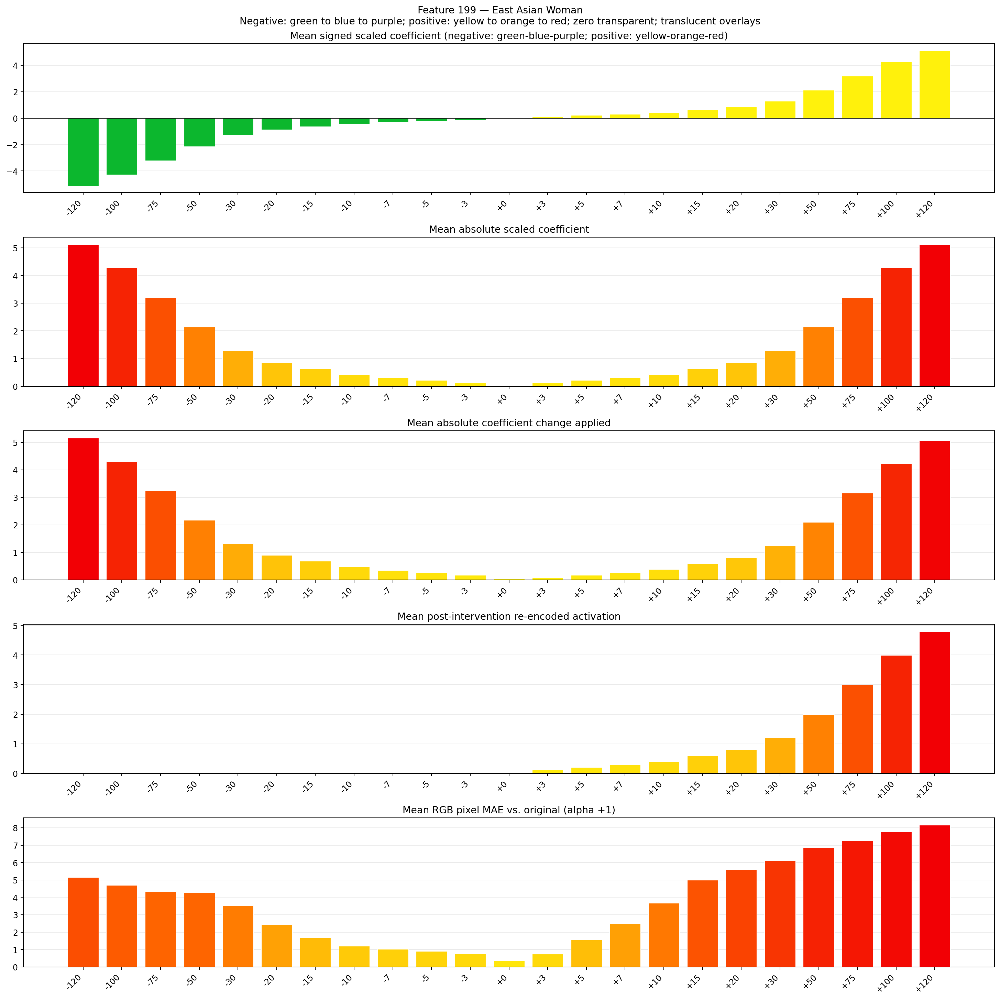
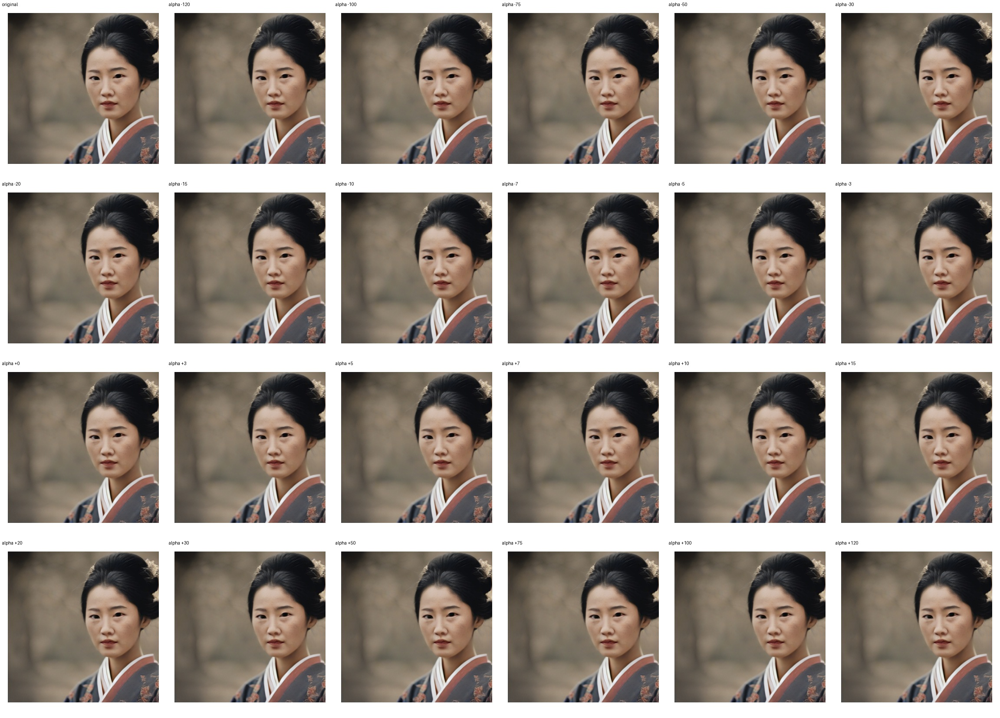

# Feature 199 — East Asian Woman

Biased dataset; original prompt and seed replay for seeds 0–19. Values are means across 20 source images. The table reports the mean post-re-encoded activation of feature 199, the active spatial fraction, mean RGB pixel MAE versus the original image (0–255 scale), and coefficient change magnitudes for each alpha.

## Activation graph

## Mean metrics by alpha

| Alpha | Mean post-reencoded feature 199 activation | Active spatial fraction | Mean pixel change (MAE) | Mean absolute coefficient change | Mean absolute scaled coefficient |
|---:|---:|---:|---:|---:|---:|
| -120 | 0.000 | 0.000 | 5.165 | 5.168 | 5.125 |
| -100 | 0.000 | 0.000 | 4.694 | 4.314 | 4.271 |
| -75 | 0.000 | 0.000 | 4.339 | 3.246 | 3.203 |
| -50 | 0.000 | 0.000 | 4.281 | 2.178 | 2.135 |
| -30 | 0.000 | 0.000 | 3.543 | 1.324 | 1.281 |
| -20 | 0.000 | 0.000 | 2.447 | 0.897 | 0.854 |
| -15 | 0.000 | 0.000 | 1.668 | 0.683 | 0.641 |
| -10 | 0.000 | 0.000 | 1.210 | 0.470 | 0.427 |
| -7 | 0.000 | 0.000 | 1.030 | 0.342 | 0.299 |
| -5 | 0.000 | 0.000 | 0.905 | 0.256 | 0.214 |
| -3 | 0.000 | 0.000 | 0.759 | 0.171 | 0.128 |
| +0 | 0.000 | 0.000 | 0.361 | 0.043 | 0.000 |
| +3 | 0.123 | 0.004 | 0.753 | 0.085 | 0.128 |
| +5 | 0.203 | 0.004 | 1.564 | 0.171 | 0.214 |
| +7 | 0.282 | 0.004 | 2.480 | 0.256 | 0.299 |
| +10 | 0.402 | 0.004 | 3.678 | 0.384 | 0.427 |
| +15 | 0.602 | 0.004 | 4.995 | 0.598 | 0.641 |
| +20 | 0.802 | 0.004 | 5.604 | 0.811 | 0.854 |
| +30 | 1.201 | 0.004 | 6.107 | 1.239 | 1.281 |
| +50 | 2.000 | 0.004 | 6.863 | 2.093 | 2.135 |
| +75 | 2.999 | 0.004 | 7.277 | 3.160 | 3.203 |
| +100 | 3.998 | 0.004 | 7.780 | 4.228 | 4.271 |
| +120 | 4.797 | 0.004 | 8.163 | 5.082 | 5.125 |

## Per-seed grids

Each 4×6 sheet contains the original followed by the 23 alpha variants in ascending alpha order, from −120 through +120.

### Plain images

[All 20 plain-image grids](seed_sheets/)

### Signed coefficient overlays

[All 20 signed coefficient grids](signed_coefficient_overlays/)

### Post-re-encoded activation overlays

[All 20 post-activation grids](post_activation_overlays/)

### Intervention-footprint overlays

[All 20 intervention-footprint grids](intervention_footprint_overlays/)

Zero is transparent. Negative coefficient colors progress green through blue to purple; positive colors progress yellow through orange to red. Each map tile is normalized individually for visibility. The original and alpha-zero tiles show the pre-intervention feature map so its location remains visible.
