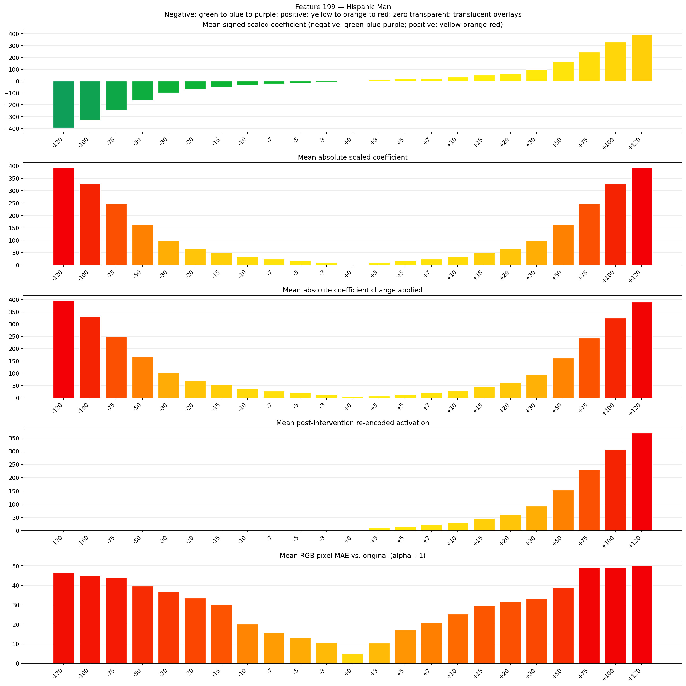
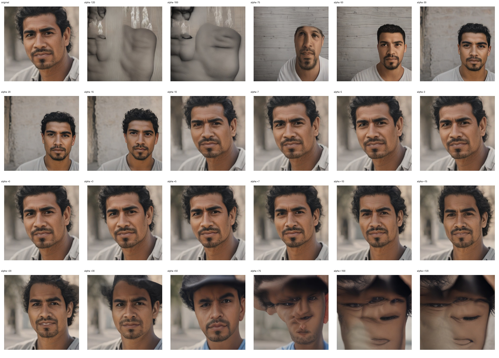
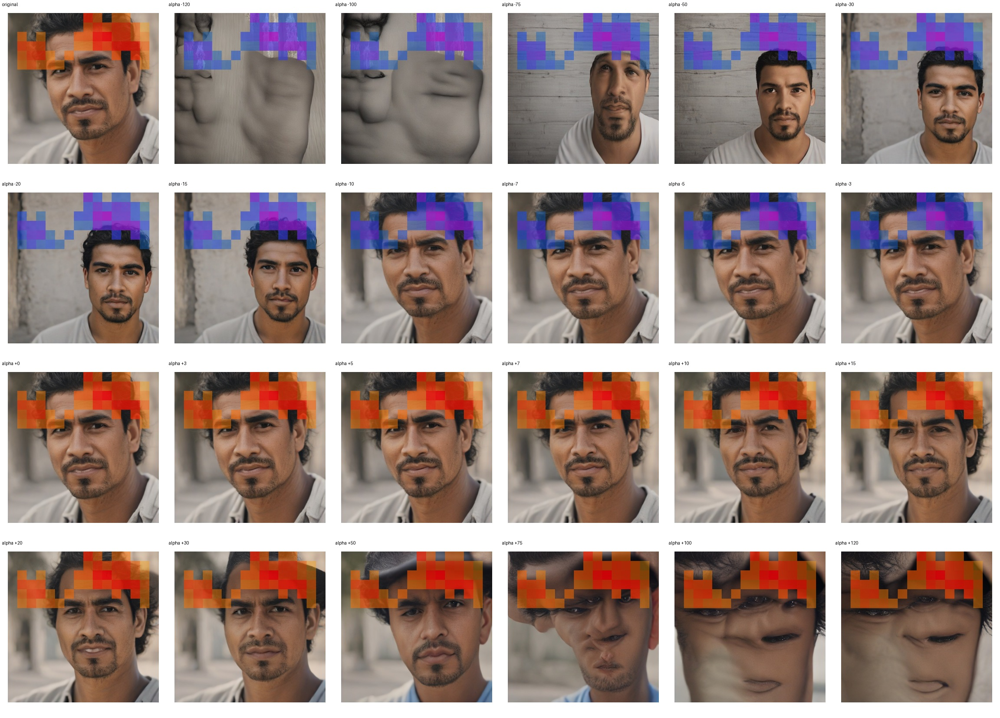
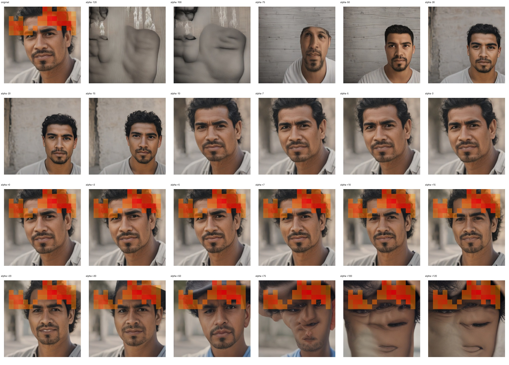

# Feature 199 — Hispanic Man

Biased dataset; original prompt and seed replay for seeds 0–19. Values are means across 20 source images. The table reports the mean post-re-encoded activation of feature 199, the active spatial fraction, mean RGB pixel MAE versus the original image (0–255 scale), and coefficient change magnitudes for each alpha.

## Activation graph

## Mean metrics by alpha

| Alpha | Mean post-reencoded feature 199 activation | Active spatial fraction | Mean pixel change (MAE) | Mean absolute coefficient change | Mean absolute scaled coefficient |
|---:|---:|---:|---:|---:|---:|
| -120 | 0.000 | 0.000 | 46.559 | 396.044 | 392.771 |
| -100 | 0.000 | 0.000 | 44.818 | 330.583 | 327.309 |
| -75 | 0.000 | 0.000 | 43.824 | 248.755 | 245.482 |
| -50 | 0.000 | 0.000 | 39.504 | 166.928 | 163.655 |
| -30 | 0.000 | 0.000 | 36.913 | 101.466 | 98.193 |
| -20 | 0.000 | 0.000 | 33.501 | 68.735 | 65.462 |
| -15 | 0.000 | 0.000 | 30.213 | 52.370 | 49.096 |
| -10 | 0.000 | 0.000 | 20.004 | 36.004 | 32.731 |
| -7 | 0.000 | 0.000 | 15.864 | 26.185 | 22.912 |
| -5 | 0.000 | 0.000 | 13.083 | 19.639 | 16.365 |
| -3 | 0.000 | 0.000 | 10.462 | 13.092 | 9.819 |
| +0 | 0.000 | 0.000 | 4.911 | 3.273 | 0.000 |
| +3 | 9.397 | 0.202 | 10.347 | 6.546 | 9.819 |
| +5 | 15.521 | 0.202 | 17.209 | 13.092 | 16.365 |
| +7 | 21.645 | 0.202 | 21.072 | 19.639 | 22.912 |
| +10 | 30.831 | 0.202 | 25.306 | 29.458 | 32.731 |
| +15 | 46.140 | 0.202 | 29.545 | 45.823 | 49.096 |
| +20 | 61.450 | 0.202 | 31.492 | 62.189 | 65.462 |
| +30 | 92.069 | 0.202 | 33.237 | 94.920 | 98.193 |
| +50 | 153.308 | 0.202 | 38.800 | 160.382 | 163.655 |
| +75 | 229.857 | 0.202 | 48.903 | 242.209 | 245.482 |
| +100 | 306.406 | 0.202 | 49.082 | 324.036 | 327.309 |
| +120 | 367.644 | 0.202 | 49.936 | 389.498 | 392.771 |

## Per-seed grids

Each 4×6 sheet contains the original followed by the 23 alpha variants in ascending alpha order, from −120 through +120.

### Plain images

[All 20 plain-image grids](seed_sheets/)

### Signed coefficient overlays

[All 20 signed coefficient grids](signed_coefficient_overlays/)

### Post-re-encoded activation overlays

[All 20 post-activation grids](post_activation_overlays/)

### Intervention-footprint overlays

[All 20 intervention-footprint grids](intervention_footprint_overlays/)

Zero is transparent. Negative coefficient colors progress green through blue to purple; positive colors progress yellow through orange to red. Each map tile is normalized individually for visibility. The original and alpha-zero tiles show the pre-intervention feature map so its location remains visible.
