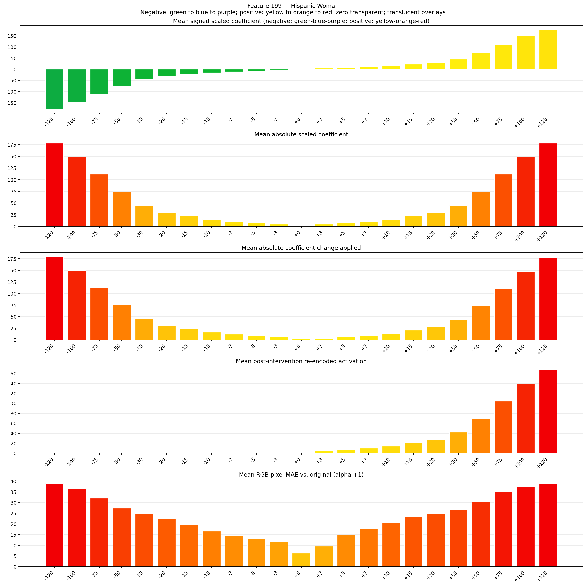
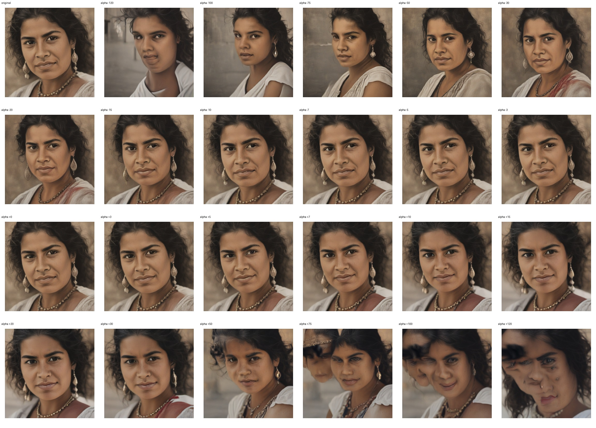
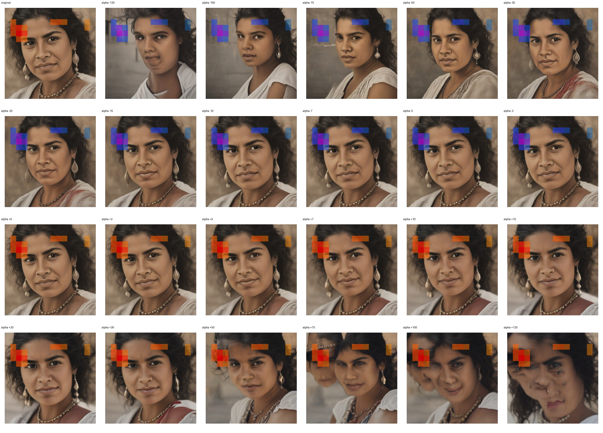
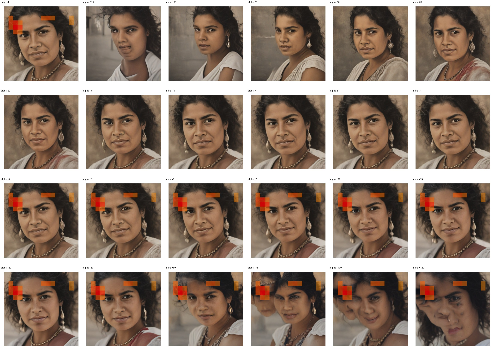

# Feature 199 — Hispanic Woman

Biased dataset; original prompt and seed replay for seeds 0–19. Values are means across 20 source images. The table reports the mean post-re-encoded activation of feature 199, the active spatial fraction, mean RGB pixel MAE versus the original image (0–255 scale), and coefficient change magnitudes for each alpha.

## Activation graph

## Mean metrics by alpha

| Alpha | Mean post-reencoded feature 199 activation | Active spatial fraction | Mean pixel change (MAE) | Mean absolute coefficient change | Mean absolute scaled coefficient |
|---:|---:|---:|---:|---:|---:|
| -120 | 0.000 | 0.000 | 38.965 | 179.568 | 178.084 |
| -100 | 0.000 | 0.000 | 36.634 | 149.887 | 148.403 |
| -75 | 0.000 | 0.000 | 32.088 | 112.786 | 111.302 |
| -50 | 0.000 | 0.000 | 27.335 | 75.686 | 74.202 |
| -30 | 0.000 | 0.000 | 24.934 | 46.005 | 44.521 |
| -20 | 0.000 | 0.000 | 22.402 | 31.165 | 29.681 |
| -15 | 0.000 | 0.000 | 19.779 | 23.745 | 22.260 |
| -10 | 0.000 | 0.000 | 16.573 | 16.324 | 14.840 |
| -7 | 0.000 | 0.000 | 14.467 | 11.872 | 10.388 |
| -5 | 0.000 | 0.000 | 13.061 | 8.904 | 7.420 |
| -3 | 0.000 | 0.000 | 11.498 | 5.936 | 4.452 |
| +0 | 0.000 | 0.000 | 6.340 | 1.484 | 0.000 |
| +3 | 4.261 | 0.089 | 9.567 | 2.968 | 4.452 |
| +5 | 7.037 | 0.089 | 14.780 | 5.936 | 7.420 |
| +7 | 9.814 | 0.089 | 17.830 | 8.904 | 10.388 |
| +10 | 13.979 | 0.089 | 20.699 | 13.356 | 14.840 |
| +15 | 20.920 | 0.089 | 23.328 | 20.776 | 22.260 |
| +20 | 27.862 | 0.089 | 24.880 | 28.197 | 29.681 |
| +30 | 41.745 | 0.089 | 26.649 | 43.037 | 44.521 |
| +50 | 69.510 | 0.089 | 30.524 | 72.718 | 74.202 |
| +75 | 104.218 | 0.089 | 35.081 | 109.818 | 111.302 |
| +100 | 138.925 | 0.089 | 37.525 | 146.919 | 148.403 |
| +120 | 166.692 | 0.089 | 38.839 | 176.600 | 178.084 |

## Per-seed grids

Each 4×6 sheet contains the original followed by the 23 alpha variants in ascending alpha order, from −120 through +120.

### Plain images

[All 20 plain-image grids](seed_sheets/)

### Signed coefficient overlays

[All 20 signed coefficient grids](signed_coefficient_overlays/)

### Post-re-encoded activation overlays

[All 20 post-activation grids](post_activation_overlays/)

### Intervention-footprint overlays

[All 20 intervention-footprint grids](intervention_footprint_overlays/)

Zero is transparent. Negative coefficient colors progress green through blue to purple; positive colors progress yellow through orange to red. Each map tile is normalized individually for visibility. The original and alpha-zero tiles show the pre-intervention feature map so its location remains visible.
