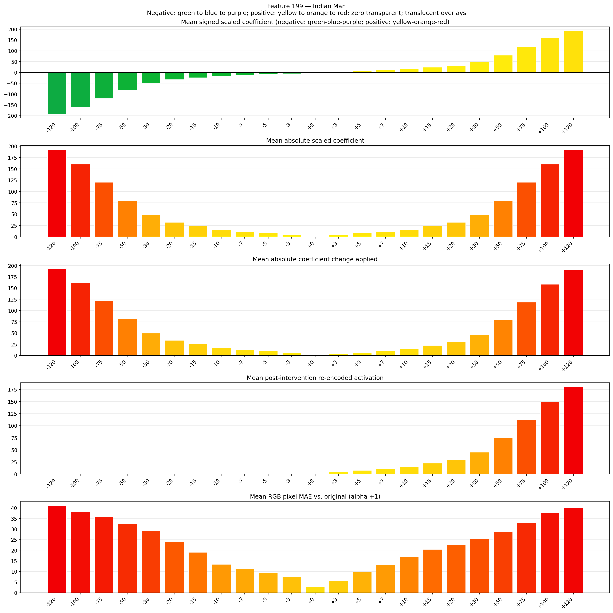
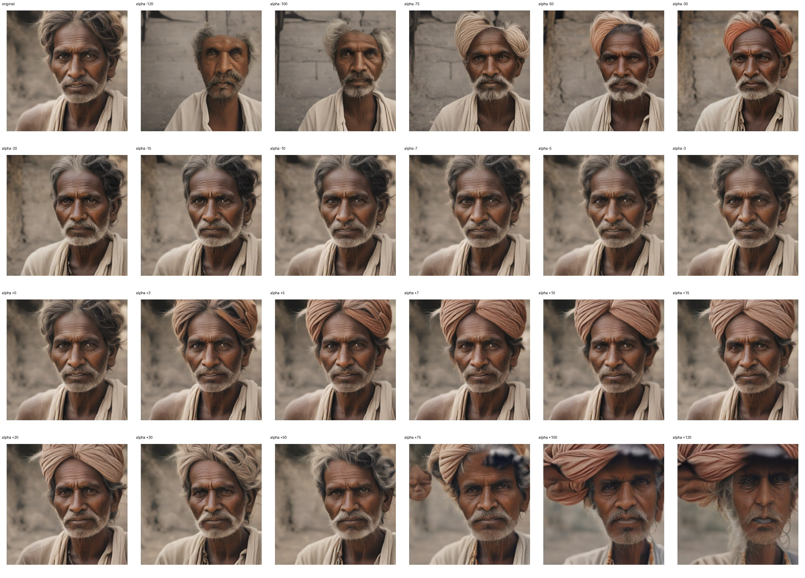
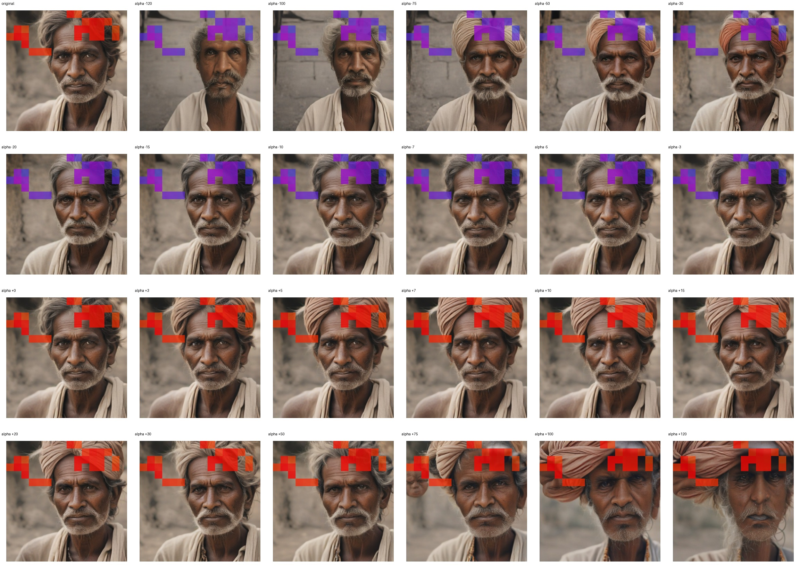
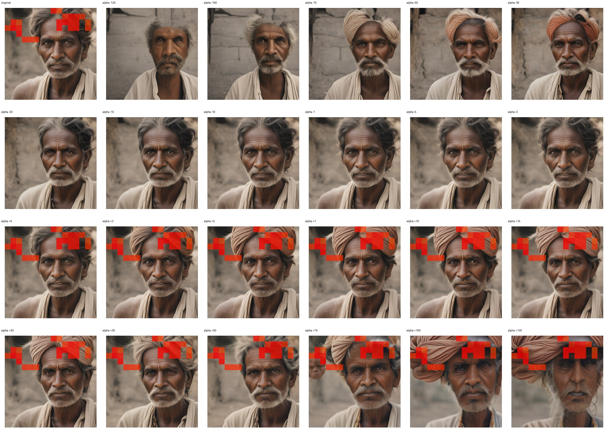

# Feature 199 — Indian Man

Biased dataset; original prompt and seed replay for seeds 0–19. Values are means across 20 source images. The table reports the mean post-re-encoded activation of feature 199, the active spatial fraction, mean RGB pixel MAE versus the original image (0–255 scale), and coefficient change magnitudes for each alpha.

## Activation graph

## Mean metrics by alpha

| Alpha | Mean post-reencoded feature 199 activation | Active spatial fraction | Mean pixel change (MAE) | Mean absolute coefficient change | Mean absolute scaled coefficient |
|---:|---:|---:|---:|---:|---:|
| -120 | 0.000 | 0.000 | 41.009 | 193.733 | 192.132 |
| -100 | 0.000 | 0.000 | 38.340 | 161.711 | 160.110 |
| -75 | 0.000 | 0.000 | 35.879 | 121.684 | 120.083 |
| -50 | 0.000 | 0.000 | 32.550 | 81.656 | 80.055 |
| -30 | 0.000 | 0.000 | 29.301 | 49.634 | 48.033 |
| -20 | 0.000 | 0.000 | 23.907 | 33.623 | 32.022 |
| -15 | 0.000 | 0.000 | 19.024 | 25.618 | 24.017 |
| -10 | 0.000 | 0.000 | 13.434 | 17.612 | 16.011 |
| -7 | 0.000 | 0.000 | 11.206 | 12.809 | 11.208 |
| -5 | 0.000 | 0.000 | 9.502 | 9.607 | 8.006 |
| -3 | 0.000 | 0.000 | 7.471 | 6.404 | 4.803 |
| +0 | 0.000 | 0.000 | 2.981 | 1.601 | 0.000 |
| +3 | 4.597 | 0.121 | 5.606 | 3.202 | 4.803 |
| +5 | 7.592 | 0.121 | 9.718 | 6.404 | 8.006 |
| +7 | 10.588 | 0.121 | 13.194 | 9.607 | 11.208 |
| +10 | 15.081 | 0.121 | 16.830 | 14.410 | 16.011 |
| +15 | 22.570 | 0.121 | 20.447 | 22.415 | 24.017 |
| +20 | 30.060 | 0.121 | 22.770 | 30.421 | 32.022 |
| +30 | 45.038 | 0.121 | 25.542 | 46.432 | 48.033 |
| +50 | 74.994 | 0.121 | 28.915 | 78.454 | 80.055 |
| +75 | 112.439 | 0.121 | 33.014 | 118.481 | 120.083 |
| +100 | 149.885 | 0.121 | 37.645 | 158.509 | 160.110 |
| +120 | 179.841 | 0.121 | 40.028 | 190.531 | 192.132 |

## Per-seed grids

Each 4×6 sheet contains the original followed by the 23 alpha variants in ascending alpha order, from −120 through +120.

### Plain images

[All 20 plain-image grids](seed_sheets/)

### Signed coefficient overlays

[All 20 signed coefficient grids](signed_coefficient_overlays/)

### Post-re-encoded activation overlays

[All 20 post-activation grids](post_activation_overlays/)

### Intervention-footprint overlays

[All 20 intervention-footprint grids](intervention_footprint_overlays/)

Zero is transparent. Negative coefficient colors progress green through blue to purple; positive colors progress yellow through orange to red. Each map tile is normalized individually for visibility. The original and alpha-zero tiles show the pre-intervention feature map so its location remains visible.
