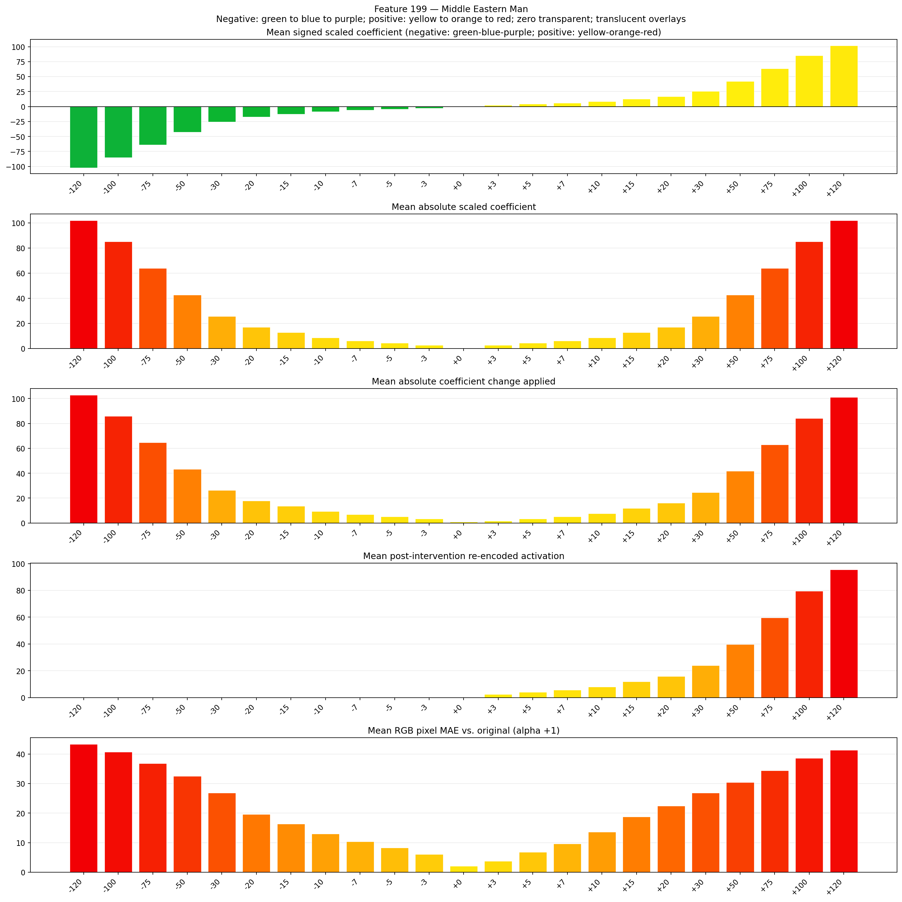
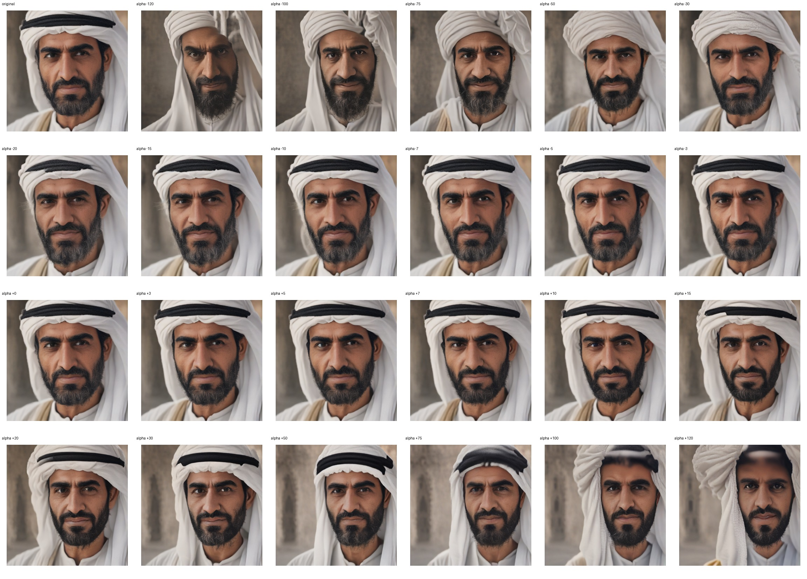
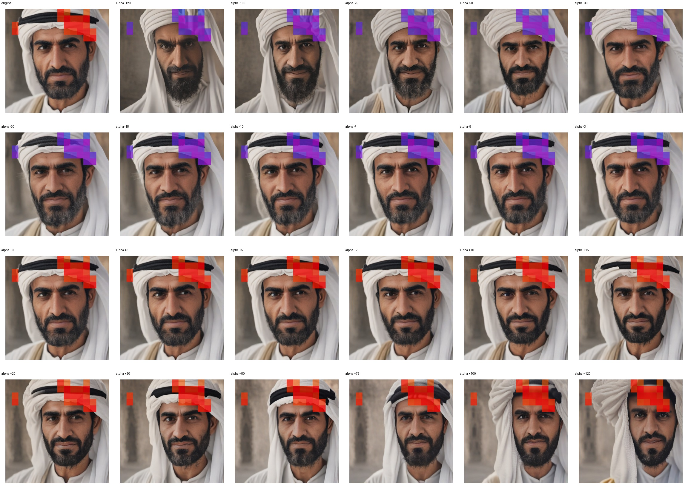
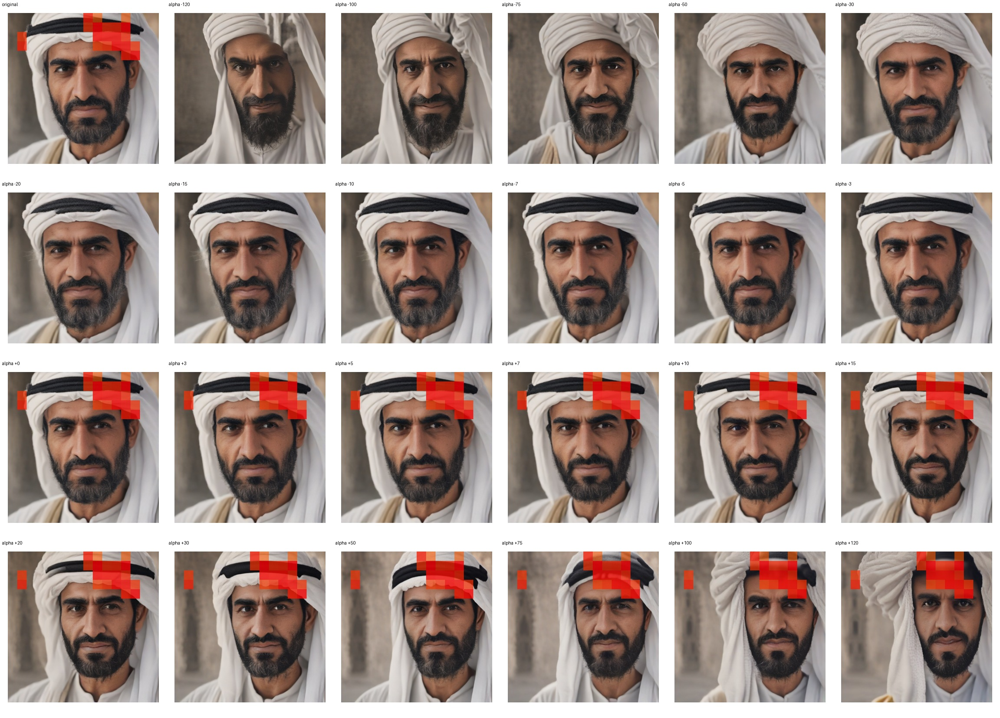

# Feature 199 — Middle Eastern Man

Biased dataset; original prompt and seed replay for seeds 0–19. Values are means across 20 source images. The table reports the mean post-re-encoded activation of feature 199, the active spatial fraction, mean RGB pixel MAE versus the original image (0–255 scale), and coefficient change magnitudes for each alpha.

## Activation graph

## Mean metrics by alpha

| Alpha | Mean post-reencoded feature 199 activation | Active spatial fraction | Mean pixel change (MAE) | Mean absolute coefficient change | Mean absolute scaled coefficient |
|---:|---:|---:|---:|---:|---:|
| -120 | 0.000 | 0.000 | 43.331 | 102.935 | 102.085 |
| -100 | 0.000 | 0.000 | 40.743 | 85.921 | 85.071 |
| -75 | 0.000 | 0.000 | 36.773 | 64.654 | 63.803 |
| -50 | 0.000 | 0.000 | 32.528 | 43.386 | 42.535 |
| -30 | 0.000 | 0.000 | 26.796 | 26.372 | 25.521 |
| -20 | 0.000 | 0.000 | 19.588 | 17.865 | 17.014 |
| -15 | 0.000 | 0.000 | 16.366 | 13.611 | 12.761 |
| -10 | 0.000 | 0.000 | 12.976 | 9.358 | 8.507 |
| -7 | 0.000 | 0.000 | 10.353 | 6.806 | 5.955 |
| -5 | 0.000 | 0.000 | 8.320 | 5.104 | 4.254 |
| -3 | 0.000 | 0.000 | 6.106 | 3.403 | 2.552 |
| +0 | 0.000 | 0.000 | 2.089 | 0.851 | 0.000 |
| +3 | 2.442 | 0.081 | 3.792 | 1.701 | 2.552 |
| +5 | 4.034 | 0.081 | 6.795 | 3.403 | 4.254 |
| +7 | 5.626 | 0.081 | 9.661 | 5.104 | 5.955 |
| +10 | 8.013 | 0.081 | 13.606 | 7.656 | 8.507 |
| +15 | 11.992 | 0.081 | 18.741 | 11.910 | 12.761 |
| +20 | 15.971 | 0.081 | 22.389 | 16.163 | 17.014 |
| +30 | 23.930 | 0.081 | 26.812 | 24.670 | 25.521 |
| +50 | 39.846 | 0.081 | 30.411 | 41.685 | 42.535 |
| +75 | 59.742 | 0.081 | 34.360 | 62.952 | 63.803 |
| +100 | 79.638 | 0.081 | 38.598 | 84.220 | 85.071 |
| +120 | 95.554 | 0.081 | 41.347 | 101.234 | 102.085 |

## Per-seed grids

Each 4×6 sheet contains the original followed by the 23 alpha variants in ascending alpha order, from −120 through +120.

### Plain images

[All 20 plain-image grids](seed_sheets/)

### Signed coefficient overlays

[All 20 signed coefficient grids](signed_coefficient_overlays/)

### Post-re-encoded activation overlays

[All 20 post-activation grids](post_activation_overlays/)

### Intervention-footprint overlays

[All 20 intervention-footprint grids](intervention_footprint_overlays/)

Zero is transparent. Negative coefficient colors progress green through blue to purple; positive colors progress yellow through orange to red. Each map tile is normalized individually for visibility. The original and alpha-zero tiles show the pre-intervention feature map so its location remains visible.
