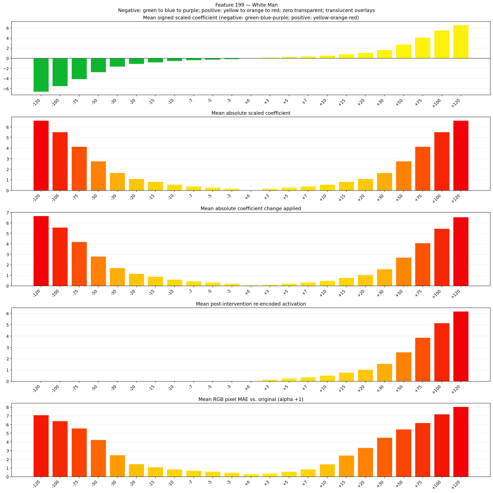
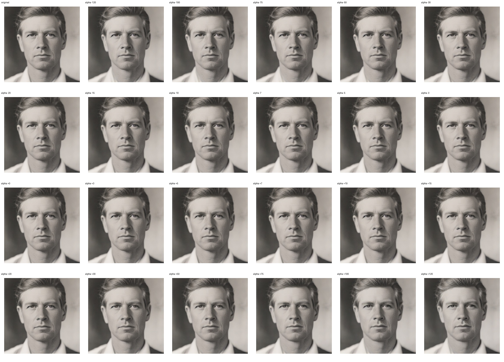
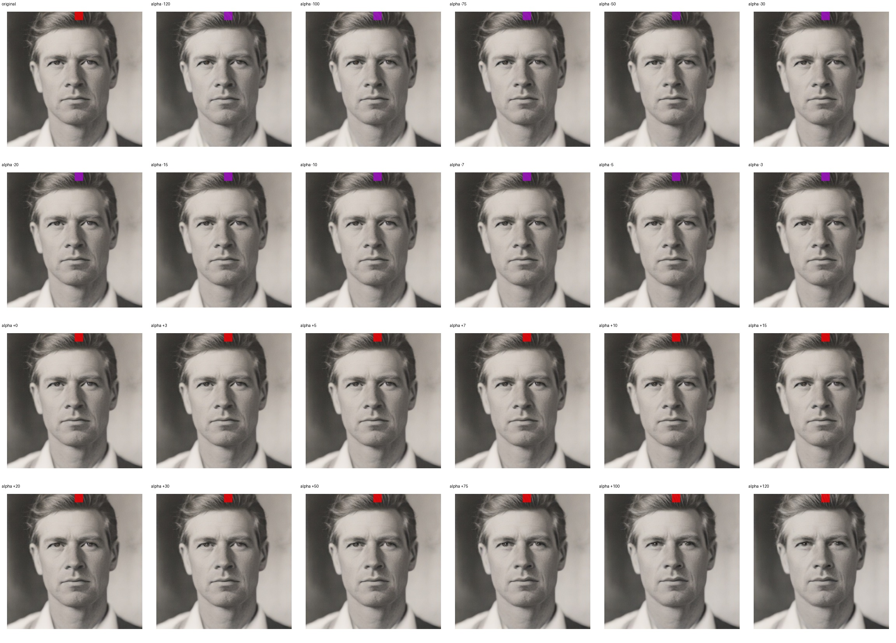
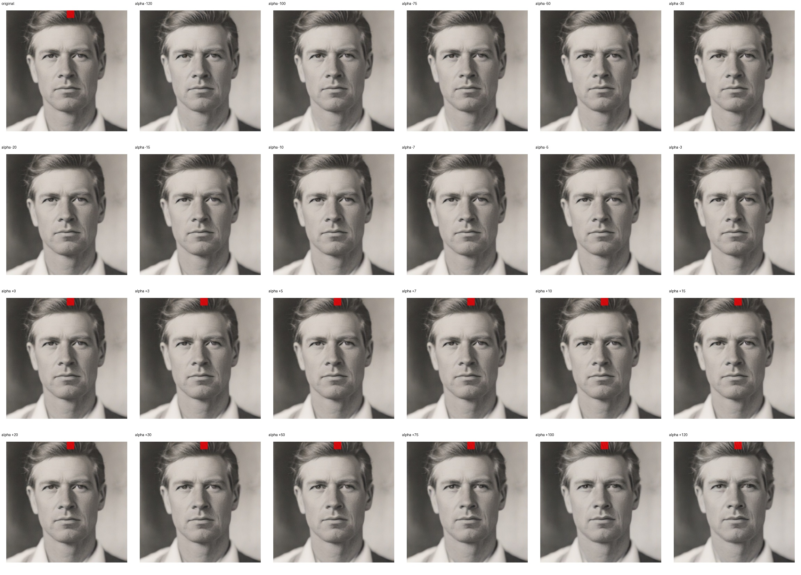

# Feature 199 — White Man

Biased dataset; original prompt and seed replay for seeds 0–19. Values are means across 20 source images. The table reports the mean post-re-encoded activation of feature 199, the active spatial fraction, mean RGB pixel MAE versus the original image (0–255 scale), and coefficient change magnitudes for each alpha.

## Activation graph

## Mean metrics by alpha

| Alpha | Mean post-reencoded feature 199 activation | Active spatial fraction | Mean pixel change (MAE) | Mean absolute coefficient change | Mean absolute scaled coefficient |
|---:|---:|---:|---:|---:|---:|
| -120 | 0.000 | 0.000 | 7.097 | 6.674 | 6.619 |
| -100 | 0.000 | 0.000 | 6.414 | 5.571 | 5.516 |
| -75 | 0.000 | 0.000 | 5.566 | 4.192 | 4.137 |
| -50 | 0.000 | 0.000 | 4.254 | 2.813 | 2.758 |
| -30 | 0.000 | 0.000 | 2.489 | 1.710 | 1.655 |
| -20 | 0.000 | 0.000 | 1.454 | 1.158 | 1.103 |
| -15 | 0.000 | 0.000 | 1.112 | 0.883 | 0.827 |
| -10 | 0.000 | 0.000 | 0.848 | 0.607 | 0.552 |
| -7 | 0.000 | 0.000 | 0.695 | 0.441 | 0.386 |
| -5 | 0.000 | 0.000 | 0.589 | 0.331 | 0.276 |
| -3 | 0.000 | 0.000 | 0.472 | 0.221 | 0.165 |
| +0 | 0.000 | 0.000 | 0.299 | 0.055 | 0.000 |
| +3 | 0.158 | 0.005 | 0.384 | 0.110 | 0.165 |
| +5 | 0.262 | 0.005 | 0.580 | 0.221 | 0.276 |
| +7 | 0.365 | 0.005 | 0.862 | 0.331 | 0.386 |
| +10 | 0.520 | 0.005 | 1.437 | 0.496 | 0.552 |
| +15 | 0.778 | 0.005 | 2.461 | 0.772 | 0.827 |
| +20 | 1.036 | 0.005 | 3.330 | 1.048 | 1.103 |
| +30 | 1.552 | 0.005 | 4.497 | 1.600 | 1.655 |
| +50 | 2.584 | 0.005 | 5.467 | 2.703 | 2.758 |
| +75 | 3.873 | 0.005 | 6.202 | 4.082 | 4.137 |
| +100 | 5.163 | 0.005 | 7.191 | 5.461 | 5.516 |
| +120 | 6.195 | 0.005 | 8.053 | 6.564 | 6.619 |

## Per-seed grids

Each 4×6 sheet contains the original followed by the 23 alpha variants in ascending alpha order, from −120 through +120.

### Plain images

[All 20 plain-image grids](seed_sheets/)

### Signed coefficient overlays

[All 20 signed coefficient grids](signed_coefficient_overlays/)

### Post-re-encoded activation overlays

[All 20 post-activation grids](post_activation_overlays/)

### Intervention-footprint overlays

[All 20 intervention-footprint grids](intervention_footprint_overlays/)

Zero is transparent. Negative coefficient colors progress green through blue to purple; positive colors progress yellow through orange to red. Each map tile is normalized individually for visibility. The original and alpha-zero tiles show the pre-intervention feature map so its location remains visible.
