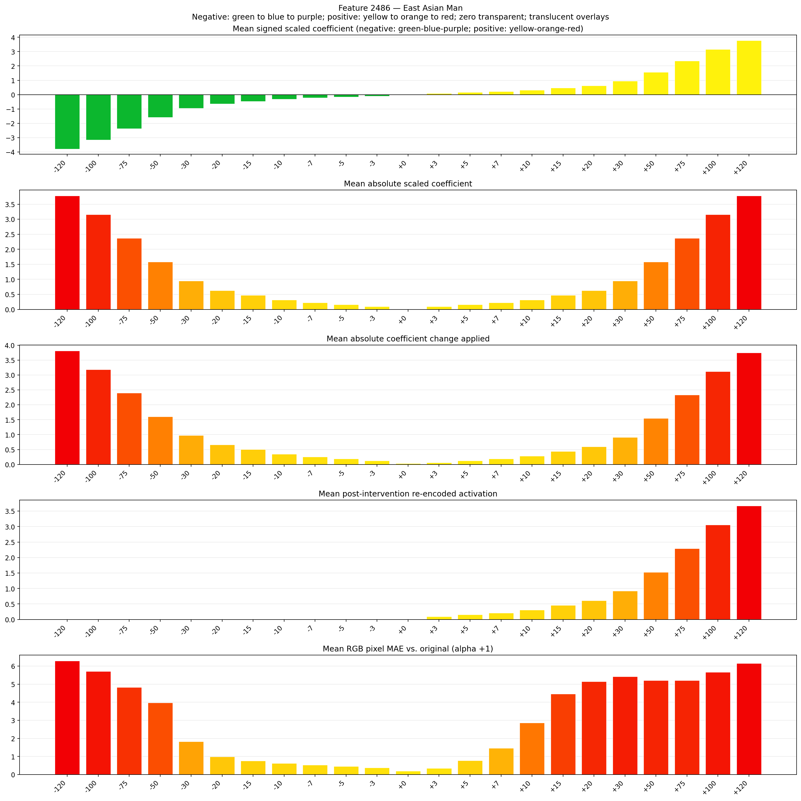
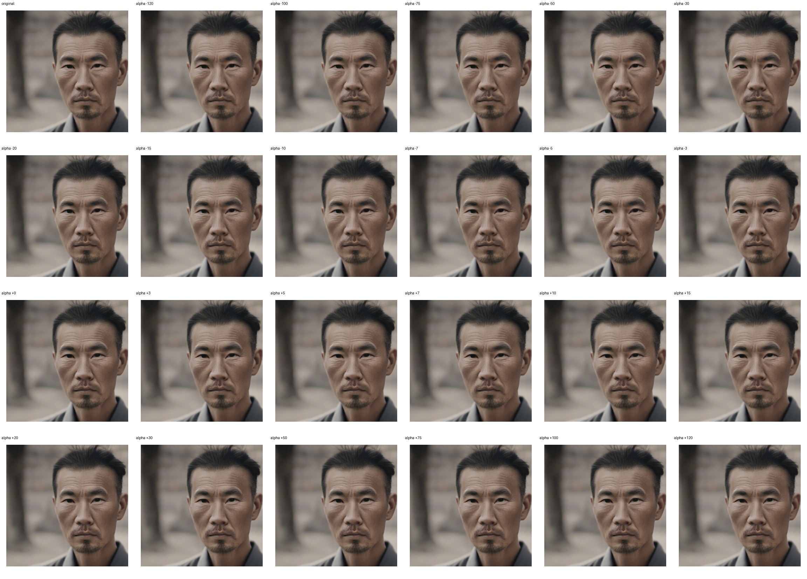

# Feature 2486 — East Asian Man

Biased dataset; original prompt and seed replay for seeds 0–19. Values are means across 20 source images. The table reports the mean post-re-encoded activation of feature 2486, the active spatial fraction, mean RGB pixel MAE versus the original image (0–255 scale), and coefficient change magnitudes for each alpha.

## Activation graph

## Mean metrics by alpha

| Alpha | Mean post-reencoded feature 2486 activation | Active spatial fraction | Mean pixel change (MAE) | Mean absolute coefficient change | Mean absolute scaled coefficient |
|---:|---:|---:|---:|---:|---:|
| -120 | 0.000 | 0.000 | 6.292 | 3.814 | 3.783 |
| -100 | 0.000 | 0.000 | 5.712 | 3.184 | 3.152 |
| -75 | 0.000 | 0.000 | 4.829 | 2.396 | 2.364 |
| -50 | 0.000 | 0.000 | 3.977 | 1.608 | 1.576 |
| -30 | 0.000 | 0.000 | 1.824 | 0.977 | 0.946 |
| -20 | 0.000 | 0.000 | 0.984 | 0.662 | 0.630 |
| -15 | 0.000 | 0.000 | 0.755 | 0.504 | 0.473 |
| -10 | 0.000 | 0.000 | 0.620 | 0.347 | 0.315 |
| -7 | 0.000 | 0.000 | 0.533 | 0.252 | 0.221 |
| -5 | 0.000 | 0.000 | 0.460 | 0.189 | 0.158 |
| -3 | 0.000 | 0.000 | 0.377 | 0.126 | 0.095 |
| +0 | 0.000 | 0.000 | 0.199 | 0.032 | 0.000 |
| +3 | 0.093 | 0.003 | 0.354 | 0.063 | 0.095 |
| +5 | 0.154 | 0.003 | 0.773 | 0.126 | 0.158 |
| +7 | 0.215 | 0.003 | 1.467 | 0.189 | 0.221 |
| +10 | 0.307 | 0.003 | 2.858 | 0.284 | 0.315 |
| +15 | 0.460 | 0.003 | 4.461 | 0.441 | 0.473 |
| +20 | 0.613 | 0.003 | 5.140 | 0.599 | 0.630 |
| +30 | 0.919 | 0.003 | 5.426 | 0.914 | 0.946 |
| +50 | 1.530 | 0.003 | 5.207 | 1.545 | 1.576 |
| +75 | 2.295 | 0.003 | 5.215 | 2.333 | 2.364 |
| +100 | 3.060 | 0.003 | 5.666 | 3.121 | 3.152 |
| +120 | 3.671 | 0.003 | 6.153 | 3.751 | 3.783 |

## Per-seed grids

Each 4×6 sheet contains the original followed by the 23 alpha variants in ascending alpha order, from −120 through +120.

### Plain images

[All 20 plain-image grids](seed_sheets/)

### Signed coefficient overlays

[All 20 signed coefficient grids](signed_coefficient_overlays/)

### Post-re-encoded activation overlays

[All 20 post-activation grids](post_activation_overlays/)

### Intervention-footprint overlays

[All 20 intervention-footprint grids](intervention_footprint_overlays/)

Zero is transparent. Negative coefficient colors progress green through blue to purple; positive colors progress yellow through orange to red. Each map tile is normalized individually for visibility. The original and alpha-zero tiles show the pre-intervention feature map so its location remains visible.
