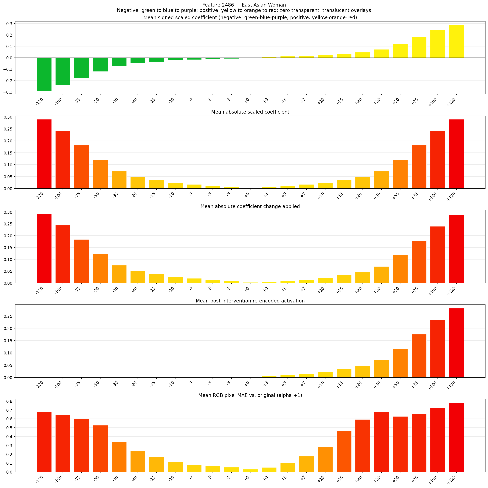

# Feature 2486 — East Asian Woman

Biased dataset; original prompt and seed replay for seeds 0–19. Values are means across 20 source images. The table reports the mean post-re-encoded activation of feature 2486, the active spatial fraction, mean RGB pixel MAE versus the original image (0–255 scale), and coefficient change magnitudes for each alpha.

## Activation graph

## Mean metrics by alpha

| Alpha | Mean post-reencoded feature 2486 activation | Active spatial fraction | Mean pixel change (MAE) | Mean absolute coefficient change | Mean absolute scaled coefficient |
|---:|---:|---:|---:|---:|---:|
| -120 | 0.000 | 0.000 | 0.675 | 0.293 | 0.290 |
| -100 | 0.000 | 0.000 | 0.645 | 0.244 | 0.242 |
| -75 | 0.000 | 0.000 | 0.600 | 0.184 | 0.181 |
| -50 | 0.000 | 0.000 | 0.527 | 0.123 | 0.121 |
| -30 | 0.000 | 0.000 | 0.337 | 0.075 | 0.073 |
| -20 | 0.000 | 0.000 | 0.234 | 0.051 | 0.048 |
| -15 | 0.000 | 0.000 | 0.167 | 0.039 | 0.036 |
| -10 | 0.000 | 0.000 | 0.113 | 0.027 | 0.024 |
| -7 | 0.000 | 0.000 | 0.084 | 0.019 | 0.017 |
| -5 | 0.000 | 0.000 | 0.068 | 0.015 | 0.012 |
| -3 | 0.000 | 0.000 | 0.052 | 0.010 | 0.007 |
| +0 | 0.000 | 0.000 | 0.031 | 0.002 | 0.000 |
| +3 | 0.007 | 0.000 | 0.051 | 0.005 | 0.007 |
| +5 | 0.012 | 0.000 | 0.106 | 0.010 | 0.012 |
| +7 | 0.017 | 0.000 | 0.177 | 0.015 | 0.017 |
| +10 | 0.024 | 0.000 | 0.284 | 0.022 | 0.024 |
| +15 | 0.035 | 0.000 | 0.468 | 0.034 | 0.036 |
| +20 | 0.047 | 0.000 | 0.593 | 0.046 | 0.048 |
| +30 | 0.070 | 0.000 | 0.676 | 0.070 | 0.073 |
| +50 | 0.117 | 0.000 | 0.626 | 0.119 | 0.121 |
| +75 | 0.176 | 0.000 | 0.659 | 0.179 | 0.181 |
| +100 | 0.235 | 0.000 | 0.724 | 0.239 | 0.242 |
| +120 | 0.282 | 0.000 | 0.782 | 0.288 | 0.290 |

## Per-seed grids

Each 4×6 sheet contains the original followed by the 23 alpha variants in ascending alpha order, from −120 through +120.

### Plain images

[All 20 plain-image grids](seed_sheets/)

### Signed coefficient overlays

[All 20 signed coefficient grids](signed_coefficient_overlays/)

### Post-re-encoded activation overlays

[All 20 post-activation grids](post_activation_overlays/)

### Intervention-footprint overlays

[All 20 intervention-footprint grids](intervention_footprint_overlays/)

Zero is transparent. Negative coefficient colors progress green through blue to purple; positive colors progress yellow through orange to red. Each map tile is normalized individually for visibility. The original and alpha-zero tiles show the pre-intervention feature map so its location remains visible.
