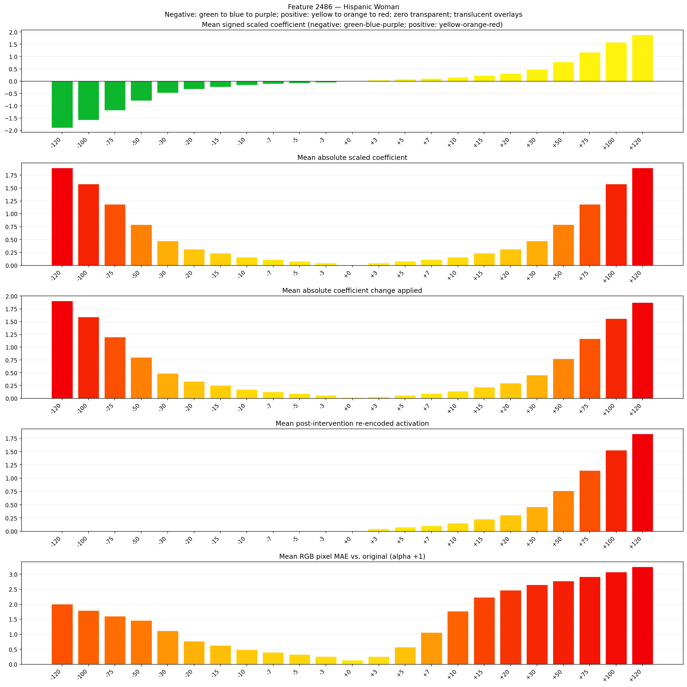
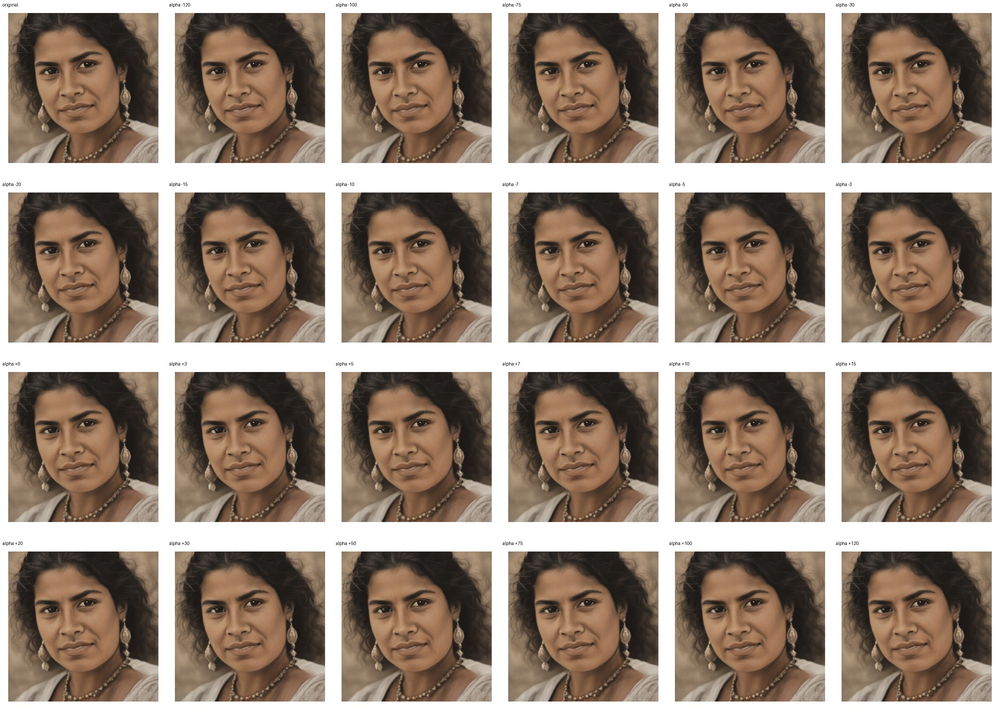

# Feature 2486 — Hispanic Woman

Biased dataset; original prompt and seed replay for seeds 0–19. Values are means across 20 source images. The table reports the mean post-re-encoded activation of feature 2486, the active spatial fraction, mean RGB pixel MAE versus the original image (0–255 scale), and coefficient change magnitudes for each alpha.

## Activation graph

## Mean metrics by alpha

| Alpha | Mean post-reencoded feature 2486 activation | Active spatial fraction | Mean pixel change (MAE) | Mean absolute coefficient change | Mean absolute scaled coefficient |
|---:|---:|---:|---:|---:|---:|
| -120 | 0.000 | 0.000 | 2.000 | 1.906 | 1.891 |
| -100 | 0.000 | 0.000 | 1.793 | 1.591 | 1.576 |
| -75 | 0.000 | 0.000 | 1.600 | 1.197 | 1.182 |
| -50 | 0.000 | 0.000 | 1.464 | 0.804 | 0.788 |
| -30 | 0.000 | 0.000 | 1.115 | 0.488 | 0.473 |
| -20 | 0.000 | 0.000 | 0.770 | 0.331 | 0.315 |
| -15 | 0.000 | 0.000 | 0.624 | 0.252 | 0.236 |
| -10 | 0.000 | 0.000 | 0.489 | 0.173 | 0.158 |
| -7 | 0.000 | 0.000 | 0.397 | 0.126 | 0.110 |
| -5 | 0.000 | 0.000 | 0.331 | 0.095 | 0.079 |
| -3 | 0.000 | 0.000 | 0.260 | 0.063 | 0.047 |
| +0 | 0.000 | 0.000 | 0.137 | 0.016 | 0.000 |
| +3 | 0.046 | 0.001 | 0.255 | 0.032 | 0.047 |
| +5 | 0.077 | 0.001 | 0.576 | 0.063 | 0.079 |
| +7 | 0.107 | 0.001 | 1.060 | 0.095 | 0.110 |
| +10 | 0.153 | 0.001 | 1.769 | 0.142 | 0.158 |
| +15 | 0.230 | 0.001 | 2.231 | 0.221 | 0.236 |
| +20 | 0.306 | 0.001 | 2.465 | 0.299 | 0.315 |
| +30 | 0.459 | 0.001 | 2.647 | 0.457 | 0.473 |
| +50 | 0.765 | 0.001 | 2.775 | 0.772 | 0.788 |
| +75 | 1.147 | 0.001 | 2.915 | 1.166 | 1.182 |
| +100 | 1.529 | 0.001 | 3.076 | 1.560 | 1.576 |
| +120 | 1.835 | 0.001 | 3.247 | 1.875 | 1.891 |

## Per-seed grids

Each 4×6 sheet contains the original followed by the 23 alpha variants in ascending alpha order, from −120 through +120.

### Plain images

[All 20 plain-image grids](seed_sheets/)

### Signed coefficient overlays

[All 20 signed coefficient grids](signed_coefficient_overlays/)

### Post-re-encoded activation overlays

[All 20 post-activation grids](post_activation_overlays/)

### Intervention-footprint overlays

[All 20 intervention-footprint grids](intervention_footprint_overlays/)

Zero is transparent. Negative coefficient colors progress green through blue to purple; positive colors progress yellow through orange to red. Each map tile is normalized individually for visibility. The original and alpha-zero tiles show the pre-intervention feature map so its location remains visible.
