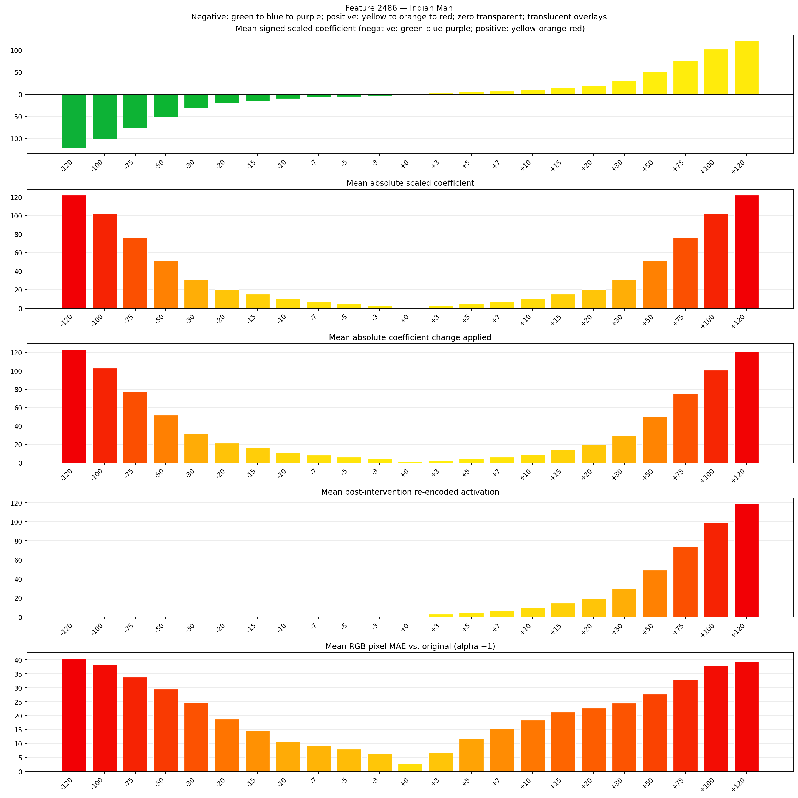
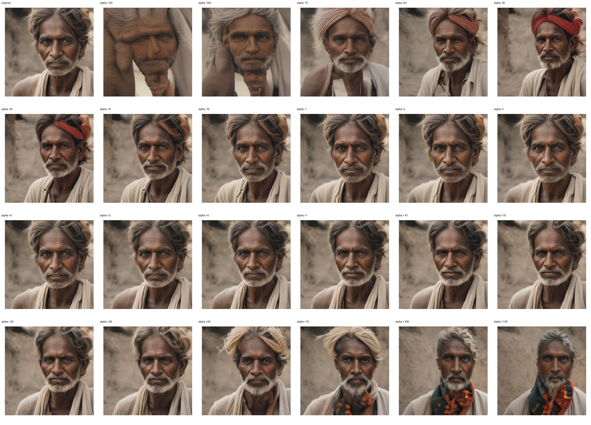
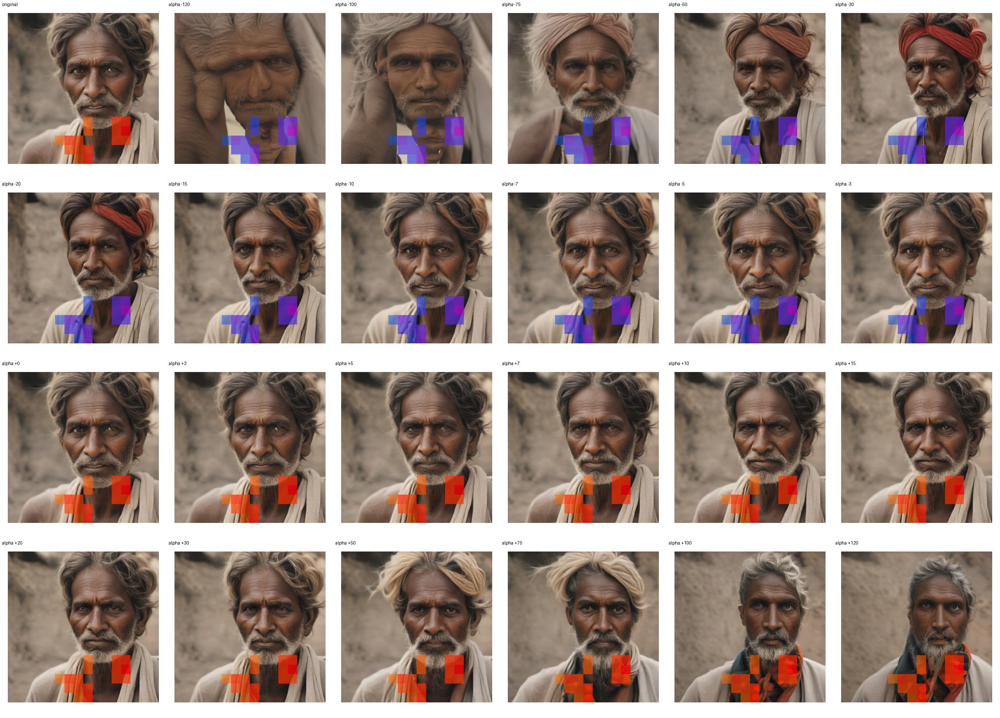
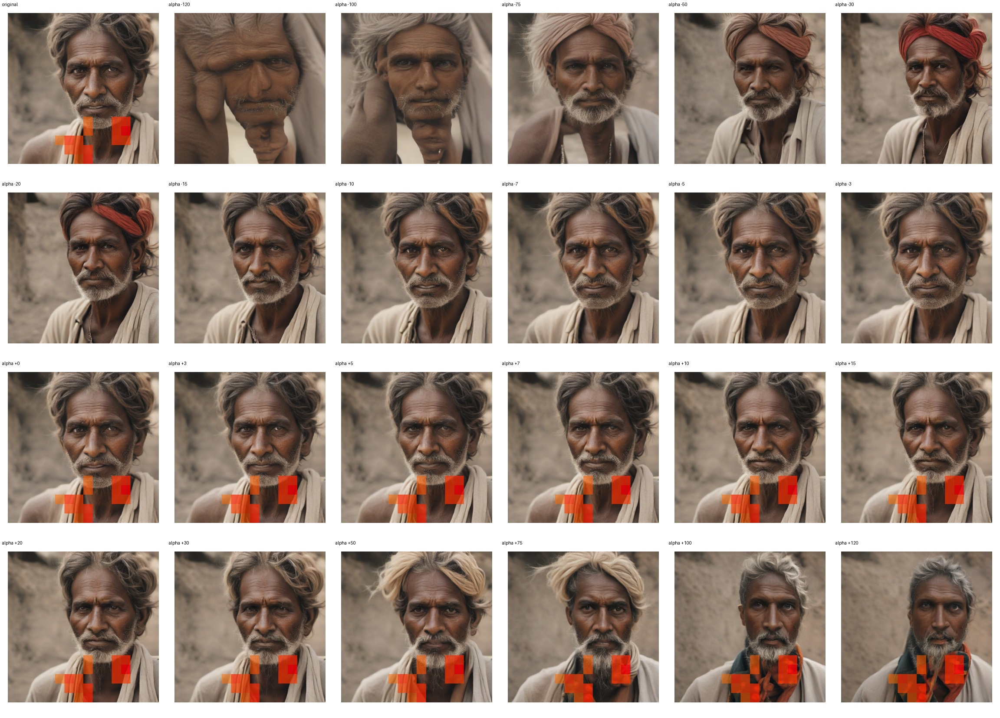

# Feature 2486 — Indian Man

Biased dataset; original prompt and seed replay for seeds 0–19. Values are means across 20 source images. The table reports the mean post-re-encoded activation of feature 2486, the active spatial fraction, mean RGB pixel MAE versus the original image (0–255 scale), and coefficient change magnitudes for each alpha.

## Activation graph

## Mean metrics by alpha

| Alpha | Mean post-reencoded feature 2486 activation | Active spatial fraction | Mean pixel change (MAE) | Mean absolute coefficient change | Mean absolute scaled coefficient |
|---:|---:|---:|---:|---:|---:|
| -120 | 0.000 | 0.000 | 40.548 | 123.297 | 122.278 |
| -100 | 0.000 | 0.000 | 38.415 | 102.918 | 101.899 |
| -75 | 0.000 | 0.000 | 33.847 | 77.443 | 76.424 |
| -50 | 0.000 | 0.000 | 29.520 | 51.968 | 50.949 |
| -30 | 0.000 | 0.000 | 24.838 | 31.589 | 30.570 |
| -20 | 0.000 | 0.000 | 18.858 | 21.399 | 20.380 |
| -15 | 0.000 | 0.000 | 14.570 | 16.304 | 15.285 |
| -10 | 0.000 | 0.000 | 10.684 | 11.209 | 10.190 |
| -7 | 0.000 | 0.000 | 9.199 | 8.152 | 7.133 |
| -5 | 0.000 | 0.000 | 8.036 | 6.114 | 5.095 |
| -3 | 0.000 | 0.000 | 6.569 | 4.076 | 3.057 |
| +0 | 0.000 | 0.000 | 2.951 | 1.019 | 0.000 |
| +3 | 2.996 | 0.070 | 6.729 | 2.038 | 3.057 |
| +5 | 4.974 | 0.070 | 11.887 | 4.076 | 5.095 |
| +7 | 6.951 | 0.070 | 15.338 | 6.114 | 7.133 |
| +10 | 9.917 | 0.070 | 18.413 | 9.171 | 10.190 |
| +15 | 14.860 | 0.070 | 21.326 | 14.266 | 15.285 |
| +20 | 19.803 | 0.070 | 22.810 | 19.361 | 20.380 |
| +30 | 29.690 | 0.070 | 24.521 | 29.551 | 30.570 |
| +50 | 49.463 | 0.070 | 27.725 | 49.930 | 50.949 |
| +75 | 74.179 | 0.070 | 32.981 | 75.405 | 76.424 |
| +100 | 98.896 | 0.070 | 37.959 | 100.880 | 101.899 |
| +120 | 118.669 | 0.070 | 39.406 | 121.259 | 122.278 |

## Per-seed grids

Each 4×6 sheet contains the original followed by the 23 alpha variants in ascending alpha order, from −120 through +120.

### Plain images

[All 20 plain-image grids](seed_sheets/)

### Signed coefficient overlays

[All 20 signed coefficient grids](signed_coefficient_overlays/)

### Post-re-encoded activation overlays

[All 20 post-activation grids](post_activation_overlays/)

### Intervention-footprint overlays

[All 20 intervention-footprint grids](intervention_footprint_overlays/)

Zero is transparent. Negative coefficient colors progress green through blue to purple; positive colors progress yellow through orange to red. Each map tile is normalized individually for visibility. The original and alpha-zero tiles show the pre-intervention feature map so its location remains visible.
