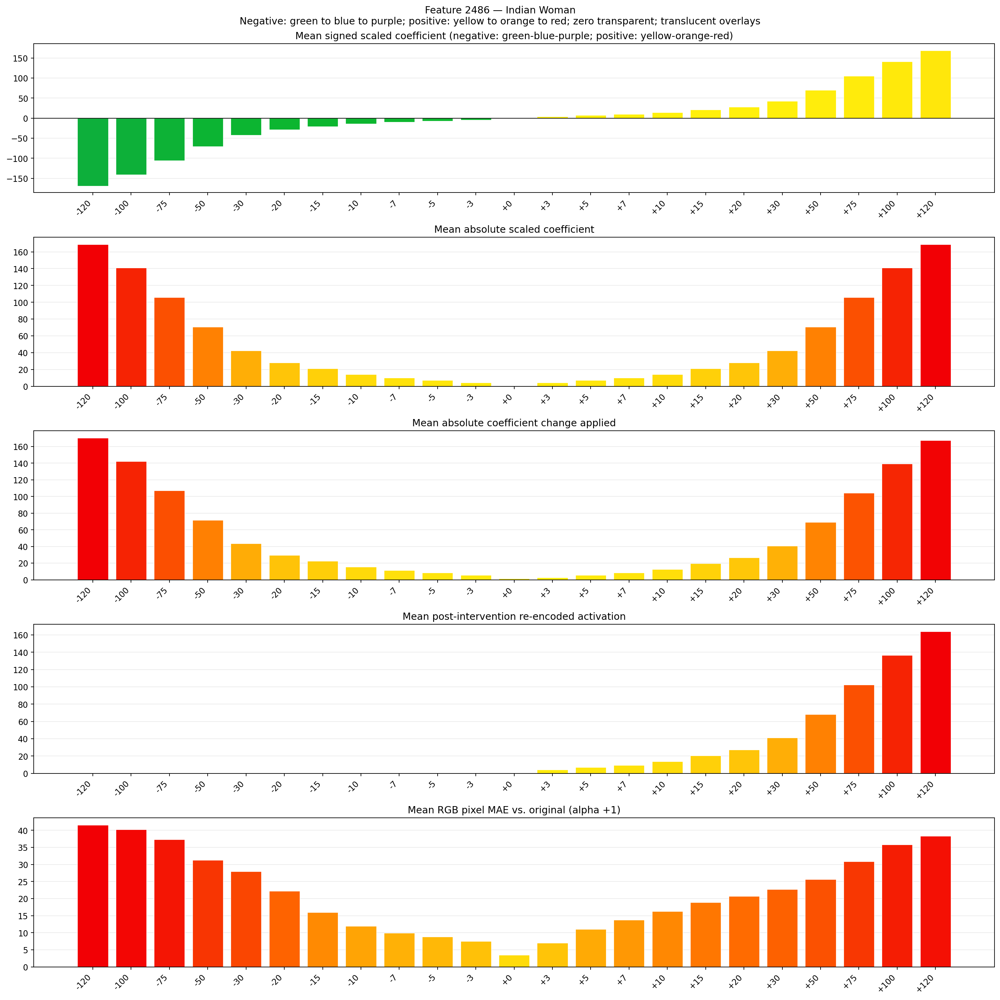
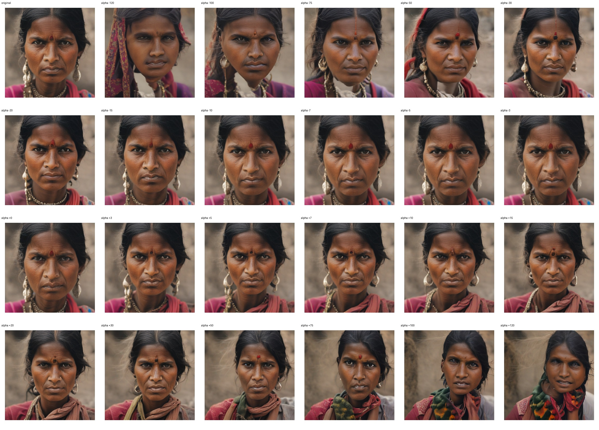
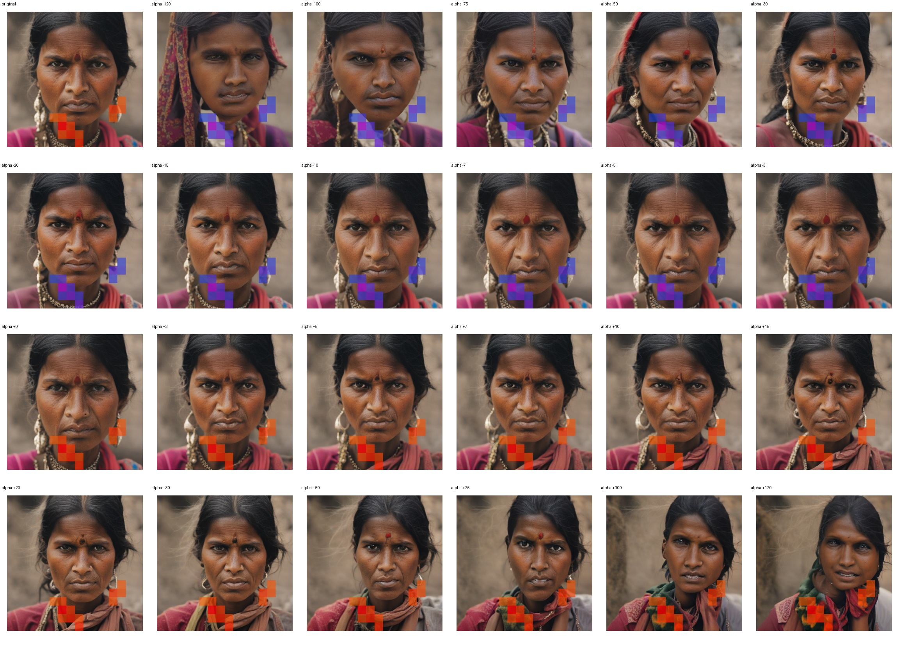
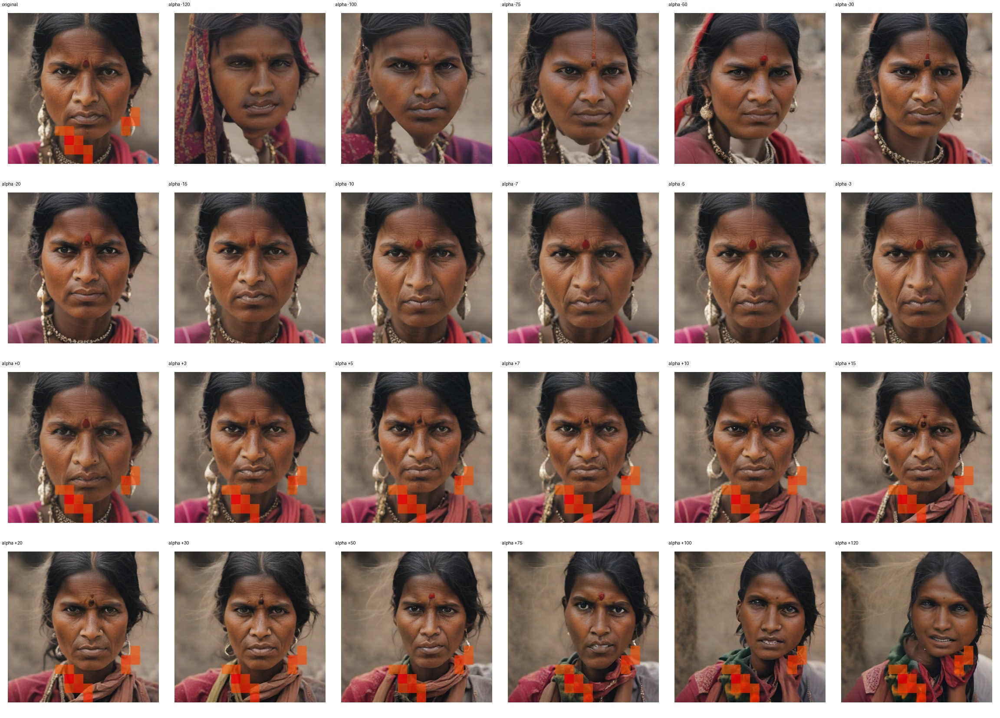

# Feature 2486 — Indian Woman

Biased dataset; original prompt and seed replay for seeds 0–19. Values are means across 20 source images. The table reports the mean post-re-encoded activation of feature 2486, the active spatial fraction, mean RGB pixel MAE versus the original image (0–255 scale), and coefficient change magnitudes for each alpha.

## Activation graph

## Mean metrics by alpha

| Alpha | Mean post-reencoded feature 2486 activation | Active spatial fraction | Mean pixel change (MAE) | Mean absolute coefficient change | Mean absolute scaled coefficient |
|---:|---:|---:|---:|---:|---:|
| -120 | 0.000 | 0.000 | 41.548 | 170.380 | 168.972 |
| -100 | 0.000 | 0.000 | 40.253 | 142.218 | 140.810 |
| -75 | 0.000 | 0.000 | 37.351 | 107.016 | 105.608 |
| -50 | 0.000 | 0.000 | 31.267 | 71.813 | 70.405 |
| -30 | 0.000 | 0.000 | 27.949 | 43.651 | 42.243 |
| -20 | 0.000 | 0.000 | 22.173 | 29.570 | 28.162 |
| -15 | 0.000 | 0.000 | 15.997 | 22.530 | 21.122 |
| -10 | 0.000 | 0.000 | 11.920 | 15.489 | 14.081 |
| -7 | 0.000 | 0.000 | 9.900 | 11.265 | 9.857 |
| -5 | 0.000 | 0.000 | 8.846 | 8.449 | 7.041 |
| -3 | 0.000 | 0.000 | 7.546 | 5.632 | 4.224 |
| +0 | 0.000 | 0.000 | 3.550 | 1.408 | 0.000 |
| +3 | 4.140 | 0.092 | 6.989 | 2.816 | 4.224 |
| +5 | 6.873 | 0.092 | 11.051 | 5.632 | 7.041 |
| +7 | 9.605 | 0.092 | 13.810 | 8.449 | 9.857 |
| +10 | 13.704 | 0.092 | 16.274 | 12.673 | 14.081 |
| +15 | 20.535 | 0.092 | 18.878 | 19.713 | 21.122 |
| +20 | 27.366 | 0.092 | 20.737 | 26.754 | 28.162 |
| +30 | 41.027 | 0.092 | 22.718 | 40.835 | 42.243 |
| +50 | 68.351 | 0.092 | 25.688 | 68.997 | 70.405 |
| +75 | 102.506 | 0.092 | 30.853 | 104.199 | 105.608 |
| +100 | 136.661 | 0.092 | 35.758 | 139.402 | 140.810 |
| +120 | 163.985 | 0.092 | 38.328 | 167.564 | 168.972 |

## Per-seed grids

Each 4×6 sheet contains the original followed by the 23 alpha variants in ascending alpha order, from −120 through +120.

### Plain images

[All 20 plain-image grids](seed_sheets/)

### Signed coefficient overlays

[All 20 signed coefficient grids](signed_coefficient_overlays/)

### Post-re-encoded activation overlays

[All 20 post-activation grids](post_activation_overlays/)

### Intervention-footprint overlays

[All 20 intervention-footprint grids](intervention_footprint_overlays/)

Zero is transparent. Negative coefficient colors progress green through blue to purple; positive colors progress yellow through orange to red. Each map tile is normalized individually for visibility. The original and alpha-zero tiles show the pre-intervention feature map so its location remains visible.
