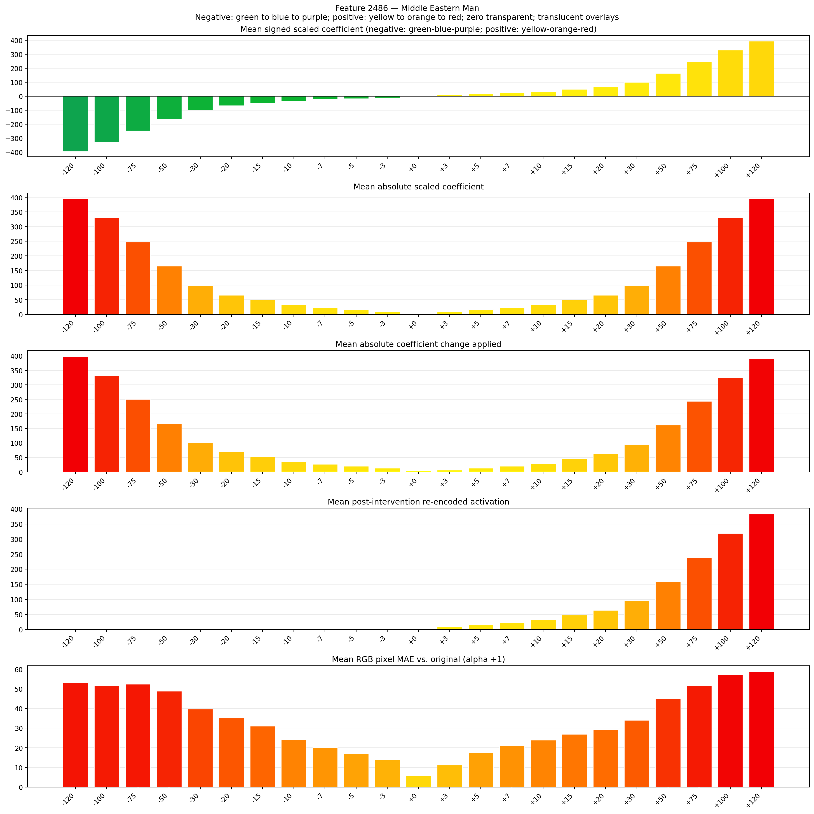
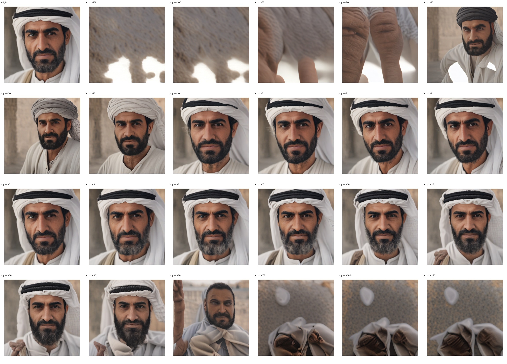
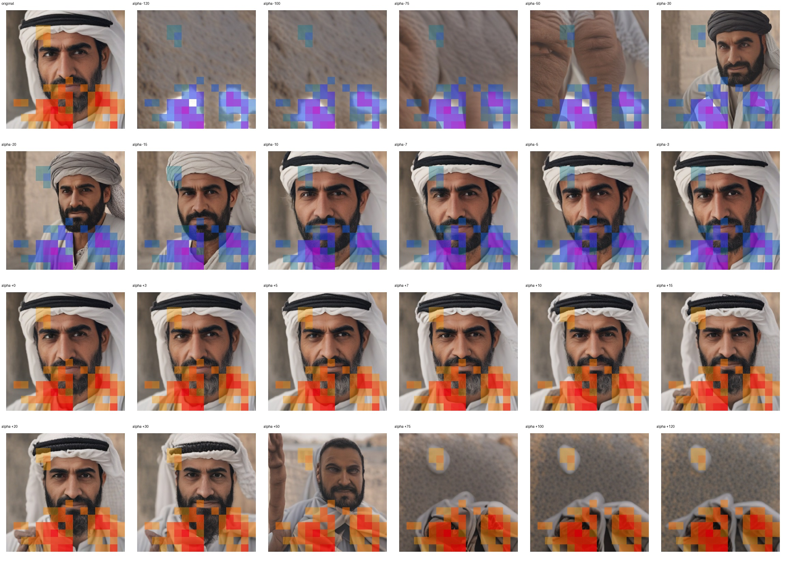
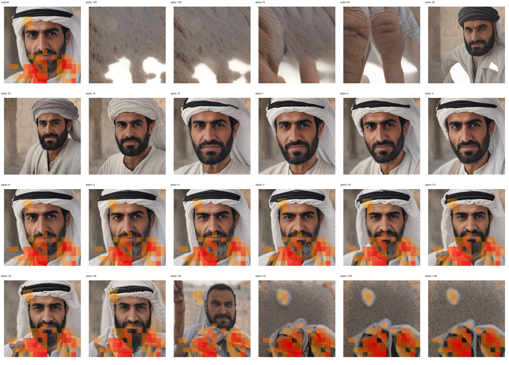

# Feature 2486 — Middle Eastern Man

Biased dataset; original prompt and seed replay for seeds 0–19. Values are means across 20 source images. The table reports the mean post-re-encoded activation of feature 2486, the active spatial fraction, mean RGB pixel MAE versus the original image (0–255 scale), and coefficient change magnitudes for each alpha.

## Activation graph

## Mean metrics by alpha

| Alpha | Mean post-reencoded feature 2486 activation | Active spatial fraction | Mean pixel change (MAE) | Mean absolute coefficient change | Mean absolute scaled coefficient |
|---:|---:|---:|---:|---:|---:|
| -120 | 0.000 | 0.000 | 53.259 | 398.064 | 394.774 |
| -100 | 0.000 | 0.000 | 51.549 | 332.268 | 328.979 |
| -75 | 0.000 | 0.000 | 52.364 | 250.024 | 246.734 |
| -50 | 0.000 | 0.000 | 48.824 | 167.779 | 164.489 |
| -30 | 0.000 | 0.000 | 39.675 | 101.983 | 98.694 |
| -20 | 0.000 | 0.000 | 35.115 | 69.086 | 65.796 |
| -15 | 0.000 | 0.000 | 31.013 | 52.637 | 49.347 |
| -10 | 0.000 | 0.000 | 24.130 | 36.188 | 32.898 |
| -7 | 0.000 | 0.000 | 20.194 | 26.318 | 23.029 |
| -5 | 0.000 | 0.000 | 17.024 | 19.739 | 16.449 |
| -3 | 0.000 | 0.000 | 13.848 | 13.159 | 9.869 |
| +0 | 0.000 | 0.000 | 5.626 | 3.290 | 0.000 |
| +3 | 9.673 | 0.205 | 11.184 | 6.580 | 9.869 |
| +5 | 16.057 | 0.205 | 17.464 | 13.159 | 16.449 |
| +7 | 22.441 | 0.205 | 20.904 | 19.739 | 23.029 |
| +10 | 32.017 | 0.205 | 23.911 | 29.608 | 32.898 |
| +15 | 47.976 | 0.205 | 26.850 | 46.057 | 49.347 |
| +20 | 63.935 | 0.205 | 29.112 | 62.506 | 65.796 |
| +30 | 95.854 | 0.205 | 34.020 | 95.404 | 98.694 |
| +50 | 159.691 | 0.205 | 44.822 | 161.200 | 164.489 |
| +75 | 239.488 | 0.205 | 51.506 | 243.444 | 246.734 |
| +100 | 319.284 | 0.205 | 57.261 | 325.689 | 328.979 |
| +120 | 383.121 | 0.205 | 58.784 | 391.485 | 394.774 |

## Per-seed grids

Each 4×6 sheet contains the original followed by the 23 alpha variants in ascending alpha order, from −120 through +120.

### Plain images

[All 20 plain-image grids](seed_sheets/)

### Signed coefficient overlays

[All 20 signed coefficient grids](signed_coefficient_overlays/)

### Post-re-encoded activation overlays

[All 20 post-activation grids](post_activation_overlays/)

### Intervention-footprint overlays

[All 20 intervention-footprint grids](intervention_footprint_overlays/)

Zero is transparent. Negative coefficient colors progress green through blue to purple; positive colors progress yellow through orange to red. Each map tile is normalized individually for visibility. The original and alpha-zero tiles show the pre-intervention feature map so its location remains visible.
