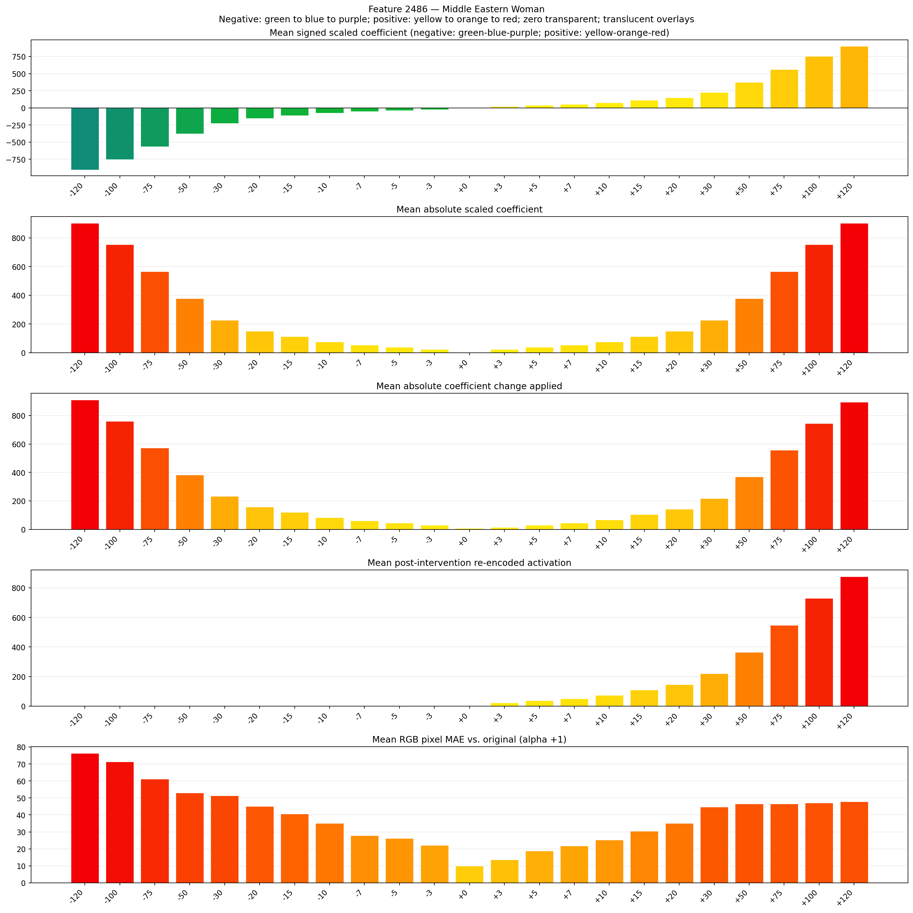
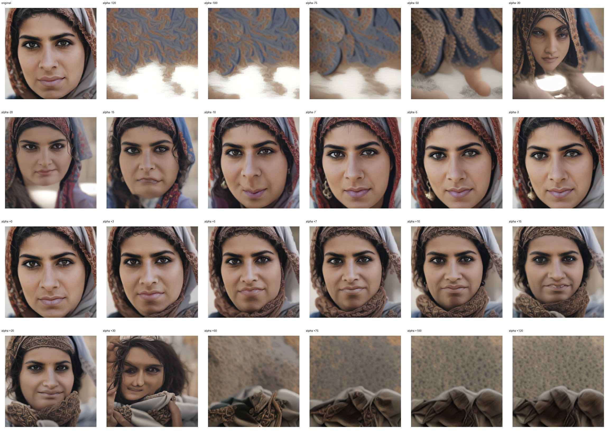
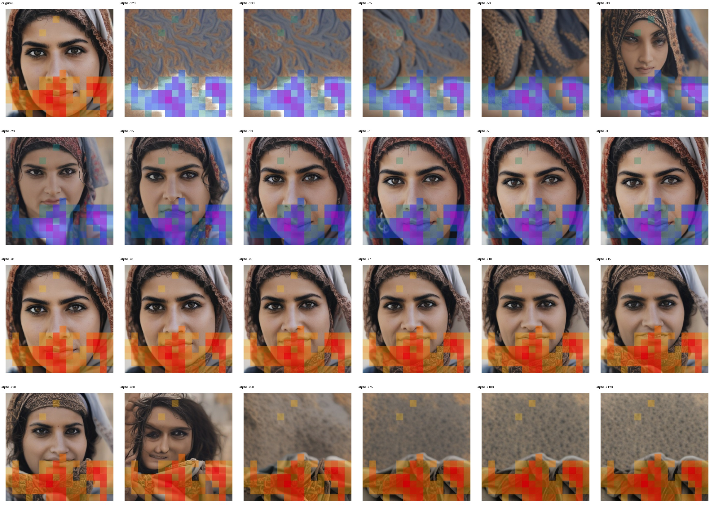
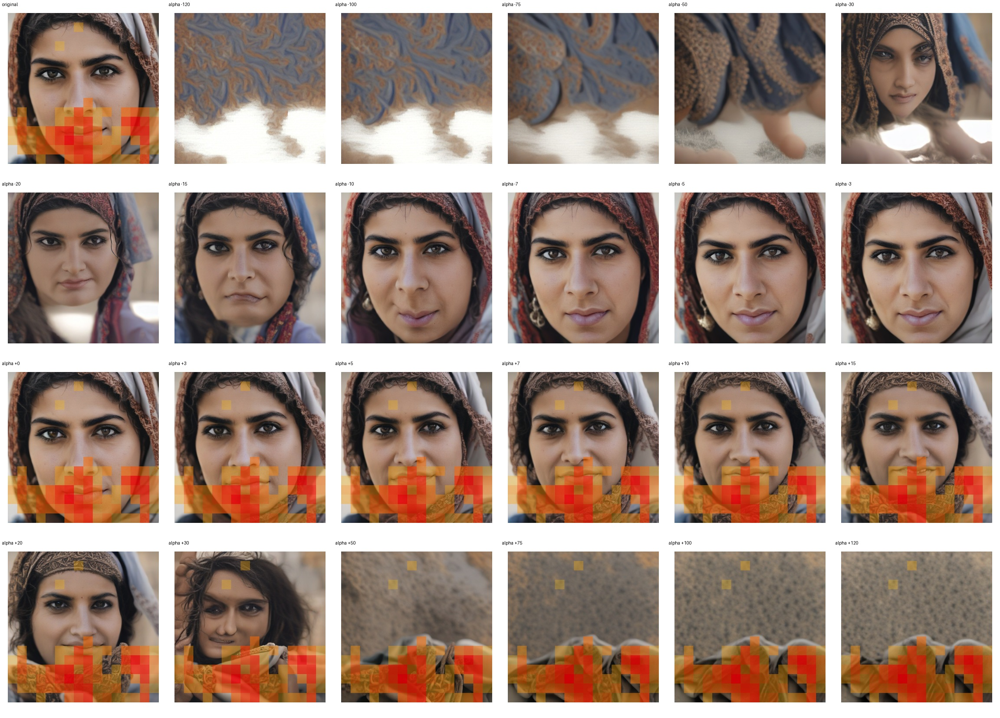

# Feature 2486 — Middle Eastern Woman

Biased dataset; original prompt and seed replay for seeds 0–19. Values are means across 20 source images. The table reports the mean post-re-encoded activation of feature 2486, the active spatial fraction, mean RGB pixel MAE versus the original image (0–255 scale), and coefficient change magnitudes for each alpha.

## Activation graph

## Mean metrics by alpha

| Alpha | Mean post-reencoded feature 2486 activation | Active spatial fraction | Mean pixel change (MAE) | Mean absolute coefficient change | Mean absolute scaled coefficient |
|---:|---:|---:|---:|---:|---:|
| -120 | 0.000 | 0.000 | 76.339 | 911.334 | 903.803 |
| -100 | 0.000 | 0.000 | 71.412 | 760.700 | 753.169 |
| -75 | 0.000 | 0.000 | 61.231 | 572.408 | 564.877 |
| -50 | 0.000 | 0.000 | 53.009 | 384.116 | 376.584 |
| -30 | 0.000 | 0.000 | 51.272 | 233.482 | 225.951 |
| -20 | 0.000 | 0.000 | 45.051 | 158.165 | 150.634 |
| -15 | 0.000 | 0.000 | 40.726 | 120.507 | 112.975 |
| -10 | 0.000 | 0.000 | 35.058 | 82.849 | 75.317 |
| -7 | 0.000 | 0.000 | 27.806 | 60.254 | 52.722 |
| -5 | 0.000 | 0.000 | 26.256 | 45.190 | 37.658 |
| -3 | 0.000 | 0.000 | 22.111 | 30.127 | 22.595 |
| +0 | 0.000 | 0.000 | 10.037 | 7.532 | 0.000 |
| +3 | 22.147 | 0.350 | 13.633 | 15.063 | 22.595 |
| +5 | 36.762 | 0.350 | 18.802 | 30.127 | 37.658 |
| +7 | 51.377 | 0.350 | 21.862 | 45.190 | 52.722 |
| +10 | 73.299 | 0.350 | 25.328 | 67.785 | 75.317 |
| +15 | 109.837 | 0.350 | 30.530 | 105.444 | 112.975 |
| +20 | 146.374 | 0.350 | 35.159 | 143.102 | 150.634 |
| +30 | 219.449 | 0.350 | 44.635 | 218.419 | 225.951 |
| +50 | 365.598 | 0.350 | 46.581 | 369.053 | 376.584 |
| +75 | 548.286 | 0.350 | 46.630 | 557.345 | 564.877 |
| +100 | 730.973 | 0.350 | 47.079 | 745.637 | 753.169 |
| +120 | 877.123 | 0.350 | 47.809 | 896.271 | 903.803 |

## Per-seed grids

Each 4×6 sheet contains the original followed by the 23 alpha variants in ascending alpha order, from −120 through +120.

### Plain images

[All 20 plain-image grids](seed_sheets/)

### Signed coefficient overlays

[All 20 signed coefficient grids](signed_coefficient_overlays/)

### Post-re-encoded activation overlays

[All 20 post-activation grids](post_activation_overlays/)

### Intervention-footprint overlays

[All 20 intervention-footprint grids](intervention_footprint_overlays/)

Zero is transparent. Negative coefficient colors progress green through blue to purple; positive colors progress yellow through orange to red. Each map tile is normalized individually for visibility. The original and alpha-zero tiles show the pre-intervention feature map so its location remains visible.
