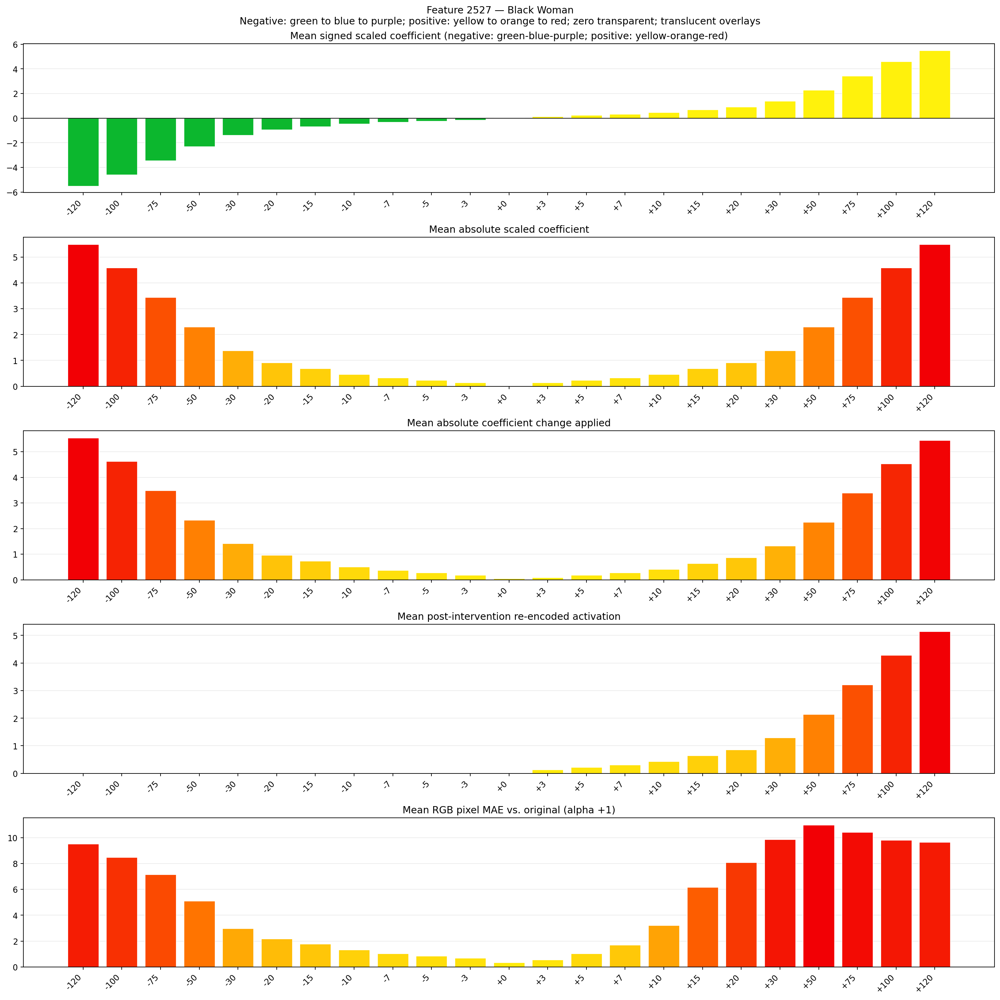

# Feature 2527 — Black Woman

Biased dataset; original prompt and seed replay for seeds 0–19. Values are means across 20 source images. The table reports the mean post-re-encoded activation of feature 2527, the active spatial fraction, mean RGB pixel MAE versus the original image (0–255 scale), and coefficient change magnitudes for each alpha.

## Activation graph

## Mean metrics by alpha

| Alpha | Mean post-reencoded feature 2527 activation | Active spatial fraction | Mean pixel change (MAE) | Mean absolute coefficient change | Mean absolute scaled coefficient |
|---:|---:|---:|---:|---:|---:|
| -120 | 0.000 | 0.000 | 9.513 | 5.541 | 5.496 |
| -100 | 0.000 | 0.000 | 8.469 | 4.625 | 4.580 |
| -75 | 0.000 | 0.000 | 7.161 | 3.480 | 3.435 |
| -50 | 0.000 | 0.000 | 5.105 | 2.336 | 2.290 |
| -30 | 0.000 | 0.000 | 2.964 | 1.420 | 1.374 |
| -20 | 0.000 | 0.000 | 2.179 | 0.962 | 0.916 |
| -15 | 0.000 | 0.000 | 1.787 | 0.733 | 0.687 |
| -10 | 0.000 | 0.000 | 1.320 | 0.504 | 0.458 |
| -7 | 0.000 | 0.000 | 1.040 | 0.366 | 0.321 |
| -5 | 0.000 | 0.000 | 0.859 | 0.275 | 0.229 |
| -3 | 0.000 | 0.000 | 0.674 | 0.183 | 0.137 |
| +0 | 0.000 | 0.000 | 0.331 | 0.046 | 0.000 |
| +3 | 0.131 | 0.004 | 0.552 | 0.092 | 0.137 |
| +5 | 0.217 | 0.004 | 1.031 | 0.183 | 0.229 |
| +7 | 0.303 | 0.004 | 1.695 | 0.275 | 0.321 |
| +10 | 0.431 | 0.004 | 3.211 | 0.412 | 0.458 |
| +15 | 0.646 | 0.004 | 6.163 | 0.641 | 0.687 |
| +20 | 0.860 | 0.004 | 8.091 | 0.870 | 0.916 |
| +30 | 1.288 | 0.004 | 9.860 | 1.328 | 1.374 |
| +50 | 2.145 | 0.004 | 10.980 | 2.244 | 2.290 |
| +75 | 3.216 | 0.004 | 10.409 | 3.389 | 3.435 |
| +100 | 4.288 | 0.004 | 9.799 | 4.534 | 4.580 |
| +120 | 5.144 | 0.004 | 9.637 | 5.450 | 5.496 |

## Per-seed grids

Each 4×6 sheet contains the original followed by the 23 alpha variants in ascending alpha order, from −120 through +120.

### Plain images

[All 20 plain-image grids](seed_sheets/)

### Signed coefficient overlays

[All 20 signed coefficient grids](signed_coefficient_overlays/)

### Post-re-encoded activation overlays

[All 20 post-activation grids](post_activation_overlays/)

### Intervention-footprint overlays

[All 20 intervention-footprint grids](intervention_footprint_overlays/)

Zero is transparent. Negative coefficient colors progress green through blue to purple; positive colors progress yellow through orange to red. Each map tile is normalized individually for visibility. The original and alpha-zero tiles show the pre-intervention feature map so its location remains visible.
