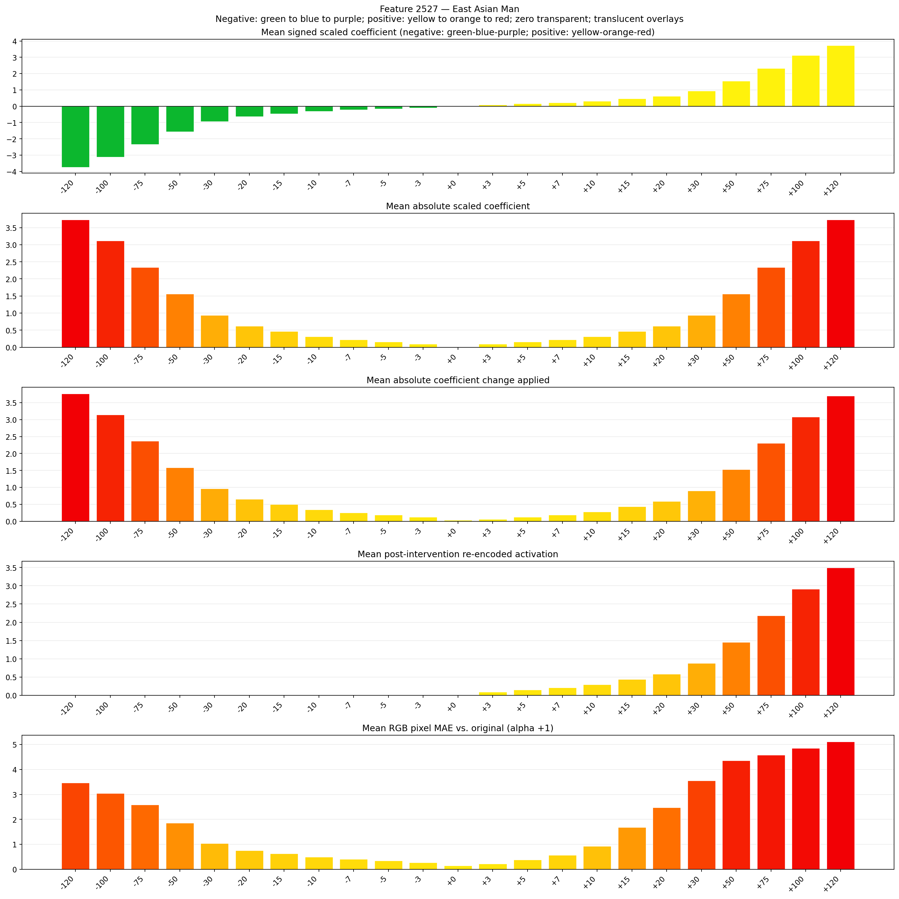

# Feature 2527 — East Asian Man

Biased dataset; original prompt and seed replay for seeds 0–19. Values are means across 20 source images. The table reports the mean post-re-encoded activation of feature 2527, the active spatial fraction, mean RGB pixel MAE versus the original image (0–255 scale), and coefficient change magnitudes for each alpha.

## Activation graph

## Mean metrics by alpha

| Alpha | Mean post-reencoded feature 2527 activation | Active spatial fraction | Mean pixel change (MAE) | Mean absolute coefficient change | Mean absolute scaled coefficient |
|---:|---:|---:|---:|---:|---:|
| -120 | 0.000 | 0.000 | 3.461 | 3.766 | 3.735 |
| -100 | 0.000 | 0.000 | 3.050 | 3.144 | 3.113 |
| -75 | 0.000 | 0.000 | 2.586 | 2.366 | 2.334 |
| -50 | 0.000 | 0.000 | 1.857 | 1.587 | 1.556 |
| -30 | 0.000 | 0.000 | 1.037 | 0.965 | 0.934 |
| -20 | 0.000 | 0.000 | 0.753 | 0.654 | 0.623 |
| -15 | 0.000 | 0.000 | 0.625 | 0.498 | 0.467 |
| -10 | 0.000 | 0.000 | 0.493 | 0.342 | 0.311 |
| -7 | 0.000 | 0.000 | 0.408 | 0.249 | 0.218 |
| -5 | 0.000 | 0.000 | 0.349 | 0.187 | 0.156 |
| -3 | 0.000 | 0.000 | 0.275 | 0.125 | 0.093 |
| +0 | 0.000 | 0.000 | 0.141 | 0.031 | 0.000 |
| +3 | 0.089 | 0.003 | 0.216 | 0.062 | 0.093 |
| +5 | 0.148 | 0.003 | 0.380 | 0.125 | 0.156 |
| +7 | 0.206 | 0.003 | 0.572 | 0.187 | 0.218 |
| +10 | 0.293 | 0.003 | 0.923 | 0.280 | 0.311 |
| +15 | 0.439 | 0.003 | 1.686 | 0.436 | 0.467 |
| +20 | 0.584 | 0.003 | 2.480 | 0.591 | 0.623 |
| +30 | 0.876 | 0.003 | 3.554 | 0.903 | 0.934 |
| +50 | 1.458 | 0.003 | 4.361 | 1.525 | 1.556 |
| +75 | 2.186 | 0.003 | 4.574 | 2.303 | 2.334 |
| +100 | 2.914 | 0.003 | 4.854 | 3.081 | 3.113 |
| +120 | 3.496 | 0.003 | 5.113 | 3.704 | 3.735 |

## Per-seed grids

Each 4×6 sheet contains the original followed by the 23 alpha variants in ascending alpha order, from −120 through +120.

### Plain images

[All 20 plain-image grids](seed_sheets/)

### Signed coefficient overlays

[All 20 signed coefficient grids](signed_coefficient_overlays/)

### Post-re-encoded activation overlays

[All 20 post-activation grids](post_activation_overlays/)

### Intervention-footprint overlays

[All 20 intervention-footprint grids](intervention_footprint_overlays/)

Zero is transparent. Negative coefficient colors progress green through blue to purple; positive colors progress yellow through orange to red. Each map tile is normalized individually for visibility. The original and alpha-zero tiles show the pre-intervention feature map so its location remains visible.
