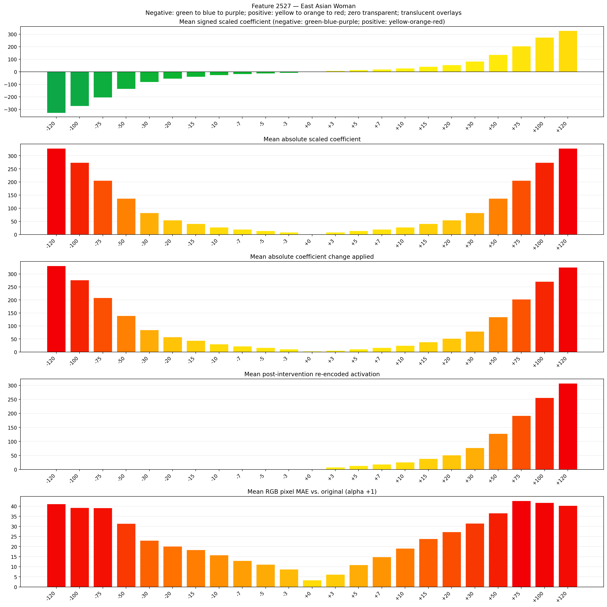
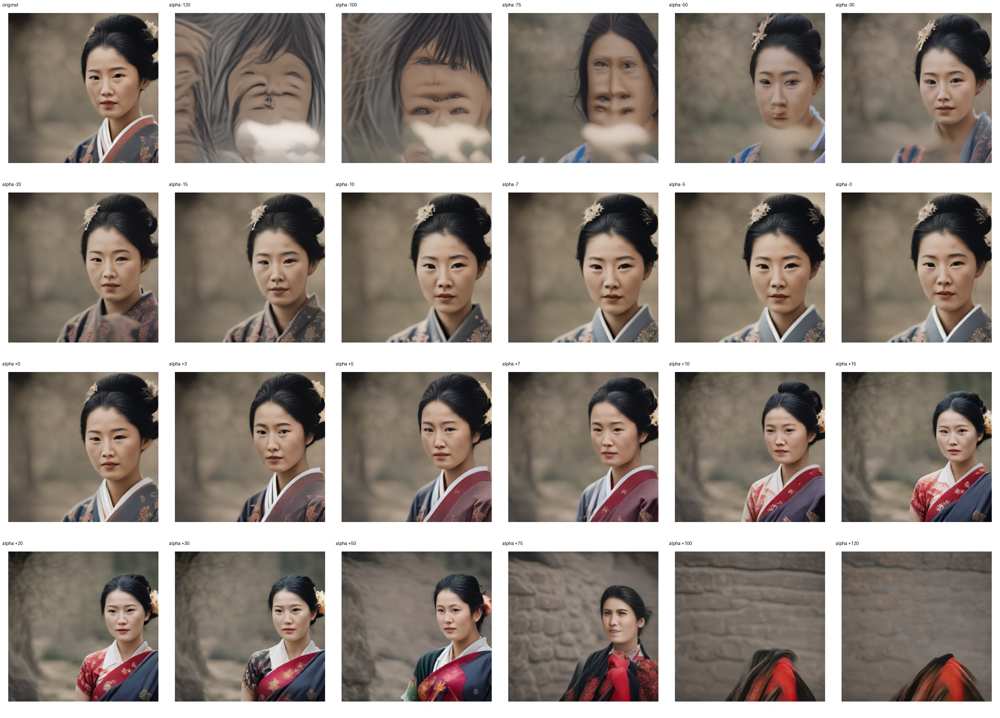
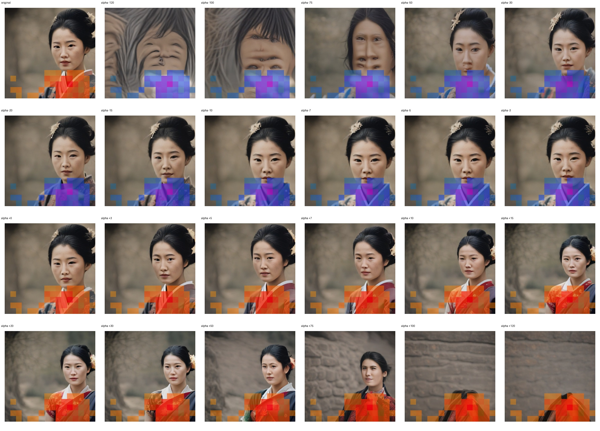
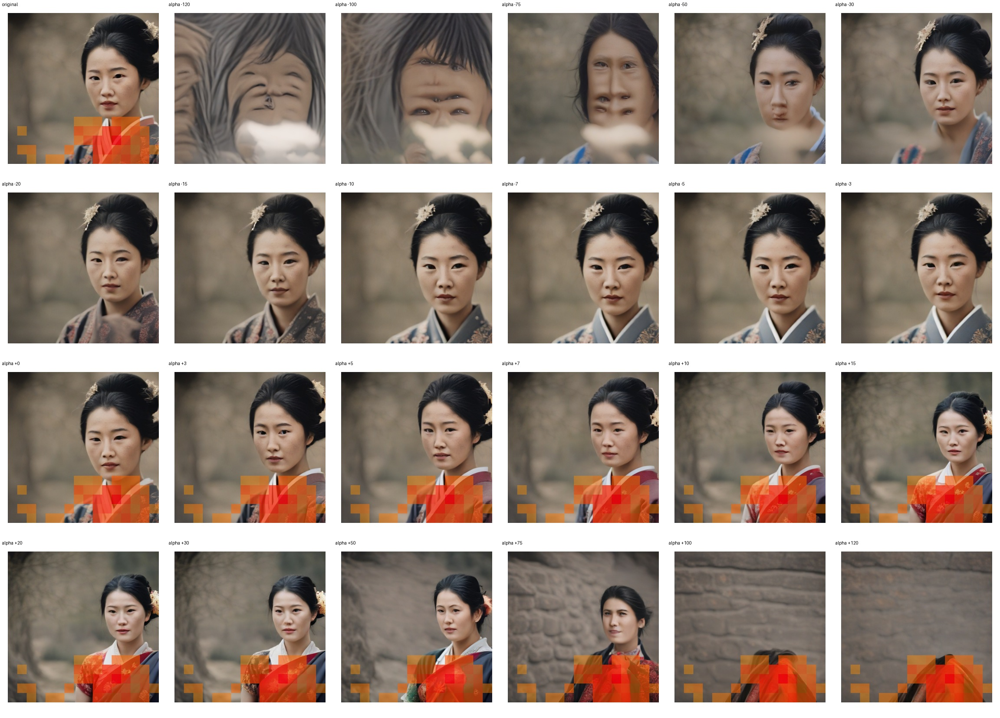

# Feature 2527 — East Asian Woman

Biased dataset; original prompt and seed replay for seeds 0–19. Values are means across 20 source images. The table reports the mean post-re-encoded activation of feature 2527, the active spatial fraction, mean RGB pixel MAE versus the original image (0–255 scale), and coefficient change magnitudes for each alpha.

## Activation graph

## Mean metrics by alpha

| Alpha | Mean post-reencoded feature 2527 activation | Active spatial fraction | Mean pixel change (MAE) | Mean absolute coefficient change | Mean absolute scaled coefficient |
|---:|---:|---:|---:|---:|---:|
| -120 | 0.000 | 0.000 | 41.182 | 331.236 | 328.499 |
| -100 | 0.000 | 0.000 | 39.284 | 276.486 | 273.749 |
| -75 | 0.000 | 0.000 | 39.153 | 208.049 | 205.312 |
| -50 | 0.000 | 0.000 | 31.394 | 139.612 | 136.875 |
| -30 | 0.000 | 0.000 | 23.066 | 84.862 | 82.125 |
| -20 | 0.000 | 0.000 | 20.149 | 57.487 | 54.750 |
| -15 | 0.000 | 0.000 | 18.425 | 43.800 | 41.062 |
| -10 | 0.000 | 0.000 | 15.808 | 30.112 | 27.375 |
| -7 | 0.000 | 0.000 | 13.060 | 21.900 | 19.162 |
| -5 | 0.000 | 0.000 | 11.141 | 16.425 | 13.687 |
| -3 | 0.000 | 0.000 | 8.753 | 10.950 | 8.212 |
| +0 | 0.000 | 0.000 | 3.364 | 2.737 | 0.000 |
| +3 | 7.860 | 0.183 | 6.200 | 5.475 | 8.212 |
| +5 | 12.982 | 0.183 | 10.952 | 10.950 | 13.687 |
| +7 | 18.104 | 0.183 | 14.852 | 16.425 | 19.162 |
| +10 | 25.788 | 0.183 | 19.097 | 24.637 | 27.375 |
| +15 | 38.593 | 0.183 | 23.884 | 38.325 | 41.062 |
| +20 | 51.399 | 0.183 | 27.339 | 52.012 | 54.750 |
| +30 | 77.010 | 0.183 | 31.510 | 79.387 | 82.125 |
| +50 | 128.232 | 0.183 | 36.607 | 134.137 | 136.875 |
| +75 | 192.260 | 0.183 | 42.715 | 202.574 | 205.312 |
| +100 | 256.288 | 0.183 | 41.797 | 271.012 | 273.749 |
| +120 | 307.511 | 0.183 | 40.340 | 325.761 | 328.499 |

## Per-seed grids

Each 4×6 sheet contains the original followed by the 23 alpha variants in ascending alpha order, from −120 through +120.

### Plain images

[All 20 plain-image grids](seed_sheets/)

### Signed coefficient overlays

[All 20 signed coefficient grids](signed_coefficient_overlays/)

### Post-re-encoded activation overlays

[All 20 post-activation grids](post_activation_overlays/)

### Intervention-footprint overlays

[All 20 intervention-footprint grids](intervention_footprint_overlays/)

Zero is transparent. Negative coefficient colors progress green through blue to purple; positive colors progress yellow through orange to red. Each map tile is normalized individually for visibility. The original and alpha-zero tiles show the pre-intervention feature map so its location remains visible.
